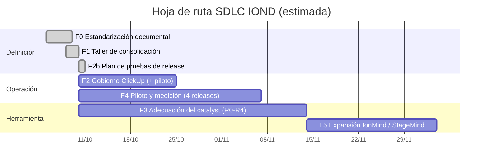

# Hoja de Ruta — Consolidación del SDLC IOND

**Fases, entregables y responsables para adoptar el SDLC y el rol de QA como Analista de Calidad y Requerimientos**

Propuesta por: Steve Nina — Scrum Master IOND
Aplica a: IOND · IonMind · StageMind
Audiencia: Scrum Master · PO · Lead Dev · RM · Lead QA · Stakeholders

---

## 1. Objetivo

Pasar del modelo **Dual Track** al **SDLC de IOND**: kanban de **Discovery**, kanban de **Improvements** y **Releases** semanales. En el SDLC, QA asume el rol de **Analista de Calidad y Requerimientos**: redacta la Matriz de Requerimientos y el PO da su VoBo. El plan estandariza el flujo, el gobierno en ClickUp, las métricas y las herramientas de QA (el *QA Catalyst*). La metodología rige **desde su aprobación**.

## 2. Mapa de documentos

| # | Documento | Para quién | Para qué |
|---|---|---|---|
| 00 | **Hoja de Ruta** (este documento) | Todos | Fases, responsables y criterios de salida |
| 01 | **Diagnóstico y Plan de Adecuación del QA Catalyst** | QA · Lead QA · SM | Puntos de quiebre de la herramienta y plan R0–R5 |
| 02 | **Análisis del Flujo SDLC IOND** | PO · LD · RM · LQA · SM | Estados, responsables, *gates*, RACI y frontera QA ↔ PO ↔ Dev |
| 03 | **Registro de Decisiones, Riesgos y Limitaciones** | Todos | Las 55 decisiones del equipo (Q-01 a Q-55), acciones de verificación (AV-xx), riesgos y limitaciones |
| 04 | **Acuerdo de Flujo de Trabajo IOND** | Todo el equipo | Acuerdo normativo PO · Development · QA |
| 05 | **Estándar Operativo de QA — Aplicación IOND** | QA · LQA · PO | Cómo trabaja QA, matrices, severidad y SLAs |
| 06a | **Guía de Gobierno ClickUp — Scrum Master** | SM | Configuración, tags, automatizaciones, auditoría, ceremonias y ajustes pendientes |
| 06b | **Guía Operativa ClickUp — Development + QA** | Dev · QA | Qué hacer en cada estado y plantillas de comentario |
| 07 | **Dashboards y Métricas** | QA · PO · SH · LD · LQA · SM | Diccionario de métricas y dashboards por rol |
| 08 | **Guía de Uso del QA Catalyst** | QA · LQA · SM | Cómo invocar las skills del catalyst en cada estado, qué producen y cómo se publican sus salidas |
| — | **Fuente canónica** `knowledge/L1-project/sdlc-consolidation.md` | Todos / catalyst | Estados, campos, tags, plantillas y automatizaciones (única fuente de verdad) |
| — | **CSV SDLC** `resources/IOND SDLC - {DISCOVERY,IMPROVEMENTS,RELEASES}.csv` | SM · equipo | Guía tabular por estado (owner, reuniones, entrada, salida, SLA) |
| — | **Suites del release** `knowledge/test-suites/` | QA · LQA · SM | Smoke maestro, E2E maestro con IDs estables, cobertura y hoja de ruta de automatización |

## 3. Fases

| Fase | Objetivo | Entregables | Responsable | Criterio de salida | Duración estimada |
|---|---|---|---|---|---|
| **F0 · Estandarización documental** | Analizar el flujo y el repositorio y proponer el estándar | CSV actualizados, fuente canónica v2, documentos 00–07 (MD + PDF) | SM / QA | Documentos publicados para revisión | Completada (octubre 2026) |
| **F1 · Taller de consolidación** ✅ | Resolver las preguntas Q-xx y aprobar el acuerdo | Registro de decisiones (doc 03 §7), **Acuerdo IOND v1.0** y **Estándar QA IOND v1.0** aprobados, fuente canónica sin críticas | SM facilita · **PO decide** · LD/RM · LQA | Preguntas 🔴 resueltas; acuerdo firmado por PO, LD/RM y LQA | 1 semana (2 sesiones de 90 min + asíncrono) |
| **F2b · Plan de pruebas de release** ✅ | Planificar `smoke`, `sanity` y `regression` y la automatización (Q-32, Q-40) | Estrategia de cuatro suites (Q-47 a Q-51): smoke maestro único, sanity y regresión por versión, E2E maestro como capa 2; E2E maestro con IDs; hoja de ruta de automatización por olas | LQA + QA | Estrategia aprobada el 2026-10-10; automatización del smoke (Ola 1) en curso | Completada (octubre 2026) |
| **F2 · Gobierno ClickUp** | Configurar los tableros según el estándar | Orden y tipos de estado, `blocked` en Discovery, tags SDLC, plantillas T-01…T-04, Form de bugs, automatizaciones (oleadas), vistas, dashboards; anexo de ajustes corregido | SM | Tableros alineados y 2 semanas de piloto sin incidencias graves de proceso | 2–3 semanas (piloto incluido) |
| **F3 · Adecuación del QA Catalyst** | Alinear la herramienta al SDLC | Etapas R0 → R4 del doc 01 (higiene, vocabulario, templates, skills por estado y de release, suites, auditoría y métricas); implementadas en el repositorio el 2026-10-10 | QA (con revisión del SM) | Un ticket de Discovery, uno de Improvements y un release recorridos de punta a punta con el catalyst | 4–6 semanas (en paralelo a F2/F4) |
| **F4 · Piloto y medición** | Estabilizar y medir | Línea base de métricas (3–4 releases semanales), retrospectiva del flujo, **Acuerdo v1.1** | SM + LQA · PO lidera la retro | Metas definitivas fijadas; ajustes incorporados | 4 semanas |
| **F5 · Expansión multi-producto** | Soporte del catalyst para IonMind y StageMind | Perfiles de producto L1, módulos L2, matrices de release por producto (R5) | QA | Primer release de IonMind o StageMind acompañado por el catalyst | A definir (depende del acceso a repos y conocimiento) |

## 4. Próximos pasos inmediatos

La fase F1 se cerró el **2026-10-09** con las decisiones Q-01 a Q-46 del documento 03, y el plan de pruebas de release (F2b) el **2026-10-10** con Q-47 a Q-54. El **2026-10-11** se sumó Q-55 (el LQA asigna al QA desde `assignment`). Las tareas que siguen son las **acciones de verificación (AV-xx)** del mismo documento:

1. **SM — configurar ClickUp (F2):** estados (`blocked` en Discovery, `to do` a Active, `done w/d` a Done, orden de `uat`), campo **Stagemind.Version**, tags SDLC, plantillas T-01 a T-04 con el checklist de acuse y Form de bugs (AV-04, AV-05). Después, el Anexo A de la guía 06a (AV-06).
2. **SM + PO:** acordar con el SH el día dedicado de la Discovery Review (AV-01).
3. **LD/RM:** inventario de CI por repositorio (AV-02) y ventana fija de despliegue con DevOps (AV-07).
4. **LQA + LD/RM:** crear la **company de prueba en producción** para el smoke post-despliegue (AV-09). **LQA + LD:** definir el flujo representativo de StageMind del smoke (AV-12).
5. **LQA:** entregar al responsable de bot-test los requisitos de la Ola 0 (AV-11) y crear en QA Kanban el ticket de automatización del smoke (Ola 1).
6. **SM:** verificar si ClickUp permite mover las subtareas `done w/d` junto con el padre (A-20, AV-10).
7. **QA:** validar el catalyst adecuado recorriendo un ticket de Discovery, uno de Improvements y el primer release semanal (criterio de salida de F3); commit del trabajo pendiente.
8. **Todos:** usar las plantillas de comentario C-xx (guía 06b y `templates/comments/`).

## 5. Gobierno del cambio

- **Dueño del estándar:** Scrum Master, junto con el PO para las decisiones de producto.
- **Control de versiones:** la fuente canónica y los documentos viven en el repositorio (`docs/sdlc-iond/`). Todo cambio se versiona (v1.0 → v1.1…) y se comunica en la retrospectiva.
- **Revisión:** al cierre de F4 y luego cada trimestre, o antes si las métricas muestran desvíos (VoBo fuera de SLA, rechazos al alza, releases fuera de calendario).
