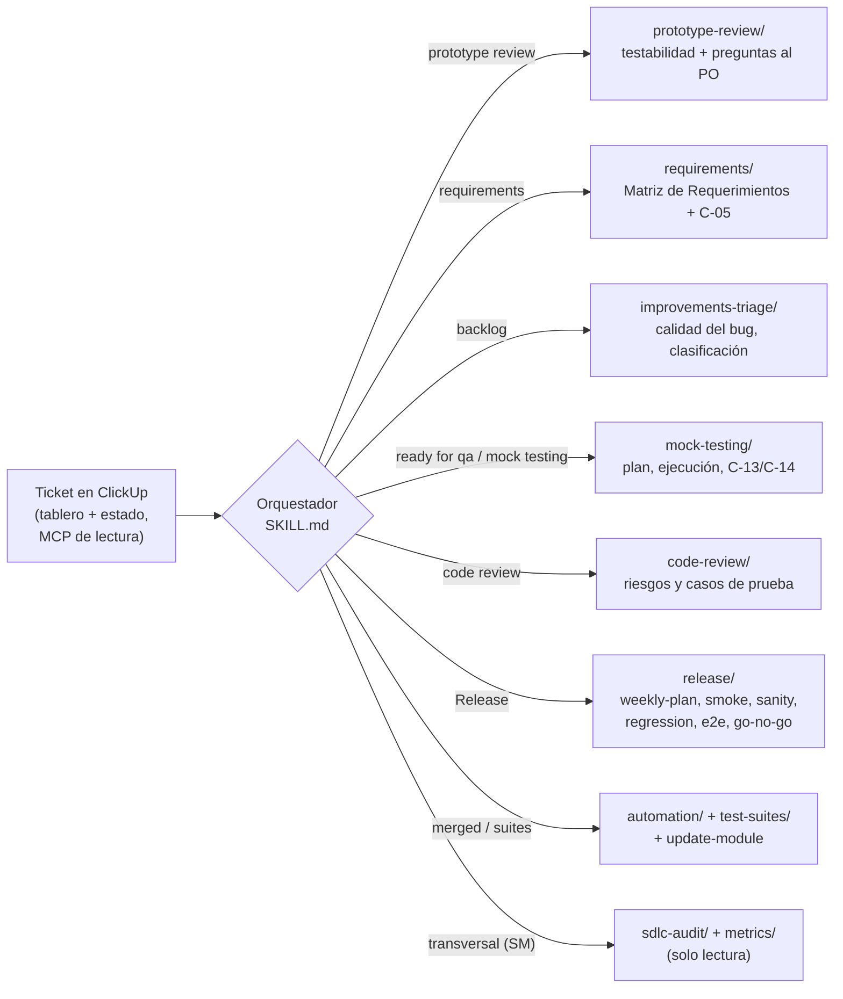
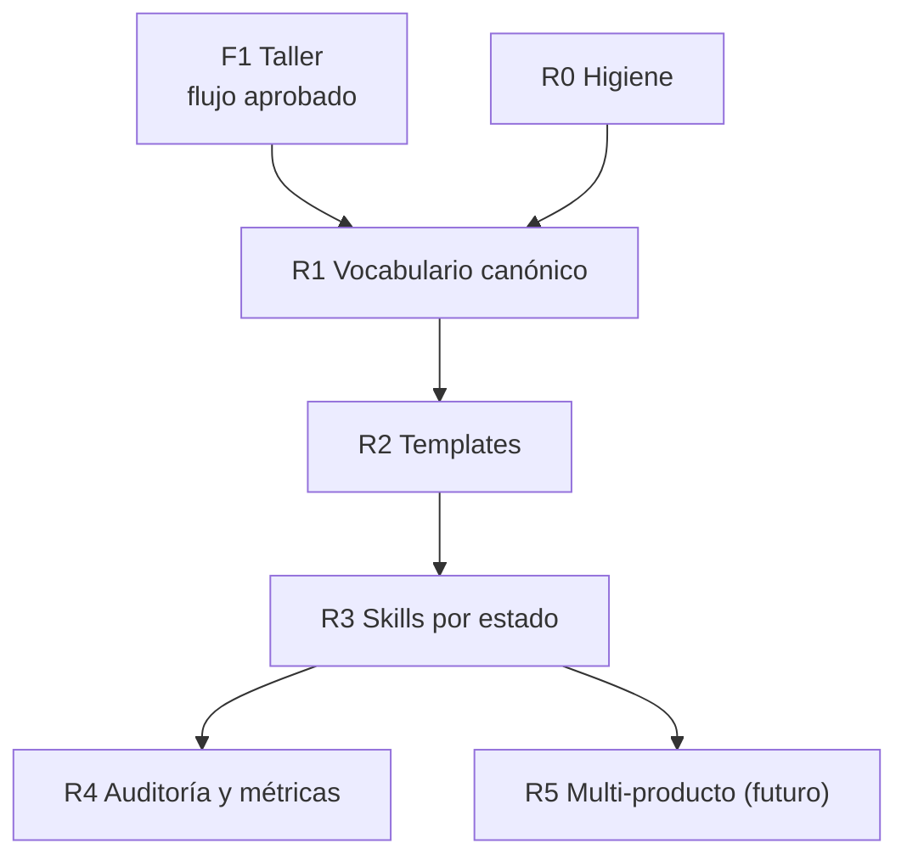

# Diagnóstico y Plan de Adecuación del QA Catalyst

**ionflow-qa-catalyst frente al SDLC IOND**

Propuesta por: Steve Nina — Scrum Master IOND
Aplica a: repositorio `ionflow-qa-catalyst` (skills, runbooks, templates y base de conocimiento)
Audiencia: QA · Lead QA · Scrum Master · mantenedores del catalyst

---

## 1. Resumen ejecutivo

El QA Catalyst se construyó como un sistema de **conocimiento estructurado (L1 proyecto / L2 módulos / L3 tickets) + skills para agentes de IA** orientado al modelo **Dual Track** (Discovery + Deployment). Con el SDLC (Discovery, Improvements y Releases semanales) y el rol de **QA como Analista de Calidad y Requerimientos**, la herramienta queda desalineada en tres frentes:

1. **Falta la pieza central del nuevo modelo:** no existe ningún artefacto, skill ni control (*gate*) para la **Matriz de Requerimientos con VoBo del PO**. Hoy el primer artefacto obligatorio es la Matriz de Pruebas.
2. **El enrutamiento y los supuestos son del modelo anterior:**
   - Las rutas se arman por "Discovery vs Deployment".
   - La planificación usa sprints 2+1 y estados que ya no existen.
   - Se asume que se prueba sobre `DEVELOPMENT` con el código ya mergeado. En el SDLC, `mock testing` ocurre **antes** del merge y el release se valida sobre la rama RC.
3. **Deuda de mantenimiento:**
   - Referencias rotas.
   - Reglas duplicadas que ya divergen (tres criterios de Go/No-Go, dos esquemas de inyección de casos, cuatro taxonomías de tags).
   - Templates con ambientes desactualizados.
   - Temas de higiene del repositorio.

Este documento lista los **puntos de quiebre (B-xx)** con su ubicación y corrección, define la **arquitectura objetivo** (skills por tablero y estado) y propone un **plan de adecuación en 6 etapas (R0–R5)**. Según lo acordado, el refactor se ejecuta en la **Fase F3**, una vez aprobado el flujo (la fase F1 se cerró el 2026-10-09). La fuente canónica para la adecuación es `knowledge/L1-project/sdlc-consolidation.md` (v2.2). **Las etapas R0 a R4 se implementaron en el repositorio el 2026-10-10**, junto con la nueva estrategia de pruebas del release (`Q-47` a `Q-54`); el estado de cada etapa está en la sección 7.1.

---

## 2. Qué es el catalyst hoy

| Componente | Contenido | Estado frente al SDLC |
|---|---|---|
| `SKILL.md` (raíz) | Orquestador: reglas de carga de contexto, 3 stages, *gates* previos, Announce → Confirm → Act, enrutamiento | 🔴 Enrutamiento y *gates* de Dual Track |
| `skills/` (24 archivos) | Runbooks de Discovery y Deployment; test-docs (prioritize, document); sprint-testing (plan, test, report); code-review; automation (plan, code, review); regression (run, analyze, decide); release (ingest, plan, plan-v1, regression-matrix, smoke-matrix, notes, brief, deployment-protocol, bug-hunt); bug-reporter; sprint-planning; knowledge/update-module | 🔴/🟠 Reutilizables en su mayoría, pero hay que re-anclarlos a estados |
| `templates/` (15) | approval, rejection, qa-report, test-matrix, ticket-memory, comment, bug-ticket, architecture-brief-qa, release-* (brief, notes, plan, regression-matrix, smoke-matrix), deployment-protocol, bug-hunt-report | 🟠 Ninguno está listo para el SDLC; faltan ~18 |
| `knowledge/L1-project` | business-rules, api-architecture, stack-overview, test-priorities, **sdlc-consolidation (v2.1)** | 🟠 stack-overview y test-priorities con conceptos anteriores |
| `knowledge/L2-modules` (15 módulos) | Un `module.md` por módulo (accounts … webhooks) | 🟠 Secciones inconsistentes; README y template desactualizados |
| `knowledge/L3-tickets` | Carpeta por ticket con artefactos de QA | 🟠 Convención del README obsoleta; nombres de iteración no estandarizados |
| `knowledge/releases` | Carpeta por versión | 🟠 Sin estructura por producto |

---

## 3. Puntos de quiebre (B-xx)

**Severidad:** 🔴 bloquea la operación en el SDLC · 🟠 genera errores o confusión · 🟢 mejora.

### 3.1 Modelo de proceso (Dual Track → SDLC)

| ID | Sev. | Punto de quiebre | Ubicación | Corrección |
|---|---|---|---|---|
| B-01 | 🔴 | **No existe la Matriz de Requerimientos** (ni template, ni skill, ni captura del VoBo del PO, ni REQ-IDs). | Todo el repo (sin coincidencias) | Skill `requirements/` + template `requirements-matrix.md` + gate de VoBo (R2–R3). |
| B-02 | 🔴 | El *gate* 2 exige `test-matrix.md` y `test-plan.md` antes de **cualquier** skill. | `SKILL.md:84-87` | *Gates* por estado: Matriz de Requerimientos con VoBo antes de `mock testing`. |
| B-03 | 🔴 | El *gate* 3 pregunta "¿track correcto? (Discovery vs Deployment)". El enrutamiento completo es por track. | `SKILL.md:94`, `:169-319`; `README.md:14`; `skills/README.md:9-49` | Enrutar por **tablero + estado** del ticket (leído vía MCP). |
| B-04 | 🔴 | `discovery-runbook` termina en `test-matrix` + `test-plan` y mezcla prototipo y requerimientos. | `skills/discovery-runbook.md:249-307`, `:349-366` | Dividirlo en `prototype-review/` (testabilidad y preguntas) y `requirements/` (matriz + VoBo). |
| B-05 | 🔴 | `deployment-runbook` exige artefactos de Discovery, así que un bug de Improvements no puede probarse. | `skills/deployment-runbook.md:43-50` | Reemplazarlo por `mock-testing/` con dos modos: Discovery (matriz) e Improvements (bug / mini-matriz). |
| B-06 | 🔴 | No hay runbook de **Improvements** (triage, bug sin matriz, mini-matriz). | — | Skill `improvements-triage/`. |
| B-07 | 🔴 | `sprint-planning` usa los estados `sprint intake`, `fortification`, `qa testing` y `qa in process`, y el modelo 2+1. | `skills/sprint-planning/SKILL.md:17-29`, `:81-85`, `:161-166` | Retirarlo. Lo reemplaza `release/weekly-plan` (corte semanal). |
| B-08 | 🔴 | `release/plan` (2+1 semanas, deploy en la semana 3) y `plan-v1` (único uso). Además están en `.gitignore` pero se enrutan. | `skills/release/plan.md:117-148`; `.gitignore:17-18`; `SKILL.md:218,316-319` | Rehacerlo para el release semanal. Versionarlo en git (sin datos privados). |
| B-09 | 🔴 | No existe el paso **SANITY** (re-ejecutar los REQ críticos de cada ticket en la RC). | — | Skill `release/sanity`, que agrega las matrices L3 de los tickets del release. |
| B-10 | 🟠 | "Regresión" significa dos cosas: suite E2E (`regression/*`) y matriz manual (`release/regression-matrix`). El orden del pipeline difiere en tres lugares. | `SKILL.md:300-314`; `skills/README.md:281-282`; `release/plan-v1.md:219-223` | Unificar en `release/regression` (riesgo + cross-system) con el orden smoke → sanity → regression. |
| B-11 | 🟠 | Ambiente y rama fijos en `DEVELOPMENT` / `dev-app.ionflow.io`; se asume el código ya mergeado. | `sprint-testing/test.md:180-189`; `report.md:240`; `code-review/review.md:61-71`; `regression/run.md:15,95`; templates | Parametrizar: rama del ticket + ambiente QA para `mock testing`; rama RC + preprod para Release. |
| B-12 | 🟠 | Estado legacy `production deploy` en el protocolo de despliegue. | `skills/release/deployment-protocol.md:105`; `templates/deployment-protocol.md:32` | Deployment como actividad posterior a `ready for release` (C-30/C-31). |
| B-13 | 🟠 | El veredicto no tiene estado destino ni comentario estándar de transición. "Approved con observaciones" no existe en el SDLC. | `sprint-testing/report.md:155-197`; `deployment-runbook.md:303-309` | Mapear veredicto → estado (`ready to merge` / `uat` / `to do`) con C-13/C-14. |
| B-14 | 🟠 | El umbral "Edge ≥ 80 %" contradice la regla del SDLC ("100 % de REQ críticos y 0 bloqueantes"). | `sprint-testing/plan.md:91`; templates `qa-report` | Criterio único de la fuente canónica (§10). |

### 3.2 Referencias rotas

| ID | Sev. | Referencia | Ubicación | Corrección |
|---|---|---|---|---|
| B-15 | 🔴 | Skill `ionflow-playwright-creator` inexistente (la vigente es `e2e-playwright-creator`). | `SKILL.md:336,376,484`; `README.md:13`; `automation/code.md:3,30,107,111,182`; `deployment-runbook.md:415,474` | Actualizar el nombre y la ruta. |
| B-16 | 🟠 | Rutas de bot-test: `../bot-test/tests/IONFLOW/`, `pages/` y `tickets/<ID>/` no existen (la estructura real es `apps/bot-test/tests/IONFLOW/{Admin-ION,Company-ION,shared,utils}`). | `SKILL.md:100,364-378`; `automation/plan.md:68-69,98`; `automation/code.md:72,121`; `regression/run.md:48-56` | Alinear con la estructura real. |
| B-17 | 🟠 | Comando NX `--args="--spec=…"` probablemente no llena `{args.spec}`. | `SKILL.md:339`; `regression/run.md:33-35`; `automation/code.md:164` | Verificar y corregir el comando. |
| B-18 | 🟠 | `../flow_binaries/migrations/*.sql` no existe. | `SKILL.md:403,564`; `deployment-runbook.md:240,494`; `document.md:211`; `test.md:340`; `update-module.md:59` | Apuntar a las fuentes reales de esquema. |
| B-19 | 🟠 | Skill `release/update-modules` mal nombrada (es `knowledge/update-module`, modo batch). | `SKILL.md:313`; `release/plan.md:194` | Corregir el nombre. |
| B-20 | 🟠 | CSVs inexistentes (`Test Plan - IONFLOW - Smoke Test.csv`, `Ionflow Version Release - Sheet1.csv`, `get_tickets_deployment_4.csv`). | `release/regression-matrix.md:6,34`; `plan-v1.md:29`; `skills/README.md:298` | Usar las plantillas de `resources/` o leer ClickUp vía MCP. |
| B-21 | 🟢 | Carpeta `knowledge/L1-project/regression-results/` inexistente, cuando L1 debería ser estable. | `regression/run.md:88`; `regression/decide.md:98` | Resultados en `knowledge/releases/<producto>/<versión>/`. |
| B-22 | 🟢 | README enlaza a `idea.md` y `plan.md` (borrados del árbol de trabajo). | `README.md:74-75,117-118` | Recuperarlos en `docs/history/` y actualizar los enlaces (R0). |
| B-23 | 🟢 | El README de L3 enlaza a `knowledge/sdlc/…` (no existe). | `knowledge/L3-tickets/README.md:36-37` | Enlazar a `sdlc-consolidation.md` y a `docs/sdlc-iond/`. |
| B-24 | 🟠 | `report` actualiza el template compartido `templates/ticket-memory.md` en lugar de la copia L3. | `sprint-testing/report.md:149` | Escribir solo en `L3/<id>/ticket-memory.md`. |
| B-25 | 🟢 | Numeración de pasos inconsistente ("Paso 9", "Paso 5/6/7 del Altacrest"). | `sprint-testing/plan.md:7`; `test-docs/document.md:7-9,299`; `prioritize.md:7,88` | Referenciar estados del SDLC en lugar de pasos. |

### 3.3 Vocabulario y datos de ClickUp

| ID | Sev. | Punto de quiebre | Ubicación | Corrección |
|---|---|---|---|---|
| B-26 | 🟠 | Cuatro taxonomías de tags incompatibles (`core`/`ux-ui`, esquema de `release/plan`, `iond-disc-N`, `qa-regression-v*`). | `SKILL.md:324`; `release/ingest.md:98,163-165`; `release/plan.md:108-113`; `sprint-planning/SKILL.md:58,67`; `knowledge/L3-tickets/README.md:38` | Taxonomía única (§12 de la fuente canónica). |
| B-27 | 🟠 | Lectura de veredictos acoplada al texto inicial de approval/rejection ("El resultado de pruebas para este ticket es: APROBADO ✅"). | `release/ingest.md:107-108,190-198`; `release/notes.md:69`; `knowledge/update-module.md:145` | Las plantillas C-13/C-14 **conservan esa frase**; documentar el contrato de parsing en un solo lugar. |
| B-28 | 🟠 | Mapeo a módulos L2 inexistentes (`exec-history`, `gateway`, `settings`, `general`) y nombres de módulo distintos entre L1 y L2. | `release/ingest.md:152-157`; `L1-project/test-priorities.md` | Mapa único Iond Subcategory → módulo L2. |
| B-29 | 🟢 | Ninguna skill lee la fuente canónica SDLC. | `SKILL.md`; `knowledge/L1-project/README.md:7-12` | Agregarla a la Regla #1 (carga de contexto) y al README de L1. |
| B-30 | 🟢 | Solo se usa un subconjunto de los custom fields de IOND, y algunos con valores desactualizados (Project). | `release/ingest.md:96-106`; `sprint-planning/SKILL.md:54-73` | Usar los custom fields de IOND (13 + Stagemind.Version; G.Version para Gateway — §11 de la fuente canónica). |

### 3.4 Duplicaciones que divergen

| ID | Sev. | Regla duplicada | Ubicaciones | Corrección |
|---|---|---|---|---|
| B-31 | 🟠 | Criterio de **Go/No-Go** definido 3 veces con umbrales distintos. | `regression/decide.md:31-37`; `release/brief.md:109-112`; `release/deployment-protocol.md:91` | Una sola regla: C-29 + §10 de la fuente canónica. |
| B-32 | 🟠 | Esquema de **inyección de TC-CR** definido 2 veces (columnas y prioridades distintas). | `deployment-runbook.md:145-157`; `code-review/review.md:546-590` | Un solo esquema de Matriz de Pruebas con REQ-ID. |
| B-33 | 🟠 | **Sugerencia de veredicto** calculada en 3 lugares. | `sprint-testing/test.md:428-446`; `deployment-runbook.md:265-279`; `report.md:70-98` | Centralizarla en `mock-testing/report`. |
| B-34 | 🟢 | La lectura de ClickUp + reconciliación de AC se repite 4 veces, sin un archivo de salida definido. | `discovery-runbook.md:66-110`; `prioritize.md:34-47`; `document.md:22-72`; `deployment-runbook.md:52-58` | Un paso único que produce el insumo de la matriz. |
| B-35 | 🟢 | Las reglas de evidencia en BD, del canal Playwright y de actualización de repos están copiadas en 4–6 archivos. | `SKILL.md:382-405,436-500,543`; runbooks; `test.md` | Moverlas a referencias compartidas (`skills/_shared/`). |

### 3.5 Templates

| ID | Sev. | Punto de quiebre | Corrección |
|---|---|---|---|
| B-36 | 🔴 | Ningún template está listo para el SDLC. Faltan, entre otros: `requirements-matrix`, solicitud y VoBo, cambio de alcance, comentarios por transición, escalamiento, fuera de matriz, acta de Pilot, acta de Prototype Review, `blocked`, `invalid`, sanity matrix, acta de Go/No-Go, UAT, `merged`, tarea de Release, triage. | Generarlos desde las plantillas T-xx y C-xx de la fuente canónica (R2). |
| B-37 | 🟠 | Ambiente fijo `dev-app.ionflow.io` / `DEVELOPMENT` en approval, rejection, qa-report, bug-ticket, release-brief y deployment-protocol. | Variables de ambiente y rama por estado. |
| B-38 | 🟠 | Íconos de severidad distintos entre templates y dos sintaxis de placeholder (`[X]` y `{{x}}`). | Escala única (prioridad nativa) y una sola sintaxis. |
| B-39 | 🟠 | `test-matrix` usa columna AC en lugar de **REQ-ID**; `rejection` no cita REQ-ID ni estado destino; `ticket-memory` registra "Track". | Agregar REQ-ID, versión de la matriz y VoBo; estado destino `to do`; tablero y estado actual. |
| B-40 | 🟢 | `comment.md` y `release-smoke-matrix.md` no se usan; `release-plan.md` lo usa solo `plan-v1`. | Deprecar o reutilizar en R2. |

### 3.6 Base de conocimiento

| ID | Sev. | Punto de quiebre | Ubicación | Corrección |
|---|---|---|---|---|
| B-41 | 🟠 | L1 conserva conceptos anteriores: branching "Dual-Track" y "smoke en cada ticket". | `L1-project/stack-overview.md:56-59`; `L1-project/test-priorities.md:30` | Actualizar al modelo RC semanal; el smoke es del Release. |
| B-42 | 🟠 | El README de L2 lista carpetas inexistentes; `_template.md` no tiene sección de **Reglas de negocio**; las skills dependen de secciones que solo algunos módulos tienen ("Database", "Edge Cases Conocidos", "Selectores E2E"). | `L2-modules/README.md:16-22`; `L2-modules/_template.md` | Template L2 con secciones obligatorias, incluida "Reglas de negocio (fuente de REQ)". |
| B-43 | 🟠 | El README de L3 describe un archivo único por ticket; en la práctica cada ticket es una carpeta. Hay IDs mixtos (interno y custom), artefactos sin skill productora (reconciliación, approval, rejection) y nombres de iteración no estandarizados. | `L3-tickets/README.md:8,14`; carpetas L3 | Convención: carpeta = ID interno; nombres fijos por estado; iteraciones `-iterN`. |
| B-44 | 🟠 | El catalyst **no verifica que el veredicto coincida con la matriz de pruebas** actualizada (conteos y estados). | `sprint-testing/report.md` | Validación automática matriz ↔ veredicto antes de proponer C-13/C-14. |

### 3.7 Higiene del repositorio

| ID | Sev. | Punto | Corrección |
|---|---|---|---|
| B-45 | 🟠 | `.playwright-mcp/` versionado (logs, snapshots y capturas de staging) y fuera de `.gitignore`. | Ignorarlo y sacarlo del índice. |
| B-46 | 🟠 | Binarios pesados versionados en L3 (p. ej. un PDF de prueba de ~11 MB). | Mover a almacenamiento externo o a Git LFS. |
| B-47 | 🟠 | Archivo de entorno de Postman en L3 pendiente de revisar (posibles tokens). | Revisarlo antes de commitear; ignorar `*.postman_environment.json`. |
| B-48 | 🟠 | `.env.sample` no incluye las 6 variables que usan las skills (`IONFLOW_ENVIRONMENT_URL`, `IONFLOW_KC_DOMAIN`, `IONFLOW_COMPANY_*`, `IONFLOW_ADMIN_*`). | Completarlo sin valores. |
| B-49 | 🔴 | **Mucho trabajo reciente sin commitear** (carpetas L3, drafts, releases, `resources/`, docs). | Commit organizado en R0, excluyendo secretos y binarios. |
| B-50 | 🟢 | `idea.md` y `plan.md` (borrados) contienen la visión y el diseño original: orquestación, *gates* humanos y "completar AC ambiguos con el PO". | Recuperarlos en `docs/history/` antes de confirmar el borrado. |

### 3.8 Multi-producto

| ID | Sev. | Punto | Corrección |
|---|---|---|---|
| B-51 | 🟢 | L1 y L2 solo cubren iond. IonMind y StageMind no tienen base de conocimiento ni matrices de release propias. | Fase R5 / F5 (implementación futura). |

---

## 4. Arquitectura objetivo: skills por tablero y estado

**Principio:** el catalyst lee el **tablero y el estado** del ticket en ClickUp (MCP de solo lectura), carga el nivel de conocimiento correcto y ofrece **la skill de ese estado**. ClickUp sigue siendo la fuente oficial. El catalyst **prepara** artefactos y comentarios, y el QA los publica.

| Skill objetivo | Estado(s) | Entradas | Salidas (L3 / releases) | Reutiliza |
|---|---|---|---|---|
| `prototype-review/` | `prototype review` | Ticket, acta, contrato, L1, L2 | `prototype-review-qa.md` (riesgos, testabilidad, preguntas) | `test-docs/prioritize`, `code-review` (modo Discovery), `architecture-brief-qa` |
| `requirements/` | `requirements` | Especificación del PO, acta, contrato, reglas L2 | `requirements-matrix.md` (vN) + borradores C-05/C-08 | `test-docs/document` (modo AC) |
| `improvements-triage/` | `backlog` | Ticket, L2 | Checklist T-02, recomendación de clasificación, C-33 | `bug-reporter/create` |
| `mock-testing/` | `ready for qa`, `mock testing` | Matriz con VoBo, handoff C-09, L2 | `test-matrix.*` (REQ-ID), `qa-report.md`, C-13/C-14/C-17 | `sprint-testing/*`, `deployment-runbook` |
| `release/` | Tarea de Release | Tickets por versión objetivo (MCP), matrices L3, E2E maestro | `release-task` (T-04), `tickets`, `smoke-preprod/prod`, `sanity-matrix`, `regression-matrix` (capa 1), `e2e-run` (capa 2), acta C-29, release notes, protocolo de despliegue | `release/*`, `regression/*` |
| `test-suites/` | Transversal (LQA) | Hoja "Iond Testing Plan", bot-test (lectura), QA Kanban | `e2e-master.csv` con IDs, `coverage.md`, `automation-roadmap.md`, revisión del smoke maestro | — (nueva) |
| `automation/` | Después de `merged` | Matriz de Pruebas, E2E maestro, L2 | Plan, **paquete** para el responsable de bot-test y revisión 3/3 (el catalyst no escribe en bot-test, `Q-54`) | `automation/*` |
| `sdlc-audit/` | Transversal | Tableros SDLC (MCP) | Reporte de cumplimiento (campos, tags, VoBo, SLAs, anexo de ajustes) | — (nueva) |
| `metrics/` | Transversal | Tableros SDLC (MCP) | Reporte semanal de métricas (doc 07) | — (nueva) |

**Formato (`Q-54`):** las skills viven en `skills/` en formato agnóstico, con el `SKILL.md` raíz como orquestador y los contratos compartidos en `skills/_shared/` (ClickUp, bot-test, evidencia y artefactos). Para Claude Code se agregan accesos livianos en `.claude/skills/iond-*/SKILL.md` que remiten a esos archivos.

### 4.1 Suites del release y automatización

| Pieza | Ubicación | Función |
|---|---|---|
| Smoke maestro | `knowledge/test-suites/smoke-master.md` | Lista fija SMK-01…SMK-17, igual en preprod y producción (`Q-47`) |
| E2E maestro | `knowledge/test-suites/e2e-master.csv` | Las 250 filas de la hoja con IDs estables, baseline, rotación G1–G4, estado de automatización y trazabilidad (`Q-51`) |
| Selección y cobertura | `scripts/e2e_master.py` | `import`, `export-sheet`, `coverage` y `select` (capa 1 por riesgo, capa 2 con rotación) con el comando de bot-test por IDs |
| Mapa de subcategorías | `knowledge/test-suites/_config/subcategory-map.csv` | Iond Subcategory → L2 → módulos del E2E → sistemas cruzados |
| Hoja de ruta | `knowledge/test-suites/automation-roadmap.md` | Olas 0–3 y tickets de QA Kanban |

---

## 5. Disposición de templates

| Template actual | Acción | Resultado |
|---|---|---|
| `test-matrix.md` | **Modificar** | Columna REQ-ID, origen (REQ / regla L2 / code review), indicador Mock vs Sanity, sin AC |
| `approval.md` | **Modificar** | = C-13 (tabla REQ → resultado, fuera de matriz, estado destino) |
| `rejection.md` | **Modificar** | = C-14 (OBS con REQ-ID, iteración, Rejection_count, destino `to do`) |
| `qa-report.md` | **Modificar** | Trazabilidad REQ → TC → resultado; criterio único; sin bloque "Smoke" por ticket |
| `ticket-memory.md` | **Modificar** | Tablero y estado actual, versión de la matriz, VoBo, Rejection_count, historial de iteraciones |
| `bug-ticket.md` | **Modificar** | = T-02 (Project, Iond Subcategory, `det-*`, REQ violado, ticket padre) |
| `architecture-brief-qa.md` | **Modificar** | Checklist de `prototype review` (contrato, testabilidad, NFR) |
| `release-brief.md` | **Modificar** | Smoke → Sanity → Regression; Go/No-Go C-29 |
| `release-plan.md` | **Reescribir** → `release-task.md` | Calendario semanal y tarea de Release T-04 |
| `release-regression-matrix.md` | **Reescribir** → `regression-matrix.md` | Capa 1: selección por riesgo desde el E2E maestro + flujos cross-system; los DIRECTA pasan a sanity |
| `release-smoke-matrix.md` | **Reescribir** → `smoke-run.md` | Ejecución del smoke maestro en preprod o producción (la lista vive en `knowledge/test-suites/smoke-master.md`) |
| `release-notes.md` | **Mantener** | Por producto y semana |
| `deployment-protocol.md` | **Modificar** | Rama RC, prerrequisitos SDLC, C-30/C-31, sin `production deploy` |
| `bug-hunt-report.md` | **Mantener** | Validación continua (bug bash); hallazgos → `backlog` con `det-exploratorio` |
| `comment.md` | **Deprecar** | Lo reemplaza el paquete C-01…C-33 |
| *(nuevos)* | **Crear** | `requirements-matrix`, `mini-matrix`, `sanity-matrix`, `e2e-run`, `go-no-go`, `release-task` (T-04), `comments/C-xx` (generados desde la fuente canónica), `prototype-review-qa`, `pilot-notes`, `triage` |

## 6. Disposición de skills

| Skill actual | Acción |
|---|---|
| `discovery-runbook` | **Dividir** en `prototype-review/` + `requirements/` |
| `deployment-runbook` | **Reemplazar** por `mock-testing/` |
| `test-docs/prioritize` · `test-docs/document` | **Absorber** en `prototype-review/` y `requirements/`; el modo Matrix pasa a `mock-testing/` |
| `sprint-testing/plan` · `test` · `report` | **Adaptar** dentro de `mock-testing/` (rama del ticket, REQ-ID, estado destino) |
| `code-review/review` | **Adaptar** (leer PR/rama del ticket; una sola inyección de casos) |
| `automation/*` | **Adaptar** rutas de bot-test y nombre de la skill E2E; disparo tras `merged`; `code` prepara un paquete para el responsable de bot-test en lugar de escribir código (`Q-54`) |
| `regression/*` · `release/regression-matrix` | **Unificar** en `release/regression` |
| `release/ingest` · `notes` · `brief` · `deployment-protocol` · `bug-hunt` | **Adaptar** (leer tickets por versión objetivo vía MCP; C-23…C-31) |
| `release/plan` · `plan-v1` · `sprint-planning` | **Retirar** y reemplazar por `release/weekly-plan` |
| `bug-reporter/create` | **Adaptar** a T-02 y a `improvements-triage/` |
| `knowledge/update-module` | **Mantener** (disparo por release desplegado, no por aprobación de QA) |
| *(nuevas)* | `sdlc-audit/`, `metrics/`, `release/weekly-plan`, `release/smoke`, `release/sanity`, `release/regression`, `release/e2e`, `release/go-no-go`, `test-suites/` |

---

## 7. Plan de adecuación por etapas (R0–R5)

| Etapa | Objetivo | Tareas principales | Esfuerzo | Depende de | Criterio de salida |
|---|---|---|---|---|---|
| **R0 Higiene** | Repo limpio y seguro | Commit del trabajo pendiente; recuperar `idea.md`/`plan.md` en `docs/history/`; ignorar `.playwright-mcp/`, binarios y entornos de Postman; completar `.env.sample`; corregir enlaces del README (B-22, B-45…B-50) | S | — | `git status` limpio; sin secretos ni binarios pesados |
| **R1 Vocabulario canónico** | Una sola fuente de verdad | Usar `sdlc-consolidation.md` v2.1 (aprobada en F1); referenciarlo en `SKILL.md` (Regla #1) y en el README de L1; actualizar stack-overview, test-priorities y READMEs de L2/L3; mapa Iond Subcategory → módulo L2 (B-26…B-30, B-41…B-43) | S | F1 | Las skills citan la fuente canónica; sin vocabulario anterior en L1 |
| **R2 Templates** | Artefactos del SDLC | Crear o modificar según §5; las plantillas C-xx como archivos en `templates/comments/` (B-36…B-40) | M | R1 | Templates nuevos revisados por QA y el SM |
| **R3 Skills por estado** | Operar por tablero y estado | `requirements/`, `prototype-review/`, `mock-testing/`, `improvements-triage/`, `release/` semanal; *gates* nuevos; retirar `sprint-planning`, `release/plan*`; corregir referencias rotas (B-01…B-25, B-31…B-35, B-44) | L | R2 | Un ticket de Discovery, uno de Improvements y un release recorridos de punta a punta con el catalyst |
| **R4 Gobierno y métricas** | Apoyo al SM y a los líderes | `sdlc-audit/` (cumplimiento diario y semanal, ajustes) y `metrics/` (reporte semanal según el doc 07), ambas de solo lectura | M | R3 | Reportes generados en 2 semanas consecutivas |
| **R5 Multi-producto** | IonMind y StageMind | Perfiles de producto en L1, módulos L2 de IonMind/StageMind, matrices de release por producto, releases en `knowledge/releases/<producto>/<versión>/` (B-51) | L | R3 + acceso a repos y conocimiento | Primer release de IonMind o StageMind acompañado por el catalyst |

### 7.1 Estado de la implementación (2026-10-10)

| Etapa | Estado | Qué quedó hecho | Pendiente |
|---|---|---|---|
| R0 Higiene | ✅ | `.gitignore` (logs de Playwright MCP, perfiles de ambiente, entornos de Postman locales), `.env.sample` completo, `docs/history/` con idea, plan, skills y templates retirados, README | Commit del trabajo y salida de `.playwright-mcp/` del índice de git (decisión del QA) |
| R1 Vocabulario | ✅ | Fuente canónica v2.2 como Regla #1; READMEs de L1, L2 y L3; `test-priorities` alineado; mapa de subcategorías; template L2 con reglas de negocio, specs y filas E2E | Completar las secciones nuevas en cada módulo L2 (`knowledge/update-module`) |
| R2 Templates | ✅ | Templates del SDLC y del release; comentarios C-01…C-33 generados desde la fuente canónica | — |
| R3 Skills | ✅ | Skills por estado, de release (herramientas del SM), suites y automatización; orquestador por tablero y estado; accesos `.claude/skills` | Recorrido de punta a punta (criterio de salida) |
| R4 Gobierno | ✅ | `sdlc-audit/` y `metrics/` | Dos semanas de reportes (criterio de salida) |
| R5 Multi-producto | ⏳ | Estructura `knowledge/releases/<producto>/` y smoke con IonMind y StageMind | Conocimiento L1/L2 de IonMind y StageMind |

---

## 8. Implementación futura: IonMind y StageMind

La metodología (tableros, matriz, release) **ya aplica** a los tres productos. Lo que queda para el futuro es el **soporte del catalyst**, que hoy no tiene información de los repositorios ni base de conocimiento de IonMind y StageMind.

| Necesidad | Qué hará falta | Prerrequisito |
|---|---|---|
| Contexto de producto | `knowledge/L1-project/products/{ionmind,stagemind}.md` (propósito, arquitectura, APIs, dependencias con iond) | Acceso a los repos `ai_ionmind` / `ai_productmind` y a su documentación |
| Módulos | `knowledge/L2-modules/<producto>/<módulo>/module.md` | Inventario de módulos y endpoints |
| Requerimientos de IA | Plantilla de matriz con umbrales, datasets de referencia y criterios estadísticos | Definición de umbrales por el PO (Q-24) |
| Release por producto | Smoke, sanity y regression propios; orden de despliegue por dependencias | Ramas RC y ambientes preprod de cada producto |
| Versionado | Ionmind.Version y Stagemind.Version (campos) | Q-42 |

---

## 9. Riesgos del refactor

| Riesgo | Mitigación |
|---|---|
| Refactorizar antes de aprobar el flujo genera retrabajo | R1–R3 empiezan **después** de F1 (decidido) |
| El equipo sigue usando skills del modelo anterior durante la transición | Banner "en adecuación" en `SKILL.md` en R0; uso manual de las plantillas C-xx mientras tanto |
| Pérdida de conocimiento útil al retirar skills | "Absorber" antes de "retirar": las reglas valiosas (evidencia en BD, heurísticas de code review, bug hunt) pasan a `skills/_shared/` |
| Lectura de ClickUp frágil (formato de comentarios) | Contrato de parsing documentado en la fuente canónica (frases fijas de C-13/C-14) |
