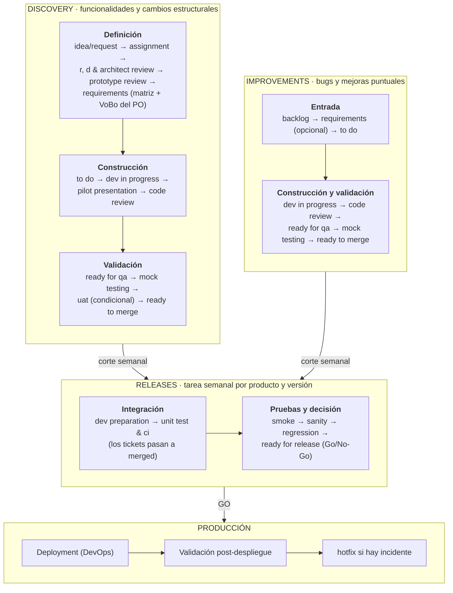
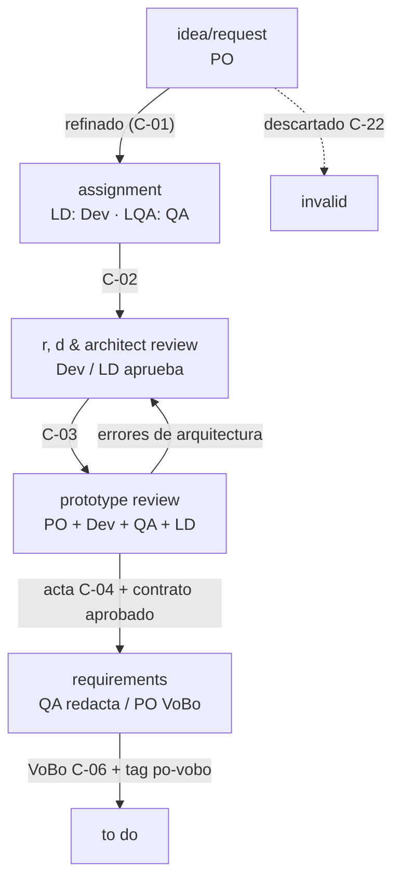
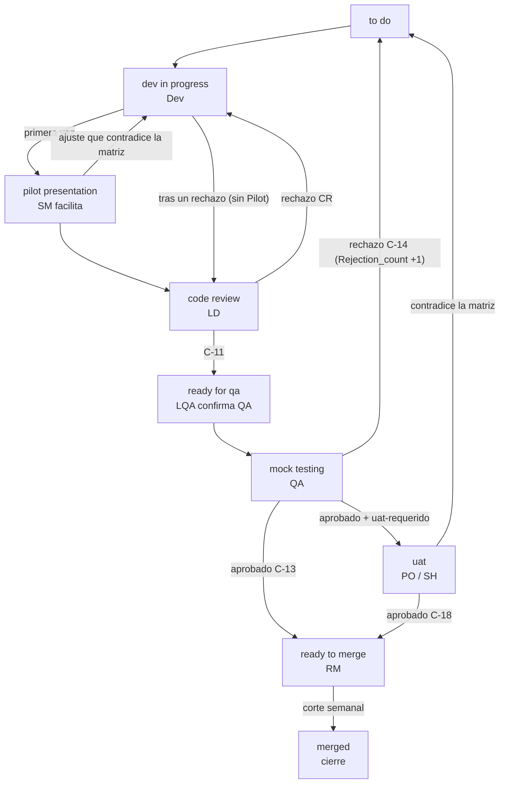
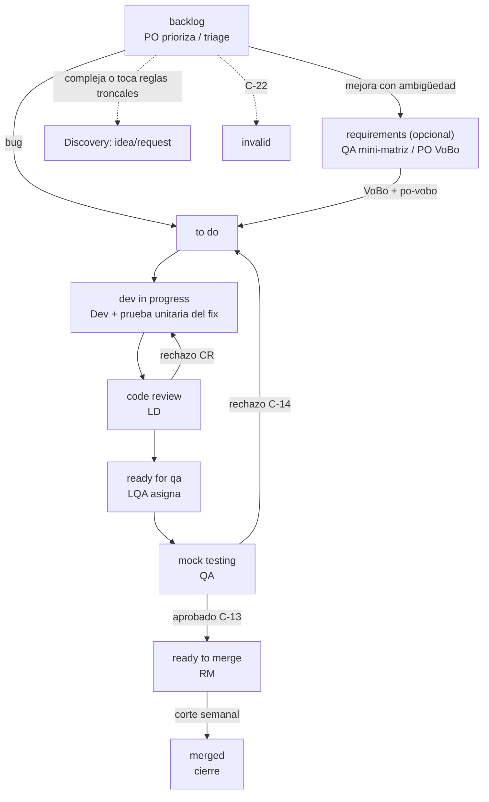
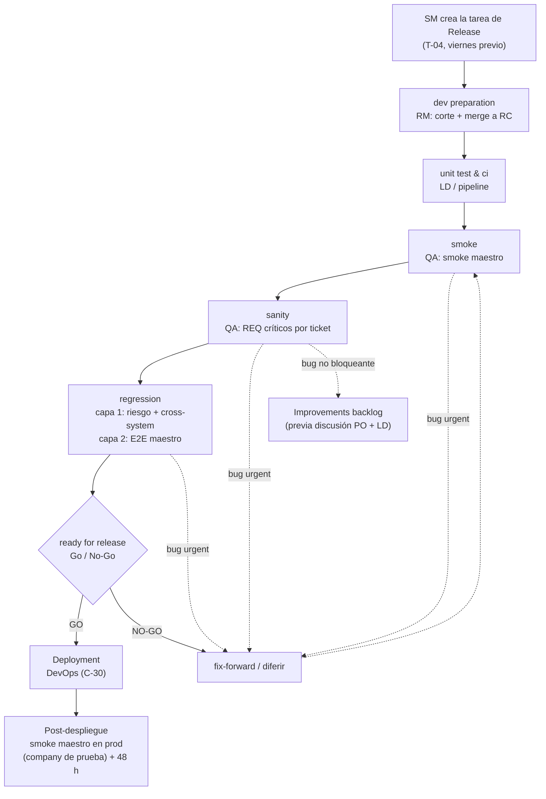
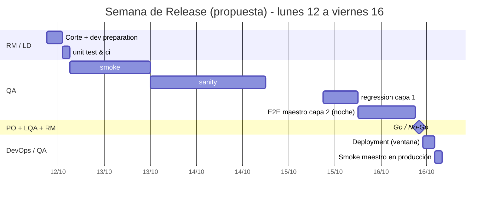
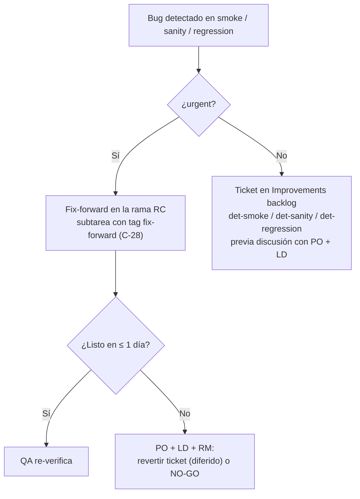
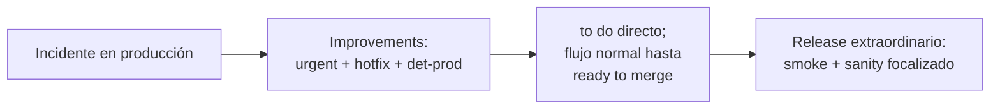
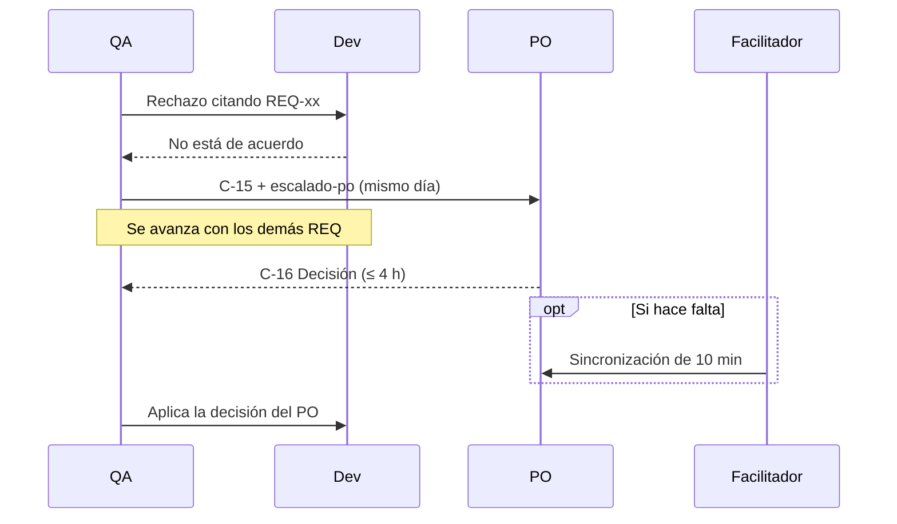
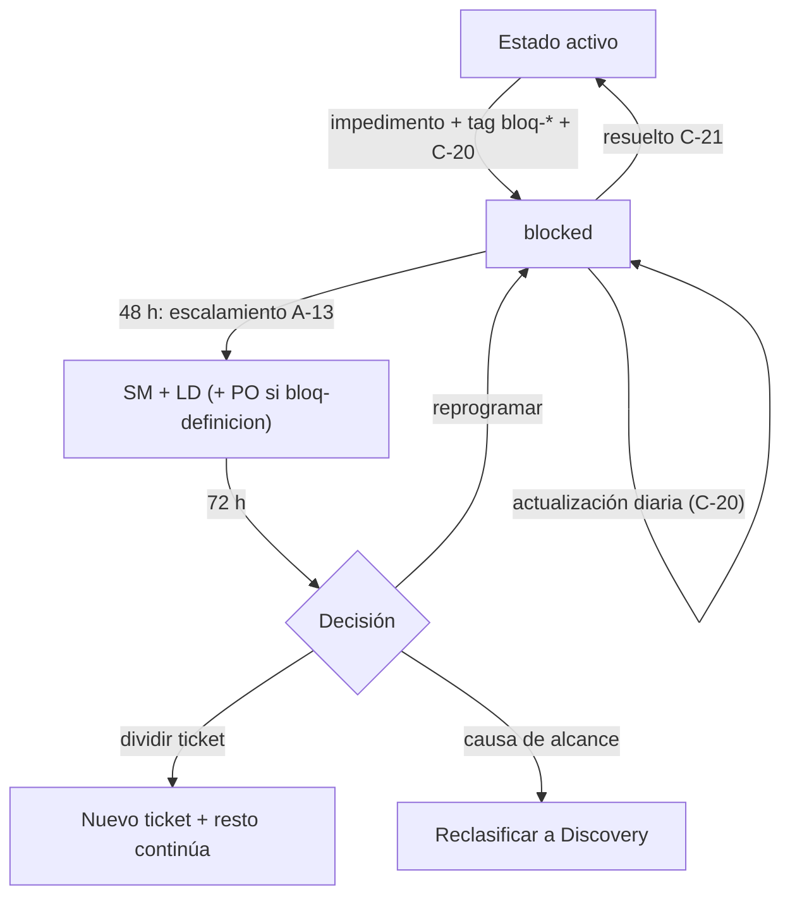

# Análisis del Flujo SDLC IOND

**Estados, responsables, puntos de control y frontera de roles**

Propuesta por: Steve Nina — Scrum Master IOND
Aplica a: IOND · IonMind · StageMind
Audiencia: PO · Lead Dev · RM · Lead QA · Scrum Master

---

## 1. Propósito

Este documento analiza el flujo SDLC de IOND estado por estado y propone su forma consolidada. Para cada estado define **qué se espera, quién responde, quién mueve el ticket, qué se exige para entrar y qué evidencia se deja al salir**. Incluye los diagramas del flujo, la matriz RACI y el **contrato de frontera entre QA, PO y Development**, que es el punto más sensible del nuevo rol de QA como Analista de Calidad y Requerimientos.

- La **fuente canónica** de los detalles operativos (fichas completas, campos, tags, plantillas y automatizaciones) es `knowledge/L1-project/sdlc-consolidation.md`. El anexo de este documento la reproduce.
- Cada regla remite a su decisión **Q-xx** del documento *03 — Registro de Decisiones, Riesgos y Limitaciones*.

---

## 2. Vista general del SDLC IOND

**Lectura del modelo:**

1. **Discovery** lleva una funcionalidad desde la idea hasta que queda lista para integrarse. Incluye diseño (R&D y prototipo), definición de requerimientos con VoBo del PO, desarrollo, Pilot, Code Review y validación de QA.
2. **Improvements** lleva bugs y mejoras puntuales por un camino corto. `requirements` es opcional y solo aplica a mejoras.
3. Ambos kanbans terminan en `ready to merge`. **Cada semana** el RM integra esos tickets en la rama **Release Candidate (RC)**. Los tickets pasan a **`merged`** y **cierran en su propio kanban**.
4. El tablero **Releases** gestiona la **versión**, no los tickets. Hay una tarea de Release por producto y versión (la crea el SM) que recorre `dev preparation` → `unit test & ci` → `smoke` → `sanity` → `regression` → `ready for release` (Go/No-Go).
5. Tras el GO, **DevOps** despliega, QA valida en producción, el LD/RM monitorea y los incidentes abren el carril de **hotfix**.

---

## 3. Discovery

### 3.1 Flujo y ciclo de rechazo

**a) Definición (G1 a G4):**

**b) Construcción y validación (G5 a G8):**

**Reglas clave de transición:**

- **Sin VoBo no se programa.** `requirements` → `to do` exige el comentario C-06 del PO y el tag `po-vobo` (automatización A-03).
- **Bypass de Pilot.** Un ticket corregido tras un rechazo **no** vuelve a `pilot presentation`: pasa de `dev in progress` a `code review`.
- **`to do` tiene dos usos:** cola para programar tras el VoBo y retorno por rechazo de QA.
- **UAT es condicional** y ocurre **antes** del merge (Q-16).
- **`blocked`** (transversal) puede usarse desde cualquier estado activo y vuelve al estado previo.
- **`done w/d`** es solo para **subtareas**. QA valida el ticket padre. Cuando el padre pasa a `ready to merge`, sus subtareas lo acompañan y lo siguen hasta `merged` (A-20, Q-53).

### 3.2 Tabla resumen

| Estado | Owner (A) | Mueve | Reunión | Evidencia de salida | SLA / timebox |
|---|---|---|---|---|---|
| `idea/request` | PO | PO | SH + PO + LD + QA | Historia, valor y prioridad (C-01) | Siguiente Discovery Review |
| `assignment` | **LD** · LQA | LD / Dev | — | Dev como assignee, Dev Reviewer, Reviewer QA (lo asigna el LQA, Q-55) y tamaño (C-02) | 1 día hábil |
| `r, d & architect review` | LD | Dev | Dev–LD puntual | Spike/POC aprobado (C-03) | S 1 · M 3 · L 5 días |
| `prototype review` | PO | PO / SM | **PO + Dev + QA + LD** (SM opc.) | Acta + contrato aprobado (C-04) | ≤ 3 días para agendar |
| `requirements` | PO (VoBo) · QA (R) | QA | QA + Dev (PO si hay dudas) | Matriz vN + VoBo (C-05, C-06) + checklist de acuse del Dev | Matriz 1–3 días · VoBo 24 h |
| `to do` | Dev | Dev | — | — | Prioridad |
| `dev in progress` | Dev | Dev | Daily | PRs + handoff (C-09) | Estimación |
| `pilot presentation` | SM | SM | SH + PO + LD + QA + Dev | Acta y clasificación de ajustes (C-10) | Discovery Review |
| `code review` | LD | LD | Asíncrona (PR) | Aprobación (C-11) | 1 día |
| `ready for qa` | LQA | QA | — | Reviewer QA confirmado + QA Points (C-12) | 1 día |
| `mock testing` | QA | QA | QA + Dev puntual | C-13 / C-14 / C-17 | QA Points |
| `uat` | PO | PO / SM | SH + Cliente + PO | C-18 | ≤ 3 días |
| `ready to merge` | RM | RM | — | Versión objetivo | Hasta el corte |
| `merged` | RM | RM | — | C-19 | Durante `dev preparation` |
| `invalid` | PO | PO | — | Motivo (C-22) | — |

### 3.3 Puntos de control (quality gates)

| Gate | Entre | Condición para avanzar | Quién verifica |
|---|---|---|---|
| **G1 Necesidad** | `idea/request` → `assignment` | Historia + valor + prioridad + TYPE, Project, Iond Subcategory | PO |
| **G2 Solución** | `r, d & architect review` → `prototype review` | Spike/POC aprobado por el LD | LD |
| **G3 Prototipo** | `prototype review` → `requirements` | Prototipo y contrato aprobados por PO, Dev, QA y LD | PO |
| **G4 Requerimientos** | `requirements` → `to do` | **Matriz con VoBo del PO** + checklist de acuse del Dev | QA / PO |
| **G5 Demo** | `pilot presentation` → `code review` | Visto bueno preliminar y ajustes clasificados | SM / PO |
| **G6 Código** | `code review` → `ready for qa` | PR aprobado y CI en verde | LD |
| **G7 Calidad** | `mock testing` → `ready to merge` | 100 % de REQ críticos y 0 `urgent` abiertos | QA |
| **G8 Aceptación** | `uat` → `ready to merge` | Aprobación del PO/cliente (si aplica) | PO |

---

## 4. Improvements

| Estado | Owner (A) | Uso clave |
|---|---|---|
| `backlog` | PO (SM ordena) | Intake con plantilla T-02/T-03 (Form). Triage semanal: prioridad = severidad en bugs; decide si pasa por `requirements`. |
| `requirements` | PO (VoBo) · QA | **Opcional**: solo mejoras que necesitan criterios. Mini-matriz de ≤ 5 REQ. Los bugs no pasan. |
| `to do` | SM | Cola priorizada y retorno por rechazo. |
| `dev in progress` | Dev | Fix con prueba unitaria que certifica la solución. |
| `code review` | LD | PR aprobado y CI en verde. |
| `ready for qa` | LQA | Asignación del Reviewer QA. |
| `mock testing` | QA | Bug: resultado esperado + no regresión de zonas cercanas. Mejora: mini-matriz. |
| `ready to merge` | RM | Versión objetivo y corte semanal. |
| `blocked` | SM | Transversal, con causa `bloq-*`. |
| `done w/d` | Dev | Solo subtareas; siguen al padre a `ready to merge` y `merged`. |
| `merged` / `invalid` | RM / PO | Cierre / cierre negativo con motivo. |

> **Sin `uat` en Improvements** (Q-30): en un caso muy excepcional que requiera validación del cliente, el PO decide si se valida en el `sanity` del release o si el ticket pasa a Discovery.

---

## 5. Releases

### 5.1 Flujo de la tarea de Release

**Suites del release (Q-47 a Q-51):** el **smoke maestro** es único y fijo para todo release (preprod y producción); el **sanity** y la **regresión capa 1** son propios de cada versión; el **E2E maestro** corre como **capa 2** dentro de `regression`: todo lo automatizado más un grupo de rotación manual (G1–G4), de modo que el maestro completo se cubre cada 4 releases. Detalle en la fuente canónica §7.7 y en el estándar de QA (doc 05 §6).

### 5.2 Calendario semanal (Q-32)

Las cajas de tiempo de la guía original (0,5 + 1 + 2 + 2 + 2 días) suman **7,5 días** y no caben en un sprint semanal. El calendario propuesto comprime las fases apoyándose en tres hechos: `sanity` **reutiliza** las matrices de `mock testing`, `regression` es **basada en riesgo** y el lote semanal es **pequeño**.

| Día | Actividad | Owner | Timebox |
|---|---|---|---|
| Viernes previo | Candidatos (`ready to merge` + versión objetivo) y tarea de Release | SM | — |
| Lunes 09:00 | **Corte**, `dev preparation` y `unit test & ci` | RM / LD | ≤ 0,5 d |
| Lunes PM – martes AM | `smoke` | QA | ≤ 0,5 d |
| Martes – miércoles | `sanity` | QA | ≤ 1,5 d |
| Jueves | `regression`: capa 1 de día; capa 2 automatizada de noche y rotación manual; consolidado el viernes 09:00 | QA | ≤ 1 d + ≈ 0,5 d |
| Viernes 10:00 | `ready for release` (Go/No-Go) y despliegue en la ventana acordada | PO + LQA + RM · DevOps | ≤ 0,5 d |

**Reglas de corte (Q-32):** sin tickets no hay release. Hay un límite de lote por capacidad de QA (QA Points). Los PRs de un ticket entran juntos o ninguno (merge atómico, Q-33).

### 5.3 Bugs durante el release y hotfix

**Hotfix (incidente en producción):**

### 5.4 Actividades posteriores al Go/No-Go (sin estado en ClickUp)

| Actividad | Owner | Registro |
|---|---|---|
| Deployment | LD/RM coordina · **DevOps ejecuta** · el PO comunica a clientes | C-30 en la tarea de Release |
| Validación post-despliegue | QA (smoke maestro en producción con la company de prueba ≤ 2 h, con limpieza) · LD/RM con DevOps (48 h) | C-31 |
| Exploratory / Bug bash | QA + Dev + SM (quincenal (Q-39)) | `backlog` con `det-exploratorio` |
| Validación continua en producción | PO + QA (reportes del soporte general de la empresa) | `hotfix` o `backlog` con `det-prod` |

---

## 6. Reglas transversales

### 6.1 Escalamiento de desacuerdos

> Cuando el SM es parte del desacuerdo, **facilita el LD/RM** (Q-03). La decisión sobre los requerimientos sigue siendo del PO.

### 6.2 Bloqueos

### 6.3 Cambio de alcance después del VoBo

1. Solo lo solicita o aprueba el **PO**.
2. QA actualiza la matriz a **v+1** (C-08), se agrega `cambio-alcance` y se retira `po-vobo` (A-04).
3. El PO da un **nuevo VoBo** (C-06).
4. **Después** se modifica el código.

---

## 7. Matriz RACI por estado

**R** = Responsable (ejecuta) · **A** = Aprueba / rinde cuentas · **C** = Consultado · **I** = Informado.

| Estado | PO | SM | LD | Dev | QA | LQA | RM |
|---|---|---|---|---|---|---|---|
| `idea/request` | **A/R** | C | C | I | C | I | — |
| `assignment` | I | I | **A/R** | R | I | R | — |
| `r, d & architect review` | I | I | **A** | **R** | C | — | — |
| `prototype review` | **A** | C | R | R | R | I | — |
| `requirements` | **A** | I | C | C | **R** | C | — |
| `to do` | I | R | I | **A** | I | — | — |
| `dev in progress` | C | I | C | **A/R** | C | — | — |
| `pilot presentation` | A | **R** | C | R | C | — | — |
| `code review` | — | I | **A/R** | R | I | — | — |
| `ready for qa` | — | I | I | C | R | **A** | — |
| `mock testing` | C | I | I | C | **A/R** | C | — |
| `uat` | **A** | R | — | C | R | I | — |
| `ready to merge` | I | I | C | C | I | I | **A/R** |
| `merged` | I | I | I | I | I | I | **A/R** |
| `invalid` | **A/R** | I | I | I | I | — | — |
| `blocked` | C | **A/R** | C | R | C | — | — |
| `dev preparation` | I | C | C | C | I | I | **A/R** |
| `unit test & ci` | — | I | **A** | R | I | I | C |
| `smoke` / `sanity` / `regression` | I | I | C | C | **R** | **A** | C |
| `ready for release` (Go/No-Go) | **A** | R (facilita) | C | — | C | **A** | **A** |
| Deployment | I | I | C | — | I | I | **A** (DevOps R) |

> Los Stakeholders (SH) son **C** en `idea/request`, `prototype review` y `pilot presentation` (pueden participar de forma asíncrona por video), y **R** en `uat`. En IOND, **LD y RM son la misma persona**: las columnas se mantienen separadas porque son responsabilidades distintas. Soporte no es un rol del equipo (se usa el soporte general de la empresa).

---

## 8. Contrato de frontera: QA ↔ PO ↔ Development

El nuevo rol de QA como Analista de Calidad y Requerimientos amplía su participación en la **definición**, pero **no** le transfiere la propiedad del producto. Esta tabla fija qué decide cada rol para evitar que los roles choquen.

| Tema | PO | QA (Analista de Calidad y Requerimientos) | Development |
|---|---|---|---|
| Necesidad de negocio y prioridad | **Decide** | Analiza y pregunta | Informa la complejidad |
| Historia y criterios de alto nivel | **Redacta** | Revisa testabilidad | Revisa viabilidad |
| Matriz de Requerimientos | **Aprueba (VoBo único)** | **Redacta y mantiene** | Apoya técnicamente y acusa lectura |
| Reglas de negocio no definidas | **Decide** | Detecta y **propone** opción recomendada | Señala implicaciones técnicas; **no decide** |
| Casos fuera de alcance | Confirma en el VoBo | **Propone y documenta** | Usa como límite |
| Contrato de API / arquitectura | Aprueba en `prototype review` | Valida testabilidad | **Diseña** (LD aprueba) |
| Cambio de alcance | **Único que lo autoriza** | Versiona la matriz (v+1) | Implementa **después** del nuevo VoBo |
| Matriz de Pruebas | — | **Decide** (interna) | Puede consultarla |
| Aceptación o rechazo en `mock testing` | Resuelve desacuerdos | **Decide contra la matriz** | Corrige o escala |
| Hallazgos fuera de matriz | **Prioriza** el ticket nuevo | Registra (`fuera-de-matriz`) | — |
| UAT | **Decide si aplica** y aprueba | Acompaña y prepara datos | Soporta |
| Go/No-Go | **Vota** (riesgo de negocio) | LQA **certifica y vota** (calidad) | RM **vota** (operación) |

**Lo que QA no hace:** priorizar el backlog, aprobar su propia matriz, decidir reglas de negocio, rechazar por preferencias no documentadas ni exigir que se repitan etapas ya aprobadas.
**Lo que el PO no hace:** aprobar fila por fila, cambiar el alcance sin versionar la matriz, dejar reglas "a criterio del Dev".
**Lo que Development no hace:** implementar algo distinto de lo acordado, decidir reglas de negocio ni cambiar el alcance sin el PO.

---

## 9. Artefactos por estado y dónde viven

| Estado | Artefacto | Dónde vive (fuente oficial) | Copia para el catalyst (Fase F3) |
|---|---|---|---|
| `idea/request` | Historia + criterios (T-01) | Descripción del ticket | — |
| `r, d & architect review` | Spike/POC | Comentario C-03 + enlace a documento | — |
| `prototype review` | Acta + contrato aprobado | Comentario C-04 + enlace | Brief de arquitectura de QA |
| `requirements` | **Matriz de Requerimientos vN** + VoBo | Descripción (`## Matriz de Requerimientos vN`) + C-06 | `requirements-matrix.md` |
| `dev in progress` | Handoff | Comentario C-09 | — |
| `mock testing` | Matriz de Pruebas + reporte | C-13/C-14 + evidencias | `test-matrix.*`, `qa-report.md` |
| Release | Smoke / Sanity / Regression / Go-No-Go | Tarea de Release (C-23…C-31) | `releases/<producto>/<versión>/` |

> **Regla:** ClickUp es la **fuente oficial**. Los archivos del catalyst son copias de trabajo que la IA usa como contexto y nunca sustituyen el registro en ClickUp.

---

## Anexo A — Fichas completas por estado (fuente canónica)

<!-- @include ../../../knowledge/L1-project/sdlc-consolidation.md#estados-discovery -->

<!-- @include ../../../knowledge/L1-project/sdlc-consolidation.md#estados-improvements -->

<!-- @include ../../../knowledge/L1-project/sdlc-consolidation.md#estados-releases -->

<!-- @include ../../../knowledge/L1-project/sdlc-consolidation.md#transiciones -->
