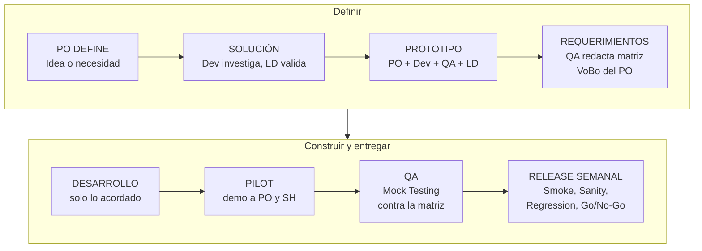
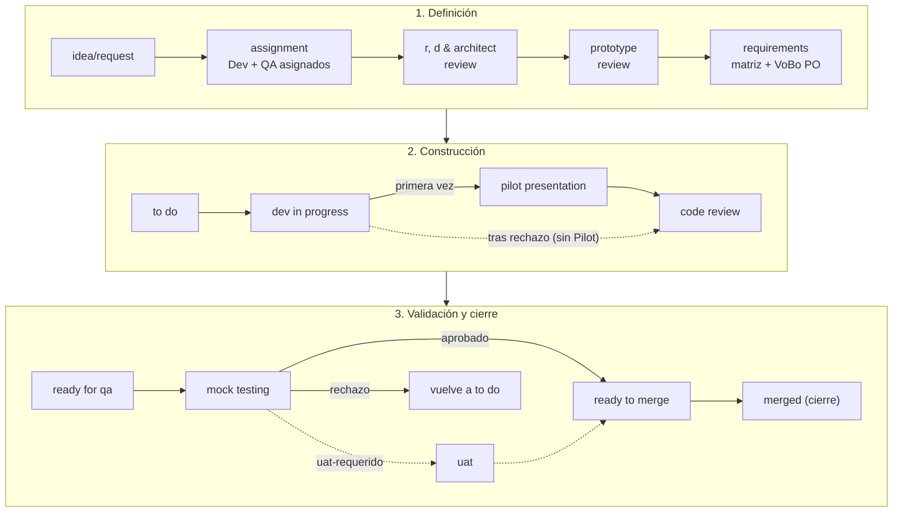

# Acuerdo de Flujo de Trabajo IOND

**PO · DEVELOPMENT · QA**

Guía para la definición, desarrollo, validación y liberación de tickets

Propuesta por: Steve Nina — Scrum Master IOND
Aplica a: IOND · IonMind · StageMind

---

**PROPÓSITO:** Establecer un flujo común, ágil y trazable para el equipo IOND: definir, desarrollar, validar y liberar tickets reduciendo el retrabajo entre QA y Development y entregando versiones semanales confiables.

## 1. Propósito, alcance y objetivo

**¿Para qué sirve este documento?** Es la guía oficial de trabajo del equipo IOND. Define las reglas para pedir, programar, probar y liberar un ticket en ClickUp en los tableros **Discovery**, **Improvements** y **Releases**.

**¿Cuál es su fin práctico?** Que los requerimientos no queden en conversaciones verbales o mensajes sueltos. Todo lo que el sistema debe hacer queda escrito en el ticket de ClickUp. Así Development sabe con exactitud qué construir, QA sabe exactamente qué validar y los tickets no rebotan una y otra vez entre ambos.

**Objetivo:** dejar los requerimientos claros y por escrito **antes** de programar, para que todos entiendan lo mismo y cada semana salga a producción una versión validada.

**Condición de éxito:** comunicación directa y compromiso conjunto entre PO, Development y QA, con el Scrum Master removiendo bloqueos y el PO interviniendo rápido cuando hay dudas.

**Alcance:** tickets de los tableros Discovery e Improvements y del folder Releases del espacio NEW GATEWAY IOND en ClickUp.

## 2. Principios del proceso

1. **El PO define la necesidad.** QA documenta los requerimientos con el apoyo técnico de Development. El PO revisa y da su **visto bueno (VoBo) con un comentario** en el ticket. Development desarrolla y QA prueba.
2. **Sin aprobación punto por punto:** el PO no aprueba fila por fila. Valida la matriz de forma integral y formaliza su VoBo con un único comentario en `requirements`.
3. **Ningún ticket de Discovery pasa a desarrollo sin el VoBo del PO** sobre los requerimientos. Una mejora que pasa por `requirements` en Improvements tampoco.
4. **La Matriz de Requerimientos acordada es el criterio oficial de aceptación y rechazo.**
5. **Ante un desacuerdo no se asume ni se continúa con interpretaciones distintas:** se escala al PO el mismo día.
6. **La documentación es proporcional** a la complejidad y el impacto del cambio.
7. **Los tickets cierran en su kanban** (`merged`). El tablero de Releases gestiona versiones, no tickets.

## 3. Roles y responsabilidades (equipo IOND)

| Rol | Responsabilidad en IOND |
|---|---|
| **PO** (Product Owner) | En IOND, un mismo PO para IOND, IonMind y StageMind. Define la necesidad de negocio y la prioridad. Clasifica los tickets de Discovery y aprueba la clasificación de bugs. Revisa la Matriz de Requerimientos y deja su **VoBo** en `requirements`. Resuelve dudas y desacuerdos a tiempo. Decide `invalid`, los cambios de alcance y la UAT. Vota en el Go/No-Go. Lidera la retrospectiva del flujo. |
| **Scrum Master** | Facilita el flujo y las ceremonias (incluido `pilot presentation`), vela por los acuerdos, elimina impedimentos (`blocked`), **crea la tarea de Release** semanal con verificación del Dev y monitorea el cumplimiento en ClickUp. |
| **Development** | Investiga y presenta la solución en R&D y `prototype review`, apoya a QA con la matriz, **desarrolla estrictamente lo acordado** y entrega el handoff a QA. |
| **Lead Development** | Hace el **`assignment`**, da feedback y validación arquitectónica en R&D y `prototype review`, y vela por la calidad del código en `code review`. Asigna un Dev como assignee en `assignment`. En IOND es también el **Release Manager**; su propio código lo revisan **dos miembros del equipo con mayor antigüedad y ambos deben aprobar**. |
| **QA** (Analista de Calidad y Requerimientos) | Asignado desde `assignment`, sigue el ticket de punta a punta. Clasifica los bugs (con aprobación del PO). Elabora la **Matriz de Requerimientos** en `requirements` (con los casos fuera de alcance), diseña y ejecuta la **Matriz de Pruebas** en `mock testing` y ejecuta Smoke, Sanity y Regression en el Release. |
| **Lead QA** | **Asigna el QA de cada ticket desde `assignment`**, junto con el Dev que asigna el LD, para que el QA siga la investigación y el prototipo y llegue listo a redactar la matriz en `requirements`. El mismo QA prueba el ticket en `mock testing`; en `ready for qa` el Lead QA solo lo confirma o lo reasigna por capacidad. En Improvements asigna al QA cuando el ticket entra a `requirements` o a `ready for qa`. Gestiona la capacidad de QA, certifica la calidad del release y vota en el Go/No-Go. |
| **Release Manager** (= Lead Dev) | Conduce el corte semanal (`dev preparation`), mergea a la rama RC (`ready to merge` → `merged`), despliega el build de cada ticket al ambiente de QA con los workflows de DevOps y coordina el despliegue a producción. Vota en el Go/No-Go. |
| **Stakeholders** | Aportan feedback y validación de negocio en Request, Prototype Review, Pilot y UAT. Pueden participar de forma asíncrona por video. |
| **DevOps** (equipo externo) | Prepara los workflows de despliegue y ejecuta el despliegue a producción en la ventana acordada. |

## 4. Clasificación del ticket: Discovery vs. Improvements

### 4.1 Discovery

Corresponde a un ticket que nace de un requerimiento de cliente manejado como proyecto, o que cumple **al menos una** de estas condiciones:

- Crea o modifica una **regla de negocio** del producto (billing, planes, consumo, permisos, marketplace…).
- Impacta **más de un módulo, servicio, repositorio o producto** (p. ej. iond + IonMind).
- Requiere **investigación técnica (R&D)** o cambios de arquitectura o de contrato de API.
- Es una funcionalidad nueva, una refactorización o un cambio estructural.

**Flujo Discovery en ClickUp.** Tiene dos caminos según el ciclo de vida del ticket.

**1. Primera vez (camino regular / happy path):**
`idea/request` → `assignment` (el LD asigna el Dev y el Lead QA asigna el QA) → `r, d & architect review` → `prototype review` → `requirements` (QA redacta la matriz + VoBo del PO en comentario) → `to do` → `dev in progress` → `pilot presentation` → `code review` → `ready for qa` → `mock testing` → [`uat`, solo si el ticket tiene `uat-requerido`] → `ready to merge` → `merged`.

**2. Ciclo de rechazo (retrabajo tras un hallazgo en `mock testing`):** el ticket vuelve a `to do` para entrar a la cola. Al retomarse pasa a `dev in progress` y, **sin volver a `pilot presentation`**, sigue a `code review` → `ready for qa` → `mock testing` → `ready to merge`.

**Reglas clave de transición en Discovery:**

- **Asignación temprana:** en `assignment` el LD asigna el Dev y el Dev Reviewer, y el Lead QA asigna el QA. Así el QA sigue la investigación y el prototipo, redacta la matriz y luego prueba el mismo ticket.
- **Sin VoBo no se programa:** `requirements` → `to do` solo con el comentario de VoBo del PO y el tag `po-vobo`.
- **Uso de `to do`:** cola para programar tras el VoBo (con el checklist de acuse del Dev marcado) y retorno cuando QA rechaza.
- **Discovery Review:** Request, Prototype Review y Pilot se tratan en una sesión **semanal** en un día dedicado, acordado con el SH. Si el SH no puede asistir, participa por video.
- **Clasificación:** en Discovery clasifica el PO.
- **Bypass de Pilot en correcciones:** ningún ticket corregido tras un rechazo vuelve a `pilot presentation`.
- **Ajustes del Pilot:** si contradicen la matriz, se corrigen en el ticket. Si son nuevos e imprescindibles, son un cambio de alcance (matriz v+1 + VoBo). Si son nuevos y no imprescindibles, van como ticket nuevo a Improvements con el tag `pilot-feedback`.
- **Subtareas:** cierran en `done w/d` (Done With Dependencies) sin QA individual; QA valida el ticket padre. Cuando el padre pasa a `ready to merge`, sus subtareas lo acompañan y lo siguen hasta `merged`. Los spikes de investigación también son subtareas.
- **`blocked`:** estado transversal con causa (`bloq-*`) y plan de acción diario.

### 4.2 Improvements

Aplica a **bugs, hallazgos de QA, Pilot o UAT, mejoras puntuales y cambios de bajo impacto** sin modificar reglas de negocio troncales.

**¿Se mantiene `requirements` en Improvements? Sí, de uso CONDICIONAL / OPCIONAL:**

- **Bugs:** van directo `backlog` → `to do` → `dev in progress`. No pasan por `requirements`, porque el reporte ya incluye pasos, resultado esperado y resultado actual.
- **Mejoras puntuales:** pasan por `requirements` cuando hace falta dejar criterios breves de aceptación antes de programar (mini-matriz de hasta 5 REQ + VoBo del PO).
- **Criterio de escalamiento:** si una mejora en `requirements` resulta compleja o toca reglas troncales, el PO la mueve de inmediato a Discovery.
- **Rechazo de QA:** vuelve a `to do`.
- **Clasificación de bugs:** QA clasifica cada bug según su criterio (tablero, TYPE y prioridad = severidad) y el PO lo aprueba en el triage semanal.
- **Sin UAT en Improvements:** en un caso muy excepcional, el PO decide si se valida en el `sanity` del release o si el ticket pasa a Discovery.

`backlog` → [`requirements`] → `to do` → `dev in progress` → `code review` → `ready for qa` → `mock testing` → `ready to merge` → `merged`

## 5. Matriz de Requerimientos (optimizada para IOND)

La Matriz de Requerimientos es el **registro formal en el ticket de ClickUp** (sección `## Matriz de Requerimientos vN` de la descripción) que especifica el comportamiento esperado.

**VoBo del PO:** no hay columna de aprobación punto por punto. El PO valida la matriz completa y deja su comentario de VoBo en `requirements`.

| ID | Módulo / Servicio | Requerimiento / Regla | ¿Cuándo aplica? (condición) | ¿Qué debe pasar? (resultado) | Excepciones / Fuera de alcance |
|---|---|---|---|---|---|
| REQ-01 | Billing / Suscripción | Regla de negocio o validación esperada | Condición de entrada o escenario | Respuesta, estado o comportamiento generado | Casos borde que no aplican o escenarios no incluidos en esta fase |

**¿Por qué es clave la columna "Fuera de alcance"?** Porque fija los límites del ticket. Protege al desarrollador de exigencias no planificadas y deja claro a QA qué comportamientos **no** deben reportarse como error en esta entrega.

**Reglas IOND adicionales:**

- QA **parte de la especificación del PO** (historia, criterios, fuera de alcance), la normaliza en REQ-IDs y completa condiciones, excepciones y límites. No reescribe lo que ya está claro.
- **Contrato aprobado en `prototype review`:** la matriz lo referencia como parte de la línea base (`REQ-xx: cumplir el contrato vN`).
- **No funcionales** (rendimiento, seguridad, compatibilidad) como filas `REQ-NF-xx` con métrica.
- **Salidas de IA** (IonMind / StageMind): resultado expresado con un **umbral medible** sobre un dataset definido.
- **Épicas con subtareas:** una sola matriz en el ticket padre.
- **Reglas de negocio indefinidas:** QA las detecta y **propone** una opción. El PO **decide** en el VoBo. Nunca quedan a criterio del Dev.
- **Acuse del Dev:** el Dev marca el checklist del ticket *"Matriz de Requerimientos vN leída por el Dev"* antes de programar.

### 5.1 Matriz de Requerimientos vs. Matriz de Pruebas

| Aspecto | Matriz de Requerimientos | Matriz de Pruebas |
|---|---|---|
| Pregunta | ¿Qué debe hacer el sistema? | ¿Cómo comprobamos que funciona? |
| Momento | Antes del desarrollo (`requirements`) | Durante `mock testing` (y se reutiliza en `sanity`) |
| Elabora | QA (con apoyo técnico del Dev) | QA |
| Validación | PO, mediante comentario de VoBo en el ticket | QA (no requiere VoBo del PO) |

## 6. Acuerdos de operación

| Regla | Acuerdo |
|---|---|
| **Criterio de rechazo** | QA rechaza **únicamente** contra la Matriz de Requerimientos acordada (y el contrato que referencia). Lo que no está contemplado no es rechazo directo: se registra como ticket nuevo (`fuera-de-matriz`). |
| **Desarrollo** | Development desarrolla tomando como base los requerimientos con VoBo del PO. Implementar algo distinto es motivo de rechazo. |
| **Cambios durante el desarrollo** | Si surge un ajuste: primero se actualiza la matriz (v+1, tag `cambio-alcance`), el PO confirma con un nuevo VoBo y **luego** se modifica el código. |
| **Hallazgos fuera de matriz** | Si contradice lo acordado, es un bug de desarrollo. Si es un comportamiento no contemplado, el PO lo evalúa como requerimiento nuevo. |
| **Avance sin bloqueos** | Si un ticket tiene varios requerimientos (REQ-01 a REQ-05) y surge una duda en REQ-03, el Dev sigue con los requerimientos ya claros (01, 02, 04, 05) mientras se resuelve la duda. |
| **Ambiente de pruebas** | `mock testing` se hace en el ambiente asignado al QA, con la rama del ticket; el LD despliega el build con los workflows de DevOps. |
| **Re-test sin pasos redundantes** | Tras un rechazo, QA verifica las correcciones sin exigir repetir etapas ya aprobadas (Pilot, definiciones). |
| **Trazabilidad** | Cada transición relevante deja su comentario estándar en el ticket, con la plantilla acordada para esa transición. |
| **Tickets en curso** | Los tickets que aún no llegaron a `dev in progress` adoptan este acuerdo completo. Los demás terminan con su documentación vigente, pero siguen las reglas de rechazo, `merged` y Release. |

## 7. Resolución de desacuerdos

**REGLA:** si QA y Development no llegan a un acuerdo sobre un punto, no se asume ni se continúa con interpretaciones distintas.

1. Registrar en el ticket el punto exacto de discrepancia y la postura de cada parte en 1 o 2 líneas, y agregar el tag `escalado-po`.
2. Notificar al PO **el mismo día** etiquetándolo en el ticket.
3. El PO alinea las posiciones y define la postura del producto en el ticket en un plazo de 4 horas hábiles.
4. Cuando sea necesario, el Scrum Master facilita una sincronización breve de 10 minutos. Si el SM es parte del desacuerdo, facilita el **LD/RM**.
5. Registrar la decisión en los comentarios del ticket para mantener la trazabilidad.

## 8. Tiempos de respuesta

| Actividad | Plazo propuesto |
|---|---|
| Elaboración de la matriz por QA | 1 día para tickets pequeños o medianos · 2 a 3 días para tickets grandes |
| VoBo del PO en comentario | 24 horas hábiles tras la notificación en `requirements`. Sin aprobación tácita: a las 24 h se escala en la daily; a las 48 h el ticket pasa a `blocked` con `bloq-definicion` |
| Respuesta de QA a dudas de Development | Menos de 2 horas hábiles |
| Resolución de dudas o desacuerdos bloqueantes | 4 horas hábiles |
| `assignment`: Dev (LD) y QA (Lead QA) asignados | 1 día hábil |
| Code Review | 1 día hábil |
| Confirmación del QA en `ready for qa` (en Improvements, asignación) | 1 día hábil |
| UAT | ≤ 3 días hábiles desde la convocatoria |
| `blocked` | Actualización diaria · escalamiento a las 48 h · decisión a las 72 h |

## 9. Estados oficiales en ClickUp

| Categoría | Discovery | Improvements |
|---|---|---|
| **No iniciado** | `idea/request` · `assignment` | `backlog` · `requirements` *(opcional)* · `to do` |
| **Definición** | `r, d & architect review` · `prototype review` · `requirements` *(VoBo del PO)* | — |
| **Construcción** | `to do` *(cola y rechazos)* · `dev in progress` · `pilot presentation` *(primera vez)* · `code review` | `dev in progress` · `code review` |
| **Validación** | `ready for qa` · `mock testing` · `uat` *(condicional)* | `ready for qa` · `mock testing` |
| **Transversal** | `blocked` | `blocked` |
| **Salida** | `ready to merge` → **`merged`** (cierre) · `done w/d` *(subtareas)* · `invalid` | `ready to merge` → **`merged`** (cierre) · `done w/d` *(subtareas)* · `invalid` |

**Releases (tarea de Release por producto y versión):** `dev preparation` → `unit test & ci` → `smoke` → `sanity` → `regression` → `ready for release`.

## 10. Releases semanales

**Modelo:** cada semana hay un sprint en el folder **Releases**. El **SM crea una tarea de Release por producto y versión** (`Release <producto> - vX.Y.Z`) con la verificación del Dev. La tarea documenta el alcance, los tickets incluidos, las ramas RC, el ambiente, los prerrequisitos, las pruebas y el Go/No-Go. **Los tickets no se mueven:** permanecen en su kanban y cierran en `merged`. Si no hay tickets listos, **no se crea release** esa semana.

| Estado | Owner | Qué asegura | Timebox |
|---|---|---|---|
| `dev preparation` | RM | Corte, merge atómico de los tickets en `ready to merge` a la rama RC, preprod actualizado; los tickets pasan a `merged` | ≤ 0,5 d (lunes) |
| `unit test & ci` | LD (pipeline) | 100 % de las pruebas unitarias en verde (mantenidas por Development) | Horas (lunes) |
| `smoke` | QA | **Smoke maestro**: la misma lista de caminos críticos y salud de los servicios en todo release | ≤ 0,5 d |
| `sanity` | QA | Propio de la versión: REQ críticos de cada ticket del release en el ambiente integrado | ≤ 1,5 d |
| `regression` | QA | **Capa 1:** regresión de la versión por riesgo + flujos cross-system. **Capa 2:** E2E maestro con todas las features, automatizado y con rotación manual | ≤ 1 d + noche |
| `ready for release` | LQA certifica | **Go/No-Go**: PO + LQA + RM | ≤ 0,5 d (viernes) |

**Bugs durante el release:**

- **Bloqueantes** (`urgent`): se corrigen **en la misma rama RC (fix-forward)**.
- **Resto:** según su prioridad, pasan a **tickets de Improvements** previa discusión con el PO y el LD.
- Si un fix-forward no llega a tiempo, el PO, el LD y el RM deciden entre revertir el ticket de la RC (`diferido`) o NO-GO.

**Decisión Go/No-Go:**

- 🟢 **GO:** sin hallazgos `urgent` abiertos y smoke, sanity y regresión capa 1 aprobados. Una falla de la capa 2 solo pesa si es `urgent` y la provocó el release.
- 🟡 **CONDITIONAL GO:** solo con hallazgos `high` que tengan workaround, riesgo aceptado por el PO y fix agendado.
- 🔴 **NO-GO:** cualquier `urgent` abierto o una regresión en un flujo crítico.

**Después del GO:**

- **DevOps** despliega en la ventana acordada.
- QA ejecuta el smoke maestro en producción con la **company de prueba** y limpia los datos que crea; el LD/RM monitorea 48 h con DevOps.
- Los incidentes abren el **carril de hotfix**: ticket `urgent` en Improvements con el tag `hotfix` y release extraordinario.

**Validación continua:** bug bash quincenal (QA + Dev + SM) y validación permanente en producción (PO + QA). Los hallazgos van a `backlog` con su tag de detección.

## 11. Multi-producto (IOND · IonMind · StageMind)

- Los tres productos usan los mismos tableros y este mismo acuerdo. El campo **Project** identifica el producto.
- **Versión objetivo:** Iond.Version (iond), Ionmind.Version (IonMind) y Stagemind.Version (StageMind). Los tickets con Project = Gateway siguen este acuerdo y usan G.Version.
- **Una tarea de Release por producto y versión.** Cuando hay dependencias, las tareas se relacionan y el despliegue sigue el orden de las dependencias (p. ej. StageMind → IonMind → iond).
- En los productos de IA, el "¿Qué debe pasar?" de la matriz se expresa con umbrales medibles.

## 12. Medición y revisión del flujo

- Tasa de rechazos de QA por ticket (Rejection_count) y First Pass Yield.
- Lead time y cycle time del ticket desde `idea/request` / `backlog` hasta `merged`.
- Tiempo en `requirements` (cumplimiento del VoBo en 24 h) y tiempo de resolución de escalamientos al PO.
- Hallazgos por fase (`det-*`), hallazgos fuera de matriz y escapes a producción.
- Resultado de cada Go/No-Go, fix-forward y hotfix por release.
- **Retrospectiva del flujo liderada por el PO:** es el espacio donde el equipo analiza qué funcionó, qué causó fricción o retrabajo entre Dev y QA y qué acuerdos deben ajustarse para que el siguiente ciclo sea más rápido, fluido y sin bloqueos.

## 13. Compromisos del equipo IOND

- No avanzar sin alineación; escalar las dudas al PO el mismo día.
- Desarrollar y probar con base en los requerimientos acordados.
- Mantener la trazabilidad en los comentarios de ClickUp.
- Respetar el corte semanal y la decisión del Go/No-Go.
- Registrar todo hallazgo fuera de la matriz como ticket nuevo, sin bloquear el ticket en curso.

## 14. Resumen ejecutivo del flujo

| Fase | Responsable principal | Resultado clave |
|---|---|---|
| Necesidad | PO | Necesidad de negocio definida y priorizada |
| Solución | Development + LD | Solución técnica investigada y aprobada |
| Prototipo | PO + Dev + QA + LD | Prototipo y contrato de interfaz aprobados |
| Asignación | LD + Lead QA | Dev y QA asignados al ticket |
| Requerimientos | QA + PO | Matriz documentada con VoBo del PO |
| Desarrollo | Development | Código implementado sobre lo acordado |
| Piloto | SM + Dev + PO + SH | Visto bueno preliminar y ajustes clasificados |
| Validación | QA | Ticket validado en `mock testing` (y UAT si aplica) |
| Integración | RM | Ticket `merged` en la RC semanal |
| Release | QA + LQA + PO + RM | Versión aprobada en el Go/No-Go y desplegada |
