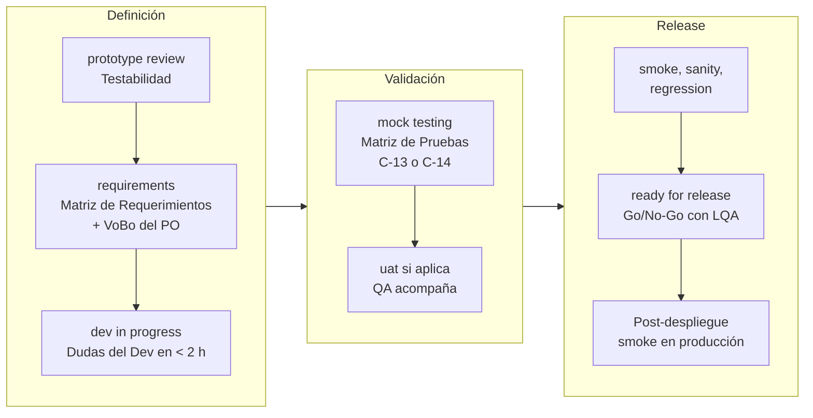
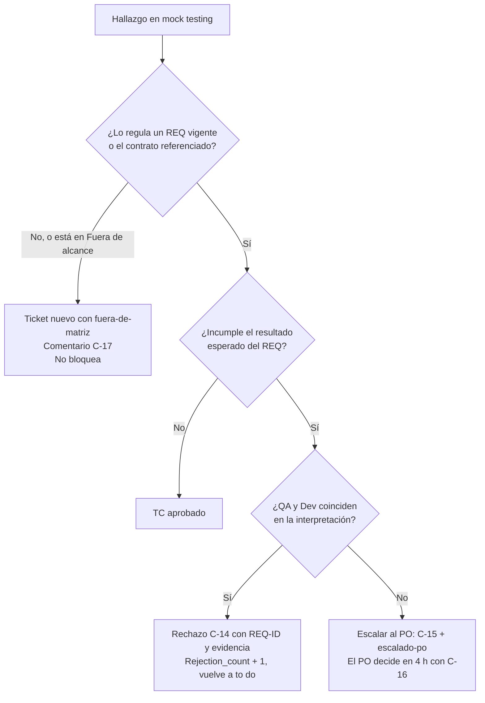

# Estándar Operativo de QA — Aplicación IOND
***Guía de definición, criterios de calidad y validación para IOND***

**Propuesta por:** Steve Nina — Scrum Master IOND

**Aplica a:** IOND · IonMind · StageMind — Espacio ClickUp NEW GATEWAY IOND (tableros Discovery, Improvements y Releases)

**Liderado por:** Lead QA

---

> **Propósito del documento:** establecer con total transparencia cómo trabaja QA en el SDLC de IOND y a qué se compromete en la definición de requerimientos, el diseño de pruebas, la validación de tickets y la certificación de releases, para dar certeza y previsibilidad al PO, a Development, al Lead Dev, al Scrum Master y al Release Manager.

> **Relación con otros documentos:** este estándar aplica a IOND el *Estándar Operativo de QA v1.0* transversal. La fuente canónica de estados, roles, campos, tags, plantillas de comentario (C-xx), automatizaciones (A-xx) y SLAs es `knowledge/L1-project/sdlc-consolidation.md`; **ante cualquier discrepancia prevalece la fuente canónica**. Las decisiones (`Q-xx`), las acciones de verificación (`AV-xx`) y los riesgos (`R-xx`) se detallan en el *Registro de Decisiones* (`03-preguntas-inconsistencias-riesgos.md`).

> **Convenciones:** los estados se escriben exactamente como en ClickUp (`minúsculas`). `(Q-xx)` remite a la decisión del *Registro de Decisiones* (documento 03).

| 1. Entendimiento | 2. Especificación | 3. Protección al Dev | 4. Validación objetiva |
|---|---|---|---|
| QA analiza la necesidad con el PO y el Dev desde `prototype review`. | QA redacta la Matriz de Requerimientos; el PO da su VoBo con un único comentario. | Se fijan límites y casos fuera de alcance antes de escribir código. | QA prueba y rechaza solo contra lo acordado. |

---

## 1. Propósito y filosofía

El rol de QA en IOND no consiste en "encontrar errores al final del ciclo". QA practica **aseguramiento de calidad preventivo**: interviene desde que se entiende el problema (`idea/request`, `prototype review`) para que los requerimientos queden escritos, sean verificables y tengan límites claros **antes** de que se programe. Un defecto de definición cuesta poco en `requirements`, bastante más en `mock testing` y mucho más en producción.

> **COMPROMISO CLAVE DE QA:** ningún QA rechaza un ticket por interpretaciones subjetivas o preferencias no documentadas. El criterio de aceptación y rechazo es **exclusivamente** la Matriz de Requerimientos vigente con VoBo del PO (tag `po-vobo`), incluido el contrato aprobado en `prototype review` cuando la matriz lo referencia (`Q-10`).

**Principios de QA en IOND**

1. **Prevención antes que detección.** La mayor contribución de QA ocurre en `prototype review` y `requirements`, no en `mock testing`.
2. **Lo acordado es el contrato.** La matriz con VoBo es la única base de rechazo; lo no contemplado se registra como ticket nuevo.
3. **Proporcionalidad.** Matriz completa en Discovery; mini-matriz o reporte T-02 en Improvements; matrices por riesgo en Releases.
4. **Trazabilidad.** REQ-ID → caso de prueba (TC) → veredicto → evidencia, todo en el ticket. Lo que no está en el ticket no existe.
5. **No frenar el flujo.** Una duda sobre un REQ no detiene el resto del ticket; los desacuerdos se escalan al PO el mismo día.
6. **Riesgo primero en el release.** `smoke`, `sanity` y `regression` se dimensionan por riesgo, no por volumen.

**Alcance:** tableros Discovery, Improvements y Releases del folder SDLC [GATEWAY/IOND]. Los folders legacy siguen operando y quedan fuera de este estándar.

---

## 2. El rol de QA como Analista de Calidad y Requerimientos

### 2.1 Qué significa

Como Analista de Calidad y Requerimientos, QA es **dueño de la calidad de la definición, no del producto**: convierte la necesidad que define el PO en reglas verificables, descubre los casos que nadie consideró, fija los límites de la entrega y custodia ese acuerdo hasta el release. El PO sigue siendo el único dueño de la necesidad, la prioridad y las reglas de negocio.

### 2.2 Qué hace QA

- Evalúa la **testabilidad** del prototipo y del contrato de interfaz en `prototype review`.
- Redacta la **Matriz de Requerimientos** en `requirements`, normalizando la especificación del PO en REQ-IDs y completando condiciones, excepciones y límites.
- Hace explícito lo que **no** entra en la entrega (columna *Excepciones / Fuera de alcance*).
- Detecta reglas de negocio indefinidas y las presenta al PO **con opciones y una opción recomendada**.
- Diseña y ejecuta la **Matriz de Pruebas** (interna) en `mock testing` y emite un veredicto objetivo (C-13 / C-14).
- Ejecuta `smoke`, `sanity` y `regression` en la tarea de Release; como LQA, certifica la calidad y vota en el Go/No-Go.

### 2.3 Qué NO hace QA

- **No prioriza los tickets** ni decide qué entra en un release: lo decide el PO (y la versión objetivo la registran el SM y el RM).
- **No decide reglas de negocio:** propone con opción recomendada y el PO decide (`Q-20`, `Q-21`).
- **No aprueba su propia matriz:** el VoBo es exclusivo del PO (R-04). Sin `po-vobo`, el ticket no pasa a `to do` (la automatización A-03 lo revierte).
- **No reescribe la especificación del PO:** la normaliza y la completa (`Q-19`, R-03).
- **No diseña la solución técnica ni aprueba PRs:** eso corresponde al Dev, al LD y al Dev Reviewer. QA puede leer el PR para orientar sus pruebas.
- **No rechaza** por preferencias, por requerimientos no escritos ni por hallazgos fuera de matriz (R-05).
- **No decide** `invalid` ni la necesidad de `uat`: los decide el PO (QA solo propone).
- **No exige repetir etapas aprobadas** (`pilot presentation`, definiciones) en un re-test.

### 2.4 Contrato de frontera QA ↔ PO ↔ Dev

| Tema | QA | PO | Dev |
|---|---|---|---|
| Necesidad de negocio y prioridad | Pregunta y hace visibles los riesgos de calidad. No prioriza. | **Define y prioriza.** | Aporta factibilidad y esfuerzo. |
| Especificación (historia, criterios de alto nivel, fuera de alcance preliminar) | La normaliza en REQ-IDs sin duplicarla (`Q-19`). | **La escribe** (T-01 / T-03). | La consulta. |
| Reglas de negocio indefinidas | Las detecta y **propone** opciones con una recomendada (C-05). | **Decide** (C-06 o C-16). | Aporta el impacto técnico de cada opción. |
| Matriz de Requerimientos | **Redacta** (R). | **Da el VoBo** con un único comentario (A). | Es consultado y marca el checklist de acuse de lectura (`Q-23`); las dudas van en C-07. |
| Solución técnica y arquitectura | Evalúa solo la testabilidad. | Decide si se avanza tras `prototype review`. | **Diseña**; el LD valida. |
| Matriz de Pruebas | **Diseña y ejecuta**; no requiere VoBo. | No la revisa. | Puede consultarla. |
| Veredicto de `mock testing` | **Aprueba o rechaza** contra la matriz. | Resuelve los desacuerdos (C-16). | Corrige o escala si discrepa (C-15). |
| Hallazgos fuera de matriz | Los registra (C-17, `fuera-de-matriz`). | **Prioriza** el ticket nuevo. | No está obligado a resolverlos en el ticket. |
| Cambio de alcance | Actualiza la matriz a v+1 (C-08). | **Lo solicita o aprueba** y da un nuevo VoBo. | No modifica código hasta el nuevo VoBo. |
| `uat` | Lo propone en C-05 y acompaña. | **Decide** (tag `uat-requerido`). | Corrige las observaciones que contradicen la matriz. |
| Severidad de un bug | La propone según la tabla única (sección 7). | Decide el orden de atención. | Puede discrepar vía C-15. |

### 2.5 Salvaguardas de independencia

La concentración de roles (SM, QA y LQA en una misma persona — R-07, Anexo C) y la autorreferencia de QA (R-04) se mitigan así:

- El **VoBo del PO** es el control externo de toda matriz.
- Revisión cruzada entre los 2 QAs, con el Anexo A, para matrices de tamaño L o con REQ críticos de billing, permisos o integridad de datos.
- El **Go/No-Go es colegiado** (PO + LQA + RM).
- Si quien facilita (SM) es parte de un desacuerdo, la sincronización la facilita el LD/RM (`Q-03`).

---

## 3. QA por tipo de ticket

### A. Discovery (funcionalidades nuevas, refactorizaciones, reglas de negocio)

| Estado | Qué hace QA | Salida |
|---|---|---|
| `idea/request` | Participa en el refinamiento (*Discovery Review*): pregunta por usuarios, reglas, datos, dependencias y riesgos. | Dudas y riesgos de calidad registrados en el ticket. |
| `assignment` | El LQA asigna al QA como **Reviewer QA** (`Q-55`). El QA lee el request y anota las preguntas para el R&D y el prototipo. | Reviewer QA en el C-02. |
| `r, d & architect review` | Participación no obligatoria. Lee el C-03 para anticipar requisitos no funcionales, dependencias y datos de prueba. | Insumos para las filas REQ-NF. |
| `prototype review` | Reunión obligatoria. Evalúa la **testabilidad** (checklist abajo) e inicia la captura de requerimientos. | Observaciones en el acta C-04; pendientes para `requirements`. |
| `requirements` | Redacta la matriz v1 (sección 4); consulta al Dev y al LD; solicita el VoBo (C-05) y el acuse del Dev (checklist del ticket — `Q-23`); estima QA Points. Con el VoBo (C-06) agrega `po-vobo` y mueve a `to do`. | Matriz vN con VoBo, QA Points y propuesta de `uat`. |
| `dev in progress` | Responde dudas del Dev en menos de 2 h hábiles; distingue aclaración de cambio de alcance (4.10); prepara la Matriz de Pruebas y los datos. | Respuestas en el ticket; Matriz de Pruebas lista. |
| `pilot presentation` | Asiste (obligatoria). Contrasta cada ajuste con la matriz y apoya al SM a clasificarlo en el acta C-10 (Q-11): contradice la matriz → se corrige en el ticket; nuevo e imprescindible → cambio de alcance (C-08); nuevo y no imprescindible → ticket nuevo con `pilot-feedback`. | Ajustes clasificados. |
| `ready for qa` | El LQA confirma al **Reviewer QA** asignado en `assignment`, que es quien redactó la matriz (solo lo reasigna si la capacidad lo exige); QA confirma el ambiente, el build y el handoff C-09. | C-12. |
| `mock testing` | Ejecuta la Matriz de Pruebas (sección 5) en el ambiente asignado al QA, con la rama del ticket y los mocks o sandbox que indique la sección *Datos de prueba* (`Q-05`). | C-13 → `uat` / `ready to merge`, o C-14 → `to do` (Rejection_count + 1). C-17 por hallazgos fuera de matriz. |
| `uat` | Acompaña: prepara los datos y un guion basado en los REQ críticos; registra y clasifica las observaciones (contradice la matriz → `to do`; nueva → ticket nuevo). Ambiente de QA o preprod (Q-16). | Insumos para el C-18 del PO. |

**Checklist de testabilidad en `prototype review`**

- ¿Cada comportamiento produce un resultado observable (UI, respuesta de API, registro en el historial, log con `transaction_id`)?
- ¿Existen, o pueden prepararse, el ambiente y los datos para probarlo (sandbox, mocks, companies de prueba)? (`Q-05`)
- ¿El contrato de interfaz (OpenAPI, mapeo de datos, diseño del board) está versionado para referenciarlo desde la matriz? (`Q-10`)
- ¿Hay dependencias de otros productos o de terceros que deban simularse?
- En salidas de IA: ¿hay un corpus de referencia y un criterio de calidad medible? (`Q-24`)
- ¿Los requisitos no funcionales tienen métrica?

**Criterio de aprobación en `mock testing`:** 100 % de los REQ críticos aprobados, cero hallazgos `urgent` abiertos, ningún REQ incumplido (sección 7) y la no regresión de las zonas cercanas en verde.

### B. Improvements (bugs, hallazgos, mejoras puntuales)

**Bugs (sin matriz).** El bug no pasa por `requirements`: su reporte **es** la especificación. Por eso QA cuida la calidad del reporte con la plantilla **T-02** (checklist en el Anexo B):

- En `backlog` (triage): QA verifica que el reporte sea reproducible y completo, clasifica el bug según su criterio —tablero, TYPE y prioridad (= severidad, sección 7)— para la aprobación del PO en el triage (`Q-15`), confirma el tag de detección `det-*`, busca duplicados y, si el bug incumple un REQ de una matriz vigente, cita el REQ-ID en *Resultado esperado*.
- En `mock testing`: el bug se aprueba si se cumple el resultado esperado del reporte, el handoff C-09 menciona la prueba unitaria que certifica la corrección y pasa el **checklist de no regresión de zonas cercanas** (3 a 5 verificaciones del módulo y de los flujos que comparten el código modificado).

**Mejoras.** El estado `requirements` es opcional:

- **Sin `requirements`:** el criterio de aceptación breve de la plantilla T-03 debe ser verificable antes de que el Dev empiece; si no lo es, QA pide pasar por `requirements`.
- **Con `requirements`:** **mini-matriz** de hasta 5 REQ con su columna *Fuera de alcance* y un checklist de no regresión; C-05, C-06 y `po-vobo`. SLA: QA 1 día hábil y VoBo 24 h hábiles.
- **Cuándo una mejora requiere `requirements`** (Q-29): el criterio no cabe en ≤ 3 líneas verificables; toca validaciones (cálculos, permisos, datos persistidos) o mensajes visibles para el usuario; o el TYPE es `New Feature`. Los bugs nunca pasan por `requirements`. Si la T-03 deja dudas que no se resuelven en menos de 2 h, QA lo señala en el triage y el PO decide.
- **Escalamiento:** si la mini-matriz supera 5 REQ, toca una regla troncal o impacta varios módulos o productos, QA lo advierte y el PO reclasifica el ticket a Discovery (`idea/request`).
- Improvements no tiene `uat` (`Q-30`): en un caso muy excepcional, el PO decide si se valida en el `sanity` del release o si el ticket pasa a Discovery.

### C. Releases (tarea de Release semanal)

| Estado | Rol de QA | Salida |
|---|---|---|
| `dev preparation` | Verifica los prerrequisitos de prueba de la T-04 (datos cargados, acceso de QA, dependencias desplegadas) y prepara las matrices de release. | Prerrequisitos confirmados para el C-23 del RM. |
| `unit test & ci` | Informado. No inicia `smoke` con el pipeline en rojo. | — |
| `smoke` | Ejecuta el **smoke maestro** (gate del release), igual para todo release (Q-47). | C-25 |
| `sanity` | Re-ejecuta los REQ críticos de cada ticket del release en preprod (propio de la versión, Q-48). | C-26 |
| `regression` | **Capa 1:** regresión de la versión por riesgo y flujos cross-system (Q-49). **Capa 2:** E2E maestro, lo automatizado completo y un grupo de rotación manual (Q-50). | C-27 |
| `ready for release` | El LQA certifica la calidad y vota en el Go/No-Go (PO + LQA + RM). | C-29 |

**Hallazgos durante el release:** un `urgent` se corrige por **fix-forward** en la rama RC (subtarea de la tarea de Release con tag `fix-forward`, C-28) y QA re-ejecuta la verificación afectada. El resto, previa discusión con el PO y el LD, se registra como ticket nuevo en `backlog` de Improvements con `det-smoke`, `det-sanity` o `det-regression`. Si el fix-forward no llega a tiempo, el PO, el LD y el RM deciden revertir el ticket de la RC (vuelve a `to do` con `diferido`) o NO-GO.

**Hotfix**: QA prioriza el `mock testing` del ticket con `hotfix` y ejecuta el smoke maestro y un `sanity` focalizado en el release extraordinario.

### D. Validación continua

- **Post-despliegue:** QA ejecuta el smoke maestro en producción con la **company de prueba** en menos de 2 h tras el despliegue y elimina los datos que crea (Q-52); el LD/RM monitorea 48 h con DevOps (C-31). Los incidentes abren `hotfix`.
- **Bug bash**: sesión quincenal de 60 a 90 minutos (QA + Dev + SM) con un objetivo y un área definidos. Los hallazgos van a `backlog` con T-02 y `det-exploratorio`.
- **Producción:** los bugs con `det-prod` los reproduce QA, que verifica si algún REQ vigente los cubría y propone un TC para la regresión, de modo que no vuelvan a escapar.
- **Mejora continua:** el LQA presenta en la retrospectiva el promedio de Rejection_count, la distribución de bugs por fase (`det-*`), los tickets `fuera-de-matriz` y el tiempo de VoBo, para identificar qué requerimientos fueron ambiguos.

---

## 4. Estándar de la Matriz de Requerimientos

La Matriz de Requerimientos es la herramienta que garantiza que PO, Development y QA hablen el mismo idioma **antes de codear**. Vive en la **descripción del ticket**, en la sección `## Matriz de Requerimientos vN`, debajo de la especificación del PO.

### 4.1 Columnas

| Columna | Qué contiene | Regla |
|---|---|---|
| **REQ-ID** | `REQ-01`, `REQ-02`…; `REQ-NF-01` para no funcionales; `REQ--01` en épicas. | Un ID eliminado no se reutiliza. |
| **Módulo / Servicio** | Iond Subcategory (Boards, Billing, API…) o servicio (IonMind, StageMind). | Uno por fila. |
| **Requerimiento / Regla** | La regla funcional o de negocio, en una frase. | Una regla por fila. |
| **¿Cuándo aplica?** | Condición: rol, estado previo, datos o disparador. | Concreta y reproducible. |
| **¿Qué debe pasar?** | Resultado observable: valor, estado, mensaje, código de respuesta o registro. | Verificable sin interpretación. |
| **Excepciones / Fuera de alcance** | Casos excluidos deliberadamente de esa regla. | Obligatoria: protege al Dev y evita reportar como error lo excluido. |
| **Crítico** | Sí / No (criterio en 4.5). | Los críticos se aprueban al 100 %. |

### 4.2 Reglas de redacción

- **Verificable:** cada fila debe poder marcarse como cumple o no cumple con evidencia.
- **Una regla por fila:** "crea y notifica" son dos filas.
- **Resultado observable:** nunca "correctamente", "adecuado", "rápido" o "amigable".
- **Sin solución técnica:** describe el comportamiento, no la implementación.

| Evitar | Preferir |
|---|---|
| "Calcular correctamente el prorrateo" | "Cargo = (precio nuevo − precio actual) × días restantes ÷ días del ciclo, redondeado a 2 decimales" |
| "La pantalla debe cargar rápido" | REQ-NF: "p95 ≤ 2 s en preprod con 50 registros" |
| "Validar permisos" | "Un usuario sin permiso de gestión de billing no ve la opción y la API responde 403" |
| "Manejar errores del proveedor" | "Si el proveedor de pagos responde error, el plan no cambia y se muestra «No se pudo completar el cambio de plan»" |

### 4.3 Partir de la especificación del PO sin duplicarla (`Q-19`, R-03)

- El PO escribe la necesidad, la historia de usuario, los criterios de aceptación de alto nivel y el fuera de alcance preliminar (T-01 / T-03).
- QA **no reescribe** lo que ya es claro: **normaliza** cada criterio del PO en uno o más REQ-IDs y deja la correspondencia (p. ej. `CA-1 → REQ-01, REQ-02`). Si un criterio ya es verificable, el REQ lo cita textualmente.
- QA **completa** lo que falta: condiciones, límites, excepciones, errores, permisos y datos.
- Todo lo que QA agregue y no se derive de la especificación se presenta en C-05 como punto para decisión del PO.

**Heurística de completitud** (casos que QA revisa siempre): roles y permisos · estados previos (activo, cancelado, bloqueado, en mora) · límites (0, exacto en el límite, máximo, ilimitado) · datos vacíos, inválidos o duplicados · errores y timeouts de servicios externos · concurrencia e idempotencia (doble clic, reintentos, webhooks duplicados) · aislamiento entre companies · impacto cruzado entre módulos y productos (iond ↔ IonMind ↔ StageMind) · datos existentes y compatibilidad hacia atrás.

**Reglas de negocio indefinidas** (`Q-20`, `Q-21`): QA no las inventa ni las deja implícitas. Las presenta en C-05 ("Puntos que requieren tu decisión") con las opciones y una **opción recomendada justificada**; el PO decide en C-06 (o en C-16 si surge después). Mientras no haya decisión, la fila se marca *Pendiente de decisión PO* y no es criterio de rechazo.

### 4.4 Línea base del contrato (`Q-10`)

El contrato de interfaz aprobado en `prototype review` (acta C-04) se **referencia** desde la matriz por versión o enlace, sin copiarlo. Cuando la matriz lo referencia, forma parte del criterio de aceptación. Cambiar el contrato después del VoBo es un cambio de alcance.

### 4.5 REQ críticos

Un REQ es crítico si su incumplimiento: provoca un cobro incorrecto o la pérdida o corrupción de datos; expone datos o elude permisos; rompe un flujo core (login, crear o ejecutar un board, historial); rompe un contrato con otro producto o sistema externo; o el PO lo declara esencial para el valor mínimo. Los REQ críticos se aprueban al 100 % en `mock testing` y se re-ejecutan en `sanity`.

### 4.6 Requisitos no funcionales (`Q-13`)

- Se escriben como filas `REQ-NF-xx` con **métrica y condición de medición** (rendimiento, seguridad, compatibilidad, resiliencia, observabilidad). Su origen habitual son los requisitos no funcionales del C-03.
- **Refactors y POC** (Q-13): en un TYPE `Refactor`, la matriz declara "sin cambio funcional"; los REQ listan los flujos que deben comportarse igual que antes y los REQ-NF fijan la métrica que no puede empeorar. En un POC, los REQ describen la pregunta que se debe responder y el criterio de éxito.

### 4.7 Salidas de IA: umbrales medibles (`Q-24`, R-14)

En IonMind, StageMind o en nodos con IA, el "¿Qué debe pasar?" se expresa con un **umbral medible sobre un corpus definido**, nunca como "la IA responde bien". Cada REQ de IA define: corpus versionado (tamaño y composición) · métrica y umbral · método de evaluación (automático o revisión visual con checklist) · quién revisa los casos dudosos · número de ejecuciones si la salida no es determinista · versión de modelo o prompt registrada · excepciones. El corpus se congela antes del VoBo y se reutiliza en `sanity` y `regression`.

### 4.8 Épicas con subtareas (`Q-12`)

Una sola matriz en el ticket padre, con REQ agrupados por subtarea: `REQ--01`, donde `` es el código corto de la subtarea (p. ej. `REQ-API-01`, `REQ-UI-01`). Las subtareas cierran en `done w/d` sin QA individual; QA valida en el ticket padre.

### 4.9 Datos de prueba

Debajo de la matriz va la sección `### Datos de prueba`, que incluye: companies, usuarios y roles; estados iniciales; mocks y sandboxes (p. ej. proveedor de pagos en modo sandbox); archivos o corpus; mecanismos especiales (simular una fecha de renovación); ambiente (`Q-05`); y quién prepara cada dato (QA, o el Dev si requiere seeds o migraciones, informado en C-09).

### 4.10 Versionado y cambio de alcance

- El título lleva la versión: `## Matriz de Requerimientos v1`. Los ajustes que pide el PO antes del VoBo generan v+1.
- **Después del VoBo**, solo el PO solicita o aprueba cambios: QA actualiza la matriz a v+1, marca las filas cambiadas y publica C-08 (tabla Antes/Ahora); agrega `cambio-alcance`, lo que retira `po-vobo` (A-04); el PO da un nuevo VoBo (C-06); QA vuelve a agregar `po-vobo` (`cambio-alcance` se conserva como historial; en un cambio posterior QA retira `po-vobo` manualmente), y **solo entonces** se modifica el código.
- **Aclaración vs. cambio**: una respuesta a una duda del Dev que no altera el "¿Qué debe pasar?", la condición ni el alcance es una aclaración (comentario, sin nueva versión). Si altera cualquiera de ellos, es v+1.
- Las filas eliminadas se marcan *Eliminado en vN*; su ID no se reutiliza.

### 4.11 Ejemplo completo (escenario genérico, ilustrativo)

> Ticket de Discovery: *"Cambio de plan de suscripción desde Billing"* · Project `Iond` · Iond Subcategory Billing. **Las reglas son ilustrativas: muestran el formato y no constituyen definición del producto.**

**Matriz de Requerimientos v1** *(en el ticket: encabezado `## Matriz de Requerimientos v1`)*

| ID | Módulo / Servicio | Requerimiento / Regla | ¿Cuándo aplica? | ¿Qué debe pasar? | Excepciones / Fuera de alcance | Crítico |
|---|---|---|---|---|---|---|
| REQ-01 | Billing / Suscripción | Upgrade inmediato | Company con suscripción activa elige un plan de mayor precio y confirma | El plan nuevo queda activo al instante; la fecha de renovación no cambia | Cambio de intervalo mensual ↔ anual | Sí |
| REQ-02 | Billing / Facturación | Proration del upgrade | Upgrade confirmado a mitad del ciclo | Cargo = (precio nuevo − precio actual) × días restantes ÷ días del ciclo, redondeado a 2 decimales; visible en la factura del proveedor de pagos | Impuestos (los calcula el proveedor); créditos o reembolsos | Sí |
| REQ-03 | Billing / Consumo | Consumo al hacer upgrade | Upgrade aplicado con consumo registrado en la ventana vigente | El consumo acumulado se conserva y el límite pasa a ser el del plan nuevo; si el consumo queda por debajo del nuevo límite, la feature se desbloquea de inmediato | — | Sí |
| REQ-04 | Billing / Suscripción | Downgrade diferido | Company elige un plan de menor precio | El cambio queda programado para la próxima renovación; hasta entonces conserva el plan y los límites actuales; la UI muestra "Cambio programado a <plan> el <fecha>" | Cancelar un downgrade programado | Sí |
| REQ-05 | Billing / Consumo | Reseteo de consumo al aplicarse el downgrade | Llega la fecha de renovación con un downgrade programado | El plan nuevo se activa y el consumo de las features con ventana (diaria o mensual) inicia en 0 con los límites del plan nuevo | Cuotas absolutas (p. ej. cantidad de plantillas): no se resetean ni se eliminan recursos existentes; solo se impide crear nuevos | Sí |
| REQ-06 | Billing / Motor de consumo | Ejecución de gracia al agotar saldo | Company sin overage activo agota el tiempo de ejecución incluido en su plan | Se permite exactamente 1 ejecución adicional por ventana (de gracia); la siguiente se bloquea con el mensaje de cuota agotada y queda en el historial como bloqueada | Companies con overage activo (regla de overage sin cambios); ejecuciones ya en curso terminan normalmente | Sí |
| REQ-07 | Billing / Permisos | Solo usuarios con permiso de gestión de billing cambian el plan | Usuario con permiso de solo lectura | No ve la opción "Cambiar plan" y la API responde 403; el plan no cambia | Roles personalizados | Sí |
| REQ-08 | Billing / UI | Confirmación previa | Usuario elige un plan nuevo | Un modal muestra plan actual, plan nuevo, monto prorrateado y fecha efectiva antes de confirmar | Textos de marketing; idiomas distintos de ES/EN | No |
| REQ-NF-01 | Billing / API | Tiempo de respuesta del cambio de plan | Solicitud de cambio de plan en preprod con el proveedor de pagos en sandbox | p95 ≤ 2 s en 20 solicitudes | Pruebas de carga | No |

**Fuera de alcance de la entrega:** cambio de intervalo mensual ↔ anual · reembolsos y créditos · cancelación de un downgrade programado · planes con condiciones negociadas.

**Trazabilidad con la especificación del PO:** `CA-1 → REQ-01, REQ-02, REQ-08` · `CA-2 → REQ-04, REQ-05` · `CA-3 → REQ-06` · completados por QA: `REQ-03, REQ-07, REQ-NF-01`.

**Datos de prueba** *(en el ticket: encabezado `### Datos de prueba`)*

- Companies en tres planes (básico, intermedio y superior); una con consumo al 100 % sin overage y otra con overage activo.
- Usuario con permiso de gestión de billing y usuario de solo lectura en la misma company.
- Proveedor de pagos en modo sandbox con tarjeta de prueba; mecanismo para simular la fecha de renovación (reloj de prueba del proveedor o ajuste controlado en el ambiente de QA).

**Puntos para decisión del PO (extracto de C-05):** 1) Al hacer upgrade, ¿el consumo acumulado se conserva o se reinicia? *Recomendado: conservarlo (REQ-03), para no duplicar el consumo incluido dentro del mismo ciclo.* 2) ¿La ejecución de gracia aplica una vez por ventana o una vez por ciclo de facturación? *Recomendado: una vez por ventana (REQ-06).*

### 4.12 Ejemplo breve: REQ con umbral para IA

| ID | Módulo / Servicio | Requerimiento / Regla | ¿Cuándo aplica? | ¿Qué debe pasar? | Excepciones / Fuera de alcance | Crítico |
|---|---|---|---|---|---|---|
| REQ-04 | Servicio de IA / Imágenes | Normalizar logos a formato cuadrado 1:1 | Se carga un logo PNG, JPG o SVG estático de cualquier proporción | Salida 1:1 sin deformar ni recortar el logo en ≥ 95 % de un corpus de N logos de referencia, aprobados en revisión visual. Logos con transparencia: el área añadida usa fondo neutro | Logos animados (GIF, APNG) | Sí |

*Datos de prueba:* corpus versionado de N logos (p. ej. N = 60: 20 horizontales, 20 verticales, 10 con transparencia y 10 con trazos finos), congelado antes del VoBo. Revisión visual con 3 criterios (proporción conservada, contenido completo, fondo correcto); los casos dudosos los revisa también el PO o un SH. Si la salida no es determinista (Q-24), el umbral debe cumplirse en cada una de 3 ejecuciones del corpus y se registra la versión del modelo o del prompt.

---

## 5. Matriz de Requerimientos vs. Matriz de Pruebas

| Aspecto | Matriz de Requerimientos | Matriz de Pruebas |
|---|---|---|
| Pregunta | ¿Qué debe hacer el sistema? (el alcance) | ¿Cómo comprobamos que funciona? (la verificación) |
| Momento | `requirements`, antes de desarrollar | `mock testing`; se reutiliza en `sanity` y alimenta `regression` |
| Elabora | QA, con apoyo técnico del Dev | QA |
| Valida | PO, con un único comentario de VoBo | QA (no requiere VoBo del PO) |
| Ubicación | Descripción del ticket | Interna de QA; se enlaza en el veredicto (C-13 / C-14) |
| Unidad | REQ-ID | TC-ID con su REQ-ID |

### 5.1 Trazabilidad REQ-ID → TC

- Cada REQ tiene **al menos un TC**; cada REQ crítico tiene al menos un TC *Happy Path* y uno *Negativo* o *Borde*.
- Cada TC referencia su REQ-ID y su tipo: **Happy Path, Negativo, Borde, Regresión, NF**.
- Un TC sin REQ-ID solo se admite como **Regresión** de zonas cercanas o como prueba exploratoria. Si falla, es motivo de rechazo únicamente si se trata de una regresión provocada por el cambio; en otro caso se registra con C-17.

**Formato mínimo (extracto del ejemplo 4.11):**

| TC-ID | REQ-ID | Tipo | Precondición / datos | Pasos | Resultado esperado | Estado |
|---|---|---|---|---|---|---|
| TC-01 | REQ-01 | Happy Path | Plan básico; usuario con gestión de billing | Elegir plan superior y confirmar | Plan nuevo activo; renovación sin cambios | Aprobado |
| TC-02 | REQ-02 | Borde | Upgrade el último día del ciclo | Confirmar upgrade | Cargo = diferencia × 1 ÷ días del ciclo | Aprobado |
| TC-03 | REQ-06 | Borde | Consumo al 100 %, sin overage | Ejecutar el board 2 veces | 1.ª permitida (gracia); 2.ª bloqueada con mensaje de cuota | Fallido (OBS-01) |
| TC-04 | REQ-07 | Negativo | Usuario de solo lectura | Llamar a la API de cambio de plan | 403; plan sin cambios | Aprobado |
| TC-05 | — | Regresión | Board activo en producción | Ejecutar el board | Consumo registrado en el historial | Aprobado |

### 5.2 Coherencia del veredicto

- El veredicto **debe coincidir** con el estado de la Matriz de Pruebas: C-13 solo si todos los TC de todos los REQ están aprobados (o se omitieron con justificación); C-14 cita los REQ-ID de los TC fallidos.
- Los totales del comentario (ejecutados, aprobados, fallidos, omitidos) son los de la matriz.
- La Matriz de Pruebas se ajusta después de cada nuevo VoBo (v+1) y antes de re-ejecutar.

---

## 6. Suites del release

El release usa cuatro suites (`Q-47` a `Q-51`). Su detalle operativo está en `knowledge/test-suites/README.md`.

| Suite | Alcance | Ambiente | Comentario |
|---|---|---|---|
| Smoke maestro | Único y fijo para todo release | Preprod (gate) y producción (company de prueba) | C-25 · C-31 |
| Sanity | Propio de la versión | Preprod | C-26 |
| Regression capa 1 | Propia de la versión, por riesgo | Preprod | C-27 |
| E2E maestro capa 2 | Todas las features | Preprod | C-27 |

### 6.1 Smoke maestro (gate)

Una **lista fija** de caminos críticos, la misma en todo release de iond, IonMind o StageMind (SMK-01 a SMK-17, `knowledge/test-suites/smoke-master.md`). No incluye verificaciones de la versión: esas van en `sanity`.

| Bloque | Verificaciones |
|---|---|
| iond (core) | Login SSO · dashboard y navegación · crear un board, ejecutarlo en test y en producción, revisar el historial y eliminarlo · listados de Webhooks, Connections, App Connectors, Persistent Data, PDF Templates y Credentials · notificaciones · plan y consumo visibles |
| Admin y Gateway | Admin: companies e información (solo lectura) · Admin Gateway: Apps (solo lectura) |
| Cross-system | Health de iond, IonMind y StageMind · flujo de IA desde iond (Flow Pilot) · flujo representativo de StageMind (AV-12) |

- **Core del smoke:** login, dashboard, crear/ejecutar/historial del board y health. Si el core falla, no se inicia `sanity` en el área afectada y se decide fix-forward o NO-GO.
- **Producción (`Q-52`):** el mismo smoke corre después del despliegue con una **company de prueba dedicada** (AV-09); todo lo que crea lleva el prefijo `autobot-smoke-` y se elimina, y lo que no tiene borrado se verifica en modo lectura.
- La lista cambia solo con acuerdo del LQA y el LD/RM (historial en el archivo).

### 6.2 Sanity de la versión

Consolidado de los **REQ críticos de los tickets del release** (`SAN-<ticket>-<REQ>`): se re-ejecutan sus TC de la Matriz de Pruebas en preprod (ambiente integrado), más las interacciones entre tickets que tocan el mismo módulo o Iond Subcategory. El C-26 lista ticket → REQ críticos → resultado. Un ticket que falla en `sanity` sigue la regla de la sección 3.C (fix-forward, Improvements o `diferido`).

### 6.3 Regression de la versión — capa 1 (Q-40, Q-49)

La suite se **selecciona del E2E maestro** según la Iond Subcategory de los tickets (mapa `knowledge/test-suites/_config/subcategory-map.csv`) y el riesgo del release:

| Nivel | Qué incluye | Cuándo |
|---|---|---|
| Baseline crítico | Filas marcadas como baseline: login/SSO, crear y ejecutar boards, historial, conexiones y App Connectors, plantillas PDF, consumo y billing | En cada release |
| Módulos impactados | Filas de los módulos de los tickets y de los que dependen de ellos (impacto cruzado del L2): `Urgent` si el riesgo es Bajo; `Urgent` y `High` si es Medio | En cada release |
| Cross-system | Flujos iond ↔ IonMind ↔ StageMind ↔ Gateway/ShipEdge Core de los sistemas que tocan los tickets (autenticación, nodos de IA, integraciones y contratos de API) | Si el release los toca; completa al menos una vez al mes |
| Extendida | Todas las filas no bloqueadas del maestro | Releases de riesgo Alto o con cambios estructurales |

El riesgo del release se registra en la T-04 (Alto / Medio / Bajo + motivo). **Alto:** toca billing o consumo, autenticación o permisos, el motor de ejecución, contratos de API o migraciones de datos. **Medio:** varios módulos sin reglas troncales. **Bajo:** UI y textos. Si la selección no entra en el timebox, se ejecuta primero lo automatizado, el baseline y lo `Urgent`; lo demás queda registrado y lo cubre la rotación de la capa 2.

### 6.4 E2E maestro — capa 2 (Q-50, Q-51)

- **Fuente:** la hoja "Iond Testing Plan" (editable por el equipo). El catalyst le asigna **IDs estables** (`E2E-<SIDE>-<MOD>-NNN`) y mantiene el maestro con su estado de automatización.
- **Cuándo:** dentro de `regression`, **después** de la capa 1: la parte automatizada corre completa y sin supervisión el jueves por la noche; la **rotación manual** ejecuta el grupo que corresponde (G1–G4, sin repetir lo que ya corrió en la capa 1). El maestro completo se cubre cada 4 releases. Resultados en el C-27 antes de las 09:00 del viernes.
- **Peso en la decisión:** una falla de la capa 2 es un hallazgo; solo es NO-GO si es `urgent` y la provocó el release. El resto va a `backlog` con `det-regression`.

### 6.5 Automatización por olas (bot-test, Playwright)

| Ola | Contenido |
|---|---|
| 0 | Requisitos del repositorio de automatización para correr las suites: integración de las suites en curso, correcciones de carga, perfiles por ambiente, etiquetas `@smoke` / `@prod-safe` (AV-11) |
| 1 | Smoke maestro al 100 % (preprod y producción) |
| 2 | Baseline crítico de la regresión |
| 3 | TC estables de REQ críticos de `sanity` y el resto del E2E maestro por prioridad |

- Los resultados automáticos se adjuntan al C-25, C-27 y C-31.
- Una prueba automática en rojo es un hallazgo que se analiza dentro del timebox (falla real, inestable, ambiente, test desactualizado o dato de prueba); solo es NO-GO directo si rompe el core del smoke.
- Las pruebas inestables se ponen en cuarentena de forma visible (nunca se ignoran en silencio) y se ejecutan manualmente mientras tanto.
- Lo visual, la UX y la revisión de salidas de IA siguen siendo manuales.
- Seguimiento en `knowledge/test-suites/coverage.md` y `automation-roadmap.md`. Meta: smoke de iond 100 % automatizado.

---

## 7. Severidad única y su efecto

La severidad se expresa con la **prioridad nativa de ClickUp** (no hay campo adicional). En tickets que no son bugs, la prioridad expresa la prioridad de negocio y la define el PO.

| Prioridad | Severidad | Definición | Efecto en `mock testing` | Efecto en el Release |
|---|---|---|---|---|
| `urgent` | **Bloqueante** | Funcionalidad core rota sin workaround; pérdida o corrupción de datos; seguridad; cobro incorrecto | Rechazo | **Fix-forward** obligatorio o NO-GO |
| `high` | Alta | Funcionalidad importante falla con workaround | Rechazo si incumple un REQ | CONDITIONAL GO solo si el PO acepta el riesgo y se agenda el fix |
| `normal` | Media | Funcionalidad secundaria o UX con impacto moderado | Rechazo si incumple un REQ; si es fuera de matriz, ticket nuevo | No bloquea; ticket en Improvements |
| `low` | Baja | Cosmético | Rechazo solo si incumple un REQ explícito | No bloquea |

**Reglas de aplicación** (Q-25, Q-22)

- Quien reporta propone la severidad y QA la valida contra la definición. El PO decide el **orden** de atención; si discrepa de la severidad, se registra su decisión con C-16.
- Un hallazgo `urgent` **provocado por el cambio del ticket** (regresión, pérdida de datos, seguridad, cobro incorrecto) es motivo de rechazo aunque no esté descrito en un REQ: la no regresión forma parte del criterio de aprobación (C-13). Un `urgent` **preexistente**, no provocado por el cambio, se registra de inmediato como ticket nuevo (`det-mock`) y se notifica al PO; no bloquea el ticket.
- **División de alcance** (`Q-27`): si el único incumplimiento es un REQ no crítico de severidad `normal` o `low`, el PO puede decidir (C-16) aprobar el ticket y trasladar ese REQ a un ticket nuevo, lo que se registra como cambio de alcance (v+1, C-08).

### 7.1 Criterios de Go/No-Go (Q-35)

| Decisión | Criterios |
|---|---|
| **GO** | Smoke al 100 % · `sanity` con el 100 % de los REQ críticos aprobados · flujos críticos de `regression` al 100 % · cero `urgent` y cero `high` abiertos · rollback verificado y ventana acordada con DevOps |
| **CONDITIONAL GO** | Cero `urgent` abiertos · los `high` abiertos tienen aceptación del riesgo por el PO en C-29, workaround comunicado al soporte general de la empresa y fix agendado (ticket en Improvements con versión objetivo) · `normal` y `low` registrados en Improvements |
| **NO-GO** | Algún `urgent` abierto sin fix-forward verificado ni revert del ticket · `smoke` del core fallido · prerrequisitos o rollback sin verificar · el PO no acepta el riesgo de un `high` abierto |

El LQA certifica la calidad y **no firma un GO ni un CONDITIONAL GO con un `urgent` abierto**. La decisión y los votos (PO, LQA y RM) quedan en C-29.

---

## 8. Reglas de operación

| Principio | Compromiso de QA |
|---|---|
| **Criterio estricto de rechazo** | QA rechaza **únicamente** contra la matriz vigente con `po-vobo`. Implementar algo distinto de lo acordado **sí** es motivo de rechazo. |
| **Hallazgos fuera de matriz** (`Q-22`) | Ticket nuevo con `fuera-de-matriz` (T-02 o T-03) y comentario C-17 en el ticket origen; prioriza el PO. **No bloquean** ni suman Rejection_count. Excepción: regresión `urgent` provocada por el cambio (sección 7). |
| **Requerimientos tardíos** (R-05) | Un requerimiento descubierto en `mock testing` no se convierte en rechazo. Opción preferida: aprobar con la matriz vigente y crear un ticket nuevo. Si el PO exige incluirlo, se trata como cambio de alcance: el ticket vuelve a `to do` con C-08 (no C-14), **no** suma Rejection_count y el recordatorio de A-09 no aplica. |
| **Avance sin bloqueos** | Si un REQ tiene una duda abierta (p. ej. REQ-03), Dev y QA avanzan con los demás. El ticket se aprueba cuando el REQ se resuelve o el PO divide el alcance (`Q-27`). |
| **Cambios de alcance** | Solo el PO: v+1, C-08, `cambio-alcance`, nuevo VoBo y después código (4.10). QA ajusta la Matriz de Pruebas tras el nuevo VoBo. |
| **Re-test sin pasos redundantes** | QA retoma de inmediato sobre los fixes, sin exigir repetir `pilot presentation` ni definiciones aprobadas. |
| **Desacuerdos** | C-15 + `escalado-po` el mismo día; el PO decide en 4 h hábiles (C-16) (8.2). |
| **VoBo que no llega** (Q-17) | A las 24 h hábiles QA vuelve a mencionar al PO y lo informa en la daily; a las 48 h el ticket pasa a `blocked` con `bloq-definicion`. Mientras tanto, QA prepara la Matriz de Pruebas y los datos. Nunca se mueve a `to do` sin `po-vobo`. |
| **Trazabilidad** | Todo veredicto, decisión y evidencia queda en el ticket, nunca solo en chats o reuniones. |

### 8.1 Decisión ante un hallazgo en `mock testing`

### 8.2 Desacuerdos (QA ↔ Dev)

1. Registrar en el ticket el punto exacto y la postura de cada parte en 1 o 2 líneas (C-15) y agregar `escalado-po`; la automatización A-15 notifica al PO.
2. El PO decide en un plazo de 4 h hábiles (C-16): es un bug del ticket, se acepta el comportamiento, es un cambio de alcance (C-08) o es un ticket nuevo. Se retira `escalado-po`.
3. Si hace falta, una sincronización de 10 minutos facilitada por el SM, o por el LD/RM cuando el SM es parte (`Q-03`).
4. Mientras se decide, se avanza con los demás REQ. Nadie continúa con una interpretación propia.

### 8.3 Re-test

- Se re-ejecutan: los TC fallidos, los TC de los REQ críticos de las áreas tocadas por el fix y la no regresión de zonas cercanas.
- Cada observación se marca como **Nuevo**, **Persistente** o **Regresión** (formato C-14).
- Los hallazgos nuevos fuera de matriz siguen la regla C-17.
- Rejection_count suma 1 por **iteración** rechazada, no por observación.

### 8.4 Estándar de evidencia

Toda observación (C-14) y todo bug (T-02) incluyen:

1. **Pasos** numerados y reproducibles desde un estado conocido, con los datos, el usuario y el rol usados.
2. **Resultado esperado según el REQ-ID** (matriz vN), o la fuente del esperado si no hay REQ.
3. **Resultado actual**, descrito de forma factual.
4. **Evidencia:** captura o video, logs, `transaction_id`, request/response. Tokens, credenciales y datos personales se enmascaran.
5. **Ambiente, rama, build o commit y PR** (Merge Request).
6. **Severidad** (prioridad) y estado de la observación.

---

## 9. SLAs de QA y capacidad

### 9.1 SLAs

| Actividad | Plazo | Responsable |
|---|---|---|
| Matriz de Requerimientos (Discovery) | 1 día hábil (S/M) · 2–3 días (L) | QA |
| Mini-matriz (Improvements) | 1 día hábil | QA |
| Respuesta a dudas del Dev | Menos de 2 h hábiles | QA |
| Escalamiento de un desacuerdo | El mismo día (C-15) | QA / Dev |
| Asignación del Reviewer QA en `assignment` (Discovery) · confirmación en `ready for qa` | 1 día hábil | LQA |
| `mock testing` | Según QA Points y la planificación | QA |
| `smoke` · `sanity` · `regression` (capa 1 · capa 2) | ≤ 0,5 d · ≤ 1,5 d · ≤ 1 d · ≈ 0,5 d de rotación + corrida nocturna | QA |
| Go/No-Go | ≤ 0,5 d (viernes AM) | LQA |
| Re-verificación de un fix-forward | Dentro del plazo del fix (≤ 1 día) | QA |
| Smoke en producción | Menos de 2 h tras el despliegue | QA |

**Dependencias de otros roles:** VoBo del PO en 24 h hábiles · decisión de desacuerdo en 4 h hábiles · `uat` en ≤ 3 días hábiles desde la convocatoria · `code review` en 1 día hábil.

### 9.2 Capacidad con 2 QAs (cálculo orientativo — R-01)

| Concepto | Días-QA / semana |
|---|---|
| Capacidad bruta: 2 QAs × 5 días | 10 |
| Release semanal: `smoke` 0,5 + `sanity` 1,5 + `regression` capa 1 1 + rotación de la capa 2 0,5 | −3,5 |
| **Disponible para `requirements` y `mock testing` (cálculo base)** | **6,5** |
| Ajuste por concentración de roles: dedicación de un QA a SM y LQA (estimada en 30–40 %) | −1,5 a −2 |
| Post-despliegue, bug bash prorrateado y ceremonias | −0,5 a −1 |
| **Disponible realista para `requirements` y `mock testing`** | **≈ 3,5 a 4,5** |

- Un segundo release de producto en la misma semana suma ≈ 1 a 1,5 días-QA (`smoke` y `sanity` focalizados; la regresión cross-system se comparte).
- El LQA reserva primero el release y las matrices comprometidas, y asigna el resto a `mock testing` según los QA Points.
- Si la demanda supera la capacidad, el LQA lo informa al SM y al PO en la planificación o la daily, y **el PO decide** qué entra primero. Límite de WIP: máximo 2 matrices en curso por QA.

### 9.3 Uso de QA Points (Q-26)

QA Points (Fibonacci 1-2-3-5-8) estima el esfuerzo de **validación** del ticket: diseño de la Matriz de Pruebas, preparación de datos, ejecución en `mock testing` y un re-test. No incluye la redacción de la matriz (cubierta por su SLA) ni el release. QA lo registra al salir de `requirements` (Discovery) o en `ready for qa` (Improvements).

| QA Points | Referencia |
|---|---|
| 1 | ≤ 2 h: bug simple, 1–2 TC |
| 2 | ≈ medio día |
| 3 | ≈ 1 día |
| 5 | ≈ 2 días: varios REQ críticos, datos complejos o integración |
| 8 | ≥ 3 días: evaluar la división del alcance (`Q-27`) |

Se usan para planificar la capacidad y para medir los QA Points completados por semana; **nunca** para evaluar el desempeño individual.

---

## 10. RACI de calidad por fase

**R** = Responsable (ejecuta) · **A** = Aprobador / owner (uno por actividad) · **C** = Consultado · **I** = Informado · **—** = no participa.

| Fase · actividad | PO | Dev | LD | SM | QA | LQA | RM |
|---|---|---|---|---|---|---|---|
| **Definición** · Refinar y priorizar el request (`idea/request`) | A/R | I | C | C | C | I | — |
| **Definición** · Prototipo y contrato (`prototype review`) | A | R | R | C | R [1] | I | — |
| **Requerimientos** · Matriz y VoBo (C-05 → C-06) | A | C | C | I | R | C [2] | — |
| **Requerimientos** · Cambio de alcance (v+1, C-08) | A | C | C | I | R | I | — |
| **Construcción** · Desarrollo, pruebas unitarias y handoff (C-09) | C | A/R | C | C | C | — | — |
| **Construcción** · `pilot presentation` (C-10) | C | R | C | A | C | — | — |
| **Construcción** · `code review` (C-11) | — | C | A/R | I | I | — | — |
| **Pruebas y aprobación** · Reviewer QA y QA Points (C-12) | — | I | I | I | R | A/R | — |
| **Pruebas y aprobación** · Matriz de Pruebas y veredicto (C-13 / C-14) | I | C | I | I | A/R | C | — |
| **Pruebas y aprobación** · Desacuerdo QA ↔ Dev (C-15 / C-16) | A | R | C | C [3] | R | I | — |
| **Pruebas y aprobación** · `uat` (C-18) | A | C | I | R | C | I | — |
| **Release** · `dev preparation`, merge y versión (C-19, C-23) | I | C | C | R [4] | I | I | A/R |
| **Release** · `smoke`, `sanity`, `regression` (C-25 a C-27) | I | C | C | I | A/R | C | I |
| **Release** · Fix-forward (C-28) | A | R | R | I | R | C | C |
| **Release** · Go/No-Go (C-29) | R | — | C | I | C | A | R |
| **Post-release** · Despliegue (C-30) | I | — | C | I | I | I | A/R [5] |
| **Post-release** · Smoke en producción (C-31) | I | I | I | I | A/R | C | C |
| **Post-release** · Bug bash y hallazgos de producción | A | R | C | R | R | C | — |

[1] QA: testabilidad y captura inicial de requerimientos. [2] LQA: revisión cruzada de matrices L o críticas. [3] SM facilita; si es parte del desacuerdo, facilita un alterno (`Q-03`). [4] SM crea la tarea de Release (T-04) con la verificación del Dev. [5] DevOps (equipo externo) ejecuta y el PO comunica a clientes. SH y DevOps no aparecen como columnas.

---

## 11. Uso del QA Catalyst

El **QA Catalyst** es el repositorio de automatización de QA con IA del equipo. Está adecuado a este estándar (Fase F3, `Q-54`): lee el tablero y el estado del ticket en ClickUp (solo lectura), aplica la fuente canónica y prepara los artefactos y comentarios que QA publica.

| Skill | Estado | Qué hace |
|---|---|---|
| `requirements/` | `requirements` | Borrador de la Matriz de Requerimientos (o mini-matriz) a partir de la especificación del PO, revisión con el Anexo A, puntos para decisión con opción recomendada y borrador de C-05. |
| `mock-testing/` | `ready for qa` · `mock testing` | Matriz de Pruebas con trazabilidad REQ-ID → TC; apoyo en la ejecución y la evidencia; reporte y borradores de C-13, C-14 y C-17. |
| `release/` | Releases | Plan del corte (T-04) para el SM, smoke maestro, sanity, regresión capa 1, E2E capa 2, borrador del acta C-29, release notes y protocolo de despliegue. |
| `test-suites/` · `automation/` | Transversal | Mantenimiento del E2E maestro y del smoke, cobertura, olas de automatización y paquetes para el repositorio de pruebas E2E (sin modificarlo). |
| `sdlc-audit/` · `metrics/` | Transversal | Verificación del cumplimiento (`po-vobo` antes de `to do`, Reviewer QA, Rejection_count, comentarios estándar, subtareas) y métricas semanales. |

**Reglas:** la IA propone y QA decide y firma; ningún comentario se publica en ClickUp sin autorización de QA; la IA no reemplaza el VoBo del PO ni el veredicto de QA.

---

## 12. Resumen para equipos y líderes

- **Cero burocracia innecesaria:** el PO no aprueba celda por celda; un único comentario de VoBo valida la Matriz de Requerimientos.
- **Seguridad para el Dev:** los límites quedan fijados desde el inicio en *Excepciones / Fuera de alcance*, y QA solo rechaza contra la matriz con VoBo.
- **QA define, no decide:** completa los casos no considerados y propone reglas con una opción recomendada; el PO decide la necesidad, la prioridad y las reglas de negocio.
- **Releases gobernados por riesgo:** smoke maestro como gate (el mismo en preprod y producción), `sanity` de REQ críticos, `regression` por riesgo y cross-system, el E2E maestro como segunda capa y un Go/No-Go colegiado con una sola escala de severidad.
- **Capacidad visible:** 2 QAs, SLAs explícitos y QA Points para planificar; la concentración de roles se gestiona como riesgo y no como supuesto.

---

## Anexo A — Checklist de calidad de la Matriz de Requerimientos (antes de pedir VoBo)

1. [ ] Cada criterio del PO está mapeado a uno o más REQ-IDs, sin reescribir lo que ya era claro (`Q-19`).
2. [ ] Cada fila contiene **una sola regla** con ID único y el título indica la versión (`## Matriz de Requerimientos vN`).
3. [ ] Cada "¿Cuándo aplica?" especifica el rol, el estado previo o los datos que disparan la regla.
4. [ ] Cada "¿Qué debe pasar?" es observable y verificable (valor, estado, mensaje, código de respuesta o registro), sin "correctamente", "rápido" o "adecuado".
5. [ ] La columna *Excepciones / Fuera de alcance* está completa y existe el bloque de fuera de alcance de la entrega.
6. [ ] Se aplicó la heurística de completitud (permisos, estados, límites, errores externos, idempotencia, multi-company, impacto cruzado).
7. [ ] Los REQ críticos están marcados según el criterio 4.5.
8. [ ] Los no funcionales tienen métrica (`REQ-NF`, `Q-13`) y las salidas de IA tienen corpus, umbral y método de evaluación (`Q-24`); en épicas, los REQ están agrupados por subtarea (`Q-12`).
9. [ ] Se referencia el contrato aprobado en `prototype review` cuando aplica (`Q-10`) y la sección `### Datos de prueba` está completa (datos, mocks, accesos y ambiente — `Q-05`).
10. [ ] Las reglas indefinidas están listadas en C-05 con opción recomendada (`Q-20`, `Q-21`), con propuesta de `uat` y el checklist de acuse para el Dev (`Q-23`); QA no decidió ninguna regla de negocio por su cuenta.

## Anexo B — Checklist de calidad del reporte de bug (T-02)

1. [ ] **Resumen** en una línea: qué falla y dónde.
2. [ ] **Ambiente:** producto y versión, ambiente (QA, preprod o producción) y rama o commit.
3. [ ] **Tag de detección** `det-*` y, en iond, tag de área (`iond-core`, `iond-uxui`, `iond-infra` o `iond-ia`).
4. [ ] **Pasos** numerados y reproducibles desde un estado conocido, con los datos y el rol usados; frecuencia si es intermitente (p. ej. 3 de 5).
5. [ ] **Resultado esperado** con el REQ-ID si existe, o la fuente del esperado.
6. [ ] **Resultado actual**, factual y sin interpretaciones.
7. [ ] **Evidencia:** captura o video, logs, `transaction_id`, request/response, con datos sensibles enmascarados.
8. [ ] **Impacto:** usuarios o clientes afectados y workaround, si existe.
9. [ ] **Prioridad (= severidad)** según la tabla de la sección 7.
10. [ ] **Campos:** TYPE `Bug`, Project e Iond Subcategory (si Project = Iond); un bug por ticket y duplicados descartados.

## Anexo C — Asignación actual (copia de la tabla 2.1 de la fuente canónica)

| Rol | Persona | Estado |
|---|---|---|
| PO (IOND, IonMind y StageMind) | Marcel Herrera Rendón | Confirmado (`Q-01`) |
| SM | Steve Nina | Confirmado |
| LQA | Steve Nina | Confirmado |
| QA (2) | Steve Nina · Mijael Rojas | Confirmado (2 QAs) |
| RM | Rodolfo Merlo Ali | Confirmado |
| LD | Rodolfo Merlo Ali (es también el RM) | Confirmado (`Q-02`) |
| DevOps | Equipo externo | Confirmado |

> **Concentración de roles:** SM, QA y LQA recaen en la misma persona; LD y RM en otra. Ver `Q-03` y el riesgo R-07; las salvaguardas de este estándar están en la sección 2.5 y el ajuste de capacidad en la sección 9.2.

---

| Versión | Fecha | Cambio |
|---|---|---|
| 1.0 | 2026-10-08 | Primera versión del estándar de QA para IOND, derivada de la fuente canónica v2.0. |
| 1.1 | 2026-10-09 | Versión consolidada con las decisiones Q-01 a Q-46 (fuente canónica v2.1). |
| 1.2 | 2026-10-10 | Suites del release (Q-47 a Q-54): smoke maestro, sanity y regresión por versión, E2E maestro como capa 2, automatización por olas, capacidad ajustada y catalyst adecuado (fuente canónica v2.2). |
| 1.3 | 2026-10-11 | El LQA asigna al QA desde `assignment` (Q-55; fuente canónica v2.3). |
