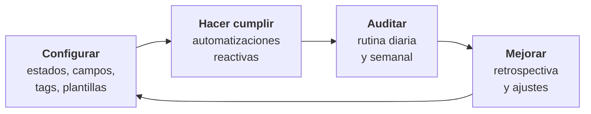
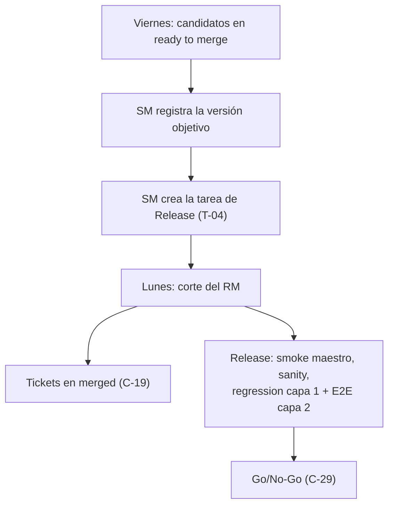

# Guía de Gobierno ClickUp — Versión Scrum Master

### Configuración, cumplimiento y auditoría de los tableros SDLC de IOND en ClickUp

**Propuesta por:** Steve Nina — Scrum Master IOND

**Aplica a: IOND · IonMind · StageMind**

**Audiencia:** Scrum Master (responsable de administrar la configuración de ClickUp del espacio NEW GATEWAY IOND). Es lectura de referencia para el PO, el Lead Dev, el Lead QA y el Release Manager.

| Dato | Valor |
|---|---|
| Espacio ClickUp | NEW GATEWAY IOND (`90171116803`) · plan **Business** |
| Folder SDLC | SDLC [GATEWAY/IOND] (`901711332688`) |
| Tableros | Discovery (`901717038641`) · Improvements (`901717038640`) · Releases (`901711332702`) |
| Fuente canónica | `knowledge/L1-project/sdlc-consolidation.md` (v2.3) |
| Documento par | `06b` — Guía Operativa ClickUp, versión Development + QA |
| Dueño del documento | Scrum Master |

---

## Contenido

1. Propósito, alcance y principios de gobierno
2. Configuración de estados
3. Custom fields
4. Tags
5. Automatizaciones
6. Plantillas de tarea y Forms
7. Vistas recomendadas
8. Rutina de auditoría del SM
9. Ceremonias
10. Gestión del Release
11. Limitaciones y concentración de roles
12. Plan de despliegue de la configuración (piloto de 2 semanas)
- Anexo A — Ajustes pendientes en tableros (foto del 2026-10-08)
- Anexo B — Bitácora de configuración

# 1. Propósito, alcance y principios de gobierno

## 1.1 Propósito

Esta guía explica al Scrum Master (SM) **cómo configurar, hacer cumplir y auditar** en ClickUp el SDLC de IOND definido en la fuente canónica. Su objetivo es que el tablero refleje en todo momento el estado real del trabajo, que cada transición deje evidencia y que las desviaciones se detecten pronto y se corrijan sin fricción.

La guía es un documento de **referencia operativa**: indica qué configurar, en qué orden, cómo comprobar que funciona y qué revisar cada día y cada semana. Las reglas del flujo (qué significa cada estado, quién mueve, qué comentario corresponde) **no se redefinen aquí**: se incluyen desde la fuente canónica para evitar duplicaciones.

## 1.2 Alcance

| Dentro del alcance | Fuera del alcance |
|---|---|
| Lista **Discovery** (`901717038641`) | Folders legacy: Sprints [Ion Flow], Old Sprint, Deployment [Ionflow], Preparations, QA [Gateway/ION] — **siguen operando y no se tocan** |
| Lista **Improvements** (`901717038640`) | Otros espacios del Workspace |
| Folder **Releases** (`901711332702`) y sus listas de sprint semanales | Configuración de repositorios, CI/CD y ambientes (DevOps externo, `L-10`) |
| Custom fields, tags, plantillas, Forms, vistas y automatizaciones que afectan a esos tableros | Creación de custom fields nuevos (prohibida: `L-02`) |

> **Importante:** el MCP de ClickUp del catalyst es de **solo lectura** (`L-09`). Puede ayudar a auditar (leer tareas, campos y comentarios), pero **todas las configuraciones las aplica el SM manualmente** en la interfaz de ClickUp.

## 1.3 A quién va dirigida

| Rol | Para qué usa esta guía |
|---|---|
| **SM** | Configurar estados, tags, plantillas, Forms, vistas y automatizaciones; ejecutar la rutina de auditoría; facilitar las ceremonias; crear la tarea de Release. |
| **PO** | Conocer las vistas que le corresponden (VoBo pendientes, escalados, triage) y las ceremonias en las que decide. |
| **LD** | Conocer los controles de `assignment` y `code review` y su rol en fix-forward y hotfix. |
| **LQA** | Conocer los controles de `ready for qa`, la cola de QA y la certificación del Release. |
| **RM** | Conocer el procedimiento de versión objetivo, corte y `merged`. |

Development y QA tienen su guía práctica en el documento `06b`.

## 1.4 Principios de gobierno

1. **ClickUp es la fuente de verdad.** Lo que no está en el ticket (estado, campo, tag o comentario) no existe. Las decisiones tomadas en reuniones o chats se trasladan al ticket con el comentario estándar correspondiente.
2. **Configuración mínima suficiente.** Se trabaja con los custom fields de IOND (13 + Stagemind.Version), la taxonomía única de tags y las plantillas de la fuente canónica. No se crean campos nuevos (`L-02`): cualquier necesidad adicional se cubre con tags o con campos nativos.
3. **Reglas reactivas.** ClickUp no impide transiciones (`L-01`). Las reglas se hacen cumplir con automatizaciones que **revierten el estado y comentan**, más la auditoría del SM. Ninguna automatización sustituye la responsabilidad de cada rol.
4. **Auditoría con propósito de mejora.** La auditoría detecta desvíos para corregirlos en el ticket y para aprender en la retrospectiva; no es un mecanismo de sanción. Los desvíos repetidos se tratan como riesgo de incumplimiento del flujo (`R-12`).
5. **No romper lo legacy.** Los tags del espacio son compartidos con los folders legacy activos (`L-04`). No se borran ni se renombran tags legacy, y los tickets SDLC no se agregan a listas legacy (evita el doble seguimiento, `R-15`).
6. **Cambios de configuración trazables.** Todo cambio de configuración (estado, vista, plantilla, automatización) se registra en la bitácora del Anexo B con fecha, motivo y verificación.

## 1.5 Convenciones de este documento

- Los estados se escriben **exactamente** como en ClickUp, en minúsculas y entre backticks (por ejemplo, `ready for qa`).
- `(Q-xx)` remite a la decisión del documento `03` (Registro de Decisiones); `AV-xx`, a una acción de verificación del mismo documento.
- Identificadores: `A-xx` (automatizaciones), `C-xx` (plantillas de comentario), `T-xx` (plantillas de tarea), `L-xx` (limitaciones), `R-xx` (riesgos).
- Los bloques incluidos desde la fuente canónica **conservan su numeración original** (por ejemplo, «11. Custom fields de IOND»). Esa numeración corresponde a la fuente, no a esta guía.
- "Verificar en el editor" indica una capacidad de ClickUp que debe confirmarse en la interfaz antes de darla por disponible (los nombres exactos de menús y operadores pueden variar según el idioma y la versión de ClickUp).

# 2. Configuración de estados

## 2.1 Estado objetivo (Q-41)

**Decisión:** se mantienen los tipos actuales de ClickUp. `uat`, `ready to merge` y `merged` son de tipo *Done* (`merged` es el último estado y el cierre del flujo) e `invalid` es el único *Closed*. La configuración se limita a cinco ajustes (AV-04):

1. **Discovery:** crear `blocked` (*Active*).
2. **Discovery:** mover `to do` de *Not started* a *Active*, después de `requirements`.
3. **Discovery:** ubicar `uat` antes de `ready to merge` dentro del grupo *Done*.
4. **Ambos tableros:** pasar `done w/d` de *Active* a *Done*, porque cierra subtareas.
5. **Improvements:** intercambiar el orden de `requirements` y `to do`.

ClickUp ordena los grupos así: *Not started* → *Active* → *Done* → *Closed* (verificar los nombres en el editor; pueden variar según el idioma).

| Tipo en la fuente | Grupo en el editor de ClickUp | Efecto práctico |
|---|---|---|
| Not started (open) | *Not started* (primer estado) | Estado inicial de toda tarea nueva |
| Not started | *Not started* | Trabajo pendiente, aún no iniciado |
| Active | *Active* (tipo "custom" en la API) | Trabajo en curso; la tarea cuenta como abierta |
| Done | *Done* | La tarea cuenta como resuelta |
| Closed | *Closed* | Cierre definitivo; solo un estado por conjunto |

### Discovery — orden y tipo objetivo

| # | Estado | Tipo objetivo | Acción del SM |
|---|---|---|---|
| 1 | `idea/request` | Not started (open) | Verificar |
| 2 | `assignment` | Not started | Verificar |
| 3 | `r, d & architect review` | Active | Verificar |
| 4 | `prototype review` | Active | Verificar |
| 5 | `requirements` | Active | Verificar |
| 6 | `to do` | Active | **Mover** desde *Not started* (hoy en la posición 3) a *Active*, después de `requirements` |
| 7 | `dev in progress` | Active | Verificar |
| 8 | `pilot presentation` | Active | Verificar |
| 9 | `code review` | Active | Verificar su posición (hoy aparece después de `done w/d`) |
| 10 | `ready for qa` | Active | Verificar |
| 11 | `mock testing` | Active | Verificar |
| 12 | `blocked` *(transversal)* | Active | **Crear** (nombre exacto, color rojo) |
| 13 | `uat` *(condicional)* | Done | **Ubicar antes de** `ready to merge` (hoy está después) |
| 14 | `ready to merge` | Done | Verificar |
| 15 | `done w/d` *(subtareas)* | Done | **Cambiar de Active a Done** |
| 16 | **`merged`** *(cierre)* | Done | Verificar que sea el último estado *Done* |
| 17 | `invalid` | Closed | Verificar |

### Improvements — orden y tipo objetivo

| # | Estado | Tipo objetivo | Acción del SM |
|---|---|---|---|
| 1 | `backlog` | Not started (open) | Verificar |
| 2 | `requirements` *(opcional)* | Not started | **Intercambiar** con `to do` (hoy `to do` está antes) |
| 3 | `to do` | Not started | Ver la fila anterior |
| 4 | `dev in progress` | Active | Verificar |
| 5 | `code review` | Active | Verificar su posición (hoy aparece después de `done w/d`) |
| 6 | `ready for qa` | Active | Verificar |
| 7 | `mock testing` | Active | Verificar |
| 8 | `blocked` *(transversal)* | Active | Verificar (ya existe) |
| 9 | `ready to merge` | Done | Verificar |
| 10 | `done w/d` *(subtareas)* | Done | **Cambiar de Active a Done** |
| 11 | **`merged`** *(cierre)* | Done | Verificar que sea el último estado *Done* |
| 12 | `invalid` | Closed | Verificar |

> **Improvements no tiene `uat`** (Q-30): no se crea. En un caso muy excepcional, el PO decide si se valida en el `sanity` del release o si el ticket pasa a Discovery.

### Releases — sin cambios

`dev preparation` (open) → `unit test & ci` → `smoke` → `sanity` → `regression` → `ready for release` (closed). Solo se verifica (sección 2.5).

## 2.2 Antes de empezar

- [ ] El SM tiene permisos de administración sobre el folder SDLC y sus listas.
- [ ] Se identificó **dónde está definido** cada conjunto de estados (espacio, folder o lista). Discovery e Improvements tienen conjuntos distintos, así que normalmente se definen a nivel de lista. Si una lista hereda los estados del folder o del espacio, editar en ese nivel afecta también a otras listas: verificar antes de guardar.
- [ ] Foto previa: exportar a CSV la vista de lista de Discovery e Improvements con las columnas Estado, TYPE, Project y fechas (sirve de línea base y de respaldo).
- [ ] Inventario de automatizaciones existentes realizado (sección 5.1), en especial las que se disparan por "tarea completada" o por grupo de estado.
- [ ] Ventana de cambio acordada (fuera de la daily y lejos del corte del lunes) y aviso previo al equipo.
- [ ] **No renombrar** ningún estado existente: las plantillas de comentario, las automatizaciones y las guías dependen de los nombres exactos.

## 2.3 Paso a paso — Discovery

1. Abrir la lista **Discovery** → menú `…` de la lista → **Configuración de lista / Editar estados** (*List settings → Task statuses*). Confirmar que la lista usa estados propios (*custom statuses*).
2. **Crear `blocked`:** agregar un estado nuevo en el grupo *Active* con el nombre exacto `blocked` (minúsculas) y color rojo. Ubicarlo al final del grupo *Active*, después de `mock testing`.
3. **`to do`:** arrastrarlo del grupo *Not started* al grupo *Active*, entre `requirements` y `dev in progress`.
4. **`done w/d`:** arrastrarlo del grupo *Active* al grupo *Done*.
5. **Orden del grupo *Done*:** `uat` → `ready to merge` → `done w/d` → `merged`.
6. **Orden del grupo *Active*:** `r, d & architect review` → `prototype review` → `requirements` → `to do` → `dev in progress` → `pilot presentation` → `code review` → `ready for qa` → `mock testing` → `blocked`.
7. Verificar que *Closed* contenga solo `invalid`.
8. Guardar. Cambiar el grupo de un estado **no mueve tareas**; solo eliminar un estado obliga a reasignarlas.
9. Registrar el cambio en la bitácora (Anexo B).

## 2.4 Paso a paso — Improvements

1. Abrir la lista **Improvements** → **Editar estados**.
2. **Intercambiar** `requirements` y `to do` dentro de *Not started*: el orden queda `backlog` → `requirements` → `to do`.
3. **`done w/d`:** moverlo de *Active* a *Done*.
4. **Orden del grupo *Active*:** `dev in progress` → `code review` → `ready for qa` → `mock testing` → `blocked`.
5. **Orden del grupo *Done*:** `ready to merge` → `done w/d` → `merged`. *Closed*: `invalid`.
6. Guardar y registrar en la bitácora.

## 2.5 Releases (solo verificación)

1. Abrir el folder **Releases** y comprobar en qué nivel están definidos los estados (normalmente en el folder, heredados por cada lista de sprint).
2. Verificar el orden `dev preparation` → `unit test & ci` → `smoke` → `sanity` → `regression` → `ready for release`, con `ready for release` como *Closed*.
3. Crear (o revisar) una lista de sprint de prueba y confirmar que **hereda** los estados del folder. Si el folder usa la funcionalidad de Sprints de ClickUp, revisar también la creación automática del siguiente sprint y la opción de mover tareas no terminadas (sección 10.8).

## 2.6 Impacto en los tickets existentes y en las métricas

| Efecto | Qué ocurre | Qué hace el SM |
|---|---|---|
| `to do` de Discovery pasa a *Active* | Los tickets en `to do` cuentan como "en curso" en vistas y tarjetas. | Es lo buscado: en Discovery, `to do` es la cola de desarrollo después del VoBo. |
| `done w/d` pasa a *Done* | Las subtareas cerradas dejan de contar como trabajo en curso y se consideran completadas. Cuando el padre pasa a `ready to merge` y a `merged`, sus subtareas lo siguen (A-20, Q-53). | Revisar las vistas que filtran por tareas "abiertas". |
| `uat`, `ready to merge` y `merged` siguen en *Done* | Las tarjetas nativas de *Lead time* y *Cycle time* terminan en el primer *Done*; esos tickets cuentan como completados en los contadores y en "Mis tareas". | Para el tiempo hasta `merged`, usar Time in Status (guía 07, P-02). Las vistas operativas filtran **por estado**, no por "abiertas". |
| Fecha nativa de resolución | Se fija al entrar al primer estado *Done* (`uat` o `ready to merge`). | Tratarla como "fecha de listo para integrar" (guía 07). |
| Dependencias nativas (*waiting on*) | Una tarea que espera a otra se libera cuando la otra entra a un estado *Done* (`uat` o `ready to merge`). | Si la dependencia requiere el código ya integrado, mantener el aviso con un comentario hasta `merged`. |

## 2.7 Checklist de verificación

- [ ] Discovery muestra 17 columnas en el Board, en el orden de la sección 2.1.
- [ ] Improvements muestra 12 columnas, sin `uat`.
- [ ] `blocked` existe en ambas listas, con el nombre exacto, en *Active* y en color rojo.
- [ ] Discovery: *Done* = `uat`, `ready to merge`, `done w/d`, `merged`; *Closed* = `invalid`.
- [ ] Improvements: *Done* = `ready to merge`, `done w/d`, `merged`; *Closed* = `invalid`.
- [ ] Una subtarea de prueba movida a `done w/d` aparece como completada.
- [ ] Releases conserva sus 6 estados y las listas de sprint los heredan.
- [ ] Los folders legacy no sufrieron cambios (revisar uno de sus tableros).
- [ ] Cambio registrado en la bitácora y comunicado al equipo.

# 3. Custom fields

Los custom fields de IOND son los **13 originales + Stagemind.Version** (`Q-42`); el heredado **G.Version** solo se llena para Project = Gateway (`Q-44`). No se crean otros campos (`L-02`). El bloque siguiente es la definición canónica.

<!-- @include ../../../knowledge/L1-project/sdlc-consolidation.md#campos -->

## 3.1 Campos obligatorios por estado

La tabla indica qué debe estar lleno **al entrar** a cada estado y qué control lo vigila. "Auditoría" significa que no hay automatización y que el control depende de la rutina del SM (sección 8).

| Al entrar a… | Tablero | Debe estar lleno | Lo llena | Control |
|---|---|---|---|---|
| Creación (`idea/request` / `backlog`) | Ambos | TYPE · Project · Iond Subcategory (si Project = Iond) · prioridad (en bugs = severidad) | Creador | Vista "Sin campos obligatorios" (auditoría diaria) |
| `r, d & architect review` (salida de `assignment`) | Discovery | Assignee · Dev Reviewer · Reviewer QA (`Q-55`) | LD · LQA | A-08 · vista "Sin Reviewer QA" · auditoría semanal |
| `requirements` | Improvements | Reviewer QA | LQA | Vista "Sin Reviewer QA"; A-05 |
| `to do` (desde `requirements`) | Ambos | QA Points · tag `po-vobo` | QA | A-03 |
| `code review` | Ambos | Merge Request (y Merge Request 2/3/4 si hay más repos) · Dev Reviewer | Dev / LD | A-06 · A-07 |
| `ready for qa` | Ambos | Reviewer QA · QA Points | LQA / QA | A-08 |
| `to do` (desde `mock testing` o `uat`) | Ambos | Rejection_count + 1 | QA | A-09 (recordatorio; `L-12`) |
| `uat` | Discovery | tag `uat-requerido` | PO | A-10 |
| `ready to merge` | Ambos | Versión objetivo: Iond.Version ≠ `DEVELOPMENT` (Iond) · Ionmind.Version ≠ `develop` (IonMind o impacto en IonMind) · Stagemind.Version ≠ `develop` (StageMind) · G.Version (Gateway) | SM / RM | A-11 · vista "Ready to merge sin versión" |
| `merged` | Ambos | Todo lo anterior, con los Merge Request apuntando a PRs mergeados | RM | Auditoría semanal |
| `blocked` | Ambos | Tag `bloq-*` (no es un campo) | Quien bloquea | A-12 · A-13 |
| `invalid` | Ambos | Ningún campo adicional; comentario C-22 obligatorio | PO | A-16 |
| Tarea de Release (`dev preparation`) | Releases | Project · versión del release en Iond.Version, Ionmind.Version, Stagemind.Version o G.Version | SM | Auditoría semanal |

**Subtareas**: llevan TYPE, Project e Iond Subcategory iguales a los del padre, para que las vistas, los filtros y los dashboards las clasifiquen correctamente.

## 3.2 Reglas de llenado y valores

| Campo | Regla |
|---|---|
| TYPE | Uno de `New Feature`, `Improvement`, `Bug`, `Refactor`, `Task` según los criterios de clasificación. El PO valida en `idea/request` o en el triage. |
| Project | `Iond`, `IONMIND`, `STAGEMIND` o `Gateway`. Los tickets de Gateway siguen en el SDLC de IOND (Q-44). |
| Iond Subcategory | Obligatorio cuando Project = Iond. Si falta un módulo en el dropdown, el SM agrega la **opción** (agregar opciones no es crear un campo). |
| Iond.Version / Ionmind.Version | `DEVELOPMENT` / `develop` mientras el ticket no tenga destino. La versión objetivo `vX.Y.Z` se registra al entrar a `ready to merge`. El SM agrega la opción de versión al dropdown cuando prepara el Release (sección 10.2). |
| Stagemind.Version | Campo nuevo (Q-42, lo crea el SM — AV-04): `develop` mientras no tenga destino; `vX.Y.Z` al entrar a `ready to merge`. |
| G.Version (heredado) | Solo para Project = Gateway: se llena la versión objetivo; no se modifica la configuración del campo (Q-44). |
| Dev Reviewer / Reviewer QA | Campos de persona. Reviewer QA identifica al QA responsable; **no** se usa el assignee para eso. |
| QA Points | Fibonacci 1-2-3-5-8. Se estima al salir de `requirements` o en `ready for qa`. |
| Merge Request 1–4 | Una URL de PR por repositorio afectado; sin URLs repetidas entre los cuatro campos. Si hay más de 4 repos, los PRs adicionales se listan en el comentario C-09. |
| Rejection_count | Vacío equivale a 0. Se incrementa en 1 con cada rechazo de QA en `mock testing` o `uat` (no con un rechazo en `code review`). Es manual (`L-12`). |

## 3.3 Configuración en ClickUp

1. **Visibilidad:** comprobar que los 14 campos (13 + Stagemind.Version) estén disponibles en Discovery, Improvements y Releases (los campos suelen estar definidos a nivel de espacio y se activan por ubicación).
2. **Columnas de las vistas de lista:** mostrar los 13 + Stagemind.Version campos (y G.Version en las vistas de Gateway) en las vistas de cumplimiento (sección 7) y ocultar los heredados.
3. **Campos obligatorios en la creación:** ClickUp ofrece marcar campos como requeridos al crear una tarea; verificar en el editor su disponibilidad en el plan Business. Aunque exista, **solo aplica a la creación**, no a las transiciones: no reemplaza a las automatizaciones ni a la auditoría.
4. **Ocultar campos vacíos en la vista de tarea:** activar la opción de ocultar campos vacíos (si está disponible) para reducir ruido visual, sin ocultar los campos del SDLC en las vistas de lista.
5. **Opciones de dropdown:** el SM es el único que agrega opciones a Project, Iond Subcategory, Iond.Version, Ionmind.Version, Stagemind.Version y G.Version, y registra cada alta en la bitácora.

## 3.4 Campos heredados que NO se usan

Estos campos aparecen en algunas tareas porque se comparten con otros espacios o con los flujos legacy. **No se borran** (otros equipos o folders los usan), **no se llenan** en tickets SDLC y **no se usan** en vistas ni dashboards del SDLC.

| Campo heredado | Equivalente en el SDLC | Qué hace el SM |
|---|---|---|
| `item_type` | TYPE | Ocultarlo en las vistas SDLC. Si un ticket SDLC lo tiene lleno y TYPE está vacío, copiar el valor a TYPE. |
| `o.version` | Iond.Version / Ionmind.Version / Stagemind.Version | Ocultarlo. Si un ticket SDLC solo tiene versión en este campo, registrarla en el campo correcto. |
| `category` | Project / Iond Subcategory | Ocultarlo; llevar el dato al campo SDLC equivalente. |
| `description` (campo personalizado) | Descripción nativa de la tarea | Ocultarlo; el contenido va en la descripción nativa (plantillas T-01 a T-04). |
| `repro_points` | Ninguno (la severidad va en la prioridad nativa; el esfuerzo de QA, en QA Points) | Ocultarlo. |
| `goal_progress` | Ninguno (el avance se lee por el estado) | Ocultarlo. |

# 4. Tags

La taxonomía siguiente es la **única lista permitida** en los tableros SDLC, junto con el mapa de tags legacy y su reemplazo.

<!-- @include ../../../knowledge/L1-project/sdlc-consolidation.md#tags -->

## 4.1 Procedimiento de uniformización

1. **Revisar qué tags ya existen.** En ClickUp los tags pertenecen al espacio. Algunos tags SDLC (por ejemplo, los de área) pueden existir ya; no se duplican con variantes de escritura.
2. **Crear los tags nuevos** que falten, exactamente como en la taxonomía (minúsculas, con guiones, sin tildes): gobierno (`po-vobo`, `uat-requerido`, `cambio-alcance`, `escalado-po`, `fuera-de-matriz`, `pilot-feedback`), bloqueo (`bloq-*`), detección (`det-*`), release (`hotfix`, `fix-forward`, `diferido`) y las versiones de StageMind cuando corresponda.
3. **Asignar colores por grupo** (sección 4.2) para que el tipo de tag se reconozca a simple vista en el Board.
4. **Comunicar la lista permitida:** publicar la sección 8 de la guía `06b` (tags que puede usar el equipo), fijarla en el canal del equipo y repasarla en la daily de la semana de arranque.
5. **No borrar ni renombrar tags legacy** (`L-04`). En ClickUp, borrar un tag lo quita de **todas** las tareas del espacio, incluidas las de los folders legacy activos, y renombrarlo cambia también esas tareas. Ambas acciones son irreversibles en la práctica.
6. **Limpieza progresiva** en tickets SDLC abiertos (sección 4.3).

## 4.2 Colores sugeridos por grupo

| Grupo | Tags | Color sugerido | Motivo |
|---|---|---|---|
| Área | `iond-core` · `iond-uxui` · `iond-infra` · `iond-ia` | Azul (`#3B82F6`) | Informativo, permanente |
| Gobierno del flujo | `po-vobo` | Verde (`#16A34A`) | Habilita la programación |
| Gobierno del flujo | `uat-requerido` · `cambio-alcance` · `escalado-po` | Ámbar (`#D97706`) | Requieren atención o decisión |
| Gobierno del flujo | `fuera-de-matriz` · `pilot-feedback` | Violeta (`#7C3AED`) | Origen del ticket |
| Bloqueo | `bloq-*` | Rojo (`#DC2626`) | Impedimento activo |
| Detección | `det-*` | Naranja (`#EA580C`) | Fase en que se detectó el bug |
| Release | `hotfix` · `fix-forward` · `diferido` | Gris oscuro (`#374151`) | Carriles especiales del release |

## 4.3 Reglas para la limpieza progresiva

- **Solo tickets SDLC abiertos** (Discovery e Improvements, sin contar `merged` ni `invalid`). Los tickets cerrados se dejan como están: son historial.
- **Primero el reemplazo, después el retiro:** antes de quitar un tag legacy se registra su equivalente según el mapa (campo, estado o tag SDLC). Por ejemplo, un tag de hito se reemplaza por la versión objetivo y un tag de producto por el campo Project.
- **Cuándo:** cuando el ticket se toca por otro motivo (transición, revisión) y en la auditoría semanal, en lotes pequeños (sugerido: hasta 15 tickets por semana) para no generar ruido de notificaciones.
- **Comentario breve** al limpiar un lote en un ticket con historia relevante: "Higiene de tags SDLC (guía 06a, sección 4): se reemplazó `<legacy>` por `<equivalente>`".
- **Tags fuera de la taxonomía y fuera del mapa:** no se borran; se anotan en la bitácora y se proponen en la retrospectiva para mapearlos o incorporarlos a la taxonomía.
- **Prevención:** la vista "Tags no permitidos" (sección 7) se revisa cada semana; el SM conversa con quien agregó un tag legacy nuevo en un ticket SDLC.

## 4.4 Versión de StageMind

La versión de StageMind se registra en el campo **Stagemind.Version** (Q-42), que crea el SM (AV-04). El tag `stagemind-vX.Y.Z` queda retirado: si aparece en un ticket SDLC, se pasa el valor al campo y se quita el tag (mapa legacy → SDLC).

# 5. Automatizaciones

El catálogo siguiente define las 20 automatizaciones del SDLC. Antes de construirlas hay que inventariar las existentes, verificar las capacidades del editor y probarlas en una lista sandbox.

<!-- @include ../../../knowledge/L1-project/sdlc-consolidation.md#automatizaciones -->

## 5.1 Inventario previo de automatizaciones existentes

Antes de activar cualquier automatización del catálogo:

1. Abrir el **administrador de automatizaciones** en cada nivel que afecte a los tableros SDLC: espacio NEW GATEWAY IOND, folder SDLC [GATEWAY/IOND], listas Discovery e Improvements y folder Releases. Una automatización definida a nivel de espacio también se dispara en las listas SDLC **y** en las legacy.
2. Registrar cada automatización en la tabla de inventario.
3. Identificar **duplicados y solapamientos** con el catálogo. Caso conocido: el comentario automático de "Code Review requerido" que publica el bot al pasar a `code review`. **No se crea A-07 encima de ella**: se ajusta la existente para que use el texto estándar y mencione al Dev Reviewer (o se reemplaza por A-07 y se desactiva la anterior, nunca las dos activas).
4. Identificar las automatizaciones que se disparan por "tarea completada" o por grupo de estado: cambian de comportamiento con la sección 2 (Q-41).
5. **No modificar** automatizaciones que sirvan a folders legacy, salvo que también afecten a los tableros SDLC; en ese caso, limitar su ubicación en lugar de borrarlas.

**Plantilla de inventario:**

| Nivel / ubicación | Descripción | Disparador | Acción | Equivalente A-xx | Decisión |
|---|---|---|---|---|---|
| Lista Discovery | Comentario "Code Review requerido" | Estado cambia a `code review` | Comentario del bot | A-07 | Ajustar al texto estándar |
| … | … | … | … | … | Mantener / ajustar / desactivar |

## 5.2 Verificación de capacidades del editor

Varias reglas dependen de condiciones cuya disponibilidad en ClickUp Business **debe verificarse** en el editor de automatizaciones (`L-05`). Si una capacidad no existe, la regla **se mantiene** y se controla con una vista filtrada y la auditoría manual.

| Capacidad requerida | Usada por | Si no está disponible |
|---|---|---|
| Disparador "el estado cambia **de** X **a** Y" | A-03 · A-09 · A-10 | Disparador "cambia a Y" y revisión del estado previo en la auditoría |
| Condición "la tarea **no** tiene el tag X" | A-03 | Vista "Cola de desarrollo sin VoBo" + auditoría diaria |
| Condición "custom field **vacío**" | A-06 · A-08 | Vistas "Code review sin MR" y "Sin Reviewer QA" |
| Condición "dropdown = valor" y condición por Project | A-11 | Vista "Ready to merge sin versión" |
| Comentario que menciona a las personas de un campo People (@Reviewer QA, @Dev Reviewer) | A-03 · A-05 · A-07 · A-09 | Mencionar al assignee o a una persona fija (LD, LQA) |
| Acción "cambiar estado" para revertir | A-03 · A-06 · A-10 | Solo comentario + corrección en la auditoría |
| Acción "fecha de vencimiento relativa" (hoy + 2 días) | A-12 | Fecha fijada manualmente por quien bloquea |
| Disparador "llega la fecha de vencimiento" con condición de estado | A-13 | Vista "Bloqueados" ordenada por fecha de vencimiento |
| Disparador "todas las subtareas resueltas" | A-14 | Revisión en la daily |
| Acción sobre las subtareas cuando cambia el estado del padre | A-20 | El RM mueve las subtareas `done w/d` como parte del C-23 (AV-10) |
| Disparador "tag agregado" y acción "quitar tag" | A-04 · A-15 · A-17 · A-19 | Gestión manual del tag + comentario |
| Acción "aplicar plantilla de tarea" y disparador "Form enviado" | A-01 · A-02 | Selección manual de la plantilla al crear la tarea |

**Interacciones a revisar antes de activar:**

- **A-03 y A-05:** cuando A-03 devuelve un ticket a `requirements`, A-05 se dispararía otra vez y duplicaría el recordatorio de SLA. Configurar A-05 con disparador "de `prototype review` a `requirements`" (Discovery) y "de `backlog` a `requirements`" (Improvements).
- **A-12 y la fecha de vencimiento:** A-12 **sobrescribe** la fecha de vencimiento del ticket. Si el equipo usa esa fecha para planificar, quien bloquea anota la fecha anterior en el comentario C-20 y la restituye al desbloquear (C-21).
- **A-11 por producto:** como la versión vive en campos distintos, A-11 se configura como **dos reglas** (Project = Iond con Iond.Version = `DEVELOPMENT`; Project = IONMIND con Ionmind.Version = `develop`). StageMind se controla con la vista "Ready to merge sin versión".
- **A-01 y A-02 con subtareas:** verificar si "tarea creada" también se dispara al crear subtareas; si es así, excluirlas con una condición (si existe) para no aplicar T-01/T-03 a cada subtarea.
- **A-01 y A-02 con descripciones existentes:** verificar si "aplicar plantilla" **sobrescribe** la descripción de una tarea creada con contenido (por ejemplo, desde el Form o duplicada). Si la sobrescribe, limitar la regla a tareas sin descripción o dejar la plantilla como selección manual.

## 5.3 Orden de activación por oleadas

| Oleada | Automatizaciones | Propósito | Cuándo | Criterio para pasar a la siguiente |
|---|---|---|---|---|
| **1 — Guardianes** | A-03 · A-06 · A-07 · A-08 · A-12 · A-13 · A-16 | Proteger los gates principales (VoBo, PR registrado, revisor de QA), los bloqueos y `invalid` | Semana 1 del piloto | 5 días hábiles sin errores en el registro de actividad y sin reversiones indebidas |
| **2 — Flujo completo** | A-01 · A-02 · A-04 · A-05 · A-09 · A-10 · A-11 · A-14 · A-15 · A-20 | Plantillas automáticas, recordatorios, UAT, versión objetivo, subtareas y escalamientos | Semana 2 del piloto | Consumo dentro de lo estimado; el equipo no reporta ruido excesivo |
| **3 — Release y producción** | A-17 · A-18 · A-19 | Hotfix, comentarios del Release y bugs de producción | Después del piloto, con Q-38 aprobada y al menos 2 releases semanales ejecutados con el modelo nuevo | — |

## 5.4 Prueba en lista sandbox

**Preparación**

1. Crear la lista **"SDLC Sandbox"** dentro del folder SDLC [GATEWAY/IOND] (mismo espacio, para compartir custom fields y tags), **privada** o visible solo para el SM.
2. Configurarla con el conjunto de estados de Discovery (y una segunda lista "SDLC Sandbox Improvements" con los de Improvements, si se prueban reglas exclusivas de ese tablero). Si se duplica la lista real, duplicar **sin tareas**.
3. Durante las pruebas, **reemplazar las menciones a PO, LD o LQA por el propio SM** para no generar notificaciones reales; restaurar las menciones al replicar la regla en la lista real.

**Procedimiento por automatización**

1. Construir la regla en la sandbox con el nombre de la convención (sección 5.6).
2. Ejecutar el **caso positivo** y el **caso negativo** de la tabla siguiente.
3. Revisar el **registro de actividad** de automatizaciones (éxito, error, condición no cumplida).
4. Replicar la regla en la lista real, restaurar las menciones y repetir el caso positivo con una tarea de prueba identificada como tal; luego mover esa tarea a `invalid` con C-22 ("tarea de prueba de automatización").
5. Registrar el resultado en la bitácora.

| ID | Caso positivo (debe actuar) | Caso negativo (no debe actuar) |
|---|---|---|
| A-01 | Crear tarea en Discovery → T-01 aplicada, `idea/request`, PO como watcher | Crear subtarea → confirmar el comportamiento decidido |
| A-02 | Crear tarea con TYPE = Bug o enviar el Form → T-02, SM como watcher | TYPE = Improvement → T-03 (no T-02) |
| A-03 | `requirements` → `to do` sin `po-vobo` → vuelve a `requirements` + comentario | Con `po-vobo` → permanece en `to do`, sin comentario |
| A-04 | Agregar `cambio-alcance` a una tarea con `po-vobo` → se quita `po-vobo` + comentario | Agregar otro tag → sin efecto |
| A-05 | `prototype review` → `requirements` → recordatorio de SLA | Reversión por A-03 → **no** duplica el recordatorio |
| A-06 | `code review` con Merge Request vacío → vuelve a `dev in progress` + comentario | Con Merge Request → permanece |
| A-07 | Entrar a `code review` → **un solo** comentario @Dev Reviewer | Confirmar que la automatización previa del bot quedó ajustada o desactivada |
| A-08 | `ready for qa` sin Reviewer QA, o un ticket de Discovery que entra a `r, d & architect review` sin Reviewer QA → comentario @LQA | Con Reviewer QA → sin comentario |
| A-09 | `mock testing` → `to do` → recordatorio C-14 + Rejection_count | `code review` → `dev in progress` → sin recordatorio |
| A-10 | `mock testing` → `ready to merge` con `uat-requerido` → pasa a `uat` + comentario | Sin el tag → permanece en `ready to merge` |
| A-11 | `ready to merge` con Iond.Version = `DEVELOPMENT` → comentario @RM @SM | Con `vX.Y.Z` → sin comentario |
| A-12 | Entrar a `blocked` → comentario C-20, SM como watcher, vencimiento = hoy + 2 días | Confirmar el efecto sobre una fecha de vencimiento previa |
| A-13 | Tarea en `blocked` con vencimiento a pocos minutos → comentario de escalamiento | Tarea no bloqueada con vencimiento → sin comentario |
| A-14 | Cerrar todas las subtareas en `done w/d` → comentario al assignee del padre | Con una subtarea abierta → sin comentario |
| A-15 | Agregar `escalado-po` → comentario @PO + PO como watcher | — |
| A-16 | Mover a `invalid` → comentario "Motivo obligatorio (C-22)" | — |
| A-17 | Agregar `hotfix` en Improvements → prioridad `urgent`, `to do`, comentario C-32 | Agregar `hotfix` en Discovery → sin efecto |
| A-18 | Mover una tarea de Release por cada estado → comentario con la plantilla del estado | — |
| A-19 | Agregar `det-prod` → LQA y LD/RM como watchers + comentario | — |
| A-20 | Padre con subtareas en `done w/d` pasa a `ready to merge` → las subtareas pasan a `ready to merge`; padre a `merged` → subtareas a `merged` | Padre que vuelve a `to do` → las subtareas quedan en `done w/d` |

## 5.5 Estimación de consumo mensual

El plan Business incluye aproximadamente **10.000 ejecuciones de automatización al mes** (`L-05`). **Ese límite es del Workspace completo**, compartido con los demás espacios y equipos; antes de activar el catálogo, el SM revisa el consumo actual en el panel de uso de automatizaciones. La estimación asume el peor caso (cada disparo cuenta como ejecución, aunque la condición no se cumpla; verificar en el panel de uso cómo cuenta ClickUp).

**Supuestos mensuales:** 15 tickets padre nuevos en Discovery, 40 en Improvements, 40 subtareas, 25 % de tickets con al menos un rechazo, 10 % con un bloqueo y hasta 3 tareas de Release por semana.

| ID | Evento | Ejecuciones/mes (estimado) |
|---|---|---|
| A-01 | Tareas creadas en Discovery (más subtareas, si no se excluyen) | 15–55 |
| A-02 | Tareas creadas o Forms enviados en Improvements | 40 |
| A-03 · A-05 | Entradas y salidas de `requirements` | 60 |
| A-04 · A-15 · A-16 | Cambios de alcance, escalados e `invalid` | 15 |
| A-06 · A-07 | Entradas a `code review` (incluye reingresos) | 140 |
| A-08 | Entradas a `ready for qa` | 70 |
| A-09 · A-10 | Rechazos y salidas de `mock testing` en Discovery | 30 |
| A-11 | Entradas a `ready to merge` (una o dos reglas) | 55–110 |
| A-12 · A-13 | Bloqueos y escalamientos | 10 |
| A-14 | Padres con todas las subtareas resueltas | 10 |
| A-20 | Padres con subtareas que pasan a `ready to merge` y a `merged` | 20 |
| A-17 · A-19 | Hotfix y bugs de producción | 6 |
| A-18 | 12 tareas de Release × 6 estados | 72 |
| **Total** | | **≈ 540–640 (5–6 % del límite)** |

Con un margen de 1,5× para reprocesos, el consumo del SDLC quedaría por debajo de **~950 ejecuciones al mes**. El SM compara la cifra real con esta estimación al cierre de cada semana del piloto (sección 8.2).

## 5.6 Mantenimiento y convención de nombres

- **Nombre o descripción de cada regla** (si el editor lo permite; si no, en el inventario): `SDLC A-03 · requirements→to do sin po-vobo`.
- **Dueño único:** el SM. Ningún otro rol crea automatizaciones en los tableros SDLC sin pasar por el inventario.
- **Revisión semanal** del registro de actividad: errores, reglas que dejaron de dispararse y consumo.
- **Cambios en la fuente canónica:** si cambia una plantilla de comentario o un estado, actualizar las reglas afectadas el mismo día y registrar el cambio en la bitácora.
- **Desactivar antes que borrar:** ante un problema, la regla se desactiva y se documenta; se borra solo cuando se confirma que no se usará.

# 6. Plantillas de tarea y Forms

## 6.1 Plantillas de tarea T-01 a T-04 (Task Templates)

El contenido de las plantillas está en la fuente canónica (sección 13 de la fuente) y se reproduce en la guía `06b`. Aquí se describe **cómo crearlas** en ClickUp.

**Procedimiento general**

1. En la lista sandbox, crear una tarea con el nombre de la plantilla y pegar en la descripción el bloque Markdown de la fuente canónica.
2. Precargar los campos indicados en la tabla (sin assignee ni fechas).
3. Convertir los checklists de la plantilla en **checklists nativos** de ClickUp cuando aporte control (por ejemplo, los prerrequisitos de T-04).
4. Menú `…` de la tarea → **Plantillas → Guardar como plantilla**. Incluir: descripción, custom fields precargados y checklists. Excluir: assignees, fechas, comentarios y adjuntos.
5. Compartir la plantilla con el espacio NEW GATEWAY IOND.
6. Probar la plantilla creando una tarea nueva desde ella en la sandbox.
7. **Actualización:** cuando cambie la fuente canónica, editar la tarea base y usar "Actualizar plantilla existente" (no crear una plantilla nueva con otro nombre).

| Plantilla | Nombre en ClickUp | Dónde se usa | Campos precargados | Checklist nativo | Cómo se aplica |
|---|---|---|---|---|---|
| T-01 | `SDLC T-01 · Request de Discovery` | Discovery | Ninguno (TYPE y Project los elige el creador) | — | A-01 o manual |
| T-02 | `SDLC T-02 · Bug` | Improvements | TYPE = `Bug` | — | A-02 o manual; base del Form |
| T-03 | `SDLC T-03 · Mejora` | Improvements | TYPE = `Improvement` | — | A-02 o manual |
| T-04 | `SDLC T-04 · Release` | Releases (lista del sprint) | Estado `dev preparation` | Prerrequisitos (4 ítems) | Manual, por el SM (sección 10.2) |

## 6.2 Form de intake de bugs (Improvements)

**Objetivo:** que QA, Development, el PO y el soporte general de la empresa registren bugs con datos completos desde el primer momento, sin depender de que conozcan todos los campos.

**Creación**

1. En la lista **Improvements**, agregar una vista **Form** llamada "Reportar bug — IOND".
2. Configurar las preguntas según la tabla y marcar las obligatorias.
3. Estado de las tareas creadas: `backlog`. Assignee por defecto: **SM** (tiene la siguiente acción: el triage).
4. Probar el Form con un envío completo y revisar la tarea creada: título, campos, tags, adjuntos y que A-02 aplicó T-02 sin borrar el contenido.
5. Compartir el enlace interno del Form en el canal del equipo y fijarlo.

| Pregunta del Form | Se guarda en | Obligatoria | Notas |
|---|---|---|---|
| Título del bug | Nombre de la tarea | Sí | Ayuda: "[Módulo] — qué falla, en una línea" |
| Producto | Project | Sí | Opciones: `Iond`, `IONMIND`, `STAGEMIND` (no ofrecer `Gateway`) |
| Módulo | Iond Subcategory | Sí, si Producto = Iond | Usar lógica condicional si el plan la permite (verificar) |
| Tipo | TYPE | Fijo = `Bug` | Valor predeterminado u oculto si el Form lo permite; si no, A-02 lo fija para los envíos del Form (verificar) |
| Severidad | Prioridad nativa | Sí | Ayuda con la tabla de severidad: `urgent` = bloqueante … `low` = cosmético |
| Pasos, resultado esperado, resultado actual y ambiente | Descripción de la tarea | Sí | Estructura de T-02 en el texto de ayuda (ver nota) |
| Evidencia | Adjuntos | Recomendada | Capturas, logs, request/response |
| Fase de detección | Tags (`det-*`) | Sí | Ofrecer solo los 7 tags `det-*` si el editor permite limitar opciones (verificar) |

> **Nota sobre la descripción:** cada pregunta del Form se guarda en un campo de la tarea, y no se crean campos nuevos (`L-02`). Por eso los pasos, el resultado esperado, el resultado actual y el ambiente se capturan en la **descripción**. Si el editor permite enviar varias preguntas de texto a la descripción, usar una pregunta por bloque; si no, una sola pregunta "Descripción del bug" con la estructura de T-02 (Resumen, Ambiente, Pasos, Esperado, Actual, Impacto) en el texto de ayuda.

# 7. Vistas recomendadas

## 7.1 Convenciones

- Las vistas transversales se crean a **nivel del folder SDLC [GATEWAY/IOND]**, para ver Discovery e Improvements juntos.
- "Ocultar cerradas = Sí" oculta los estados de los grupos *Done* y *Closed* (`done w/d`, `merged`, `invalid`). Con Q-41 aplicada, `ready to merge` y `uat` **siguen visibles**.
- "Subtareas como tareas separadas" se activa en las vistas de cumplimiento, para detectar subtareas sin campos.
- Las vistas compartidas se **protegen** contra cambios accidentales (si el plan lo permite; verificar) y se fijan en la barra de vistas.
- Los nombres de los operadores de filtro ("no contiene", "no está definido") varían según el idioma de la interfaz; la tabla usa su sentido funcional.
- Las vistas con **grupos O** requieren filtros avanzados con grupos anidados (verificar en el editor). Si no están disponibles, crear una vista por cada rama del grupo O.

## 7.2 Vistas transversales (folder SDLC)

| Vista | Tipo | Filtros (todos con Y) | Agrupar / ordenar | Uso |
|---|---|---|---|---|
| **Pendientes de VoBo** | Lista | Estado es `requirements` · Tags **no contiene** `po-vobo` | Ordenar por fecha de actualización (más antigua primero) | Auditoría diaria; PO |
| **Cola de desarrollo sin VoBo** | Lista | Lista es Discovery · Estado es `to do` · Tags no contiene `po-vobo` | Ordenar por fecha de actualización | Respaldo de A-03 (en Improvements, revisar a mano los que pasaron por `requirements`) |
| **Bloqueados** | Lista | Estado es `blocked` | Agrupar por tag; ordenar por fecha de vencimiento | Daily; seguimiento 48/72 h |
| **Escalados al PO** | Lista | Tags contiene `escalado-po` | Ordenar por fecha de actualización | SLA de 4 h hábiles |
| **Ready to merge sin versión** | Lista | Estado es `ready to merge` · **Grupo O:** (Project = Iond · Iond.Version = `DEVELOPMENT`) **o** (Project = IONMIND · Ionmind.Version = `develop`) **o** (Project = STAGEMIND · Stagemind.Version = `develop` o vacío) **o** (Project = Gateway · G.Version vacío) | Agrupar por Project | Respaldo de A-11; corte |
| **Candidatos al corte** | Lista | Estado es `ready to merge` | Agrupar por Project; columnas Iond.Version, Ionmind.Version, Merge Request 1–4 | Preparación del Release (viernes) |
| **Sin Reviewer QA** | Lista | Reviewer QA **no está definido** · Estado es `r, d & architect review`, `prototype review`, `requirements`, `ready for qa`, `mock testing` o `uat` | Agrupar por estado | Respaldo de A-08; LQA |
| **Code review sin MR** | Lista | Estado es `code review` · Merge Request no está definido | — | Respaldo de A-06 |
| **Sin campos obligatorios** | Lista | Ocultar cerradas · Subtareas separadas · **Grupo O:** TYPE no está definido **o** Project no está definido **o** (Project = Iond · Iond Subcategory no está definido) | Agrupar por lista; ordenar por fecha de creación | Auditoría diaria y semanal |
| **Rechazos activos** | Lista | Ocultar cerradas · Rejection_count ≥ 1 | Ordenar por Rejection_count (mayor primero) | Retrospectiva; coaching |
| **Cumplimiento** | Lista | Ocultar cerradas · Fecha de actualización en los últimos 7 días | Agrupar por estado; columnas: los campos SDLC + tags | Auditoría semanal |
| **Tags no permitidos** | Lista | Ocultar cerradas · Tags contiene cualquiera de los tags legacy del mapa | Agrupar por tag (si el plan lo permite) | Limpieza progresiva |
| **Mi trabajo** | Lista (privada, cada persona) | Assignee = yo **o** Reviewer QA = yo **o** Dev Reviewer = yo · Ocultar cerradas | Agrupar por estado | Uso diario de Dev y QA |

## 7.3 Discovery

| Vista | Tipo | Filtros | Agrupar / ordenar | Uso |
|---|---|---|---|---|
| **Board SDLC** (predeterminada) | Board | Ocultar subtareas como tarjetas; mostrar `merged` de los últimos 14 días | Columnas por estado; tarjeta con TYPE, Project, Reviewer QA, QA Points | Daily |
| **Discovery Review** | Lista | Estado es `idea/request`, `prototype review` o `pilot presentation` | Agrupar por estado; ordenar por prioridad | Ceremonia semanal (Q-07) |
| **Timebox R&D** | Lista | Estado es `r, d & architect review` | Ordenar por fecha de actualización | Control del timebox |
| **UAT en curso** | Lista | Estado es `uat` | Ordenar por fecha de actualización | SLA de 3 días hábiles |

## 7.4 Improvements

| Vista | Tipo | Filtros | Agrupar / ordenar | Uso |
|---|---|---|---|---|
| **Board SDLC** (predeterminada) | Board | Igual que en Discovery | Columnas por estado | Daily |
| **Triage** | Lista | Estado es `backlog` | Agrupar por TYPE; ordenar por prioridad y fecha de creación | Triage semanal (Q-28) |
| **Cola de QA** | Lista | Estado es `ready for qa` o `mock testing` | Agrupar por Reviewer QA; suma de QA Points por grupo | Capacidad de QA (LQA) |
| **Hotfix y producción** | Lista | Tags contiene `hotfix` o `det-prod` · Ocultar cerradas | Ordenar por prioridad | PO y LQA |
| **Hallazgos derivados** | Lista | Tags contiene `fuera-de-matriz` o `pilot-feedback` | Ordenar por fecha de creación | Priorización del PO |

## 7.5 Releases

| Vista | Tipo | Filtros | Agrupar / ordenar | Uso |
|---|---|---|---|---|
| **Release de la semana** | Board (folder Releases) | Lista = sprint vigente | Columnas por estado | Seguimiento del Release |
| **Fix-forward** | Lista | Tags contiene `fix-forward` · Ocultar cerradas | Agrupar por tarea padre | Control del plazo de fix-forward |
| **Histórico de releases** | Lista | Mostrar cerradas | Agrupar por lista (sprint) | Trazabilidad de versiones |

# 8. Rutina de auditoría del SM

La rutina convierte las reglas reactivas en control efectivo (`L-01`). El catalyst genera en modo lectura un reporte previo de estos puntos con la skill `sdlc-audit` (`L-09`); las correcciones siempre las aplica el SM o el dueño del ticket.

## 8.1 Auditoría diaria (5–10 minutos, antes de la daily)

- [ ] **Bloqueados:** cada ticket en `blocked` tiene tag `bloq-*` y una actualización C-20 del día. Los que cumplen 48 h recibieron el escalamiento (A-13). Los que cumplen 72 h tienen decisión registrada (reprogramar, dividir o reclasificar) (Q-31).
- [ ] **Escalados al PO:** ningún `escalado-po` supera las 4 h hábiles sin C-16; si alguno lo supera, recordatorio directo al PO y punto en la daily.
- [ ] **VoBo vencidos:** en "Pendientes de VoBo", los tickets con más de 24 h hábiles desde C-05 reciben recordatorio al PO.
- [ ] **Transiciones sin comentario estándar:** revisar los tickets que cambiaron de estado desde la auditoría anterior (vista "Cumplimiento" ordenada por fecha de actualización) y comprobar el comentario de la transición. Prioridad: C-14 en rechazos, C-13 en aprobaciones, C-12 en `ready for qa`, C-19 en `merged` y C-22 en `invalid`.
- [ ] **Gates de respaldo:** revisar "Code review sin MR", "Sin Reviewer QA" y "Cola de desarrollo sin VoBo" (sobre todo si alguna automatización no se pudo construir).
- [ ] **Reversiones automáticas del día:** si A-03 o A-06 revirtieron algún ticket, conversar con la persona durante el día (acompañamiento, no sanción).
- [ ] **Campos obligatorios:** revisar "Sin campos obligatorios" para los tickets creados en las últimas 24 h y pedir al creador que los complete.

## 8.2 Auditoría semanal (viernes, 45–60 minutos)

- [ ] **Cumplimiento de campos:** recorrer "Cumplimiento" y "Sin campos obligatorios"; corregir o asignar la corrección a su dueño.
- [ ] **Tags no permitidos:** limpiar un lote (sección 4.3) y anotar los tags fuera del mapa en la bitácora.
- [ ] **Tiempo en estado vs SLA:** comparar el tiempo en cada estado con la tabla de SLAs (sección 8.3). Si está disponible la opción "tiempo en estado" de ClickUp, usar esa columna (verificar disponibilidad en el plan Business); si no, la fecha de actualización y el historial de actividad.
- [ ] **Preparación del corte del Release:** revisar "Candidatos al corte" y "Ready to merge sin versión", acordar versiones con el RM y preparar la tarea de Release (sección 10.2).
- [ ] **Rejection_count vs comentarios C-14:** los rechazos documentados coinciden con el contador (`L-12`).
- [ ] **Coherencia de clasificación:** tickets cuyo TYPE o tablero no coinciden con los criterios de clasificación; proponer la corrección al PO.
- [ ] **Doble seguimiento:** ningún ticket SDLC está agregado también a una lista legacy (`R-15`).
- [ ] **Automatizaciones:** registro de actividad (errores, reglas que no se disparan) y consumo semanal frente a la estimación (sección 5.5).
- [ ] **KPIs:** calcular y publicar los indicadores de la sección 8.4 en el canal del equipo.

## 8.3 SLAs de referencia

<!-- @include ../../../knowledge/L1-project/sdlc-consolidation.md#slas -->

## 8.4 KPIs de cumplimiento

No hay histórico confiable (`L-06`): la **línea base** se toma en la semana 1 del piloto y se registra cada semana en una hoja o documento del equipo.

| KPI | Fórmula | Fuente | Meta inicial | Frecuencia |
|---|---|---|---|---|
| Campos obligatorios completos | Tickets abiertos con TYPE + Project (+ Iond Subcategory si Iond) ÷ tickets abiertos | Vista "Sin campos obligatorios" | ≥ 95 % | Semanal |
| Transiciones con comentario estándar | Transiciones revisadas con su C-xx ÷ transiciones revisadas (muestra mínima: 20) | Auditoría diaria | ≥ 90 % | Semanal |
| Rechazos con REQ-ID | Comentarios C-14 que citan REQ-ID ÷ total de C-14 | Tickets con Rejection_count ≥ 1 | 100 % | Semanal |
| `to do` con VoBo | Tickets que entraron a `to do` desde `requirements` con `po-vobo` ÷ total | "Cola de desarrollo sin VoBo" + A-03 | 100 % | Semanal |
| VoBo dentro del SLA | VoBo emitidos en ≤ 24 h hábiles ÷ VoBo emitidos | Fechas de C-05 y C-06 | ≥ 80 % | Semanal |
| Versión objetivo al corte | Tickets en `ready to merge` con versión al corte ÷ total | "Candidatos al corte" | 100 % | Por release |
| Bloqueos sin decisión a las 72 h | Número de tickets | "Bloqueados" | 0 | Semanal |
| Tags no permitidos en tickets SDLC abiertos | Número de tickets | "Tags no permitidos" | Tendencia a 0 | Semanal |
| Reversiones por automatización | Número de reversiones de A-03 + A-06 | Registro de actividad | Tendencia descendente | Semanal |
| Consumo de automatizaciones | Ejecuciones del mes ÷ estimación | Panel de uso | ≤ 100 % de la estimación | Semanal |

## 8.5 Cómo actuar ante un desvío

1. **Corregir en el ticket**, no por fuera: completar el campo, publicar el comentario faltante o devolver el estado, con un comentario breve que explique el ajuste.
2. **Pedir la corrección a su dueño** cuando el dato solo lo conoce esa persona (por ejemplo, C-09 o C-14).
3. **Patrones repetidos** (la misma persona o la misma regla varias veces en la semana): llevarlos a la retrospectiva como tema de proceso (`R-12`), sin exponer a personas en canales públicos.
4. **Regla que no se puede cumplir** (por herramienta o por diseño): registrarla en la bitácora y llevarla al taller como ajuste de la fuente canónica.

# 9. Ceremonias

## 9.1 Calendario de ceremonias

| Ceremonia | Frecuencia | Duración | Participantes | Entrada | Salida | Estado ClickUp |
|---|---|---|---|---|---|---|
| **Discovery Review** (Q-07) | Semanal | 60–90 min | SH · PO · LD · QA · Dev que presentan · SM (facilita) | Requests nuevos; prototipos listos; funcionalidades listas para Pilot | C-01 · C-04 · C-10 | `idea/request` · `prototype review` · `pilot presentation` |
| **Triage de Improvements** (Q-28) | Semanal | 30 min | PO · QA · LD · SM (facilita) | Vista "Triage" | Prioridad, decisión sobre `requirements` y clasificación (C-33) | `backlog` |
| **Daily** | Diaria | 15 min | Dev · QA · LD · SM | Board SDLC; vista "Bloqueados" | Impedimentos visibles; C-20 actualizado | `dev in progress` · `blocked` |
| **Preparación del corte** | Viernes previo | 30 min | SM · RM · Dev de los tickets candidatos | "Candidatos al corte" | Versiones registradas; tarea de Release creada (T-04) | `ready to merge` · `dev preparation` |
| **Corte del Release** | Lunes 09:00 | 30–60 min | RM · LD · Dev · QA | Tarea de Release; candidatos | Ramas RC; C-23; tickets en `merged` (C-19) | `dev preparation` · `unit test & ci` |
| **Go/No-Go** (Q-35) | Viernes 10:00 | 30 min | PO · LQA · RM | C-25 · C-26 · C-27; hallazgos abiertos | C-29; release notes; ventana con DevOps (Q-36) | `ready for release` |
| **Bug bash** (Q-39) | Quincenal | 60–90 min | QA · Dev · SM | Charter de exploración por módulo | Tickets en `backlog` con `det-exploratorio` | `backlog` |
| **Retrospectiva** | Quincenal | 60 min | Todo el equipo | KPIs de cumplimiento; desvíos de la bitácora | Acciones de mejora con dueño y fecha | — |
| **Sincronización de desacuerdo** | Ad hoc | 10 min | QA · Dev · PO · facilitador | Ticket con `escalado-po` (C-15) | Decisión C-16 | Estado en curso del ticket |

## 9.2 Agenda semanal tipo (Q-32)

| Día | Release | Kanbans |
|---|---|---|
| Lunes | 09:00 corte: `dev preparation` y `unit test & ci`; `smoke` por la tarde | Daily |
| Martes | Cierre del `smoke` (mañana) y `sanity` | Daily · Triage de Improvements |
| Miércoles | `sanity` | Daily · Discovery Review |
| Jueves | `regression`: capa 1 de día; capa 2 (E2E maestro) automatizada de noche y rotación manual | Daily · Bug bash (semanas alternas) |
| Viernes | 09:00 C-27 consolidado; 10:00 Go/No-Go; despliegue en la ventana acordada; smoke maestro en producción (company de prueba) | Daily · auditoría semanal · preparación del corte siguiente · Retrospectiva (semanas alternas) |

Los días del Triage, de la Discovery Review y del Bug bash son una sugerencia; lo importante es que no coincidan con el corte del lunes ni con el Go/No-Go.

## 9.3 Guiones breves

**Discovery Review (60–90 min)**
1. Requests nuevos (`idea/request`): el PO presenta; SH validan el valor; LD y QA preguntan; el PO prioriza → C-01.
2. Prototipos (`prototype review`): el Dev presenta; el LD valida la arquitectura; QA revisa la testabilidad → acta C-04.
3. Pilot (`pilot presentation`): el Dev hace la demo; el SM clasifica los ajustes (contradice la matriz / nuevo imprescindible / nuevo no imprescindible) → acta C-10.
4. Cierre: el SM confirma los movimientos de estado y los comentarios publicados antes de terminar.

**Go/No-Go (30 min)**
1. El LQA presenta los resultados del smoke maestro, del `sanity`, de la regresión capa 1 y del E2E capa 2.
2. El RM confirma el plan de rollback y la ventana con DevOps.
3. Se revisan los hallazgos abiertos por severidad (`urgent` abierto = NO-GO o fix-forward).
4. Votación y decisión → C-29. El SM verifica que el acta quedó en la tarea de Release.

# 10. Gestión del Release

## 10.1 Modelo

- Cada semana existe una lista de sprint en el folder Releases: `Sprint N (fecha inicio - fecha fin)`.
- El SM crea **una tarea de Release por producto y versión** con la plantilla T-04 y la verificación del Dev.
- **Los tickets no se mueven a Releases:** permanecen en su kanban y cierran en `merged`. La tarea de Release los referencia por **relación nativa** y por **versión objetivo**.

## 10.2 Preparación del Release (viernes previo)

> **Herramienta:** la skill `release/weekly-plan` del catalyst lista los candidatos (tickets en `ready to merge` con versión objetivo y C-13), propone el riesgo y el grupo de rotación de la capa 2, y arma el borrador de la T-04. Es de solo lectura: los pasos siguientes los ejecuta el SM.

1. Abrir la vista **"Candidatos al corte"**: tickets en `ready to merge`, agrupados por Project.
2. Por cada producto con candidatos, acordar con el RM el **número de versión** `vX.Y.Z`.
3. Si la versión no existe como opción, **agregarla** al dropdown Iond.Version o Ionmind.Version; en Stagemind.Version para StageMind y en G.Version para Gateway. Registrar el alta en la bitácora.
4. Registrar la versión objetivo en cada ticket candidato (campo o tag). Los tickets que no entran en esta versión conservan `DEVELOPMENT` / `develop`.
5. En la lista del sprint vigente del folder Releases, crear la tarea desde **T-04** con el nombre `Release <producto> - vX.Y.Z`, en estado `dev preparation`. Assignee: RM. Watchers: PO, LQA y QA. Campos: Project y la versión del release (o el tag de StageMind).
6. Completar la tabla "Información general" de T-04: repos y ramas RC previstas, ambiente de validación, número de tickets y riesgo.
7. **Verificación del Dev:** comentar en la tarea de Release mencionando a los Dev de cada ticket para que confirmen PRs, ramas y prerrequisitos (migraciones, variables, dependencias) antes del lunes 09:00.

## 10.3 Relación de los tickets con la tarea de Release

- Usar la **relación nativa entre tareas** de ClickUp (vincular tareas) desde la tarea de Release hacia cada ticket incluido. No se usa un campo de relación personalizado (sería un campo nuevo, `L-02`).
- Listar además los tickets en la tabla "Tickets incluidos" de la descripción de T-04 (nombre y enlace), para que la información sobreviva a exportaciones.
- El RM, al mover cada ticket a `merged`, publica C-19 con el enlace a la tarea de Release.
- Si un ticket se retira del release (diferido), se elimina la relación, el ticket vuelve a `to do` con el tag `diferido` y su versión vuelve a `DEVELOPMENT` / `develop`.

## 10.4 Semana sin tickets

Si en el corte no hay tickets en `ready to merge` para un producto, **no se crea la tarea de Release** de ese producto esa semana (Q-32). No se crean tareas "en espera" ni marcadores vacíos. La lista del sprint puede quedar vacía; el SM lo anota en el resumen semanal de KPIs.

Si ya existe una tarea de Release y no llegan tickets, se deja un comentario "En espera de tickets" y, cuando haya candidatos, se mueve la tarea a la lista del sprint del corte real. Si la versión se abandona, el SM lo comenta en la tarea y lleva al taller la forma de cerrarla: el tablero de Releases no tiene estado `invalid`, y cerrar en `ready for release` se confundiría con un GO (Q-32).

## 10.5 Fix-forward

1. QA detecta un bug `urgent` en `smoke`, `sanity` o `regression` y lo informa a RM, PO y LD.
2. El PO y el LD deciden el fix-forward (decisión ≤ 4 h; fix ≤ 1 día (Q-34)).
3. El SM o el RM crea una **subtarea de la tarea de Release** con el tag `fix-forward`, TYPE `Bug`, prioridad `urgent`, Project del producto y el comentario C-28 (con el enlace al ticket de origen).
4. La subtarea usa los estados del tablero de Releases: se crea en el estado de la fase donde se detectó el bug y se cierra en `ready for release` cuando QA re-verifica (C-28 actualizado).
5. Si el fix no está listo en el plazo, el PO, el LD y el RM deciden entre **revertir el ticket de la RC** (vuelve a `to do` con `diferido`) o **NO-GO**.
6. Los bugs no bloqueantes no son fix-forward: van a Improvements (`backlog`) con `det-smoke`, `det-sanity` o `det-regression`.

## 10.6 Release extraordinario de hotfix (Q-38)

1. Ante un incidente reportado (soporte general de la empresa, clientes o monitoreo), el PO o el LQA abre el ticket en Improvements (TYPE `Bug`, prioridad `urgent`, tags `hotfix` + `det-prod`, comentario C-32). A-17 lo lleva a `to do`.
2. El PO y el LD autorizan; el flujo es el normal desde `to do` hasta `ready to merge`, con prioridad máxima en `code review` y `mock testing`.
3. El SM crea en el sprint vigente la tarea `Hotfix <producto> - vX.Y.Z+1` desde T-04, con alcance reducido: `smoke` + `sanity` focalizado.
4. El RM ejecuta el corte y coordina con DevOps; QA hace el smoke maestro en producción con la company de prueba (C-31).
5. El hotfix no reemplaza al release semanal: si coincide con un corte, el RM decide si se integra en él.

## 10.7 Cierre y actividades posteriores

- `ready for release` es *Closed*: se alcanza con la decisión GO o CONDITIONAL GO registrada en C-29.
- No existe estado de deployment (`L-07`): el despliegue (C-30) y la validación posterior (C-31) se registran como **comentarios** en la tarea de Release.
- El SM verifica que los tickets relacionados estén en `merged` con su versión y que la tarea tenga C-23 a C-31 según corresponda.

## 10.8 Mantenimiento de las listas de sprint

- Verificar que cada semana exista la lista `Sprint N (fecha inicio - fecha fin)`. Si el folder usa la funcionalidad de Sprints de ClickUp, revisar la creación automática del siguiente sprint.
- Revisar la opción de **mover tareas no terminadas al siguiente sprint** (verificar en la configuración de Sprints): una tarea de Release que no llegó a `ready for release` no debe moverse sola sin que el SM lo decida.
- No agregar tickets de los kanbans a las listas de sprint.

# 11. Limitaciones y concentración de roles

## 11.1 Limitaciones de la herramienta y del contexto

| ID | Limitación | Impacto | Mitigación del SM |
|---|---|---|---|
| L-01 | ClickUp no bloquea transiciones | Un ticket puede saltarse un gate | Automatizaciones reactivas (A-03, A-06, A-10) + vistas de respaldo + auditoría diaria |
| L-02 | Custom fields fijos (13) | No se pueden crear campos nuevos | Tags, campos nativos, opciones de dropdown y descripción estructurada (plantillas) |
| L-03 | StageMind sin campo de versión | La versión de StageMind se registra en un campo nuevo | Stagemind.Version (Q-42, AV-04) + vista "Ready to merge sin versión" |
| L-04 | Tags compartidos con los folders legacy | Borrar o renombrar un tag afecta a los flujos legacy | No borrar ni renombrar; limpieza progresiva solo en tickets SDLC abiertos |
| L-05 | Límites y condiciones de las automatizaciones | Algunas condiciones pueden no existir; límite de ~10.000 ejecuciones/mes por Workspace | Verificación previa (5.2), oleadas (5.3), consumo (5.5) y vistas de respaldo |
| L-06 | Métricas sin histórico | No hay línea base comparable | Línea base desde la semana 1 del piloto; registro semanal de KPIs |
| L-07 | Sin estado de deployment | El despliegue no se ve en el Board | Comentarios C-30 y C-31 en la tarea de Release |
| L-09 | MCP del catalyst de solo lectura | El catalyst no puede corregir ni configurar | El catalyst audita; el SM configura y corrige manualmente |

Otras limitaciones que el SM debe tener presentes: sin ambiente mock dedicado (`L-08`), DevOps externo (`L-10`), CI y cobertura no confirmados en todos los repos (`L-11`) y Rejection_count manual (`L-12`).

## 11.2 Concentración de roles (R-07)

Hoy el SM es también QA y LQA (y el LD es también el RM). Esa concentración crea conflictos de interés (audita su propio trabajo, facilita desacuerdos en los que es parte, asigna su propia capacidad de QA) y un punto único de falla. Recomendaciones:

1. **Facilitador alterno** (Q-03): cuando el desacuerdo involucra al SM como QA, la sincronización la facilita el **LD/RM**. El PO sigue siendo quien decide (C-16).
2. **Auditoría cruzada:** una vez por semana, el segundo QA revisa una muestra de los tickets en los que el SM fue Reviewer QA (C-13/C-14 con REQ-ID y evidencia, Rejection_count) y deja su observación en la bitácora.
3. **Asignación transparente de QA:** como LQA, el SM documenta en C-12 el criterio de asignación cuando se asigna tickets a sí mismo (capacidad, conocimiento del módulo) y revisa el balance en la vista "Cola de QA".
4. **Go/No-Go:** el SM vota **una sola vez** (como LQA). Un CONDITIONAL GO requiere la aceptación explícita del riesgo por parte del PO.
5. **Respaldo de administración:** otorgar permisos de administración del folder SDLC a una segunda persona (sugerido: el RM) para ausencias, con acceso a esta guía y a la bitácora.
6. **Timebox del gobierno:** respetar los tiempos de la rutina (10 min diarios, 60 min semanales) para no desplazar el trabajo de QA; si se excede de forma sostenida, llevarlo a la retrospectiva.

## 11.3 Otros riesgos de gobierno

- **Incumplimiento del flujo (`R-12`):** se mitiga con onboarding (guía `06b`), automatizaciones por oleadas, KPIs visibles y acompañamiento individual, no con sanciones.
- **Doble seguimiento por legacy (`R-15`):** un ticket SDLC no se agrega a listas legacy ni se duplica en ellas; si un trabajo nace en legacy y pasa al SDLC, se crea el ticket SDLC y el legacy se cierra con un enlace, según las reglas de ese flujo.

# 12. Plan de despliegue de la configuración (piloto de 2 semanas)

## 12.1 Prerrequisitos

- Fuente canónica v2.0 aprobada en lo esencial; las propuestas pendientes (Q-41, Q-30, Q-32, Q-38) tienen decisión o se aplican solo cuando se aprueben.
- Guía `06b` revisada por el LD y el segundo QA.
- Ventana de cambio comunicada al equipo.

## 12.2 Semana 1 — Configuración base y guardianes

| Día | Actividad | Responsable | Verificación |
|---|---|---|---|
| Día 1 | Foto previa (CSV); inventario de automatizaciones (5.1); creación de la lista sandbox; verificación de capacidades del editor (5.2) | SM | Inventario completo; tabla 5.2 marcada disponible / no disponible |
| Día 2 | Configuración de estados (sección 2) fuera de horario pico; checklist 2.7 | SM | Checklist 2.7 completo; aviso al equipo |
| Día 3 | Tags nuevos y colores (sección 4); vistas transversales y por tablero (sección 7); ocultar campos heredados | SM | Vistas creadas y fijadas |
| Día 4 | Oleada 1 en sandbox (A-03, A-06, A-07, A-08, A-12, A-13, A-16); activación en las listas reales | SM | Casos positivos y negativos superados (5.4) |
| Día 5 | Plantillas T-01 a T-04; Form de bugs; onboarding de 45 min con el equipo (guía `06b`); preparación del primer corte con T-04; línea base de KPIs | SM · RM | Plantillas probadas; Form probado; primera tarea de Release creada |

## 12.3 Semana 2 — Flujo completo y ajustes

| Día | Actividad | Responsable | Verificación |
|---|---|---|---|
| Día 6 | Primer corte con el modelo nuevo; observar `dev preparation` y C-19; auditoría diaria completa | RM · SM | Tickets en `merged` con C-19 y versión |
| Día 7 | Oleada 2 en sandbox (A-01, A-02, A-04, A-05, A-09, A-10, A-11, A-14, A-15, A-20) | SM | Casos superados; interacción A-03/A-05 resuelta |
| Día 8 | Activación de la oleada 2; control de consumo y de ruido de notificaciones | SM | Consumo dentro de la estimación |
| Día 9 | Ajustes del Anexo A (prioridades 1 y 2); limpieza del primer lote de tags | SM | Anexo A actualizado en la bitácora |
| Día 10 | Auditoría semanal; KPIs; retrospectiva del piloto; Go/No-Go del release | Equipo · SM | Decisión de salida del piloto |

**Después del piloto:** oleada 3 (A-17, A-18, A-19) cuando Q-38 esté aprobada y se hayan ejecutado al menos dos releases con el modelo; revisión mensual de la configuración.

## 12.4 Criterios de salida del piloto

| Criterio | Meta |
|---|---|
| Oleadas 1 y 2 activas y sin errores en el registro | 100 % |
| Transiciones con comentario estándar (muestra) | ≥ 80 % en la semana 2 |
| Tickets que entraron a `to do` desde `requirements` con `po-vobo` | 100 % |
| Tickets abiertos con campos obligatorios completos | ≥ 90 % |
| Release semanal ejecutado con T-04 y tickets cerrados en `merged` | Al menos 1 |
| Consumo de automatizaciones | Dentro de la estimación |

## 12.5 Plan de reversa

- **Automatizaciones:** desactivar la regla problemática (no borrarla) y aplicar su vista de respaldo.
- **Estados:** si el cambio de tipo de `ready to merge`/`uat` genera un problema no previsto, devolverlos al grupo anterior; ninguna tarea se mueve con esa operación.
- **Plantillas y Form:** volver a la creación manual de tareas.
- Toda reversa se registra en la bitácora y se analiza en la retrospectiva.

# Anexo A — Ajustes pendientes en tableros (foto del 2026-10-08)

Lista operativa obtenida en **modo lectura** (`L-09`) el 2026-10-08. Es la única sección de la guía con IDs de ticket.

**Cómo usarla**

1. Antes de cada ajuste, abrir el ticket y confirmar que la situación sigue igual (la foto puede haber cambiado).
2. Aplicar el ajuste y dejar un comentario breve: "Ajuste de higiene SDLC (guía 06a, Anexo A): …".
3. Registrar el lote en la bitácora (Anexo B).

**Orden sugerido:** (1) A.4 y A.12, que afectan al próximo corte; (2) A.2, A.3, A.5 y A.6 (estados); (3) A.10 (campos); (4) A.1 (tags); (5) A.7, A.8, A.9 y A.11.

## A.1 Tags legacy en tickets SDLC

Retirar y reemplazar según el mapa legacy → SDLC (sección 4).

| ID | Ticket | Tablero | Estado | Ajuste sugerido |
|---|---|---|---|---|
| [86e183hjk](https://app.clickup.com/t/86e183hjk) | [POC-GTW] Desacoplar envío de chunks de órdenes a ShipEdgeCore… | Discovery | `ready to merge` | Retirar `shopify-gt-se`, `core-s13`, `discovery-1`, `iond-disc-1`, `iond-depl-4`. Antes, resolver el Project = Gateway (A.8). |
| [86e25e49v](https://app.clickup.com/t/86e25e49v) | Implementar flujo de sincronización ClickPost-USPS via iond | Discovery | `uat` | Retirar `iond-depl-4`. |
| [86e35zdkx](https://app.clickup.com/t/86e35zdkx) | [STAGEMIND] Catalog Builder: operación compuesta para nombre y descripción | Discovery | `assignment` | Retirar `iond-depl-9` (y `stagemind`, ya cubierto por Project = STAGEMIND). |
| [86e2mt598](https://app.clickup.com/t/86e2mt598) | IonMind - Estabilidad y regresión de Discovery, Analyze y Extract | Improvements | `dev in progress` | Retirar `iond-depl-6`. |
| [86e1kkd57](https://app.clickup.com/t/86e1kkd57) | Gateway ZID - No es posible instalar la APP de shipedge | Improvements | `ready for qa` | Retirar `iond-depl-2`; `zid-gt-se` depende de la decisión sobre el flujo (A.8). |
| [86e2fe5w8](https://app.clickup.com/t/86e2fe5w8) | Diseño de un nuevo template - Olivela | Improvements | `done w/d` | Retirar `iond-depl-5` e `ionpdf-ion-se` (Iond Subcategory = PDF Templates ya registrada). |
| [86e3adcup](https://app.clickup.com/t/86e3adcup) | [P1][IONMIND/IOND] Auditar contrato, versionado y caché de App Connectors | Improvements | `ready to merge` | Retirar `for-analysis` (lo expresa el estado), `ionmind` e `iond` (Project = Iond; el impacto en IonMind va en Ionmind.Version). |
| [86e35d4kk](https://app.clickup.com/t/86e35d4kk) | IOND - Persistencia configurable del motor: SQLite por instancia o PostgreSQL | Discovery | `idea/request` | Retirar `for-analysis`. |
| [86e300zud](https://app.clickup.com/t/86e300zud) | MCP de IOND (FASE 3) | Discovery | `idea/request` | Retirar `for-analysis`. |

**Tags de hito `iond-mvp` / `iond-beta`:** reemplazar por la versión objetivo (Iond.Version) cuando el ticket la tenga; mientras tanto, `DEVELOPMENT`. Retirar el tag de hito.

| ID | Ticket | Tablero | Estado | Ajuste sugerido |
|---|---|---|---|---|
| [86e25dyyz](https://app.clickup.com/t/86e25dyyz) | Mejorar UX de navegación y edición en App Connectors creados | Discovery | `ready to merge` | Retirar `iond-beta`; registrar la versión objetivo (ver A.4). |
| [86e35882c](https://app.clickup.com/t/86e35882c) | IOND — Reorganizar el menú principal y unificar los accesos de Billing… | Discovery | `ready to merge` | Retirar `iond-beta`; registrar la versión objetivo (ver A.4). |
| [86e1y463z](https://app.clickup.com/t/86e1y463z) | Absorción y Unificación de NOVASPHERE en Gateway e Ionflow | Discovery | `mock testing` | Retirar `iond-mvp` e `iond-beta`. |
| [86e2hpdu5](https://app.clickup.com/t/86e2hpdu5) | CLICKPOST - Implementar conteo de uso y plan mensual por bloques de tracking | Discovery | `ready to merge` | Retirar `iond-mvp`; registrar la versión objetivo (ver A.4). |
| [86e20p5yp](https://app.clickup.com/t/86e20p5yp) | Implementar selección y edición de logos de App Connectors con IonMind y Logo.dev | Discovery | `code review` | Retirar `iond-mvp`. |
| [86e35wv7f](https://app.clickup.com/t/86e35wv7f) | Soporte de websockets en el frontend | Improvements | `ready for qa` | Retirar `iond-beta`. |

**Observación adicional de la misma foto:** el tag `iond-flow-integration` aparece en los tickets de integración de tracking (por ejemplo, [86e25e49v](https://app.clickup.com/t/86e25e49v), [86e2hpdu5](https://app.clickup.com/t/86e2hpdu5) y la familia [86e344hbj](https://app.clickup.com/t/86e344hbj)). Ya está incluido en el mapa legacy → SDLC: se reemplaza por Iond Subcategory (p. ej. Board Design o integraciones). También se observan `flowpilot` (subtareas FlowPilot) y `keycloak` ([86e3dhzrq](https://app.clickup.com/t/86e3dhzrq)), que el mapa reemplaza por Iond Subcategory, e `ionmind` ([86e2wmytb](https://app.clickup.com/t/86e2wmytb), [86e3dg2zp](https://app.clickup.com/t/86e3dg2zp), [86e3dg9jy](https://app.clickup.com/t/86e3dg9jy)), que el mapa reemplaza por Project.

## A.2 Estado que no sigue la regla de rechazo

| ID | Ticket | Tablero | Estado | Ajuste sugerido |
|---|---|---|---|---|
| [86e35zdkx](https://app.clickup.com/t/86e35zdkx) | [STAGEMIND] Catalog Builder: operación compuesta para nombre y descripción | Discovery | `assignment` (Rejection_count 1) | Un rechazo de QA devuelve el ticket a `to do`. Confirmar que existe el C-14 y mover a `to do`. |

## A.3 `done w/d` usado en un ticket padre

| ID | Ticket | Tablero | Estado | Ajuste sugerido |
|---|---|---|---|---|
| [86e2fe5w8](https://app.clickup.com/t/86e2fe5w8) | Diseño de un nuevo template - Olivela | Improvements | `done w/d` | `done w/d` es solo para subtareas. Mover al estado real: `ready to merge` (QA aprobado, pendiente de merge) o `merged` (ya integrado, con C-19). |

## A.4 `ready to merge` sin versión objetivo (Iond.Version = `DEVELOPMENT`)

| ID | Ticket | Tablero | Estado | Ajuste sugerido |
|---|---|---|---|---|
| [86e25dyyz](https://app.clickup.com/t/86e25dyyz) | Mejorar UX de navegación y edición en App Connectors creados | Discovery | `ready to merge` | Registrar la versión objetivo con el RM. Además, Merge Request 2 y Merge Request 3 tienen la misma URL: dejar una sola. |
| [86e3adcup](https://app.clickup.com/t/86e3adcup) | [P1][IONMIND/IOND] Auditar contrato, versionado y caché de App Connectors | Improvements | `ready to merge` | Registrar Iond.Version y, por su impacto en IonMind, Ionmind.Version (hoy `develop`). |
| [86e2hpdu5](https://app.clickup.com/t/86e2hpdu5) | CLICKPOST - Implementar conteo de uso y plan mensual por bloques de tracking | Discovery | `ready to merge` | Registrar la versión objetivo con el RM. |
| [86e35882c](https://app.clickup.com/t/86e35882c) | IOND — Reorganizar el menú principal y unificar los accesos de Billing… | Discovery | `ready to merge` | Registrar la versión objetivo con el RM. |

## A.5 `uat` prolongado y sin Merge Request

| ID | Ticket | Tablero | Estado | Ajuste sugerido |
|---|---|---|---|---|
| [86e25e49v](https://app.clickup.com/t/86e25e49v) | Implementar flujo de sincronización ClickPost-USPS via iond | Discovery | `uat` (desde 2026-09-14) | Revisar el estado real con el PO y el RM: si la UAT terminó, publicar C-18 y pasar a `ready to merge` con los PR registrados; si el entregable no tiene PR (configuración de board), acordar con el PO cómo se cierra y llevar el caso al taller como regla general. |

## A.6 `ready for qa` sin movimiento

| ID | Ticket | Tablero | Estado | Ajuste sugerido |
|---|---|---|---|---|
| [86e1kkd57](https://app.clickup.com/t/86e1kkd57) | Gateway ZID - No es posible instalar la APP de shipedge | Improvements | `ready for qa` (sin cambios desde 2026-09-19; Rejection_count 2) | Reasignar Reviewer QA y planificar la prueba, o mover a `blocked` con su tag `bloq-*` y C-20. Resolver antes el Project = Gateway (A.8). |

## A.7 Versión objetivo desactualizada (v0.1.0 ya liberada)

Actualizar a `DEVELOPMENT` o a la versión objetivo real.

| ID | Ticket | Tablero | Estado | Ajuste sugerido |
|---|---|---|---|---|
| [86e344hbj](https://app.clickup.com/t/86e344hbj) | [CLICKPOST][P0] Integrar tracking de Australia Post vía IOND | Discovery | `prototype review` | Iond.Version → `DEVELOPMENT`. |
| [86e344hby](https://app.clickup.com/t/86e344hby) | [CLICKPOST][P1] Integrar tracking de UPS vía IOND | Discovery | `prototype review` | Iond.Version → `DEVELOPMENT`. |
| [86e344hda](https://app.clickup.com/t/86e344hda) | [CLICKPOST][P2] Integrar tracking de Canada Post vía IOND | Discovery | `prototype review` | Iond.Version → `DEVELOPMENT`. |
| [86e344hc3](https://app.clickup.com/t/86e344hc3) | [CLICKPOST][P1] Integrar tracking de DHL vía IOND | Discovery | `prototype review` | Iond.Version → `DEVELOPMENT`. |
| [86e344hcr](https://app.clickup.com/t/86e344hcr) | [CLICKPOST][P1] Integrar tracking de FedEx vía IOND | Discovery | `prototype review` | Iond.Version → `DEVELOPMENT`. |
| [86e344hur](https://app.clickup.com/t/86e344hur) | [DISCOVERY] Extraer documentación de tracking de Australia Post (subtarea) | Discovery | `done w/d` | Alinear con el padre: `DEVELOPMENT`. |
| [86e2fe5w8](https://app.clickup.com/t/86e2fe5w8) | Diseño de un nuevo template - Olivela | Improvements | `done w/d` | Si ya se entregó en v0.1.0, el valor es correcto y el ticket va a `merged` (A.3); si no, `DEVELOPMENT` o la versión objetivo real. |

## A.8 Project = Gateway dentro de los tableros SDLC (Q-44)

| ID | Ticket | Tablero | Estado | Ajuste sugerido |
|---|---|---|---|---|
| [86e183hjk](https://app.clickup.com/t/86e183hjk) | [POC-GTW] Desacoplar envío de chunks de órdenes a ShipEdgeCore… | Discovery | `ready to merge` | Se queda en el SDLC de IOND (Q-44): registrar la versión objetivo en G.Version, completar los campos SDLC y retirar los tags legacy (A.1). |
| [86e1kkd57](https://app.clickup.com/t/86e1kkd57) | Gateway ZID - No es posible instalar la APP de shipedge | Improvements | `ready for qa` | Igual que el anterior. |

## A.9 TYPE frente a tablero (revisar con los criterios de clasificación)

| ID | Ticket | Tablero | Estado | Ajuste sugerido |
|---|---|---|---|---|
| [86e3bthj2](https://app.clickup.com/t/86e3bthj2) | Integrar el widget de Quackback en iond para feedback in-app | Improvements | `to do` | TYPE `New Feature` en Improvements: válido solo si es pequeña y sin regla de negocio, con `requirements` obligatorio. Confirmar matriz y `po-vobo`; si no cumple, el PO decide reclasificar. |
| [86e3dhzrq](https://app.clickup.com/t/86e3dhzrq) | [Feature] Implementar update de email con Keycloak (IOND) | Improvements | `dev in progress` | TYPE `New Feature` en Improvements y cambio de autenticación: revisar con el PO si correspondía a Discovery. Como ya está en desarrollo, completa su ciclo aquí (Q-45) con sus campos corregidos (A.10). |
| [86e3adcup](https://app.clickup.com/t/86e3adcup) | [P1][IONMIND/IOND] Auditar contrato, versionado y caché de App Connectors | Improvements | `ready to merge` | TYPE `Bug` con naturaleza de auditoría: evaluar `Task` o `Refactor`. |
| [86e35d4kk](https://app.clickup.com/t/86e35d4kk) | IOND - Persistencia configurable del motor: SQLite por instancia o PostgreSQL | Discovery | `idea/request` | TYPE `Improvement` en Discovery: validar los criterios (arquitectura). Si los cumple, se mantiene en Discovery; revisar si el TYPE correcto es `Refactor` o `New Feature`. |
| [86e34kb9y](https://app.clickup.com/t/86e34kb9y) | [IOND] Mejorar búsqueda y jerarquía de resultados en Admin Companies | Discovery | `code review` | Validar los criterios de Discovery; por su avance no se mueve de tablero (Q-45). |
| [86e25dyyz](https://app.clickup.com/t/86e25dyyz) | Mejorar UX de navegación y edición en App Connectors creados | Discovery | `ready to merge` | Igual que el anterior. |
| [86e35882c](https://app.clickup.com/t/86e35882c) | IOND — Reorganizar el menú principal y unificar los accesos de Billing… | Discovery | `ready to merge` | Igual que el anterior. |

## A.10 Campos obligatorios vacíos (TYPE / Project / Iond Subcategory)

| ID | Ticket | Tablero | Estado | Ajuste sugerido |
|---|---|---|---|---|
| [86e3mf4r8](https://app.clickup.com/t/86e3mf4r8) | [IONMIND] Catálogo y estados de errores de IonMind | Discovery | `idea/request` | Completar TYPE y Project. |
| [86e3kaw8e](https://app.clickup.com/t/86e3kaw8e) | [IONMIND] Recibir archivos PDF directamente e integrarlos al procesamiento existente | Discovery | `idea/request` | Completar TYPE y Project. |
| [86e3kaw5q](https://app.clickup.com/t/86e3kaw5q) | [IONMIND] Ampliar corpus de benchmark con incidentes reales… | Discovery | `idea/request` | Completar TYPE y Project. |
| [86e3kaw39](https://app.clickup.com/t/86e3kaw39) | [IONMIND] Normalizar logos extraídos a formato cuadrado 1:1… | Discovery | `idea/request` | Completar TYPE y Project. |
| [86e3gd6mj](https://app.clickup.com/t/86e3gd6mj) | [Flow Editor] Búsqueda y descripción del selector de nodos (subtarea) | Discovery | `idea/request` | Completar TYPE, Project e Iond Subcategory (iguales al padre). |
| [86e3gd6kw](https://app.clickup.com/t/86e3gd6kw) | [Flow Editor] Mejoras visuales del board y títulos de Secciones (subtarea) | Discovery | `idea/request` | Completar TYPE, Project e Iond Subcategory (iguales al padre). |
| [86e3k5eu8](https://app.clickup.com/t/86e3k5eu8) | [P1] Generar y publicar OpenAPI workspace con pruebas de contrato | Discovery | `r, d & architect review` | Completar TYPE, Project e Iond Subcategory. |
| [86e300zud](https://app.clickup.com/t/86e300zud) | MCP de IOND (FASE 3) | Discovery | `idea/request` | Completar TYPE, Project e Iond Subcategory. |
| [86e3012dc](https://app.clickup.com/t/86e3012dc) | [P0] Crear evals, pruebas de contrato y threat model del MCP (subtarea) | Discovery | `idea/request` | Completar TYPE, Project e Iond Subcategory (iguales al padre). |
| [86e3012bd](https://app.clickup.com/t/86e3012bd) | [P1] Implementar tools MCP gobernadas para IonMind (subtarea) | Discovery | `idea/request` | Igual que el anterior. |
| [86e3012a9](https://app.clickup.com/t/86e3012a9) | [P1] Implementar tools MCP de configuración y authoring de company (subtarea) | Discovery | `idea/request` | Igual que el anterior. |
| [86e3012dv](https://app.clickup.com/t/86e3012dv) | [P1] Documentar, empaquetar y liberar el MCP (subtarea) | Discovery | `idea/request` | Igual que el anterior. |
| [86e301286](https://app.clickup.com/t/86e301286) | [P0] Construir cliente IOND compartido para el servidor MCP (subtarea) | Discovery | `idea/request` | Igual que el anterior. |
| [86e301268](https://app.clickup.com/t/86e301268) | [P0] Definir catálogo, UX y matriz de tools MCP (subtarea) | Discovery | `idea/request` | Igual que el anterior. |
| [86e3hw0x5](https://app.clickup.com/t/86e3hw0x5) | FlowPilot: migrar herramientas a un proveedor independiente del motor (subtarea) | Discovery | `idea/request` | Completar TYPE, Project e Iond Subcategory. |
| [86e3hw0wr](https://app.clickup.com/t/86e3hw0wr) | FlowPilot: aprobación duradera de herramientas y reanudación de turnos (subtarea) | Discovery | `dev in progress` | Completar Project y TYPE (iguales al padre). |
| [86e3hw0ww](https://app.clickup.com/t/86e3hw0ww) | FlowPilot: preservar eventos SSE y habilitar cambio reversible de motor (subtarea) | Discovery | `dev in progress` | Igual que el anterior. |
| [86e3hw0wz](https://app.clickup.com/t/86e3hw0wz) | FlowPilot: ejecutar run_preview con aprobación y diagnóstico por nodo (subtarea) | Discovery | `dev in progress` | Igual que el anterior. |
| [86e3hw0wn](https://app.clickup.com/t/86e3hw0wn) | FlowPilot: desacoplar Controller y Engine mediante interfaces estables (subtarea) | Discovery | `dev in progress` | Igual que el anterior. |
| [86e3hw0x1](https://app.clickup.com/t/86e3hw0x1) | FlowPilot: implementar Planner, FlowPilot, CodePilot y QA con permisos acotados (subtarea) | Discovery | `dev in progress` | Igual que el anterior. |
| [86e3hw0wv](https://app.clickup.com/t/86e3hw0wv) | FlowPilot: implementar el adaptador einoengine (subtarea) | Discovery | `dev in progress` | Igual que el anterior. |
| [86e3dhzrq](https://app.clickup.com/t/86e3dhzrq) | [Feature] Implementar update de email con Keycloak (IOND) | Improvements | `dev in progress` | Completar Iond Subcategory, Iond.Version, Reviewer QA y Dev Reviewer. Pasar la versión de los campos heredados `o.version`/`g.version` a Iond.Version. Retirar el tag `keycloak`. |
| [86e3dg9jy](https://app.clickup.com/t/86e3dg9jy) | [IONMIND] Detectar todos los SPECS enlazados a profundidad 1 | Improvements | `backlog` | Completar TYPE y Project; retirar el tag `ionmind`. |

## A.11 Bugs en `backlog` con QA como assignee

Convención propuesta: en `backlog`, el assignee es quien tiene la **siguiente acción** (PO o SM para el triage); el QA responsable va en Reviewer QA.

| ID | Ticket | Tablero | Estado | Ajuste sugerido |
|---|---|---|---|---|
| [86e39c9n1](https://app.clickup.com/t/86e39c9n1) | Nodes — Code Node falla silenciosa con Input Variable grande (~148 KB) | Improvements | `backlog` | Assignee → PO o SM; mantener Reviewer QA. |
| [86e39au6h](https://app.clickup.com/t/86e39au6h) | Nodes — Aggregate deadlock silencioso con partial failures en iteración | Improvements | `backlog` | Assignee → PO o SM; confirmar el TYPE (hoy `Improvement`) en el triage. |
| [86e39amrh](https://app.clickup.com/t/86e39amrh) | Nodes — HTTP Request trata non-2xx como error fatal, sin error policy | Improvements | `backlog` | Assignee → PO o SM; mantener Reviewer QA. |
| [86e36ptat](https://app.clickup.com/t/86e36ptat) | Data Store — Campos recortados en tabla y modal no expansible | Improvements | `backlog` | Assignee → PO o SM; mantener Reviewer QA. |
| [86e39agpb](https://app.clickup.com/t/86e39agpb) | Boards — Schedule Start field sin validación | Improvements | `backlog` | Assignee → PO o SM; mantener Reviewer QA. |

## A.12 Releases

| ID | Ticket | Tablero | Estado | Ajuste sugerido |
|---|---|---|---|---|
| [86e39jadr](https://app.clickup.com/t/86e39jadr) | Release iond - v0.2.0 | Releases (Sprint 1) | `dev preparation` (desde 2026-09-15) | **Se reutiliza para el release beta iond v0.2.0** (corte 12/10, Go/No-Go 16/10): moverla a la lista del sprint del corte, completar la T-04 y relacionar los tickets `iond-beta`, según `knowledge/releases/iond/v0.2.0/acciones-clickup.md`. No crear tareas de Release en las listas de los Sprints 2 a 5, que siguen vacías (regla de no crear releases vacíos). |

# Anexo B — Bitácora de configuración

Registro de todo cambio de configuración en los tableros SDLC (estados, campos y opciones, tags, plantillas, Forms, vistas y automatizaciones) y de los lotes de ajustes del Anexo A.

| Fecha | Cambio | Tablero / nivel | Motivo (ID) | Aplicado por | Verificado |
|---|---|---|---|---|---|
| AAAA-MM-DD | Ej.: creación del estado `blocked` | Discovery | Sección 2 · Q-41 | SM | Checklist 2.7 ✔ |
| | | | | | |
