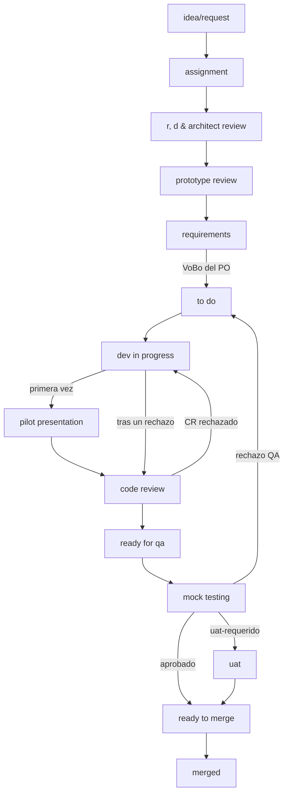
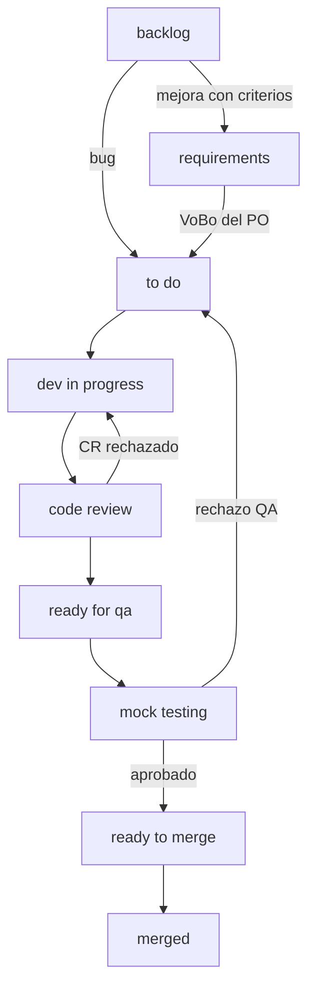
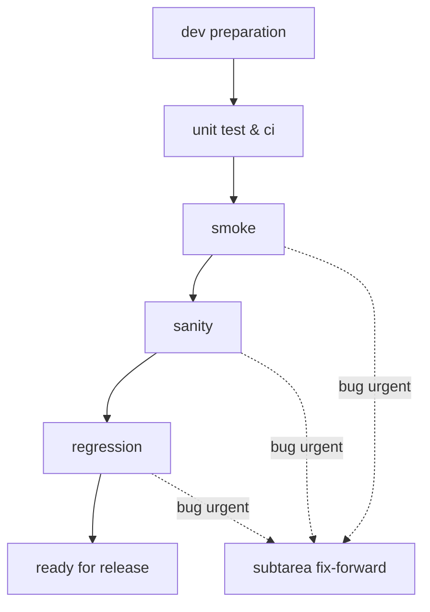

# Guía Operativa ClickUp — Versión Development + QA

### Qué hacer en cada estado, qué llenar y qué comentar en los tableros SDLC de IOND

**Propuesta por:** Steve Nina — Scrum Master IOND

**Aplica a: IOND · IonMind · StageMind**

**Audiencia:** Developers (Dev y Lead Dev) y QA (QA y Lead QA) que trabajan en los tableros Discovery, Improvements y Releases del espacio NEW GATEWAY IOND.

| Dato | Valor |
|---|---|
| Espacio ClickUp | NEW GATEWAY IOND |
| Tableros | Discovery · Improvements · Releases |
| Fuente canónica | `knowledge/L1-project/sdlc-consolidation.md` (v2.3) |
| Documento par | `06a` — Guía de Gobierno ClickUp, versión Scrum Master |

---

## Contenido

1. Cómo usar esta guía y las 10 reglas de oro
2. Mapa rápido de los 3 tableros
3. Qué hago en cada estado
4. Checklists DoR y DoD
5. Protocolos
6. Plantillas de tarea
7. Plantillas de comentario
8. Tags que puedes usar
9. Qué hacen las automatizaciones por ti
10. Severidad
11. Preguntas frecuentes

# 1. Cómo usar esta guía y las 10 reglas de oro

Esta guía es tu referencia rápida para el día a día en ClickUp. Busca el estado en el que está tu ticket en la **sección 3** para saber qué te toca, qué campos llenar, qué comentario publicar y a dónde se mueve. Antes de mover un ticket, revisa el **checklist DoR** del estado de destino (sección 4). Si pasa algo fuera de lo normal (un rechazo, un desacuerdo, un bloqueo, un cambio de alcance), sigue el **protocolo** de la sección 5. Los comentarios se copian tal cual de la sección 7. Los nombres de estado aparecen siempre como en ClickUp, en minúsculas (por ejemplo, `ready for qa`), y `(Q-xx)` remite a la decisión del *Registro de Decisiones* (documento 03).

## Las 10 reglas de oro

1. **Lo que no está en ClickUp no existe.** Las decisiones de una reunión o de un chat se registran en el ticket con su comentario estándar.
2. **Sin VoBo no se programa.** Un ticket que pasa por `requirements` solo entra a `to do` con el comentario de VoBo del PO (C-06) y el tag `po-vobo`.
3. **QA solo rechaza contra la matriz.** El criterio de rechazo es la Matriz de Requerimientos con VoBo vigente; cada rechazo cita el REQ-ID que no se cumple.
4. **Todo PR va en Merge Request.** Un PR por repositorio en Merge Request, Merge Request 2, 3 y 4, antes de pasar a `code review`.
5. **Un comentario estándar por transición.** Cada cambio de estado relevante lleva su plantilla C-xx, publicada antes del movimiento o en el mismo momento.
6. **`done w/d` es solo para subtareas.** Un ticket padre nunca se cierra en `done w/d`. Cuando el padre pasa a `ready to merge`, sus subtareas lo acompañan y lo siguen hasta `merged` (A-20).
7. **`merged` es el cierre.** El ticket cierra en su propio kanban cuando el RM lo integra a la rama RC; no se mueve al tablero de Releases.
8. **Ante un desacuerdo, `escalado-po`.** No se asume ni se sigue con interpretaciones distintas: se registra (C-15) y el PO decide en el día.
9. **Ante un bloqueo, `blocked` con tag de causa.** El ticket pasa a `blocked` con su tag `bloq-*` y un plan de acción (C-20) que se actualiza cada día.
10. **Un hallazgo fuera de la matriz va a un ticket nuevo.** Se crea un ticket con `fuera-de-matriz` (C-17); no es motivo de rechazo.

# 2. Mapa rápido de los 3 tableros

## 2.1 Discovery

Funcionalidades nuevas, refactorizaciones y cambios estructurales o de reglas de negocio, desde la idea hasta el merge.

Además: `blocked` se usa desde cualquier estado activo y se vuelve al estado previo; `invalid` es una decisión del PO; `done w/d` cierra subtareas.

## 2.2 Improvements

Bugs, hallazgos de QA o del Pilot, mejoras puntuales y deuda técnica acotada, sin cambios en reglas de negocio troncales.

## 2.3 Releases

Una tarea de Release por producto y versión cada semana. Los tickets **no** se mueven aquí: la tarea de Release los referencia.

# 3. Qué hago en cada estado

**Cómo leer las tablas:** "Campos" indica los custom fields que deben quedar llenos en ese estado (entre paréntesis, quién los llena si no eres tú). "Comentario" indica la plantilla de la sección 7 y quién la publica. "Siguiente" indica a dónde se mueve el ticket y quién lo mueve.

## 3.1 Discovery

| Estado | Si eres Dev | Si eres QA | Campos | Tags | Comentario | Siguiente |
|---|---|---|---|---|---|---|
| `idea/request` | Si te convocan, aporta viabilidad en el refinamiento. | Asiste al refinamiento; pregunta por testabilidad y casos límite. | TYPE · Project · Iond Subcategory (creador) | Área `iond-*` | C-01 (PO) | `assignment` (PO) · `invalid` (PO) |
| `assignment` | Acepta, confirma que tienes la información básica y mueve a R&D. | El LQA te asigna como Reviewer QA (Q-55): lee el request y anota tus preguntas para el R&D y el prototipo. | Assignee · Dev Reviewer (LD) · Reviewer QA (LQA) | — | C-02 (LD) | `r, d & architect review` (Dev) |
| `r, d & architect review` | Spike o POC: opciones, recomendación, repos, borrador de API, riesgos y requisitos no funcionales. Las subtareas de investigación cierran en `done w/d`. | Opcional: señala riesgos de testabilidad. | — | — | C-03 (Dev, con aprobación del LD) | `prototype review` (Dev) |
| `prototype review` | Presenta el prototipo y el contrato de interfaz. | Valida la testabilidad y toma nota de los requerimientos iniciales. | — | — | C-04 (acta) | `requirements` · vuelve a R&D |
| `requirements` | Apoya técnicamente, lee la matriz y marca el **checklist de acuse** del ticket (Q-23). **No programes todavía.** | Redacta la Matriz vN (fuera de alcance, REQ críticos, datos de prueba), pide el VoBo y, al recibirlo, agrega `po-vobo`. Estima QA Points. | Reviewer QA · QA Points | `po-vobo` · `uat-requerido` (PO) | C-05 (QA) · C-06 (PO) · checklist de acuse (Dev; dudas en C-07) | `to do` (QA, solo con `po-vobo`) |
| `to do` | Toma el ticket cuando tengas capacidad. Si viene de un rechazo, lee primero el C-14. | Responde dudas en menos de 2 h hábiles. | — | — | — | `dev in progress` (Dev) |
| `dev in progress` | Código según la matriz, pruebas unitarias, linters limpios, PR registrados y handoff. | Responde dudas y prepara la Matriz de Pruebas. | Merge Request 1–4 | — | C-09 (Dev) | `pilot presentation` (primera vez) · `code review` (tras un rechazo) |
| `pilot presentation` | Haz la demo en el ambiente local o dev. | Asiste y contrasta cada ajuste con la matriz. | — | `pilot-feedback` · `cambio-alcance` | C-10 (SM) | `code review` (SM) |
| `code review` | Atiende las observaciones del revisor; CI en verde. | — | Merge Request · Dev Reviewer | — | C-11 (LD) | `ready for qa` · `dev in progress` |
| `ready for qa` | Confirma el build desplegado en QA, las migraciones y las variables. | El LQA confirma al Reviewer QA asignado en `assignment` (solo reasigna por capacidad); el QA confirma QA Points y fecha de inicio. | Reviewer QA · QA Points | — | C-12 (LQA) | `mock testing` (QA, al iniciar) |
| `mock testing` | Da soporte puntual. No hagas merge. | Ejecuta la Matriz de Pruebas; aprueba o rechaza con REQ-ID y evidencia; registra los hallazgos fuera de matriz. | Rejection_count (+1 si rechazas) | `fuera-de-matriz` (ticket nuevo) · `escalado-po` | C-13 · C-14 · C-17 (QA) | `uat` · `ready to merge` · `to do` |
| `uat` | Corrige si una observación contradice la matriz. | Acompaña la sesión y registra el resultado. | — | `uat-requerido` | C-18 | `ready to merge` · `to do` |
| `ready to merge` | Mantén tus PR sin conflictos y atiende al RM. | — | Versión objetivo según el Project (SM/RM) | — | — | `merged` (RM) |
| `blocked` | Si detectas el impedimento: mueve, etiqueta, comenta y actualiza cada día. | Igual que Dev. | — | `bloq-*` | C-20 · C-21 | Estado previo |
| `done w/d` | Cierra tus subtareas cuando estén integradas en la rama del padre. Siguen al padre a `ready to merge` y `merged` (A-20). | No pruebes la subtarea: valida el ticket padre. | — | — | — | — (solo subtareas) |
| `merged` | Nada más: el ticket está cerrado. | Se re-verifica en el `sanity` del Release. | — | — | C-19 (RM) | — (cierre) |
| `invalid` | — | — | — | — | C-22 (PO) | — |

## 3.2 Improvements

| Estado | Si eres Dev | Si eres QA | Campos | Tags | Comentario | Siguiente |
|---|---|---|---|---|---|---|
| `backlog` | Registra el bug o la mejora con T-02 / T-03 o el Form. | Registra los bugs con T-02 o el Form, deja la evidencia y **clasifica** el bug (tablero, TYPE y prioridad = severidad) para la aprobación del PO en el triage (Q-15). | TYPE · Project · Iond Subcategory · prioridad | `det-*` (bugs) · área | C-33 (PO/SM) | `to do` · `requirements` (PO/SM) |
| `requirements` *(opcional)* | Apoya y marca el checklist de acuse. **No programes todavía.** | Mini-matriz (hasta 5 REQ) + checklist de no regresión; pide el VoBo. | Reviewer QA · QA Points | `po-vobo` | C-05 · C-06 · C-07 | `to do` (QA, con `po-vobo`) |
| `to do` | Toma el ticket. Si viene de un rechazo, lee el C-14. | — | — | — | — | `dev in progress` (Dev) |
| `dev in progress` | Fix o mejora con una **prueba unitaria que certifique la solución**; PR; handoff corto. | Prepara la verificación y la no regresión de zonas cercanas. | Merge Request 1–4 | — | C-09 (versión corta) | `code review` (Dev) |
| `code review` | Atiende el review; CI en verde. | — | Merge Request · Dev Reviewer | — | C-11 (LD) | `ready for qa` · `dev in progress` |
| `ready for qa` | Confirma el build en QA. | El LQA asigna (o confirma, si pasó por `requirements`); el QA confirma QA Points. | Reviewer QA · QA Points | — | C-12 (LQA) | `mock testing` (QA) |
| `mock testing` | Da soporte puntual. | Bug: se cumple el resultado esperado y la no regresión. Mejora: se cumple la mini-matriz. | Rejection_count | `fuera-de-matriz` · `escalado-po` | C-13 · C-14 · C-17 | `ready to merge` · `to do` |
| `ready to merge` | Mantén el PR sin conflictos. | — | Versión objetivo (SM/RM) | — | — | `merged` (RM) |
| `blocked` | Igual que en Discovery. | Igual que en Discovery. | — | `bloq-*` | C-20 · C-21 | Estado previo |
| `done w/d` | Solo subtareas. | Valida el padre. | — | — | — | — |
| `merged` | Ticket cerrado. | — | — | — | C-19 (RM) | — (cierre) |
| `invalid` | — | — | — | — | C-22 (PO) | — |

## 3.3 Releases (tarea de Release)

| Estado | Si eres Dev | Si eres QA | Campos | Tags | Comentario | Siguiente |
|---|---|---|---|---|---|---|
| `dev preparation` | Antes del corte, confirma tus PR y prerrequisitos (migraciones, variables, dependencias); ayuda al RM con los conflictos. | Prepara la ejecución del smoke maestro, la matriz de Sanity (REQ críticos de cada ticket), la selección de la regresión (capa 1) y el grupo de rotación del E2E maestro (capa 2), y los datos de prueba. | — | — | C-23 (RM) | `unit test & ci` |
| `unit test & ci` | Si un test falla, corrígelo de inmediato. | — | — | — | C-24 | `smoke` |
| `smoke` | Mantente disponible para un fix-forward. | Ejecuta el **smoke maestro** (la misma lista en todo release); un bug `urgent` abre fix-forward. | — | `fix-forward` · `det-smoke` | C-25 · C-28 | `sanity` |
| `sanity` | Soporte puntual; fix-forward si aplica. | Re-ejecuta los REQ críticos de cada ticket en preprod. | — | `det-sanity` | C-26 | `regression` |
| `regression` | Soporte puntual. | **Capa 1:** suite de la versión por riesgo y flujos cross-system. **Capa 2:** E2E maestro (automatizado de noche + rotación manual). | — | `det-regression` | C-27 | `ready for release` |
| `ready for release` | Mantente disponible en la ventana de despliegue. | El LQA certifica y vota en el Go/No-Go; QA hace el smoke maestro en producción con la company de prueba tras el despliegue. | — | `det-prod` (si hay incidente) | C-29 · C-30 · C-31 | — (cierre) |

# 4. Checklists DoR y DoD

## 4.1 DoR para pasar a `to do`

**Discovery**
- [ ] La Matriz de Requerimientos vN está en la descripción, con su columna Fuera de alcance, los REQ críticos marcados y la sección de datos de prueba.
- [ ] El contrato aprobado en `prototype review` (C-04) está referenciado en la matriz.
- [ ] QA publicó la solicitud de VoBo (C-05).
- [ ] El PO publicó su VoBo (C-06) y el ticket tiene el tag `po-vobo`.
- [ ] Se decidió si requiere UAT (`uat-requerido`, lo marca el PO).
- [ ] El Dev marcó el checklist *"Matriz vN leída por el Dev"* (Q-23).
- [ ] Reviewer QA, QA Points y Dev Reviewer están llenos.

**Improvements**
- [ ] TYPE, Project, Iond Subcategory (si Project = Iond) y prioridad están llenos.
- [ ] Si es un bug: pasos, resultado esperado, resultado actual, ambiente, evidencia y tag `det-*`.
- [ ] El triage está registrado (C-33).
- [ ] Si pasó por `requirements`: mini-matriz con VoBo (C-06 + `po-vobo`).

## 4.2 DoR para pasar a `code review`

- [ ] El código cubre los REQ de la matriz (o el resultado esperado del bug).
- [ ] Las pruebas unitarias están en verde (meta: cobertura de 80 % o más en código nuevo, si el repositorio lo soporta).
- [ ] Los linters están limpios.
- [ ] Cada PR está registrado en Merge Request, Merge Request 2, 3 o 4 (uno por repositorio, sin URLs repetidas).
- [ ] Se publicó el handoff C-09.
- [ ] El Dev Reviewer está asignado.
- [ ] Discovery, primera vez: el Pilot se realizó y su acta (C-10) está publicada.

## 4.3 DoR para pasar a `ready for qa`

- [ ] El Code Review está aprobado (C-11) y la CI está en verde.
- [ ] El build de la rama del ticket está desplegado en el ambiente de QA.
- [ ] Las migraciones y variables están aplicadas e informadas en el C-09.
- [ ] El Reviewer QA está asignado (o el LQA fue avisado para asignarlo).

## 4.4 DoR para pasar a `ready to merge`

- [ ] QA publicó la aprobación (C-13) con evidencia por REQ.
- [ ] El 100 % de los REQ críticos está aprobado y no hay bugs `urgent` abiertos.
- [ ] Si el ticket tiene `uat-requerido`: la UAT está aprobada (C-18).
- [ ] Los hallazgos fuera de matriz están registrados como tickets nuevos (C-17).
- [ ] Los PR no tienen conflictos con la rama destino.
- [ ] La versión objetivo está registrada o se avisó al SM/RM para registrarla.

## 4.5 DoD del ticket (= `merged`)

- [ ] Los PR están mergeados en la rama RC de la semana.
- [ ] El RM publicó C-19 con la rama RC, la versión y el enlace a la tarea de Release.
- [ ] La versión objetivo está registrada (Iond.Version, Ionmind.Version, Stagemind.Version o G.Version, según el Project).
- [ ] Todas las subtareas están en `done w/d`.
- [ ] El Rejection_count refleja los rechazos de QA documentados.
- [ ] No queda ningún `escalado-po` abierto y el ticket no está en `blocked` (los tags `bloq-*` se conservan como historial).
- [ ] Los tickets derivados (`fuera-de-matriz`, `pilot-feedback`) están enlazados.

**DoD de una subtarea (`done w/d`):** código terminado, validado localmente e integrado en la rama del ticket padre. QA valida en el padre.

# 5. Protocolos

## 5.1 Rechazo (QA)

1. Confirma que el problema **contradice un REQ** de la matriz vigente (o el resultado esperado del bug). Si no, aplica el protocolo de hallazgo fuera de matriz (5.6).
2. Publica C-14 con una observación por REQ incumplido: severidad, REQ-ID, pasos, resultado esperado, resultado actual y evidencia.
3. Suma 1 a **Rejection_count** (es manual; ClickUp te lo recuerda).
4. Mueve el ticket a `to do`, en Discovery y en Improvements.
5. El Dev corrige y el ticket recorre `dev in progress` → `code review` → `ready for qa` → `mock testing`. **No vuelve a `pilot presentation`.**

## 5.2 Re-test (QA)

1. Lee tu C-14 anterior y verifica cada observación: resuelta o persistente.
2. Re-ejecuta los REQ críticos y las zonas cercanas afectadas por el cambio. **No exijas repetir etapas ya aprobadas** (Pilot, definiciones).
3. Si aparece algo nuevo: si contradice un REQ, es una observación nueva o una regresión del ticket; si no, es un hallazgo fuera de matriz.
4. Publica C-13 (aprobado) o C-14 (nueva iteración, con el número de iteración) y mueve el ticket según el resultado.

## 5.3 Desacuerdo y escalamiento

1. Registra en el ticket el punto exacto y la postura de cada parte en 1–2 líneas (C-15) y agrega el tag `escalado-po`.
2. ClickUp avisa al PO; avísale también por el canal habitual **el mismo día**.
3. Mientras tanto, sigue con los REQ no afectados. No implementes ni pruebes interpretaciones propias del punto en discusión.
4. El PO decide en un máximo de 4 h hábiles (C-16) y retira `escalado-po`. Si hace falta, el SM facilita una sincronización de 10 minutos; si el SM es parte del desacuerdo, facilita el LD/RM (Q-03).
5. Aplica la decisión: es un bug del ticket (se corrige), se acepta el comportamiento, es un cambio de alcance (5.4) o es un ticket nuevo.

## 5.4 Cambio de alcance (después del VoBo)

1. Solo el **PO** solicita o aprueba un cambio de alcance.
2. QA actualiza la matriz a la versión v+1, marca las filas cambiadas, publica C-08 y agrega `cambio-alcance` (ClickUp retira `po-vobo` automáticamente).
3. El Dev **no modifica el código** de lo cambiado hasta el nuevo VoBo; puede seguir con los REQ que no cambiaron.
4. El PO da el nuevo VoBo (C-06); QA vuelve a poner `po-vobo`. El tag `cambio-alcance` se conserva como historial (si hay otro cambio, QA retira `po-vobo` a mano).
5. El Dev implementa el cambio y QA actualiza su Matriz de Pruebas.

## 5.5 Bloqueo

1. Mueve el ticket a `blocked` desde el estado en el que estaba. ClickUp agrega al SM como watcher y fija el vencimiento a 2 días; si el ticket tenía otra fecha de vencimiento, anótala en el C-20.
2. Agrega el tag de causa: `bloq-externo`, `bloq-ambiente`, `bloq-definicion` o `bloq-dependencia`. Si depende de otro ticket, usa la dependencia nativa (*waiting on*).
3. Publica C-20 con el impedimento, de quién depende y el plan de acción. Actualízalo cada día (se revisa en la daily).
4. A las 48 h ClickUp escala al SM y al LD (y al PO si es `bloq-definicion`). A las 72 h se decide: reprogramar, dividir el ticket o reclasificarlo (lo decide el PO) (Q-31).
5. Al resolverse: vuelve al estado previo, publica C-21 y restituye la fecha de vencimiento anterior. El tag `bloq-*` **se conserva** como historial de la causa.

## 5.6 Hallazgo fuera de la matriz

1. Confirma que lo observado no está en ningún REQ o que figura en la columna Fuera de alcance.
2. Crea un ticket nuevo en Improvements (`backlog`) con T-02 o T-03, con los tags `fuera-de-matriz` y `det-*`, y enlázalo al ticket de origen.
3. Publica C-17 en el ticket de origen con el enlace al ticket nuevo.
4. El hallazgo **no bloquea** el ticket de origen: su veredicto se basa solo en la matriz.
5. El PO decide la prioridad del ticket nuevo en el triage.

## 5.7 Fix-forward en el Release (Q-34)

**Cuándo aplica:** a un bug con prioridad `urgent` (bloqueante) detectado en `smoke`, `sanity` o `regression` de la tarea de Release. Los bugs `high`, `normal` y `low` **no** son fix-forward: van a Improvements (paso 8). Un `high` solo entra como fix-forward si el PO y el LD lo deciden de forma explícita.

**Quién decide:** el PO y el LD/RM. **Plazos:** decisión en **≤ 4 h hábiles** desde el aviso; corrección lista y re-verificada en **≤ 1 día hábil**.

| Paso | Quién | Qué hace | Dónde queda |
|---|---|---|---|
| 1 | QA | Reproduce el bug `urgent` y avisa de inmediato al PO y al LD/RM. | Comentario con evidencia en la tarea de Release |
| 2 | QA | Crea una **subtarea** de la tarea de Release: TYPE `Bug`, prioridad `urgent`, tags `fix-forward` + `det-smoke` / `det-sanity` / `det-regression`, relación con el ticket de origen. La subtarea se crea en el estado de la fase donde se detectó. | Subtarea + C-28 ("Detectado en") |
| 3 | PO + LD/RM | Deciden en ≤ 4 h: **fix-forward**, **revertir el ticket de origen** (`diferido`) o **NO-GO**. | C-28 ("Decisión") |
| 4 | Dev | Corrige **en la rama RC** (no en la rama del ticket) y registra el PR en la subtarea (Merge Request). | Merge Request + C-28 |
| 5 | LD (o los dos revisores senior si el PR es del LD/RM) | Revisan y aprueban el PR. | PR aprobado |
| 6 | LD/RM | Despliega la RC corregida en preprod con los workflows de DevOps. | Comentario en la tarea de Release |
| 7 | QA | Re-ejecuta la verificación afectada (y el smoke del área si aplica), actualiza C-28 y cierra la subtarea en `ready for release`. | C-28 ("Re-verificación QA: ✅") |
| 8 | PO + LD | Los bugs **no bloqueantes** se registran como tickets nuevos en Improvements (`backlog`, T-02, tag `det-*`) y se priorizan en el triage; no detienen el release. | Tickets nuevos en Improvements |

**Si el fix no está listo en 1 día hábil:** el PO, el LD y el RM deciden entre:
- **Revertir el ticket de origen de la RC:** el ticket sale de `merged`, vuelve a `to do` en su kanban con el tag `diferido` (no suma Rejection_count), se actualiza su versión objetivo y reingresa a un corte posterior después de pasar de nuevo por `mock testing`.
- **Declarar NO-GO** (C-29): la tarea de Release se queda en `regression`, se reprograma su fecha de vencimiento al siguiente Go/No-Go y se registra el motivo.

**Reglas:** a la RC solo entran fix-forward aprobados. Todo fix-forward se re-verifica antes del Go/No-Go. Un `urgent` abierto siempre es NO-GO.
## 5.8 Hotfix (incidente en producción) (Q-38)

1. Ante un incidente reportado (soporte general de la empresa, clientes o monitoreo), el PO o el LQA abre el ticket en Improvements: TYPE `Bug`, prioridad `urgent`, tags `hotfix` + `det-prod` y comentario C-32. ClickUp lo lleva a `to do`.
2. El PO y el LD autorizan el hotfix.
3. El Dev sigue `dev in progress` → `code review` → `ready for qa` con prioridad máxima; QA prioriza el `mock testing`.
4. En `ready to merge`, el SM crea el release extraordinario `Hotfix <producto> - vX.Y.Z+1` (`smoke` + `sanity` focalizado) y el RM ejecuta el corte.
5. DevOps despliega y QA hace el smoke maestro en producción con la company de prueba (C-31).

# 6. Plantillas de tarea

Para crear un ticket, usa el botón **Plantillas** de ClickUp y elige `SDLC T-01 · Request de Discovery`, `SDLC T-02 · Bug` o `SDLC T-03 · Mejora`. Para reportar un bug también puedes usar el **Form "Reportar bug — IOND"** de Improvements, que ya pide todos los datos. La plantilla T-04 la usa el SM para la tarea de Release.

<!-- @include ../../../knowledge/L1-project/sdlc-consolidation.md#plantillas-tarea -->

# 7. Plantillas de comentario

Copia la plantilla, completa los `[...]` y publícala **en el ticket** antes de mover el estado o al mismo tiempo.

**Las que más vas a usar:**

| Si eres… | Plantillas habituales |
|---|---|
| Dev | C-03 (R&D concluido) · checklist de acuse de la matriz (dudas en C-07) · C-09 (handoff a QA) · C-15 (escalamiento) · C-20 / C-21 (bloqueo y desbloqueo) |
| QA | C-05 (solicitud de VoBo) · C-08 (cambio de alcance) · C-13 (aprobación) · C-14 (rechazo) · C-17 (hallazgo fuera de matriz) · C-25 a C-28 (Release) |
| Lead Dev | C-02 (assignment) · C-11 (resultado del Code Review) |
| Lead QA | Reviewer QA en el C-02 (`assignment`) · C-12 (confirmación en `ready for qa`) · voto en C-29 |

<!-- @include ../../../knowledge/L1-project/sdlc-consolidation.md#comentarios -->

# 8. Tags que puedes usar

En los tableros SDLC **solo** se usan estos tags. No uses tags de sprint, de despliegue ni de hito (`iond-depl-*`, `iond-mvp`, `iond-beta`, `qa-*`, `sp*`), ni `for-analysis`, ni tags de producto (`iond`, `ionmind`, `stagemind`): esa información va en el estado, en el campo Project o en el campo de versión.

| Tag | Cuándo | Quién |
|---|---|---|
| `iond-core` · `iond-uxui` · `iond-infra` · `iond-ia` | Al crear un ticket de iond: uno, según la capa principal del cambio | Creador / LD |
| `po-vobo` | Cuando el PO publica el VoBo (C-06) | QA (o PO) |
| `uat-requerido` | El ticket necesita UAT antes del merge (se decide en `requirements`) | PO |
| `cambio-alcance` | La matriz cambió después del VoBo (v+1) | QA |
| `escalado-po` | Hay un desacuerdo esperando la decisión del PO | QA o Dev |
| `fuera-de-matriz` | Ticket nuevo nacido de un hallazgo fuera de la matriz | QA |
| `pilot-feedback` | Ticket nuevo nacido de un ajuste del Pilot | SM |
| `bloq-externo` · `bloq-ambiente` · `bloq-definicion` · `bloq-dependencia` | Al mover a `blocked`; se retira al desbloquear | Quien bloquea |
| `det-mock` · `det-uat` · `det-smoke` · `det-sanity` · `det-regression` · `det-prod` · `det-exploratorio` | Al reportar un bug: fase en la que se detectó | Quien reporta |
| `hotfix` | Incidente en producción | PO / LQA |
| `fix-forward` | Subtarea de corrección dentro de la RC | QA / RM |
| `diferido` | Ticket revertido de la RC o pasado a la siguiente versión | RM |

# 9. Qué hacen las automatizaciones por ti

ClickUp no impide mover un ticket a cualquier estado, así que algunas reglas se aplican **después** del movimiento: ClickUp devuelve el ticket y te deja un comentario. Las automatizaciones se activan de forma progresiva; si alguna todavía no está activa, **la regla se aplica igual** y el SM la revisa en su auditoría.

| Si tú… | ClickUp… | Qué haces |
|---|---|---|
| Creas una tarea en Discovery | Aplica la plantilla T-01 y agrega al PO como watcher (A-01) | Completa la plantilla y los campos |
| Creas una tarea o envías el Form en Improvements | Aplica T-02 (bug) o T-03 (mejora) y agrega al SM (A-02) | Completa la plantilla |
| Mueves de `requirements` a `to do` sin `po-vobo` | **Lo regresa** a `requirements` y comenta (A-03) | Espera el VoBo del PO (C-06) |
| Agregas `cambio-alcance` | Quita `po-vobo` y avisa al PO (A-04) | Espera el nuevo VoBo |
| Entras a `requirements` | Recuerda los plazos de la matriz y del VoBo (A-05) | — |
| Mueves a `code review` sin Merge Request | **Lo regresa** a `dev in progress` y comenta (A-06) | Registra el PR y vuelve a moverlo |
| Entras a `code review` | Avisa al Dev Reviewer (A-07) | — |
| Entras a `ready for qa` (o, en Discovery, a `r, d & architect review`) sin Reviewer QA | Avisa al LQA para asignarlo (A-08) | — |
| Rechazas (de `mock testing` o `uat` a `to do`) | Te recuerda publicar C-14 y actualizar Rejection_count (A-09) | Hazlo, si aún no lo hiciste |
| Apruebas un ticket con `uat-requerido` hacia `ready to merge` | Lo mueve a `uat` y avisa al PO (A-10) | Acompaña la UAT |
| Entras a `ready to merge` sin versión objetivo | Avisa al RM y al SM (A-11) | — |
| Mueves a `blocked` | Publica la plantilla C-20, agrega al SM y fija el vencimiento a 2 días (A-12) | Completa el C-20 y el tag `bloq-*` |
| Dejas un ticket 48 h en `blocked` | Escala al SM y al LD (+ PO si es `bloq-definicion`) (A-13) | Actualiza el plan |
| Cierras todas las subtareas | Avisa al dueño del ticket padre (A-14) | Avanza el padre |
| Agregas `escalado-po` | Avisa al PO: decisión en 4 h hábiles (A-15) | Sigue con los REQ no afectados |
| Mueves a `invalid` | Pide el motivo obligatorio (A-16) | El PO publica C-22 |
| Alguien agrega `hotfix` | Prioridad `urgent`, estado `to do` y aviso a PO, LD y RM (A-17) | Prioriza el ticket |
| Cambia el estado de la tarea de Release | Publica la plantilla del comentario de ese estado (A-18) | Complétala |
| Agregas `det-prod` | Avisa al LQA y al LD/RM (A-19) | — |

# 10. Severidad

La severidad de un bug se expresa con la **prioridad nativa** de ClickUp.

<!-- @include ../../../knowledge/L1-project/sdlc-consolidation.md#severidad -->

**Para elegir bien la severidad:**
- Pregúntate primero si hay **workaround**: sin workaround en una funcionalidad core, es `urgent`; con workaround, normalmente `high`.
- Pérdida o corrupción de datos, problemas de seguridad y cobros incorrectos son siempre `urgent`.
- La severidad no decide si un hallazgo es motivo de rechazo: eso lo decide la matriz. Un `low` que incumple un REQ explícito se rechaza; un `high` fuera de la matriz va a un ticket nuevo.

# 11. Preguntas frecuentes

**1. ¿Qué hago si el PO no da el VoBo a tiempo?**
El ticket se queda en `requirements`. El VoBo tiene un plazo de 24 h hábiles: avisa al SM, que lo recuerda al PO y lo lleva a la daily si es necesario. Mientras tanto, no empieces a programar ese ticket: toma otro de `to do`.

**2. ¿Puedo empezar a programar los REQ claros si uno está en duda?**
Sí, cuando la matriz ya tiene VoBo. Avanza con los REQ claros, escala el dudoso (C-15 + `escalado-po`) y no implementes tu propia interpretación del REQ en discusión hasta que el PO decida (C-16).

**3. ¿Qué pasa si encuentro un bug que no está en la matriz?**
No es motivo de rechazo. Crea un ticket nuevo en Improvements con `fuera-de-matriz` y `det-*`, enlázalo y publica C-17 en el ticket original. El PO decide su prioridad (protocolo 5.6).

**4. ¿Qué es `done w/d` y cuándo lo uso?**
Significa *Done With Dependencies*. Es el cierre de una **subtarea** técnica cuyo código ya está integrado en la rama del ticket padre. La subtarea no pasa por QA: QA valida el padre. Nunca se usa en un ticket padre. Cuando el padre pasa a `ready to merge`, la subtarea pasa también a `ready to merge` y luego a `merged` junto con él (automatización A-20 o, si no está disponible, el RM en el corte).

**5. ¿Por qué ClickUp devolvió mi ticket a otro estado?**
Porque faltaba un requisito del gate: el VoBo del PO al pasar a `to do` (A-03) o el PR en Merge Request al pasar a `code review` (A-06). Lee el comentario automático, completa lo que falta y vuelve a mover el ticket.

**6. ¿Cuándo pasa mi ticket a `merged`? ¿Tengo que moverlo al tablero de Releases?**
Lo mueve el RM durante `dev preparation`, cuando integra tus PR a la rama RC de la semana, y publica C-19. El ticket **no** se mueve a Releases: se queda cerrado en su kanban y la tarea de Release lo referencia.

**7. ¿Un rechazo en `code review` cuenta en Rejection_count? ¿Después de un rechazo hay que volver a Pilot?**
No y no. Un rechazo en `code review` devuelve el ticket a `dev in progress` sin tocar Rejection_count, que solo cuenta los rechazos de QA. Después de un rechazo de QA, el ticket no vuelve a `pilot presentation`.

**8. Mi cambio toca más de cuatro repositorios. ¿Dónde registro los PR?**
Usa Merge Request, Merge Request 2, 3 y 4 para los cuatro principales y lista los demás en el C-09. Si pasa a menudo, coméntalo con el LD: puede ser señal de que el ticket debe dividirse.

**9. ¿Puedo seguir usando tags como `iond-depl-*`, `iond-mvp` o `for-analysis`?**
No en los tableros SDLC. La versión va en Iond.Version, Ionmind.Version, Stagemind.Version o G.Version (según el Project); el análisis se refleja con el estado; el producto, con el campo Project. Usa solo los tags de la sección 8.

**10. Una mejora de Improvements necesita validación del cliente. ¿Qué hago?**
Es una señal de que pertenece a Discovery (Q-30). Avisa al PO, que decide si la reclasifica a Discovery (`idea/request`) o si se valida de otra forma sin agregar UAT en Improvements.
