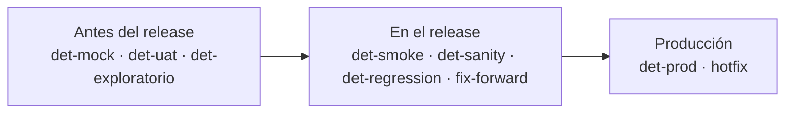
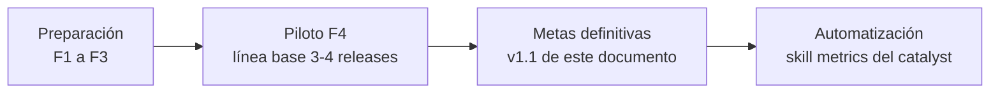

# Dashboards y Métricas del SDLC IOND
**Diccionario de métricas, prerrequisitos de datos y dashboards de ClickUp por rol**

Propuesta por: Steve Nina — Scrum Master IOND
Aplica a: IOND · IonMind · StageMind
Audiencia: PO · Scrum Master · Lead Dev · Lead QA · QA · RM · Stakeholders
Espacio ClickUp: **NEW GATEWAY IOND** · Plan **Business**

| Control del documento | |
|---|---|
| Fuente canónica | `knowledge/L1-project/sdlc-consolidation.md` (v2.3): estados, tipos de estado, campos, tags, comentarios, automatizaciones y SLAs |
| Documentos relacionados | *02 — Análisis del Flujo SDLC IOND* · *03 — Registro de Decisiones, Riesgos y Limitaciones* (IDs `Q-xx`, `R-xx`, `L-xx`) · *05 — Estándar Operativo de QA* (suites del release, §6) · guía de configuración de ClickUp (06a) |
| Convenciones | Estados en minúsculas y entre backticks, tal como en ClickUp. **Meta inicial** = meta o umbral que se confirma tras el piloto F4. **(verificar en Business)** = tipo de tarjeta o filtro cuya disponibilidad en el plan Business debe comprobarse antes de construir la tarjeta. `DM-xx` = decisión de medición que este documento pide al taller (sección 3.3). |
| Alcance de los datos | Solo estados, historial de estados (Time in Status), fechas nativas, assignees, prioridad nativa, relaciones y subtareas, lista de origen, watchers, los **custom fields de IOND (13 + Stagemind.Version)**, el heredado **G.Version** (solo Project = Gateway) y los **tags SDLC**. El resto de heredados (`item_type`, `o.version`, `category`, `description`, `repro_points`, `goal_progress`) **no se usan**. |

---

## Índice

1. Propósito y principios
2. Diccionario de métricas
3. Prerrequisitos de datos
4. Dashboards por rol
5. Calendario y seguimiento en las ceremonias
6. Mockup del dashboard de Lead QA
7. Limitaciones y proxies
8. Roadmap de métricas

---

## 1. Propósito y principios

### 1.1 Propósito

Este documento define **qué se mide, cómo se mide y dónde se ve** en el SDLC de IOND. Traduce el flujo de la fuente canónica (tableros Discovery, Improvements y Releases) a un conjunto de métricas con definición única y a seis dashboards de ClickUp, uno por rol.

Las métricas responden a tres preguntas de equipo:

1. **¿Fluye el trabajo?** Tiempos, colas, WIP, bloqueos y throughput.
2. **¿Entregamos con calidad?** Rechazos, fugas de defectos por fase, incidentes en producción y resultados del release.
3. **¿Se cumple el acuerdo de trabajo?** VoBo del PO, estabilidad de los requerimientos, escalamientos y completitud de los datos en ClickUp.

### 1.2 Principios

1. **Las métricas sirven para mejorar el flujo, no para evaluar personas.** Ninguna métrica de este documento se usa en evaluaciones de desempeño individuales.
2. **Métricas de equipo.** Se agregan por equipo, tablero, producto (Project), módulo (Iond Subcategory) o TYPE. **No se publican rankings individuales** de rechazos, bugs o tiempos por desarrollador ni por QA. Las vistas por persona (mi cola, WIP por persona, carga de QA Points) son **operativas**: sirven para repartir el trabajo y detectar sobrecarga, no para comparar.
3. **Tendencias sobre valores absolutos.** Se observan series semanales y medias móviles de 4 semanas. Para los tiempos se reportan **mediana y P85**, no el promedio, porque unos pocos tickets largos distorsionan la media.
4. **Línea base durante el piloto F4.** Todas las metas de este documento son **iniciales**. Durante 3–4 releases semanales se mide sin juzgar; al cierre del piloto se fijan las metas definitivas (sección 8). No hay histórico comparable antes de la nueva configuración (`L-06`).
5. **Una métrica, una definición.** El diccionario (sección 2) manda. Una tarjeta que no use exactamente la fuente y los filtros del diccionario no se presenta en las ceremonias.
6. **Siempre filtrado por las listas SDLC.** Los tags son compartidos con los folders legacy activos (`L-04`, `R-15`): toda tarjeta se ubica en las listas Discovery (`901717038641`) e Improvements (`901717038640`) o en el folder Releases (`901711332702`). Nunca en el espacio completo.
7. **Medir con lo que el proceso ya registra.** No se crean custom fields (`L-02`). Lo que no se puede medir con los datos disponibles se declara y se mide con un **proxy** explícito.
8. **Métricas en pares.** Velocidad y calidad se leen juntas (por ejemplo, throughput con First Pass Yield y fuga a producción) para no optimizar una a costa de la otra.
9. **Un dato faltante es una señal de proceso.** Un ticket sin campos o sin tags obligatorios indica incumplimiento del flujo (`R-12`) y se corrige en el ticket, no a mano en el reporte.

---

## 2. Diccionario de métricas

El diccionario tiene **47 métricas** en siete grupos. Cada grupo tiene dos tablas: **definición** (qué y cómo se calcula) y **medición** (fuente exacta, frecuencia, meta inicial y dueño). El dueño es el rol que impulsa la mejora de la métrica, no quien la "produce".

Convenciones de cálculo para todo el diccionario:

- **Ticket** = tarea padre de las listas Discovery o Improvements. Se **excluyen las subtareas** (cierran en `done w/d` y duplicarían conteos), salvo las subtareas `fix-forward` del folder Releases cuando se indica.
- **Fecha de cierre** = fecha en que el ticket entra en `merged`, tomada del historial de estados (Time in Status o catalyst). Como `uat`, `ready to merge` y `merged` son de tipo *Done* (`Q-41`), la fecha nativa de ClickUp se fija al entrar al **primer** estado Done: se usa como *fecha de listo para integrar*. Ver P-03.
- **Semana** = lunes a domingo, alineada con el sprint semanal de Releases.
- Se **excluye `invalid`** salvo en M-25.
- Se excluyen los tickets creados antes de la fecha del corte de transición (`Q-45`) en las métricas de VoBo y de proceso.

### 2.1 Flujo y previsibilidad (M-01 a M-10)

**Definición**

| ID | Métrica | Definición | Fórmula / cálculo |
|---|---|---|---|
| M-01 | Lead time | Tiempo total desde que el ticket se registra (`idea/request` en Discovery, `backlog` en Improvements) hasta que cierra en `merged`. Incluye esperas, bloqueos y retrabajo. | `fecha de cierre − fecha de creación`. Mediana y P85 por tablero, TYPE y Project. |
| M-02 | Cycle time de desarrollo | Tiempo desde la primera entrada en `dev in progress` hasta `merged`, incluido el retrabajo por rechazos. | **Improvements:** card nativa *Cycle Time* (de `dev in progress` al primer Done, `ready to merge`) + Time in Status de `ready to merge`. **Discovery:** Σ Time in Status de `dev in progress`, `pilot presentation`, `code review`, `ready for qa`, `mock testing`, `uat`, `ready to merge` y `blocked`. Aproximación: no incluye la espera en `to do` tras un rechazo. Mediana y P85. |
| M-03 | Time in Status por estado | Tiempo acumulado de los tickets en cada estado. Foco: `requirements` (proxy del SLA de VoBo), `ready for qa`, `code review`, `blocked` y `ready to merge`; además `assignment`, `r, d & architect review`, `mock testing` y `uat`. | Mediana y P85 por estado y tablero; % de tickets dentro del umbral del estado (tabla 2.7). Derivada: **eficiencia de flujo** = Σ tiempo en estados de trabajo / Σ tiempo total, donde las colas son `assignment`, `to do`, `ready for qa`, `ready to merge` y `blocked`. |
| M-04 | Throughput semanal | Tickets que llegan a `merged` por semana. | `nº de tickets con fecha de cierre en la semana`, por tablero, TYPE y Project. Media móvil de 4 semanas. |
| M-05 | Mix de trabajo (features vs fixes) | Proporción de lo entregado según su naturaleza. | `% del throughput por TYPE` (`New Feature`, `Improvement`, `Bug`, `Refactor`, `Task`) por mes. |
| M-06 | WIP por estado | Tickets en curso en cada estado en un momento dado. | Conteo instantáneo por estado sobre el conjunto WIP (sección 4.0). |
| M-07 | WIP por persona | Tickets en curso por persona, para repartir trabajo (no para comparar). | **Dev:** tickets en `dev in progress` y en `to do` con Rejection_count ≥ 1, por assignee. **QA:** tickets en `ready for qa`, `mock testing` y `uat`, por Reviewer QA. |
| M-08 | WIP aging | Antigüedad de cada ticket en curso en su estado actual. | Time in Status del estado actual de cada ticket WIP, comparado con el umbral del estado (tabla 2.7). Proxy: días desde la fecha de actualización. |
| M-09 | % de bloqueados | Proporción del WIP detenida por impedimentos, por causa. | `tickets en blocked / tickets WIP × 100`, con desglose por `bloq-externo`, `bloq-ambiente`, `bloq-definicion` y `bloq-dependencia`. |
| M-10 | Tiempo bloqueado por causa | Duración de los bloqueos y su causa. | Time in Status de `blocked` por ticket, agrupado por tag `bloq-*` (requiere DM-01). Mediana, P85 y % de bloqueos resueltos o decididos en ≤ 72 h. |

**Medición**

| ID | Fuente de datos | Frecuencia | Meta inicial | Dueño |
|---|---|---|---|---|
| M-01 | Card *Lead Time* (verificar en Business); fecha de creación y fecha de cierre; listas Discovery e Improvements. Con los tipos de `Q-41`, la card nativa mide hasta el primer Done (listo para integrar); hasta `merged` se suma Time in Status. | Semanal; tendencia mensual | Improvements, TYPE `Bug`: mediana ≤ 10 días naturales y P85 ≤ 20. Discovery: solo línea base en F4. | SM |
| M-02 | Card *Cycle Time* (Improvements; verificar en Business); Time in Status (Discovery) | Semanal | Improvements: P85 ≤ 10 días naturales (incluye la espera hasta el corte semanal). Discovery: línea base. | LD |
| M-03 | ClickApp Time in Status; card *Time in Status* (verificar en Business) o vista Lista con columna Time in Status | Diaria (alertas); semanal (tendencia) | ≥ 85 % de los tickets dentro del umbral de cada estado (tabla 2.7) | SM |
| M-04 | Estado `merged`; fecha de cierre; TYPE; Project; lista de origen | Semanal | Línea base. Alerta si cae > 30 % frente a la media móvil de 4 semanas. | SM |
| M-05 | Estado `merged`; TYPE | Mensual | Sin meta (diagnóstico). Señal: `Bug` > 50 % del throughput durante 4 semanas seguidas. | PO |
| M-06 | Estados del conjunto WIP; card *Cumulative Flow* (verificar en Business); Bar chart por estado | Diaria | Límites WIP: `code review` ≤ 4 · `ready for qa` ≤ 4 · `mock testing` ≤ 2 por QA · `blocked` ≤ 10 % del WIP | SM |
| M-07 | Assignees; Reviewer QA; estados | Diaria | Dev: ≤ 2 tickets en `dev in progress`. QA: ≤ 2 tickets en `mock testing` a la vez. | SM (Dev) · LQA (QA) |
| M-08 | Time in Status del estado actual; fecha de actualización (proxy) | Diaria | Ámbar > 5 días naturales en el mismo estado; rojo > 10. Tras F4: P85 de M-03 por estado. | SM |
| M-09 | Estado `blocked`; tags `bloq-*` | Diaria | ≤ 10 % del WIP | SM |
| M-10 | Time in Status de `blocked`; tags `bloq-*` (DM-01); fecha de vencimiento fijada por A-12 (hoy + 2 días) | Semanal | 100 % con decisión ≤ 72 h; mediana ≤ 2 días naturales | SM |

### 2.2 Calidad (M-11 a M-16)

**Definición**

| ID | Métrica | Definición | Fórmula / cálculo |
|---|---|---|---|
| M-11 | First Pass Yield (FPY) | % de tickets que llegan a `ready to merge` sin ningún rechazo de QA. | `tickets cerrados en merged en el periodo con Rejection_count = 0 / tickets cerrados en merged en el periodo × 100`. Se mide al cierre porque `ready to merge` es transitorio. |
| M-12 | Tasa de rechazo y rechazos promedio por ticket | Proporción de tickets rechazados al menos una vez y número medio de rechazos de QA. | Tasa = `tickets merged con Rejection_count ≥ 1 / tickets merged × 100`. Promedio = `Σ Rejection_count / tickets merged`. Por equipo, Project, Iond Subcategory y TYPE, **nunca por desarrollador**. |
| M-13 | Defect leakage por fase | Distribución de los defectos según la fase en la que se detectan (tabla 2.8). | Fuga al release = `(det-smoke + det-sanity + det-regression + fix-forward) / total detectados × 100`. Fuga a producción = `det-prod / total detectados × 100`. Total = tickets con algún tag `det-*` + subtareas `fix-forward` sin tag `det-*`, creados en el periodo. |
| M-14 | Escaped defects | Defectos detectados en producción. | `nº de tickets con det-prod creados en el mes`, por prioridad (severidad), Project e Iond Subcategory; % que además tienen `hotfix`. |
| M-15 | Bugs por módulo y por producto | Concentración de defectos. | `nº de tickets TYPE = Bug` abiertos y creados en el periodo, por Iond Subcategory, Project, tag de área (`iond-core`, `iond-uxui`, `iond-infra`, `iond-ia`) y prioridad. |
| M-16 | Automatización de regresión (dato externo) | Cobertura automatizada del E2E maestro y del smoke maestro (`Q-40`, `Q-50`). | `filas automatizadas / filas vigentes × 100` del E2E maestro y `verificaciones automatizadas / 17` del smoke. Se obtiene de `knowledge/test-suites/coverage.md`. |

**Medición**

| ID | Fuente de datos | Frecuencia | Meta inicial | Dueño |
|---|---|---|---|---|
| M-11 | Rejection_count (con valor 0 explícito — DM-02); estado `merged`; fecha de cierre | Semanal y por release | ≥ 70 % | LQA |
| M-12 | Rejection_count; estado `merged`; Project; Iond Subcategory; TYPE | Semanal | Tasa ≤ 30 %; promedio ≤ 0,5 rechazos por ticket | LQA |
| M-13 | TYPE = `Bug`; tags `det-mock`, `det-uat`, `det-smoke`, `det-sanity`, `det-regression`, `det-prod`, `det-exploratorio`; subtareas `fix-forward` del folder Releases; fecha de creación | Mensual y por release | Fuga a producción ≤ 10 %; fuga al release ≤ 25 % | LQA |
| M-14 | Tag `det-prod`; prioridad nativa; Project; Iond Subcategory | Semanal (conteo); mensual (tendencia) | 0 `urgent` por mes; ≤ 2 `high` por mes | LQA |
| M-15 | TYPE = `Bug`; Iond Subcategory; Project; tags de área; prioridad | Semanal | Sin meta (diagnóstico). Señal: módulo con ≥ 3 bugs `urgent` o `high` abiertos. | LQA |
| M-16 | `knowledge/test-suites/coverage.md` (catalyst), registrado en una tarjeta *Text* y en el comentario C-27 | Por release | Línea base: 34 % automatizado (2026-10-10); smoke 100 % automatizado como primera meta (`Q-40`) | LQA |

### 2.3 Requerimientos y gobierno (M-17 a M-25)

**Definición**

| ID | Métrica | Definición | Fórmula / cálculo |
|---|---|---|---|
| M-17 | Cumplimiento del SLA de VoBo | % de tickets cuya Matriz de Requerimientos recibe el VoBo dentro del SLA. | **Proxy nativo:** `% de tickets con Time in Status de requirements ≤ umbral` (tabla 2.7: matriz 1 día + VoBo 24 h hábiles). **Exacto:** `fecha de C-06 − fecha de C-05 ≤ 24 h hábiles` (lectura de comentarios; catalyst o revisión manual). |
| M-18 | Cobertura de VoBo | % de tickets que salieron de `requirements` con el tag `po-vobo`. | `tickets en to do … merged con po-vobo / tickets en to do … merged que pasaron por requirements × 100`. Discovery: todos los tickets. Improvements: solo los que pasaron por `requirements` (Time in Status de `requirements` > 0). Complemento: ejecuciones de A-03 (reversiones por falta de VoBo). Se excluyen los tickets con `cambio-alcance` en espera del nuevo VoBo. |
| M-19 | Estabilidad de requerimientos | % de tickets cuya matriz cambió después del VoBo. | `tickets con cambio-alcance / tickets con po-vobo en el periodo × 100` (requiere DM-01; sin DM-01: conteo de comentarios C-08). |
| M-20 | Hallazgos fuera de matriz | Tickets nuevos nacidos de observaciones no contempladas en la matriz. | `nº de tickets creados con fuera-de-matriz` en el periodo; ratio por ticket probado (`/ tickets que salieron de mock testing`). |
| M-21 | Feedback de Pilot | Tickets nuevos nacidos de ajustes no imprescindibles del Pilot. | `nº de tickets creados con pilot-feedback` por periodo y por `pilot presentation` realizada. |
| M-22 | Escalamientos al PO | Desacuerdos escalados y tiempo hasta la decisión. | Abiertos = `nº de tickets con escalado-po` (instantáneo). Tiempo de resolución = `fecha de C-16 − fecha de C-15` (catalyst o revisión manual). |
| M-23 | UAT | UAT pendientes y su duración. | Conteo en `uat`; Time in Status de `uat`; `nº de tickets con uat-requerido` que aún no llegan a `uat` (cartera de UAT). |
| M-24 | Embudo y backlog | Volumen y antigüedad de la demanda. | Discovery: conteo por estado. Improvements: conteo en `backlog` por prioridad y TYPE, y antigüedad (`hoy − fecha de creación`). |
| M-25 | `invalid` del periodo | Tickets descartados por el PO. | `nº de tickets que entran en invalid en el periodo`, por tablero y TYPE; % sobre los creados. |

**Medición**

| ID | Fuente de datos | Frecuencia | Meta inicial | Dueño |
|---|---|---|---|---|
| M-17 | Time in Status de `requirements`; tag `po-vobo`; comentarios C-05 y C-06 | Diaria (alertas); semanal | ≥ 90 % dentro del SLA | PO |
| M-18 | Tag `po-vobo`; estados; fecha de creación ≥ corte de transición (`Q-45`); historial de la automatización A-03 | Semanal | 100 % | SM |
| M-19 | Tag `cambio-alcance` (DM-01); comentario C-08 | Mensual | ≤ 15 % | PO |
| M-20 | Tag `fuera-de-matriz`; fecha de creación | Semanal | Línea base; tendencia decreciente | PO · LQA |
| M-21 | Tag `pilot-feedback`; fecha de creación | Por Pilot; mensual | Línea base | PO |
| M-22 | Tag `escalado-po`; comentarios C-15 y C-16 | Diaria | 100 % decididos en ≤ 4 h hábiles | PO |
| M-23 | Estado `uat`; tag `uat-requerido`; Time in Status de `uat` | Semanal | 100 % en ≤ 3 días hábiles | PO |
| M-24 | Estados de Discovery; estado `backlog`; prioridad; TYPE; fecha de creación | Semanal (Discovery Review y Triage) | `idea/request` ≤ 7 días sin refinar; 0 bugs `urgent` en `backlog` > 1 día; `high` ≤ 14 días en `backlog` | PO |
| M-25 | Estado `invalid`; fecha de cierre; lista de origen; TYPE | Mensual | Sin meta (diagnóstico de la calidad del intake) | PO |

### 2.4 Capacidad (M-26 a M-29)

**Definición**

| ID | Métrica | Definición | Fórmula / cálculo |
|---|---|---|---|
| M-26 | Carga QA | Esfuerzo de prueba comprometido por QA. | `Σ QA Points` por Reviewer QA de los tickets en `ready for qa`, `mock testing` y `uat`. Las matrices en `requirements` se cuentan aparte (nº de tickets), porque los QA Points se estiman a la salida de ese estado. |
| M-27 | QA Points completados | Capacidad real de prueba del equipo, para calibrar M-26 (`Q-26`). | `Σ QA Points` de los tickets cerrados en `merged` en la semana. Total del equipo; el desglose por QA solo se usa para planificar capacidad. |
| M-28 | Carga de code review | Tickets esperando revisión, por revisor. | `nº de tickets en code review` por Dev Reviewer. |
| M-29 | Tiempo en code review | Rapidez de la revisión de código. | Mediana y P85 del Time in Status de `code review`; % ≤ 1 día hábil. |

**Medición**

| ID | Fuente de datos | Frecuencia | Meta inicial | Dueño |
|---|---|---|---|---|
| M-26 | QA Points; Reviewer QA; estados | Diaria | ≤ 8 QA Points activos por QA, a recalibrar con M-27. El release semanal consume ≈ 3 días-QA por semana (`R-01`). | LQA |
| M-27 | QA Points; estado `merged`; fecha de cierre | Semanal | Línea base en F4; define la capacidad usada en M-26 y M-30 | LQA |
| M-28 | Dev Reviewer; estado `code review` | Diaria | ≤ 3 tickets por revisor | LD |
| M-29 | Time in Status de `code review` | Semanal | P85 ≤ 1 día hábil (≈ 2 días naturales en la tarjeta) | LD |

### 2.5 Release y entrega (M-30 a M-39)

**Definición**

| ID | Métrica | Definición | Fórmula / cálculo |
|---|---|---|---|
| M-30 | Tamaño del release | Volumen de cambios por versión. | `nº de tickets y Σ QA Points` en `merged` por valor de Iond.Version, Ionmind.Version, Stagemind.Version o G.Version, por TYPE e Iond Subcategory. |
| M-31 | Listos sin versión objetivo | Tickets que no pueden entrar al corte por falta de versión. | `nº de tickets en ready to merge` con Iond.Version = `DEVELOPMENT` (Project `Iond`), Ionmind.Version = `develop` (Project `IONMIND`) o Stagemind.Version = `develop` (Project `STAGEMIND`) o G.Version vacío (Project `Gateway`). |
| M-32 | Resultado Go/No-Go | Decisión de cada tarea de Release. | `% de GO = GO / (GO + CONDITIONAL GO + NO-GO)` en una ventana móvil de 4 releases, por producto. |
| M-33 | Puntualidad del release | Releases que llegan a `ready for release` en la fecha planificada. | `tareas de Release cerradas en ready for release en su fecha de vencimiento o antes / tareas de Release × 100` (DM-03). |
| M-34 | Fix-forward por release | Correcciones urgentes dentro de la RC. | `nº de subtareas con fix-forward` por tarea de Release. |
| M-35 | Diferidos por release | Tickets revertidos de la RC o pasados a la siguiente versión. | `nº de tickets con diferido` por release. Fuente fiel: la lista "Diferidos" del comentario C-23. |
| M-36 | Hotfix por mes | Incidentes de producción atendidos por el carril urgente. | `nº de tickets con hotfix creados en el mes`, por Project; `nº de tareas Hotfix <producto> - vX.Y.Z+1`. |
| M-37 | Tiempo de resolución de hotfix | Proxy de MTTR. | `fecha del C-30 de la tarea Hotfix − fecha de creación del ticket hotfix`. Proxy nativo: lead time (M-01) de los tickets con `hotfix`. |
| M-38 | Frecuencia de despliegue (proxy DORA) | Despliegues a producción por semana. | `nº de tareas de Release cerradas en ready for release con GO o CONDITIONAL GO por semana`, por Project; confirmación con el C-30. |
| M-39 | Change failure rate (proxy DORA) | Releases que provocan incidentes en producción. | `releases con ≥ 1 ticket hotfix o det-prod asociado / releases desplegados × 100` (mensual). Asociación por relación nativa (DM-05); proxy: `det-prod` del mismo Project creados ≤ 7 días después del despliegue. |

**Medición**

| ID | Fuente de datos | Frecuencia | Meta inicial | Dueño |
|---|---|---|---|---|
| M-30 | Iond.Version; Ionmind.Version; Stagemind.Version (`Q-42`); G.Version; QA Points; estado `merged` | Por release | ≤ 15 QA Points de sanity por QA y semana (límite de lote de `Q-32`) | RM |
| M-31 | Estado `ready to merge`; Project; Iond.Version; Ionmind.Version; Stagemind.Version; G.Version | Diaria; obligatoria el viernes previo al corte | 0 el viernes previo al corte | RM |
| M-32 | Comentario C-29 (sin campo ni estado: `L-02`, DM-04); tarea de Release | Por release; mensual | ≥ 80 % GO; 0 NO-GO por defectos que debieron detectarse en `mock testing` | LQA |
| M-33 | Fecha de vencimiento y fecha de cierre de la tarea de Release (DM-03) | Por release | ≥ 80 % | RM |
| M-34 | Subtareas con tag `fix-forward` en el folder Releases | Por release | ≤ 1 por release | LQA |
| M-35 | Tag `diferido`; comentario C-23 | Por release | ≤ 1 por release | RM |
| M-36 | Tag `hotfix` en tickets y, con DM-06, en la tarea de Release extraordinaria; Project | Mensual | ≤ 1 por producto y mes | PO |
| M-37 | Fecha de creación del ticket con `hotfix`; comentario C-30; estado `merged` | Por hotfix; mensual | ≤ 24 h hasta producción (`Q-38`) | RM |
| M-38 | Estado `ready for release`; fecha de cierre de las tareas de Release; comentario C-30 (`L-07`) | Semanal | 1 release por producto con contenido listo por semana | RM |
| M-39 | Tags `hotfix` y `det-prod`; relaciones nativas (DM-05); tareas de Release | Mensual | ≤ 15 % | LQA |

### 2.6 Cumplimiento de proceso (M-40 a M-42)

**Definición**

| ID | Métrica | Definición | Fórmula / cálculo |
|---|---|---|---|
| M-40 | Completitud de campos por estado | % de tickets que tienen los datos obligatorios de su estado (tabla 3.2). | `tickets sin incumplimientos / tickets en el estado × 100`, por regla. |
| M-41 | Higiene de tags | Uso de tags fuera de la taxonomía SDLC y ausencia de tags obligatorios. | `% de tickets de las listas SDLC con algún tag legacy` (sección 12.1 de la fuente canónica); `% de bugs sin det-*`; `% de tickets en blocked sin bloq-*`; `% de tickets de Project Iond sin tag de área`. |
| M-42 | Tickets sin actividad | Proxy de tickets sin comentario ni avance (los comentarios no se filtran en los dashboards). | `nº de tickets WIP con fecha de actualización > 3 días hábiles`. |

**Medición**

| ID | Fuente de datos | Frecuencia | Meta inicial | Dueño |
|---|---|---|---|---|
| M-40 | Los custom fields SDLC; estados; filtros "vacío / no vacío" | Diaria (SM); semanal (tendencia) | ≥ 95 %; 0 en las reglas críticas (`code review` sin Merge Request; `ready to merge` sin versión) | SM |
| M-41 | Tags del ticket frente a la taxonomía (`L-04`) | Semanal | 0 tickets con tags legacy; 100 % de bugs con `det-*` | SM |
| M-42 | Fecha de actualización nativa; estados del conjunto WIP | Diaria | 0 | SM |

### 2.7 Umbrales de Time in Status por estado (M-03, M-08)

ClickUp mide Time in Status en **tiempo natural** (verificar en Business), mientras que los SLAs de la fuente canónica están en **días u horas hábiles**. Los umbrales de los dashboards se expresan en tiempo natural con margen para fines de semana; el cumplimiento exacto en horas hábiles lo calcula el catalyst (sección 8).

| Estado | Tablero | SLA canónico | Umbral inicial en dashboard | Acción al superarlo |
|---|---|---|---|---|
| `idea/request` | Discovery | Siguiente *Discovery Review* | > 7 días naturales | El PO lo agenda en la próxima Discovery Review |
| `assignment` | Discovery | 1 día hábil | > 1 día (> 3 si cruza fin de semana) | El LD asigna Dev y Dev Reviewer; el LQA asigna el Reviewer QA (`Q-55`) |
| `r, d & architect review` | Discovery | S ≤ 1 · M ≤ 3 · L ≤ 5 días | > 7 días naturales (techo del timebox L; el tamaño está en C-02 y no es filtrable) | El LD revisa el timebox con el Dev |
| `prototype review` | Discovery | Agenda ≤ 3 días hábiles tras el R&D | > 5 días naturales | El SM agenda la sesión |
| `requirements` | Ambos | Matriz 1 día (S/M) o 2–3 (L) + VoBo 24 h hábiles | Ámbar > 2 días; rojo > 4 | QA publica C-05; el PO da C-06 (`R-02`, `Q-17`) |
| `dev in progress` | Ambos | — | > 5 días naturales (WIP aging) | Se revisa en la daily |
| `code review` | Ambos | 1 día hábil | > 2 días naturales | El LD reasigna o prioriza |
| `ready for qa` | Ambos | Confirmación del QA ≤ 1 día hábil | > 2 días naturales | El LQA confirma, reasigna o replanifica |
| `mock testing` | Ambos | Según QA Points | > 5 días naturales | El LQA revisa la carga (`R-01`) |
| `uat` | Discovery | ≤ 3 días hábiles | > 5 días naturales | El PO convoca o decide |
| `blocked` | Ambos | Escalamiento 48 h · decisión 72 h | Ámbar > 2 días; rojo > 3 | SM (A-13) y decisión de la sección 8.3 de la fuente canónica |
| `ready to merge` | Ambos | Siguiente corte semanal | > 7 días naturales | El RM y el SM revisan versión, conflictos o `diferido` |

### 2.8 Fases de detección para el defect leakage (M-13)

| Grupo | Tags y fuentes | Momento | Lectura |
|---|---|---|---|
| Contenido antes del release | `det-mock`, `det-uat`, `det-exploratorio` | Validación del ticket y bug bash (`Q-39`) | Deseable: aquí debe concentrarse la mayoría |
| Contenido en el release | `det-smoke`, `det-sanity`, `det-regression` y subtareas `fix-forward` | RC en preprod (lunes a jueves) | Aceptable, pero encarece el release |
| Escapado a producción | `det-prod` (incluye `hotfix`) | Producción | Fuga: alimenta M-14 y M-39 |

> Los rechazos en `mock testing` no generan tickets (se registran en Rejection_count) y se miden en M-11 y M-12. Una subtarea `fix-forward` que también lleve `det-*` se cuenta una sola vez.



### 2.9 Suites del release y automatización (M-43 a M-47)

Datos externos a ClickUp: los producen las skills de release del catalyst en `knowledge/releases/<producto>/<versión>/` y en `knowledge/test-suites/` (`Q-47` a `Q-51`).

**Definición**

| ID | Métrica | Definición | Fórmula / cálculo |
|---|---|---|---|
| M-43 | Paso del smoke maestro | Verificaciones del smoke aprobadas en la primera ejecución, en preprod y en producción. | `SMK aprobados / SMK ejecutados × 100`, por ambiente y release. |
| M-44 | Cobertura ejecutable del E2E maestro | Filas del maestro que hoy corren de forma automática, y su peso en el baseline y en el smoke. | `filas Ejecutable o En PR / filas vigentes × 100`; ídem sobre las filas `BASELINE = sí` y sobre SMK-01…SMK-17. |
| M-45 | Avance de la rotación | Cumplimiento de la rotación manual de la capa 2. | `filas manuales ejecutadas del grupo / filas manuales del grupo × 100`, por release; ciclos G1–G4 completos. |
| M-46 | Tests en cuarentena | Pruebas automáticas inestables o con bug conocido marcadas en cuarentena. | `nº de tests en cuarentena` y `% sobre los ejecutables`, por release. |
| M-47 | Escapes por suite | Defectos de producción cuyo flujo estaba cubierto por una suite del release. | `nº de bugs det-prod cuyo flujo está en el smoke maestro, en la capa 1 del release o en el E2E maestro`, por suite y por mes. |

**Medición**

| ID | Fuente de datos | Frecuencia | Meta inicial | Dueño |
|---|---|---|---|---|
| M-43 | `smoke-preprod.md` y `smoke-prod.md` (C-25, C-31) | Por release | Preprod ≥ 95 %; producción 100 % | LQA |
| M-44 | `knowledge/test-suites/coverage.md` | Por release | Línea base 28 % ejecutable (2026-10-10); smoke 100 % y baseline ≥ 60–70 % al cierre del piloto F4 (`Q-40`) | LQA |
| M-45 | `e2e-run.md` de cada release | Por release | ≥ 90 % del grupo; maestro completo cada 4 releases | LQA |
| M-46 | `regression-matrix.md` y `e2e-run.md` | Por release | ≤ 5 % de los ejecutables; ningún test en cuarentena más de 2 releases | LQA |
| M-47 | Bugs `det-prod` (MCP) cruzados con los IDs de las suites | Mensual | 0 escapes en flujos del smoke; tendencia decreciente en capa 1 y capa 2 | LQA |

---

## 3. Prerrequisitos de datos

Las métricas solo son tan buenas como los datos que el equipo registra en cada transición. Esta sección lista lo que debe estar configurado, lo que debe llenarse y cuándo, y las decisiones de registro que el taller debe tomar.

### 3.1 Configuración previa de ClickUp

| ID | Prerrequisito | Para qué | Responsable |
|---|---|---|---|
| P-01 | ClickApp **Time in Status** activa en las listas Discovery e Improvements y en el folder Releases | M-02, M-03, M-08, M-10, M-17, M-23, M-29 | SM |
| P-02 | **Orden y tipos de estado** según `Q-41`: `uat`, `ready to merge` y `merged` son *Done* (`merged` es el último); `invalid` es *Closed*; `to do` de Discovery y `blocked` son *Active*; `done w/d` es *Done* | Las cards nativas *Lead Time* y *Cycle Time* cierran el reloj en el primer Done (`uat` / `ready to merge`); el tiempo hasta `merged` se obtiene sumando Time in Status | SM (AV-04) |
| P-03 | Verificar qué fecha nativa registra ClickUp al entrar en `merged` (tipo *done*): fecha de cierre o fecha de finalización. Usar la misma en todas las tarjetas (verificar en Business) | M-01, M-04, M-11, M-12, M-27 | SM |
| P-04 | ClickApp **Sprints** activa en el folder Releases (sprints semanales) | Ubicar y filtrar las tareas de Release por sprint | SM |
| P-05 | ClickApps **Tags**, **Custom Fields**, **Priorities** y **Subtasks** activas; relaciones y dependencias nativas habilitadas | Todas las métricas por tag, campo, prioridad y relación | SM |
| P-06 | Los custom fields SDLC **visibles en el folder Releases** (al menos Project, Iond.Version, Ionmind.Version, Stagemind.Version y G.Version) para la tarea de Release (verificar en Business) | M-30, M-32, M-33, M-38 | SM |
| P-07 | Automatizaciones A-03, A-04, A-09, A-11, A-12, A-13 y A-15 activas | Generan las fechas de vencimiento de `blocked`, los recordatorios de Rejection_count y los avisos de VoBo y versión | SM |
| P-08 | Dashboards creados con el nombre `SDLC · <rol>` y compartidos con su audiencia (Stakeholders como invitados de solo lectura o exportación mensual; verificar en Business) | Sección 4 | SM |

### 3.2 Datos obligatorios por momento del flujo

| Momento (estado) | Dato que debe quedar registrado | Quién | Métricas que habilita |
|---|---|---|---|
| Creación (`idea/request` / `backlog`) | TYPE · Project · Iond Subcategory (si Project = `Iond`) · tag de área (si Project = `Iond`) · prioridad (en bugs = severidad) | Creador; el PO valida | M-04, M-05, M-12, M-15, M-24 |
| Creación de un bug | Tag `det-*` de la fase de detección; `hotfix` + `det-prod` si es incidente de producción; `fuera-de-matriz` o `pilot-feedback` si aplica | Quien reporta | M-13, M-14, M-20, M-21, M-36 |
| `assignment` | Assignee (Dev) · Dev Reviewer · Reviewer QA (`Q-55`) | LD · LQA | M-07, M-26, M-28 |
| `requirements` | Reviewer QA (Improvements) · tag `po-vobo` al recibir C-06 · tag `uat-requerido` si el PO lo decide · QA Points a la salida | QA · PO | M-17, M-18, M-23, M-26 |
| Cambio de alcance | Tag `cambio-alcance` (A-04 retira `po-vobo`) | QA | M-19 |
| Antes de `code review` | Merge Request (y Merge Request 2, 3 y 4 si hay más repos) | Dev | M-40; análisis por repositorio (catalyst) |
| `ready for qa` | Reviewer QA (bugs de Improvements) · QA Points · **Rejection_count = 0** (DM-02) | LQA · QA | M-11, M-12, M-26, M-27 |
| Rechazo de QA (`mock testing` → `to do`) | Rejection_count + 1 (recordatorio A-09, `L-12`) | QA | M-11, M-12 |
| `blocked` | Tag `bloq-*` de la causa; fecha de vencimiento (A-12) | Quien bloquea | M-09, M-10 |
| Desacuerdo | Tag `escalado-po`; comentarios C-15 y C-16 | QA o Dev · PO | M-22 |
| `ready to merge` | Iond.Version (≠ `DEVELOPMENT`) o Ionmind.Version (≠ `develop`) o Stagemind.Version (≠ `develop`) o G.Version (Gateway) | SM · RM | M-30, M-31 |
| Tarea de Release (creación) | Nombre `Release <producto> - vX.Y.Z` o `Hotfix <producto> - vX.Y.Z+1` · fecha de vencimiento = viernes del Go/No-Go · Project · versión · relación con cada ticket (DM-03) | SM | M-30, M-33, M-38 |
| Release en curso | Subtareas `fix-forward`; tag `diferido` en los tickets revertidos; comentarios C-23 a C-29 | QA · RM | M-32, M-34, M-35 |
| Despliegue y post-despliegue | Comentarios C-30 y C-31; relación del bug `det-prod` con la tarea de Release (DM-05) | LD/RM · QA | M-37, M-38, M-39 |

### 3.3 Decisiones de medición (DM)

Estas convenciones no crean campos ni estados: ajustan **cómo** se usan los tags, fechas y relaciones existentes. **Todas están incorporadas en la fuente canónica v2.3** (secciones 7, 8, 11, 12 y 15). El tratamiento de un NO-GO de DM-04 se decidió en `Q-35`.

| ID | Decisión requerida | Motivo | Métricas afectadas |
|---|---|---|---|
| DM-01 | **Conservar** los tags `bloq-*` y `cambio-alcance` después de resolverse. ✅ Incorporada. El estado activo se distingue por el estado `blocked` o por la ausencia de `po-vobo`. Alternativa: snapshot semanal del SM. | Al retirar el tag se pierde la historia: no se puede saber después la causa de un bloqueo ni qué tickets cambiaron de alcance. | M-10, M-19 |
| DM-02 | **Rejection_count = 0 explícito** al entrar en `ready for qa` (automatización A-08). ✅ Incorporada. | En ClickUp un número vacío no es 0: los promedios lo ignoran y los filtros "= 0" no lo incluyen. | M-11, M-12 |
| DM-03 | La tarea de Release lleva **fecha de vencimiento** (viernes del Go/No-Go), **Project**, **versión** (Iond.Version, Ionmind.Version, Stagemind.Version o G.Version) y **relación** con cada ticket incluido. ✅ Incorporada. | Permite filtrar el release de la semana, medir puntualidad y agrupar por producto sin campos nuevos. | M-30, M-32, M-33, M-38 |
| DM-04 | El resultado del Go/No-Go se escribe en el C-29 con texto normalizado (`Decisión: GO`, `CONDITIONAL GO` o `NO-GO`, dejando una sola opción en la plantilla). Ante un NO-GO, la tarea de Release permanece en `regression` y se reprograma su fecha de vencimiento (`Q-35`). ✅ Incorporada. | No hay campo ni estado para el resultado (`L-02`). | M-32, M-38 |
| DM-05 | Todo bug `det-prod` o `hotfix` se **relaciona** (relación nativa) con la tarea de Release de la versión donde se detectó. ✅ Incorporada. | Sin esa relación, el change failure rate solo puede estimarse por ventana de tiempo. | M-39 |
| DM-06 | La tarea de Release extraordinaria `Hotfix <producto> - vX.Y.Z+1` lleva también el tag `hotfix`. ✅ Incorporada. | Permite contar y filtrar los releases de hotfix sin depender del nombre de la tarea. | M-36, M-39 |

### 3.4 Histórico y línea base

- **No hay histórico comparable** (`L-06`): Time in Status solo acumula desde que la ClickApp está activa, y los cambios de orden y tipo de estado (`Q-41`) alteran el significado de las series anteriores. La línea base empieza el **primer lunes de corte del piloto F4**.
- Los tickets que estaban en `dev in progress` o más adelante en el corte de transición (`Q-45`) terminan con su documentación vigente: se **excluyen** de M-17, M-18, M-19 y M-40 filtrando por fecha de creación ≥ fecha de corte.
- Los tickets con Project `Gateway` siguen en el SDLC (`Q-44`): se incluyen en las métricas y se pueden segmentar por Project; su versión objetivo está en G.Version.
- Durante las 2 primeras semanas del piloto se revisan primero **M-40, M-41 y M-42**: si la completitud es < 90 %, las demás métricas no son confiables todavía.

---

## 4. Dashboards por rol

### 4.0 Convenciones comunes

**Ubicaciones y filtros abreviados** (se usan en todas las tablas de tarjetas):

| Abreviatura | Significado |
|---|---|
| `[SDLC]` | Listas Discovery (`901717038641`) e Improvements (`901717038640`). Excluye subtareas, tareas archivadas y `invalid`, salvo indicación. |
| `[DISC]` · `[IMP]` | Solo la lista Discovery · solo la lista Improvements. |
| `[REL]` | Folder Releases (`901711332702`): tareas de Release. Con "incl. subtareas" incluye las subtareas `fix-forward`. |
| `[REL-SEM]` | `[REL]` con fecha de vencimiento en la semana en curso (DM-03). Alternativa: filtrar por el sprint en curso (verificar en Business). |
| `WIP-DISC` | `r, d & architect review`, `prototype review`, `requirements`, `to do`, `dev in progress`, `pilot presentation`, `code review`, `ready for qa`, `mock testing`, `uat`, `ready to merge`, `blocked` |
| `WIP-IMP` | `requirements`, `dev in progress`, `code review`, `ready for qa`, `mock testing`, `ready to merge`, `blocked`, y `to do` con Rejection_count ≥ 1 (retrabajo) |
| `ABIERTOS` | Cualquier estado excepto `merged`, `done w/d` e `invalid` |
| `= Yo` | Valor dinámico "Me" en un campo de personas (verificar en Business). Alternativa: duplicar la tarjeta por cada QA (son 2). |

**Reglas de construcción:**

- Nombre del dashboard: `SDLC · <rol>`. Fila 1: indicadores (*Calculation*, *Battery*); fila 2: colas de acción (*Task list*); fila 3: tendencias (*Bar*, *Line*, *Cumulative Flow*).
- Una *Calculation* no calcula cocientes entre dos conjuntos de tareas: los porcentajes (FPY, % bloqueados, % GO) se muestran como **numerador y denominador** en dos tarjetas y el % se lee en la revisión o lo calcula el catalyst (verificar en Business si existe cálculo por fórmula).
- La agrupación por campos de personas (Dev Reviewer, Reviewer QA) y por campos numéricos (Rejection_count) en *Bar chart* y *Pie chart* debe verificarse en Business. Alternativa: una *Calculation* por persona o una *Task list* agrupada.
- Las tarjetas *Velocity*, *Burnup* y *Burndown* **no se usan en v1.0**: los tickets no se mueven a las listas de sprint y el folder Releases solo contiene 1–3 tareas por semana, sin puntos de sprint.
- El RM (que también es el LD) usa las tarjetas de release de los dashboards de Lead QA, PO y Scrum Master. DevOps (externo) no tiene dashboard.

### 4.1 Dashboard QA — `SDLC · QA`

- **Objetivo:** que cada QA vea su trabajo del día y lo que espera a otros: cola de pruebas, matrices en curso, VoBo pendientes, tickets rechazados en corrección, hallazgos fuera de matriz y el testing del release en curso.
- **Usuarios y dueño:** los 2 QAs · dueño: LQA.
- **Frecuencia de uso:** diaria, al inicio de la jornada y antes de la daily; lunes a jueves también para el release.
- **Preguntas que responde:**
  - ¿Qué debo probar hoy y en qué orden?
  - ¿Qué matrices tengo en `requirements` y cuáles esperan VoBo?
  - ¿Qué tickets rechacé y van a volver a mi cola?
  - ¿Qué hallazgos fuera de matriz reporté y siguen sin prioridad?
  - ¿En qué fase va el release de la semana y hay fix-forward abiertos?
  - ¿Cómo van las suites del release (smoke maestro, sanity, regresión capa 1, E2E capa 2) y qué grupo de rotación toca?

| # | Tarjeta (tipo) | Qué mide y cómo interpretarla | Métrica | Fuente / filtros | Agrupación / eje | Umbral / alerta |
|---|---|---|---|---|---|---|
| 1 | *Task list* — Mi cola de pruebas | Mide la cola personal de pruebas y cuánto lleva cada ticket en su estado. **Lectura:** el orden de la lista es el orden de trabajo del día. Un ticket con más de 2 días en `ready for qa` indica que la cola crece más rápido que la capacidad. | M-07, M-08 | `[SDLC]` · Reviewer QA `= Yo` · estados `ready for qa`, `mock testing`, `uat` | Orden: prioridad, luego Time in Status. Columnas: estado, prioridad, Project, QA Points | `urgent` primero; > 2 días en `ready for qa` |
| 2 | *Calculation* — Mis QA Points activos | Mide el esfuerzo de prueba comprometido en este momento. **Lectura:** hasta 8 es una carga sana; entre 8 y 13 se avisa al LQA; más de 13 obliga a reasignar o replanificar. | M-26 | Igual que la tarjeta 1 | Suma de QA Points | Ámbar > 8; rojo > 13 |
| 3 | *Task list* — Mis matrices en `requirements` | Mide las matrices en redacción o a la espera del VoBo. **Lectura:** más de 2 días indica que la matriz o el VoBo se demoran; más de 4 ya frena el desarrollo y se escala en la daily. | M-03, M-17 | `[SDLC]` · Reviewer QA `= Yo` · estado `requirements` · sin tag `po-vobo` | Columnas: Time in Status, Project, Iond Subcategory | Ámbar > 2 días; rojo > 4 |
| 4 | *Task list* — Re-VoBo pendiente | Mide los tickets con cambio de alcance que esperan un nuevo VoBo. **Lectura:** mientras el ticket figure aquí, el Dev no implementa el cambio; después de 1 día se recuerda al PO. | M-19 | `[SDLC]` · Reviewer QA `= Yo` · tag `cambio-alcance` · sin tag `po-vobo` | Columnas: estado, fecha de actualización | Cualquier ticket > 1 día |
| 5 | *Task list* — Escalamientos abiertos | Mide los desacuerdos que esperan la decisión del PO. **Lectura:** cada fila es trabajo detenido. Pasadas 4 h hábiles sin decisión, el SM lo lleva a la daily. | M-22 | `[SDLC]` · Reviewer QA `= Yo` · tag `escalado-po` | Columnas: estado, fecha de actualización | > 4 h hábiles sin C-16 |
| 6 | *Task list* — Mis rechazos en corrección | Mide los tickets que rechazaste y que volverán a tu cola. **Lectura:** sirve para anticipar el re-test. Con 3 rechazos o más, el problema suele estar en la matriz o en el entendimiento, no en el código. | M-12 | `[SDLC]` · Reviewer QA `= Yo` · estados `to do`, `dev in progress`, `code review` · Rejection_count ≥ 1 | Columnas: Rejection_count, estado | Rejection_count ≥ 3: revisar la matriz con PO y LD |
| 7 | *Task list* — Fuera de matriz reportados | Mide los hallazgos fuera de matriz que reportaste como ticket nuevo. **Lectura:** más de 7 días sin prioridad se recuerdan en el triage. Muchos hallazgos de un mismo módulo indican matrices incompletas. | M-20 | `[IMP]` · tag `fuera-de-matriz` · creado por `= Yo` · creado en los últimos 30 días | Columnas: estado, prioridad | En `backlog` > 7 días sin prioridad del PO |
| 8 | *Task list* — Mis tickets bloqueados | Mide tus tickets detenidos por un impedimento. **Lectura:** una fecha de vencimiento superada significa que pasaron 48 h y corresponde escalar. | M-09 | `[SDLC]` · Reviewer QA `= Yo` · estado `blocked` | Columnas: tag `bloq-*`, fecha de vencimiento | Fecha de vencimiento superada (> 48 h) |
| 9 | *Task list* — Release de la semana | Mide el estado de cada tarea de Release frente al calendario semanal. **Lectura:** lunes en `smoke`, martes y miércoles en `sanity`, jueves en `regression`. Un día de atraso pone en riesgo el Go/No-Go. | M-32, M-33 | `[REL-SEM]` · estados `dev preparation`, `unit test & ci`, `smoke`, `sanity`, `regression` | Columnas: estado, Project, fecha de vencimiento | Atraso frente al calendario semanal (sección 7.4 de la fuente canónica) |
| 10 | *Task list* — Contenido de la RC (sanity) | Mide los tickets que entraron a la RC de la semana, base del `sanity`. **Lectura:** cada fila debe tener versión objetivo y Reviewer QA; si falta, el ticket no tiene responsable en el sanity. | M-30 | `[SDLC]` · estado `merged` · fecha de cierre en la semana en curso | Agrupado por Project. Columnas: Iond.Version, Ionmind.Version, Stagemind.Version, G.Version, Iond Subcategory, tags, Reviewer QA | — |
| 11 | *Task list* — Fix-forward abiertos | Mide las correcciones urgentes abiertas dentro de la RC. **Lectura:** más de 1 día abierta obliga a decidir entre revertir el ticket o NO-GO. | M-34 | `[REL]` incl. subtareas · tag `fix-forward` · sin cerrar | Columnas: tarea padre, estado | Abierto > 1 día (`Q-34`) |
| 12 | *Text* — Suites del release en curso | Mide el avance y el resultado de las cuatro suites del release. **Lectura:** un fallo del core del smoke detiene el sanity del área afectada; una suite atrasada se avisa al LQA el mismo día. | M-43, M-45, M-46 | Dato externo: resultados del smoke maestro, `sanity`, regresión capa 1 y E2E capa 2 del release de la semana (artefactos del catalyst en `knowledge/releases/<producto>/<versión>/`), con el grupo de rotación | — | Suite atrasada frente al calendario; core del smoke fallido |

### 4.2 Dashboard PO — `SDLC · PO`

- **Objetivo:** concentrar las decisiones que solo el PO puede tomar (VoBo, escalamientos, prioridades, UAT, `invalid`) y darle visibilidad del embudo y del contenido del próximo release. Es la mitigación principal de `R-02`.
- **Usuarios y dueño:** PO · dueño: PO (lo mantiene el SM).
- **Frecuencia de uso:** diaria (VoBo y escalamientos); semanal en la *Discovery Review*, el *Triage* (`Q-28`) y antes del corte.
- **Preguntas que responde:**
  - ¿Qué VoBo tengo pendientes y cuáles están vencidos?
  - ¿Qué desacuerdos esperan mi decisión?
  - ¿Cómo está el embudo de Discovery y qué requests llevan tiempo sin refinar?
  - ¿Qué hay en el backlog de Improvements por prioridad y antigüedad?
  - ¿Qué UAT están pendientes?
  - ¿Qué entra en el próximo release y qué descarté este mes?

| # | Tarjeta (tipo) | Qué mide y cómo interpretarla | Métrica | Fuente / filtros | Agrupación / eje | Umbral / alerta |
|---|---|---|---|---|---|---|
| 1 | *Calculation* — VoBo pendientes | Mide cuántas matrices están en `requirements` sin VoBo. **Lectura:** indica la carga de VoBo del PO. Incluye matrices aún en redacción, por eso se lee junto con la tarjeta 2. | M-17 | `[SDLC]` · estado `requirements` · sin tag `po-vobo` | Conteo | Informativo (incluye matrices en redacción) |
| 2 | *Task list* — VoBo pendientes por antigüedad | Mide cuánto tiempo espera cada matriz su VoBo. **Lectura:** en ámbar (> 2 días) se revisa hoy; en rojo (> 4) el desarrollo ya está detenido por la definición. | M-17, M-03 | Igual que la tarjeta 1 | Orden: Time in Status descendente. Columnas: Reviewer QA, Project, Time in Status | Ámbar > 2 días; rojo > 4 |
| 3 | *Task list* — Re-VoBo por cambio de alcance | Mide los cambios de alcance que esperan una nueva aprobación. **Lectura:** cualquier ticket que siga aquí más de 1 día frena a Development y a QA. | M-19 | `[SDLC]` · tag `cambio-alcance` · sin tag `po-vobo` | Columnas: estado, Reviewer QA | Cualquier ticket > 1 día |
| 4 | *Task list* — Decisiones pendientes | Mide los desacuerdos que solo el PO puede resolver. **Lectura:** el plazo es de 4 h hábiles; una decisión tardía suele terminar en retrabajo. | M-22 | `[SDLC]` · tag `escalado-po` | Columnas: estado, Reviewer QA, assignee, fecha de actualización | Rojo > 4 h hábiles |
| 5 | *Bar chart* — Embudo de Discovery | Mide cuántas ideas hay en cada etapa de Discovery. **Lectura:** una barra que crece semana a semana marca dónde se atasca la definición (por ejemplo, muchos tickets en `prototype review` = falta agenda). | M-24 | `[DISC]` · `ABIERTOS` | Eje X: estado (orden del flujo); eje Y: nº de tickets | Acumulación en un estado frente a la semana anterior |
| 6 | *Task list* — Requests sin refinar | Mide las ideas que llevan más de 7 días sin refinar. **Lectura:** se llevan a la próxima Discovery Review o se descartan. Una lista larga indica que el ingreso de ideas no se está priorizando. | M-24 | `[DISC]` · estado `idea/request` · creado hace > 7 días | Columnas: Project, prioridad, fecha de creación | > 7 días |
| 7 | *Bar chart* (apilado) — Backlog de Improvements por prioridad | Mide el volumen del backlog de Improvements por prioridad y TYPE. **Lectura:** nunca debería haber un `urgent` en `backlog`; muchos `high` indican deuda acumulada. | M-24 | `[IMP]` · estado `backlog` | Eje X: prioridad; apilado: TYPE | `urgent` en `backlog` > 0: rojo |
| 8 | *Bar chart* — Antigüedad del backlog | Mide desde cuándo esperan los tickets del backlog. **Lectura:** los meses antiguos con `high` piden una decisión: priorizar o pasar a `invalid`. | M-24 | `[IMP]` · estado `backlog` | Eje X: fecha de creación por mes; apilado: prioridad | `high` > 14 días |
| 9 | *Task list* — Por priorizar: hallazgos y Pilot | Mide los hallazgos fuera de matriz y los ajustes del Pilot sin prioridad. **Lectura:** más de 7 días sin prioridad es feedback que se pierde; se resuelven en el triage. | M-20, M-21 | `[IMP]` · estado `backlog` · tag `fuera-de-matriz` o `pilot-feedback` | Columnas: tag, prioridad, fecha de creación | Sin prioridad > 7 días |
| 10 | *Task list* — UAT pendientes y próximos | Mide las UAT en curso y las que se aproximan. **Lectura:** más de 5 días en `uat` retrasa el release; los tickets con `uat-requerido` que ya están en `code review` o en QA deben agendarse. | M-23 | `[DISC]` · estado `uat`, o tag `uat-requerido` en `code review`, `ready for qa` o `mock testing` | Agrupado por estado. Columnas: Time in Status | `uat` > 5 días naturales: rojo |
| 11 | *Task list* — Candidatos al próximo release | Mide lo que está listo para integrarse. **Lectura:** es el contenido probable del próximo release; un ticket sin versión objetivo no entra al corte. | M-30, M-31 | `[SDLC]` · estado `ready to merge` | Agrupado por Project. Columnas: Iond.Version, Ionmind.Version, Stagemind.Version, G.Version, tags, TYPE, Iond Subcategory | Sin versión objetivo: ámbar |
| 12 | *Pie chart* — Próximo release por TYPE | Mide la mezcla del próximo release por TYPE. **Lectura:** si predominan las correcciones sobre lo nuevo, el release está apagando incendios; sirve para comunicar a los SH. | M-05, M-30 | Igual que la tarjeta 11 | Segmentos: TYPE | — |
| 13 | *Bar chart* — `invalid` del periodo | Mide los tickets descartados del periodo por origen y TYPE. **Lectura:** muchos `invalid` de una misma fuente indican que las ideas llegan sin filtrar. | M-25 | `[SDLC]` incl. `invalid` · estado `invalid` · fecha de cierre en los últimos 30 días | Eje X: lista de origen; apilado: TYPE | Informativo |
| 14 | *Task list* — Incidentes de producción abiertos | Mide los defectos de producción que siguen abiertos. **Lectura:** un `urgent` abierto es la prioridad del día y abre el carril de hotfix. | M-14, M-36 | `[IMP]` · tag `det-prod` · `ABIERTOS` | Columnas: prioridad, tag `hotfix`, estado, Project | `urgent` abierto: rojo |

### 4.3 Dashboard Stakeholder — `SDLC · Vista ejecutiva`

- **Objetivo:** vista ejecutiva de lo entregado y lo que viene, sin detalle operativo: entregas por semana y producto, features frente a fixes, tendencia del lead time, próximos releases, incidentes y resultado del Go/No-Go.
- **Usuarios y dueño:** Stakeholders y dirección · dueño: PO (lo mantiene el SM).
- **Frecuencia de uso:** semanal (consulta) y mensual (revisión con stakeholders).
- **Preguntas que responde:**
  - ¿Cuánto entregamos por semana y en qué producto?
  - ¿Qué proporción es funcionalidad nueva y cuánto es corrección?
  - ¿Estamos entregando más rápido o más lento?
  - ¿Qué sale en los próximos releases y en qué módulos?
  - ¿Hubo incidentes o hotfix? ¿Cómo terminó el último Go/No-Go?
  - ¿Qué tan protegido está el release (smoke en producción y cobertura automatizada)?

| # | Tarjeta (tipo) | Qué mide y cómo interpretarla | Métrica | Fuente / filtros | Agrupación / eje | Umbral / alerta |
|---|---|---|---|---|---|---|
| 1 | *Bar chart* (apilado) — Entregas por semana y producto | Mide cuántos tickets se entregan por semana y en qué producto. **Lectura:** se mira la tendencia, no una semana suelta; una caída de más del 30 % frente al promedio requiere explicación. | M-04 | `[SDLC]` · estado `merged` · fecha de cierre en las últimas 12 semanas | Eje X: semana de cierre; apilado: Project | Caída > 30 % frente a la media de 4 semanas |
| 2 | *Bar chart* (apilado) — Features vs fixes | Mide qué parte de lo entregado es nuevo y qué parte es corrección. **Lectura:** si las correcciones superan la mitad durante un mes, la calidad está consumiendo la capacidad del equipo. | M-05 | `[SDLC]` · estado `merged` · últimos 6 meses | Eje X: mes de cierre; apilado: TYPE | `Bug` > 50 % durante 4 semanas: ámbar |
| 3 | *Lead Time* — Tendencia del lead time (verificar en Business) | Mide cuánto tarda un pedido desde que se registra hasta que se integra. **Lectura:** la mediana es el caso típico y el P85 el peor caso habitual; 3 semanas de subida señalan un cuello de botella. | M-01 | `[SDLC]`; alternativa: *Line chart* con el dato semanal del catalyst | Por semana; mediana y P85 | Subida 3 semanas seguidas |
| 4 | *Task list* — Próximos releases | Mide qué versiones salen esta semana y la siguiente. **Lectura:** el estado frente al calendario indica si la fecha comprometida se sostiene. | M-32, M-33 | `[REL]` · fecha de vencimiento en esta semana o la siguiente | Columnas: estado, Project, fecha de vencimiento | Atraso frente al calendario |
| 5 | *Bar chart* (apilado) — Contenido del próximo release por módulo | Mide qué módulos cambian en el próximo release. **Lectura:** ayuda a anticipar a qué clientes o áreas hay que comunicarles el cambio. | M-30 | `[SDLC]` · estado `ready to merge`, o `merged` con fecha de cierre en la semana | Eje X: Iond Subcategory (Project para IonMind y StageMind); apilado: TYPE | — |
| 6 | *Calculation* — Hotfix del mes | Mide las correcciones urgentes en producción del mes. **Lectura:** más de 1 por producto indica que algo se escapó de las pruebas. | M-36 | `[IMP]` · tag `hotfix` · creado en el mes en curso | Conteo | > 1 por producto |
| 7 | *Calculation* — Incidentes de producción del mes | Mide los defectos reportados en producción en el mes. **Lectura:** cualquier `urgent` es rojo; la tendencia mensual refleja la calidad que percibe el cliente. | M-14 | `[IMP]` · tag `det-prod` · creado en el mes en curso | Conteo (segunda tarjeta con prioridad `urgent`) | `urgent` > 0: rojo |
| 8 | *Text* — Resultado del último Go/No-Go | Mide la decisión de salida del último release y sus condiciones. **Lectura:** un CONDITIONAL GO trae riesgos aceptados por el PO que conviene conocer. | M-32 | Transcripción manual del C-29 por el SM (decisión, fecha, hallazgos aceptados por el PO) | — | NO-GO o CONDITIONAL GO resaltado |
| 9 | *Line chart* — Frecuencia de despliegue | Mide cuántas versiones salen a producción por semana. **Lectura:** una semana sin release habiendo trabajo listo indica un problema en el corte o en las pruebas. | M-38 | `[REL]` · estado `ready for release` · fecha de cierre en las últimas 12 semanas | Eje X: semana; eje Y: nº de tareas de Release; serie por Project | Semana sin release habiendo tickets listos |
| 10 | *Text* — Change failure rate y tiempo de hotfix | Mide qué porcentaje de releases provoca incidentes y cuánto tarda su corrección. **Lectura:** un CFR mayor al 15 % pide reforzar las suites; el hotfix debe llegar a producción en ≤ 24 h. | M-39, M-37 | Cálculo mensual manual o del catalyst | — | CFR > 15 % |
| 11 | *Text* — Calidad del release | Mide el resultado del smoke en producción y la automatización de las pruebas. **Lectura:** el smoke en producción debe estar al 100 %; la cobertura automatizada debe crecer release a release. | M-43, M-44 | Dato externo del catalyst: paso del smoke maestro en producción del último release y % automatizado del smoke y del E2E maestro | — | Smoke en producción < 100 % |

### 4.4 Dashboard Lead Dev — `SDLC · Lead Dev`

- **Objetivo:** gestionar la cola de code review, el WIP de desarrollo, los bloqueos y el retrabajo; asegurar que lo listo tenga versión para el corte y que los fix-forward se resuelvan a tiempo.
- **Usuarios y dueño:** LD y Dev Reviewers; también el RM · dueño: LD.
- **Frecuencia de uso:** diaria (cola de code review, bloqueados); semanal (cycle time y rechazos por módulo).
- **Preguntas que responde:**
  - ¿Qué PRs esperan revisión y desde cuándo? ¿Quién está saturado de revisiones?
  - ¿Hay devs con demasiado trabajo en paralelo?
  - ¿Qué está bloqueado y por qué?
  - ¿Cuánto tarda el desarrollo y en qué módulos se concentra el retrabajo?
  - ¿Qué tickets listos no tienen versión? ¿Hay fix-forward abiertos?

| # | Tarjeta (tipo) | Qué mide y cómo interpretarla | Métrica | Fuente / filtros | Agrupación / eje | Umbral / alerta |
|---|---|---|---|---|---|---|
| 1 | *Task list* — Cola de code review | Mide los PRs que esperan revisión y desde cuándo. **Lectura:** más de 2 días (rojo) detiene a QA; se reasigna el revisor o se prioriza en la daily. | M-28, M-29 | `[SDLC]` · estado `code review` | Orden: Time in Status. Columnas: Dev Reviewer, Time in Status, Merge Request (1–4), Project | > 2 días naturales: rojo |
| 2 | *Bar chart* — Code review por Dev Reviewer | Mide cuántas revisiones tiene cada revisor. **Lectura:** más de 3 por revisor indica que hay que repartir; no sirve para comparar personas. | M-28 | Igual que la tarjeta 1 | Eje X: Dev Reviewer (verificar en Business) | > 3 por revisor |
| 3 | *Bar chart* (apilado) — WIP por dev | Mide cuánto trabajo en paralelo tiene cada desarrollador. **Lectura:** más de 2 tickets en `dev in progress` suele alargarlos a todos: conviene terminar antes de empezar. | M-07 | `[SDLC]` · estados `dev in progress`, y `to do` con Rejection_count ≥ 1 | Eje X: assignee; apilado: estado | > 2 en `dev in progress` |
| 4 | *Task list* — Bloqueados | Mide el trabajo detenido y su causa. **Lectura:** vencido (> 48 h) se escala; más de 72 h sin decisión exige que el LD y el PO decidan. | M-09, M-10 | `[SDLC]` · estado `blocked` | Columnas: tag `bloq-*`, assignee, fecha de vencimiento (A-12) | Vencida (> 48 h): ámbar; > 72 h sin decisión: rojo |
| 5 | *Cycle Time* — Cycle time de desarrollo (verificar en Business) | Mide cuánto tarda un ticket desde que se empieza a programar hasta que se integra. **Lectura:** se sigue el P85; si supera 10 días, hay que buscar dónde espera (review, QA o corte). | M-02 | `[IMP]` (nativo); Discovery con el dato semanal del catalyst | Por semana; mediana y P85 | P85 > 10 días |
| 6 | *Time in Status* — Tiempo por estado de desarrollo (verificar en Business) | Mide en qué estado de desarrollo se pasa más tiempo. **Lectura:** si `code review` supera 2 días, el cuello de botella está en la revisión, no en la programación. | M-03, M-29 | `[SDLC]` · estados `dev in progress`, `code review`, `ready to merge` | Mediana por estado | `code review` > 2 días naturales |
| 7 | *Bar chart* — Rechazos de QA por módulo | Mide en qué módulos QA rechaza más. **Lectura:** un módulo con más del 30 % de rechazos pide revisar su matriz, su deuda técnica o sus pruebas unitarias. Nunca se lee por persona. | M-12 | `[SDLC]` · estado `merged` · últimos 90 días · Rejection_count ≥ 1 | Eje X: Iond Subcategory (o Project); eje Y: Σ Rejection_count (verificar en Business) | Módulo con tasa > 30 % |
| 8 | *Task list* — Retrabajo en curso | Mide los tickets que se corrigen tras un rechazo. **Lectura:** con 3 rechazos o más se convoca a PO, QA y Dev para alinear el entendimiento. | M-12 | `[SDLC]` · estados `to do`, `dev in progress` · Rejection_count ≥ 1 | Columnas: Rejection_count, Project, Iond Subcategory | Rejection_count ≥ 3: sesión PO + QA + Dev |
| 9 | *Task list* — `ready to merge` sin versión | Mide lo listo que no podrá entrar al corte por falta de versión. **Lectura:** debe estar en 0 el viernes previo al corte. | M-31 | `[SDLC]` · estado `ready to merge` · (Project `Iond` e Iond.Version = `DEVELOPMENT`) o (Project `IONMIND` e Ionmind.Version = `develop`) o (Project `STAGEMIND` y Stagemind.Version = `develop` o vacío) o (Project `Gateway` y G.Version vacío) | Agrupado por Project | > 0 el viernes previo al corte: rojo |
| 10 | *Task list* — Fix-forward abiertos | Mide las correcciones urgentes pendientes en la RC. **Lectura:** más de 1 día abierta obliga a decidir entre revertir el ticket o NO-GO. | M-34 | `[REL]` incl. subtareas · tag `fix-forward` · sin cerrar | Columnas: tarea padre, assignee | Abierto > 1 día (`Q-34`) |
| 11 | *Task list* — Definición fuera de timebox | Mide los tickets de Discovery que excedieron el tiempo de asignación o de investigación. **Lectura:** se revisa el alcance del R&D o se ajusta el tamaño con el Dev. | M-03 | `[DISC]` · `assignment` > 1 día, o `r, d & architect review` > 7 días naturales | Columnas: estado, Time in Status, assignee | Cualquier ticket |
| 12 | *Bar chart* (apilado) — Bugs abiertos por área | Mide dónde se concentran los bugs abiertos. **Lectura:** un área con `urgent` abiertos tiene prioridad sobre el trabajo nuevo. | M-15 | `[SDLC]` · TYPE = `Bug` · `ABIERTOS` | Eje X: tag de área (`iond-core`, `iond-uxui`, `iond-infra`, `iond-ia`); apilado: prioridad | `urgent` > 0 |

> **Rechazos por repositorio:** Merge Request es un campo URL y no se puede agrupar en una tarjeta. El desglose por repositorio lo calcula el catalyst a partir de las URLs (sección 8). Las tarjetas 7 y 8 nunca se agrupan por desarrollador (principio 2).

### 4.5 Dashboard Lead QA — `SDLC · Lead QA`

- **Objetivo:** gestionar la capacidad de QA (`R-01`), vigilar la calidad del flujo (FPY, rechazos, fugas por fase, incidentes), el cumplimiento del VoBo y los resultados de cada release para certificar en el Go/No-Go.
- **Usuarios y dueño:** LQA; se proyecta en el Go/No-Go y en la retro · dueño: LQA.
- **Frecuencia de uso:** diaria (capacidad y colas); por release (viernes, Go/No-Go); quincenal (retro).
- **Preguntas que responde:**
  - ¿Cuánta carga tiene cada QA frente a su capacidad? ¿Hay tickets sin Reviewer QA o sin QA Points?
  - ¿Qué % de tickets pasa QA a la primera? ¿Cuántos rechazos promedio tenemos?
  - ¿En qué fase detectamos los defectos? ¿Cuántos llegan a producción?
  - ¿Cuánto esperan los tickets en `ready for qa` y cuánto dura `mock testing`?
  - ¿Se cumple el VoBo? ¿Cómo van los releases de la semana, los fix-forward y los diferidos?
  - ¿Cómo están las suites y la automatización: paso del smoke, avance de la rotación, tests en cuarentena, cobertura y escapes por suite?

| # | Tarjeta (tipo) | Qué mide y cómo interpretarla | Métrica | Fuente / filtros | Agrupación / eje | Umbral / alerta |
|---|---|---|---|---|---|---|
| 1 | *Calculation* ×2 — QA Points activos (una por QA) | Mide la carga de prueba de cada QA. **Lectura:** por encima de 8 QA Points el QA está sobre su capacidad: se reasigna o se replanifica. | M-26 | `[SDLC]` · Reviewer QA = QA-A / QA-B · estados `ready for qa`, `mock testing`, `uat` | Suma de QA Points | > capacidad (8) → `R-01` |
| 2 | *Workload* — Capacidad QA (verificar en Business) | Mide la carga semanal frente a la capacidad. **Lectura:** permite ver con anticipación la semana en que QA se satura. | M-26 | Igual que la tarjeta 1, con QA Points como medida de capacidad | Por Reviewer QA y semana | Sobre capacidad; si no existe, se usa la tarjeta 1 |
| 3 | *Task list* — Sin Reviewer QA o sin QA Points | Mide los tickets sin QA responsable o sin estimación. **Lectura:** desde `assignment` todo ticket de Discovery debe tener Reviewer QA (`Q-55`); cada fila es una tarea del LQA para hoy. | M-40 | `[SDLC]` · Reviewer QA vacío en `r, d & architect review`, `prototype review`, `requirements`, `ready for qa` o `mock testing`; o QA Points vacío en `ready for qa` o `mock testing` | Columnas: estado, Time in Status | > 1 día hábil |
| 4 | *Calculation* ×2 — First Pass Yield (30 días) | Mide qué porcentaje de tickets pasa QA a la primera. **Lectura:** 70 % o más indica una buena definición; si baja, revisar la calidad de las matrices y del handoff. | M-11 | (a) `[SDLC]` · `merged` · fecha de cierre en los últimos 30 días · Rejection_count = 0; (b) el mismo filtro sin la condición de Rejection_count | Conteos (a) y (b); FPY = a / b | < 70 % |
| 5 | *Calculation* — Rechazos promedio por ticket (30 días) | Mide cuántas vueltas da en promedio un ticket con QA. **Lectura:** más de 0,5 indica retrabajo sistemático; se cruza con la tarjeta 13 para ubicar el módulo. | M-12 | `[SDLC]` · `merged` · fecha de cierre en los últimos 30 días | Promedio de Rejection_count (exige DM-02) | > 0,5 |
| 6 | *Bar chart* (apilado) — Defect leakage por fase | Mide en qué fase se detectan los defectos. **Lectura:** lo sano es encontrar la mayoría antes del release; si producción supera el 10 %, las suites no cubren lo que importa. | M-13 | `[SDLC]` + `[REL]` incl. subtareas · TYPE = `Bug` o tag `fix-forward` · creados en los últimos 6 meses | Eje X: mes de creación; apilado: tags `det-*` (verificar en Business que se pueda limitar a esos tags; si no, 7 *Calculation*) | `det-prod` > 10 % del total |
| 7 | *Line chart* — Escaped defects por mes | Mide los defectos que llegan a producción cada mes. **Lectura:** cualquier `urgent` es inaceptable y su causa se analiza en la retro. | M-14 | `[IMP]` · tag `det-prod` | Eje X: mes de creación; series: prioridad | `urgent` > 0 |
| 8 | *Time in Status* — Espera y ejecución de QA (verificar en Business) | Mide cuánto esperan los tickets antes de QA y cuánto dura la prueba. **Lectura:** espera alta = falta capacidad o asignación; ejecución alta = tickets grandes o ambientes inestables. | M-03 | `[SDLC]` · estados `ready for qa`, `mock testing`, `uat` | Mediana y P85 por estado y semana | `ready for qa` > 2 días naturales |
| 9 | *Task list* — VoBo en riesgo | Mide las matrices que esperan el VoBo demasiado tiempo. **Lectura:** en rojo, el LQA y el SM lo escalan al PO en la daily. | M-17 | `[SDLC]` · estado `requirements` · sin tag `po-vobo` | Orden: Time in Status. Columnas: Reviewer QA, Project | Ámbar > 2 días; rojo > 4 |
| 10 | *Calculation* — Tickets sin VoBo después de `requirements` | Mide los tickets que avanzaron sin VoBo. **Lectura:** debe ser 0; cualquier caso es un incumplimiento del acuerdo y se corrige en el ticket. | M-18 | `[DISC]` · estados `to do` a `merged` · sin tag `po-vobo` · sin `cambio-alcance` · creado ≥ fecha de corte (`Q-45`) | Conteo | > 0: rojo (`R-12`) |
| 11 | *Task list* — Releases de la semana | Mide el avance de cada release frente al calendario. **Lectura:** es la base del seguimiento diario del release de lunes a jueves. | M-32, M-33 | `[REL-SEM]` | Columnas: estado, Project, fecha de vencimiento | Atraso frente al calendario |
| 12 | *Bar chart* — Fix-forward y diferidos por release | Mide las correcciones urgentes y los tickets retirados de cada release. **Lectura:** más de 1 por release indica que `mock testing` deja pasar defectos o que entran tickets inmaduros. | M-34, M-35 | `[REL]` incl. subtareas con tag `fix-forward`; `[SDLC]` con tag `diferido` | Eje X: sprint o versión; series: `fix-forward`, `diferido` | > 1 por release |
| 13 | *Bar chart* (apilado) — Bugs por módulo | Mide la concentración de bugs por módulo y severidad. **Lectura:** un módulo con 3 o más `urgent`/`high` abiertos merece prueba exploratoria o un bug bash. | M-15 | `[SDLC]` · TYPE = `Bug` · creados en los últimos 90 días | Eje X: Iond Subcategory; apilado: prioridad | Módulo con ≥ 3 `urgent`/`high` abiertos |
| 14 | *Calculation* ×2 — Fuera de matriz y Pilot (30 días) | Mide los hallazgos que quedaron fuera de las matrices y el feedback del Pilot. **Lectura:** si crecen 3 semanas seguidas, las matrices o el prototipo no capturan lo que espera el negocio. | M-20, M-21 | `[IMP]` · tag `fuera-de-matriz` / tag `pilot-feedback` · creados en los últimos 30 días | Conteos | Tendencia creciente 3 semanas |
| 15 | *Text* — Suites y automatización | Mide el estado de las suites del release y de la automatización. **Lectura:** el smoke debe pasar en preprod, la rotación debe completarse y la cuarentena no debe crecer. | M-16, M-43 a M-47 | Dato externo: reporte semanal del catalyst (`metrics/weekly`) y `knowledge/test-suites/coverage.md`, actualizado por release | — | Sin actualizar > 2 releases |

### 4.6 Dashboard Scrum Master — `SDLC · Scrum Master`

- **Objetivo:** cuidar el flujo de punta a punta y el cumplimiento del acuerdo de trabajo en ClickUp (`R-12`): acumulaciones, WIP envejecido, bloqueos, datos incompletos, tags no permitidos, release semanal y ceremonias.
- **Usuarios y dueño:** SM; se proyecta en la daily, la revisión semanal de flujo y la retro · dueño: SM.
- **Frecuencia de uso:** diaria (auditoría y daily); semanal (revisión de flujo); quincenal (retro).
- **Preguntas que responde:**
  - ¿Dónde se acumula el trabajo en cada tablero?
  - ¿Qué tickets llevan demasiado tiempo en su estado?
  - ¿Qué está bloqueado, por qué causa y desde cuándo? ¿Hay que escalar o decidir?
  - ¿Qué tickets incumplen los campos o tags obligatorios? ¿Hay tags legacy en el SDLC?
  - ¿Qué tickets no tienen actividad? ¿Cómo va el release semanal? ¿Se hicieron las ceremonias?

| # | Tarjeta (tipo) | Qué mide y cómo interpretarla | Métrica | Fuente / filtros | Agrupación / eje | Umbral / alerta |
|---|---|---|---|---|---|---|
| 1 | *Cumulative Flow* — CFD de Discovery (verificar en Business) | Mide cuántos tickets hay en cada estado de Discovery a lo largo del tiempo. **Lectura:** una banda que se ensancha es una cola que crece; las bandas paralelas indican un flujo estable. | M-06 | `[DISC]` · últimas 8 semanas | Bandas por estado | Banda que se ensancha 2 semanas seguidas |
| 2 | *Cumulative Flow* — CFD de Improvements (verificar en Business) | Mide lo mismo para Improvements. **Lectura:** si `backlog` crece y `merged` se aplana, entra más trabajo del que sale. | M-06 | `[IMP]` · últimas 8 semanas | Bandas por estado | Igual que la tarjeta 1 |
| 3 | *Task list* — WIP aging | Mide cuántos días lleva cada ticket en su estado actual. **Lectura:** es la lista de la daily: en ámbar (> 5 días) se pregunta qué falta; en rojo (> 10) se exige un plan. | M-08 | `[SDLC]` · estados `WIP-DISC` y `WIP-IMP` | Orden: Time in Status. Columnas: estado, Time in Status, fecha de actualización, assignee | Ámbar > 5 días; rojo > 10 |
| 4 | *Bar chart* — Bloqueados por causa | Mide las causas de bloqueo. **Lectura:** si domina `bloq-definicion`, el problema está en la definición (PO); si domina `bloq-ambiente`, en la infraestructura. | M-09 | `[SDLC]` · estado `blocked` | Eje X: tags `bloq-*` | `bloq-definicion` > 0: avisar al PO |
| 5 | *Calculation* ×2 — % bloqueados | Mide qué parte del trabajo en curso está detenida. **Lectura:** por encima del 10 % el flujo está comprometido. | M-09 | (a) `[SDLC]` · `blocked`; (b) `[SDLC]` · `WIP-DISC` y `WIP-IMP` | Conteos (a) y (b) | > 10 % |
| 6 | *Task list* — Bloqueados > 48 h | Mide los bloqueos que superaron el plazo de escalamiento. **Lectura:** cada fila se escala hoy; más de 72 h sin decisión es un impedimento del SM. | M-10 | `[SDLC]` · estado `blocked` · fecha de vencimiento anterior a hoy (A-12) | Columnas: tag `bloq-*`, assignee, fecha de vencimiento | > 72 h sin decisión: rojo |
| 7 | *Bar chart* (apilado) — Throughput semanal | Mide cuántos tickets se cierran por semana. **Lectura:** se compara con el promedio de 4 semanas; una caída de más del 30 % se analiza en la revisión de flujo. | M-04 | `[SDLC]` · estado `merged` · últimas 12 semanas | Eje X: semana de cierre; apilado: lista de origen | Caída > 30 % |
| 8 | *Lead Time* y *Cycle Time* (verificar en Business) | Mide el tiempo de punta a punta y el tiempo de construcción. **Lectura:** si el lead time sube y el cycle time no, el tiempo se pierde antes del desarrollo (definición o cola). | M-01, M-02 | `[DISC]` y `[IMP]` por separado | Por semana | Tendencia creciente 3 semanas |
| 9 | *Task list* — Campos obligatorios incumplidos | Mide los tickets con datos obligatorios faltantes. **Lectura:** debe estar en 0: los datos faltantes hacen que las demás métricas no sean confiables. | M-40 | `[SDLC]` con grupos de filtros "o" (verificar en Business), uno por regla de la tabla 3.2: sin TYPE o Project; Project `Iond` sin Iond Subcategory; desde `r, d & architect review` sin Dev Reviewer o sin Reviewer QA; `code review` en adelante sin Merge Request; `ready for qa` en adelante sin Reviewer QA o sin QA Points; `ready to merge` sin versión | Agrupado por estado | > 0 |
| 10 | *Task list* — Tags no permitidos o faltantes | Mide el uso correcto de los tags. **Lectura:** debe estar en 0; los tags legacy mezclan tableros y distorsionan los filtros. | M-41 | `[SDLC]` · tags legacy de la sección 12.1 de la fuente canónica; o TYPE = `Bug` sin `det-*`; o `blocked` sin `bloq-*`; o Project `Iond` sin tag de área | Columnas: tags, creador | > 0 |
| 11 | *Task list* — Sin actividad | Mide los tickets en curso sin movimiento en 3 días hábiles. **Lectura:** un ticket quieto es un impedimento oculto: se pregunta en la daily. | M-42 | `[SDLC]` · `WIP-DISC` y `WIP-IMP` · fecha de actualización hace > 3 días hábiles | Columnas: estado, assignee, fecha de actualización | > 0 |
| 12 | *Task list* — Release semanal en curso | Mide el estado del release frente al calendario. **Lectura:** si un estado se atrasa, el SM coordina con el LQA y el RM antes de que afecte al viernes. | M-32, M-33 | `[REL-SEM]` incl. subtareas | Columnas: estado, Project, fecha de vencimiento; subtareas `fix-forward` | Estado atrasado frente al calendario |
| 13 | *Text* — Ceremonias y acuerdos | Mide si cada ceremonia se realizó. **Lectura:** una ceremonia que no se hace dos veces seguidas es un tema para la retro. | — | Calendario de la sección 5 con casilla de realización (Daily, Discovery Review, Triage, Pilot, Go/No-Go, Retro, Bug bash) | — | Ceremonia no realizada |

> La asistencia a las ceremonias y la publicación de cada comentario estándar (C-01 a C-33) **no son medibles** en un dashboard. El SM las audita por muestreo; la skill `sdlc-audit` del catalyst lee los comentarios en modo solo lectura (sección 8).
>
> **Subtareas que siguen al padre (A-20, `Q-53`):** ClickUp no permite filtrar una subtarea por el estado de su padre, así que las subtareas en `done w/d` cuyo padre ya está en `ready to merge` o `merged` no se ven en una tarjeta. Las detecta la auditoría del catalyst (control 9) y se corrigen en la daily.

---

## 5. Calendario y seguimiento en las ceremonias

### 5.1 Calendario de revisión de métricas

| Cadencia | Foro | Dashboard y métricas | Presenta | Participan |
|---|---|---|---|---|
| Diaria | Daily (15 min) | SM: M-06 a M-09 y M-42 · Lead Dev: cola de code review (M-28) · QA: su cola (M-07) | SM | Dev, QA, LD |
| Diaria | Revisión individual al inicio de la jornada | QA: `SDLC · QA` · PO: VoBo y escalamientos (M-17, M-22) · SM: auditoría (M-40, M-41) | Cada rol | — |
| Semanal (viernes previo al corte) | Verificación de candidatos | M-30, M-31 | SM | RM, LD |
| Lunes a jueves | Seguimiento del release | M-32, M-33, M-34 | LQA | QA, RM |
| Por release (viernes) | Go/No-Go | `SDLC · Lead QA`: M-11 a M-14, M-30, M-32 a M-35 + resultados del smoke maestro, `sanity`, regresión capa 1 y E2E capa 2 (M-43, M-45, M-46) | LQA | PO, RM |
| Semanal | Discovery Review | `SDLC · PO`: embudo (M-24), M-21 | PO | SH, LD, QA |
| Semanal | Triage (opcional, `Q-28`) | `SDLC · PO`: backlog (M-24), M-15, M-20 | PO | QA, LD |
| Semanal (30 min) | Revisión de flujo | `SDLC · Scrum Master`: M-01 a M-10, M-40 a M-42 | SM | LD, LQA; PO opcional |
| Quincenal | Bug bash | `SDLC · Lead QA`: bugs por módulo (M-15) para elegir el módulo a explorar | QA | Dev, SM |
| Quincenal | Retrospectiva | Tendencias: M-08, M-11, M-12, M-13, M-17, M-19, M-29, M-46, M-47. Se eligen 1–2 acciones de mejora | SM, con el LQA | Equipo |
| Mensual | Revisión de capacidad QA (`R-01`) | M-26, M-27, M-30, M-44, M-45 (la rotación y la automatización consumen capacidad) | LQA | SM, PO |
| Mensual | Revisión con stakeholders | `SDLC · Vista ejecutiva`: M-01, M-04, M-05, M-14, M-36 a M-39, M-43, M-44 | PO, con el SM | SH |
| Fin del piloto F4 | Cierre del piloto | Informe de línea base de las 47 métricas y propuesta de metas definitivas | SM y LQA | Todos |

**Reglas de las revisiones:**

- Se presentan **tendencias** (al menos 4 puntos) y se discute qué dicen del flujo, nunca quién falló.
- Cada alerta roja sin dueño ni acción al cierre de la revisión se registra como impedimento del SM.
- Si M-40 o M-41 están por debajo de la meta, los datos de esa semana se presentan con advertencia.

### 5.2 Seguimiento por rol en las ceremonias

Cada rol llega a la ceremonia con su dashboard ya revisado. Las tablas indican qué tarjetas mira cada rol (número de tarjeta de la sección 4) y qué lleva o decide. Las ceremonias se hacen sobre el dashboard proyectado, no sobre memoria.

**Scrum Master** — `SDLC · Scrum Master`

| Momento o ceremonia | Qué revisa | Qué hace |
|---|---|---|
| Antes de la daily (10 min) | Tarjetas 3 (WIP aging), 6 (bloqueados > 48 h), 9 (campos), 10 (tags) y 11 (sin actividad); de lunes a jueves, la 12 (release) | Arma la lista de tickets a tratar y pide a cada dueño que corrija los datos faltantes antes de la daily |
| Daily | Las mismas tarjetas, proyectadas | Facilita con el guion 5.3.1, registra los impedimentos y escala los bloqueos de 48 h |
| Discovery Review y Triage | `SDLC · PO`: tarjetas 5, 6, 9 y 10 | Cuida el timebox, que cada ticket salga con su acta o decisión en ClickUp y agenda los `prototype review` pendientes |
| Viernes previo al corte | `SDLC · Lead Dev` tarjeta 9 · `SDLC · PO` tarjeta 11 | Confirma los candidatos con el RM y crea la tarea de Release. Si no hay tickets listos, no se crea release |
| Seguimiento del release (lunes a jueves) | Tarjeta 12 | Compara el estado con el calendario y coordina cualquier atraso con el LQA y el RM |
| Revisión semanal de flujo | Tarjetas 1 a 11 | Presenta las tendencias con el guion 5.3.2 y acuerda 1–2 acciones |
| Retrospectiva quincenal | Tendencias de la sección 5.1 | Facilita con el guion 5.3.5 y da seguimiento a las acciones anteriores |
| Revisión mensual con stakeholders | `SDLC · Vista ejecutiva` | Actualiza las tarjetas *Text* (8, 10 y 11) antes de la reunión |
| Cierre de la semana | Tarjeta 13 | Marca qué ceremonias se realizaron |

**PO** — `SDLC · PO`

| Momento o ceremonia | Qué revisa | Qué hace |
|---|---|---|
| Inicio de la jornada | Tarjetas 1 a 4 | Da los VoBo pendientes (24 h hábiles) y decide los escalamientos (4 h hábiles) |
| Daily (cuando asiste o lo mencionan) | Tarjetas 2 y 4 | Compromete una fecha para cada VoBo o decisión vencida |
| Discovery Review | Tarjetas 5, 6 y 10 | Prioriza las ideas, decide cuáles avanzan y agenda las UAT |
| Triage semanal | Tarjetas 7, 8, 9 y 14 | Aprueba la clasificación de bugs de QA y prioriza el backlog |
| Viernes previo al corte | Tarjetas 11 y 12 | Confirma qué entra en el release y qué se comunica a los clientes |
| Go/No-Go | `SDLC · Lead QA` y la lista de lo no ejecutado | Acepta o rechaza el riesgo de cada `high` abierto y vota |
| Retrospectiva | Tendencias de VoBo y de alcance (M-17, M-19) | Lidera las decisiones sobre el flujo y los acuerdos |
| Revisión mensual con stakeholders | `SDLC · Vista ejecutiva` | Presenta lo entregado y lo que viene |

**Lead Dev / RM** — `SDLC · Lead Dev`

| Momento o ceremonia | Qué revisa | Qué hace |
|---|---|---|
| Inicio de la jornada | Tarjetas 1, 2, 3 y 11 | Reparte las revisiones y asigna Dev y Dev Reviewer a los tickets en `assignment` dentro de 1 día hábil |
| Daily | Tarjetas 1 y 4 | Informa los PRs con más de 2 días en revisión y los bloqueos técnicos, con fecha de solución |
| Revisión semanal de flujo | Tarjetas 5 a 8 y 12 | Analiza el retrabajo por módulo y el tiempo en `code review` |
| Viernes previo al corte | Tarjeta 9 | Registra las versiones objetivo y prepara las ramas RC |
| Lunes de corte | `SDLC · Scrum Master` tarjeta 12 | Publica el C-23 (RM) y el C-24 (pipeline) |
| Seguimiento del release (lunes a jueves) | Tarjeta 10 | Asegura que cada fix-forward se resuelva en ≤ 1 día |
| Go/No-Go | Plan de rollback y ventana de despliegue | Vota y confirma la ventana con DevOps |

**Lead QA** — `SDLC · Lead QA`

| Momento o ceremonia | Qué revisa | Qué hace |
|---|---|---|
| Inicio de la jornada | Tarjetas 1, 2, 3 y 9 | Asigna el Reviewer QA de los tickets que entran a `assignment` (`Q-55`) y equilibra la carga entre los QAs |
| Daily | Tarjetas 1 y 9 | Informa sobrecarga de QA y VoBo en riesgo |
| Seguimiento del release (lunes a jueves) | Tarjetas 11, 12 y 15 | Revisa con los QAs el avance de las suites y decide los fix-forward con el PO y el LD |
| Go/No-Go | Tarjetas 4 a 7, 11, 12 y 15 | Presenta los resultados (guion 5.3.4) y certifica la calidad del release |
| Retrospectiva | Tarjetas 4 a 8, 13 y 14 | Aporta las tendencias de calidad junto con el SM |
| Revisión mensual de capacidad | Tarjetas 1 y 2 + M-27 | Ajusta la capacidad de QA y el límite de lote del release |

**QA** — `SDLC · QA`

| Momento o ceremonia | Qué revisa | Qué hace |
|---|---|---|
| Inicio de la jornada | Tarjetas 1 a 6 | Ordena el día: primero `urgent`, luego lo más antiguo; revisa matrices y VoBo pendientes |
| Daily | Tarjetas 1, 3 y 8 | Informa qué prueba hoy, qué matriz espera VoBo y qué lo bloquea |
| Discovery Review y `prototype review` | Los tickets que le asignaron en `assignment` | Lleva preguntas de testabilidad y los riesgos para la matriz |
| Triage | Tarjeta 7 | Presenta la clasificación de los bugs para la aprobación del PO |
| Release (lunes a jueves) | Tarjetas 9 a 12 | Ejecuta las suites y publica los C-25 a C-27 |
| Retrospectiva | Tarjeta 6 | Aporta los motivos de rechazo más frecuentes, sin señalar personas |

### 5.3 Guiones del Scrum Master

Guiones de facilitación para las ceremonias principales. El SM los adapta al equipo, pero respeta el timebox, el orden de la agenda y estas reglas:

- Se proyecta el dashboard y se habla de tickets y del flujo, nunca de personas (principio 1).
- Cada tema cierra con **qué, quién y para cuándo**. Lo que no se resuelve en 2 minutos sale de la ceremonia: "lo vemos después con [rol]".
- Las decisiones quedan en el ticket con su comentario estándar. Lo que no está en ClickUp no existe.

#### 5.3.1 Daily (15 min, todos los días)

**Asisten:** Dev, QA, LD y SM; el LQA y el PO cuando hay temas suyos. **Preparación (SM, 10 min antes):** tarjetas 3, 6, 9, 10 y 11 de `SDLC · Scrum Master` (y la 12 de lunes a jueves), con la lista de tickets a tratar.

| Minuto | Bloque | Qué dice o pregunta el SM |
|---|---|---|
| 0–1 | Apertura | "Recorremos el tablero de derecha a izquierda: primero lo que está más cerca de salir." |
| 1–6 | Recorrido del flujo | De `ready to merge` hacia `requirements`: "¿Qué necesita este ticket para avanzar hoy? ¿Quién lo destraba y para cuándo?" |
| 6–9 | Bloqueos y envejecimiento | "Este ticket lleva [n] días en `[estado]`: ¿qué falta?" · "Este bloqueo vence hoy: ¿lo escalamos a [LD / PO]?" |
| 9–11 | VoBo y escalamientos | "La matriz de [ticket] espera el VoBo desde hace 24 h. @PO, ¿la revisas hoy?" · "Hay un escalamiento sin decisión: ¿cuándo decide el PO?" |
| 11–13 | Release (lunes a jueves) | "El release está en `[estado]` y según el calendario debería estar en `[estado]`. ¿Hay fix-forward abiertos?" |
| 13–15 | Cierre | Lee en voz alta los compromisos (qué, quién y cuándo) y los impedimentos que registra |

**Salida:** impedimentos registrados, bloqueos de 48 h escalados (A-13) y datos faltantes corregidos el mismo día.

#### 5.3.2 Revisión semanal de flujo (30 min)

**Asisten:** SM (presenta), LD y LQA; el PO es opcional. **Dashboard:** `SDLC · Scrum Master`.

| Minuto | Bloque | Qué dice o pregunta el SM |
|---|---|---|
| 0–5 | Calidad de los datos | Tarjetas 9, 10 y 11: "¿Los datos de esta semana son confiables?" Si M-40 < 90 %, los números se presentan con advertencia |
| 5–15 | Flujo | Tarjetas 1, 2, 7 y 8: "¿Qué banda se ensanchó? ¿Entra más trabajo del que sale? ¿El lead time sube por la definición o por la construcción?" |
| 15–25 | Bloqueos y envejecimiento | Tarjetas 3 a 6: "¿Qué causa de bloqueo se repite? ¿Qué ticket envejecido necesita una decisión?" |
| 25–30 | Acciones | "Elegimos 1 o 2 acciones para la semana: ¿quién es el dueño y cuándo la revisamos?" |

**Salida:** 1–2 acciones con dueño. Las alertas rojas sin dueño se registran como impedimento del SM.

#### 5.3.3 Discovery Review y Triage (semanales)

**Discovery Review** — lidera el PO, facilita el SM; asisten SH, LD y QA. **Dashboard:** `SDLC · PO`.

| Bloque | Qué dice o pregunta el SM |
|---|---|
| Ideas nuevas (tarjetas 5 y 6) | "Tenemos [n] ideas sin refinar; empezamos por la de mayor prioridad. ¿Avanza a `assignment`, se replantea o se descarta?" |
| Prototipos y Pilots | "¿Qué `prototype review` y `pilot presentation` hacemos hoy? ¿Están los asistentes obligatorios?" |
| Ajustes del Pilot | "¿Este ajuste contradice la matriz, es imprescindible o va como ticket nuevo?" |
| UAT (tarjeta 10) | "¿Qué UAT agendamos y quién participa por parte del SH?" |
| Cierre | "Cada ticket tratado hoy queda con su acta o su decisión en ClickUp." |

**Triage** — PO y QA; el LD si hace falta. **Dashboard:** `SDLC · PO`, tarjetas 7, 8, 9 y 14.

| Bloque | Qué dice o pregunta el SM |
|---|---|
| Incidentes y `urgent` | "¿Hay incidentes de producción abiertos? Van primero." |
| Bugs nuevos | "QA presenta su clasificación: ¿el PO la aprueba o la cambia?" |
| Hallazgos y Pilot | "Estos hallazgos llevan más de 7 días sin prioridad: ¿los priorizamos o los descartamos?" |
| Backlog envejecido | "Estos `high` llevan más de 14 días: ¿entran esta semana o pasan a `invalid`?" |

#### 5.3.4 Viernes previo al corte y Go/No-Go

**Viernes previo al corte** (15 min) — SM con el RM y el LD.

| Bloque | Qué dice o pregunta el SM |
|---|---|
| Candidatos | "Estos son los tickets en `ready to merge`: ¿todos tienen versión objetivo?" (`SDLC · Lead Dev` tarjeta 9 en 0) |
| Alcance | "¿Algún ticket queda fuera por dependencias o por riesgo? ¿Hay contenido suficiente para un release?" |
| Tarea de Release | "Creo la tarea de Release con fecha de vencimiento el viernes del Go/No-Go y la relaciono con cada ticket." |

**Go/No-Go** (viernes 10:00, 30 min) — quórum PO + LQA + RM; el SM facilita y el LQA presenta.

| Minuto | Bloque | Qué dice o pregunta el SM |
|---|---|---|
| 0–2 | Quórum | "¿Están el PO, el LQA y el RM? Sin quórum no hay decisión." |
| 2–15 | Resultados | El LQA presenta las suites y los hallazgos abiertos (`SDLC · Lead QA`) |
| 15–25 | Riesgos | "¿Qué quedó sin ejecutar y por qué? @PO, ¿aceptas el riesgo de cada `high` abierto?" |
| 25–30 | Decisión | "Votamos: GO, CONDITIONAL GO o NO-GO." El LQA publica el C-29 y el SM transcribe el resultado en la *Vista ejecutiva* (tarjeta 8) |

#### 5.3.5 Retrospectiva quincenal (60 min)

**Asisten:** todo el equipo. El PO lidera las decisiones sobre el flujo; el SM facilita y presenta las tendencias con el LQA.

| Minuto | Bloque | Qué dice o pregunta el SM |
|---|---|---|
| 0–10 | Acciones anteriores | "¿Cumplimos las acciones de la retro pasada? ¿Qué efecto tuvieron en las métricas?" |
| 10–25 | Tendencias | M-08, M-11, M-12, M-13, M-17, M-19, M-29, M-46 y M-47: "¿Qué cambió en las últimas cuatro semanas?" |
| 25–45 | Conversación | "¿Qué funcionó? ¿Qué generó fricción o retrabajo entre Dev y QA? ¿Qué acuerdo nos cuesta cumplir?" |
| 45–60 | Acuerdos | "Elegimos 1 o 2 acciones con dueño y fecha. ¿Hay algún acuerdo del flujo que el PO deba ajustar?" |

#### 5.3.6 Revisión mensual con stakeholders (30 min)

**Presenta:** el PO; **prepara:** el SM, con las tarjetas *Text* 8, 10 y 11 de la *Vista ejecutiva* actualizadas y las tendencias de 12 semanas.

| Bloque | Qué se cuenta |
|---|---|
| Entregas (tarjetas 1, 2 y 5) | Qué se entregó y en qué módulos |
| Velocidad (tarjeta 3) | Si el equipo entrega más rápido o más lento, y por qué |
| Calidad (tarjetas 6, 7, 10 y 11) | Incidentes, hotfix y protección del release |
| Lo que viene (tarjeta 4) | Próximos releases y fechas |

---

## 6. Mockup del dashboard de Lead QA

Wireframe textual de `SDLC · Lead QA` (sección 4.5). Los valores son **ficticios** y solo ilustran el formato.

```text
+------------------------------------------------------------------------------------+
| SDLC · Lead QA        Listas: Discovery + Improvements | Releases       [Filtros]  |
| Periodo: últimos 30 días     Semana de release: actual     Valores: FICTICIOS      |
+--------------------+--------------------+--------------------+---------------------+
| [Calc] QA Points   | [Calc] QA Points   | [Calc] FPY 30 d    | [Calc] Rechazos     |
| activos - QA-A     | activos - QA-B     | 14 / 20 = 70 %     | promedio / ticket   |
|   11 / 8   ROJO    |    5 / 8   OK      | meta >= 70 %  OK   |  0,4   meta <= 0,5  |
+--------------------+--------------------+--------------------+---------------------+
| [Task list] Sin Reviewer QA / sin QA Points | [Task list] VoBo en riesgo           |
|  estado        Project   T. en estado       |  Project   Reviewer QA   T. estado   |
|  ready for qa  Iond      1 d 6 h   ÁMBAR    |  Iond      QA-A          4 d  ROJO   |
|  mock testing  IONMIND   0 d 4 h            |  IONMIND   QA-B          1 d         |
+---------------------------------------------+--------------------------------------+
| [Bar apilado] Defect leakage por fase       | [Line] Escaped defects por mes       |
|  M1 |##########======+                      |  high    .__.                        |
|  M2 |###########=====                       |              \__.__.                 |
|  M3 |#########=======++                     |  urgent  ._____________.             |
|  # antes   = release   + producción         |  M1   M2   M3   M4   M5   M6         |
+---------------------------------------------+--------------------------------------+
| [Time in Status] ready for qa | mock testing | uat     (mediana / P85 por semana)  |
|  ready for qa  ====== 1,5 d / 3 d  ÁMBAR                                           |
|  mock testing  ========= 2 d / 4 d                                                 |
+---------------------------------+--------------------------+-----------------------+
| [Task list] Releases semana     | [Bar] Fix-forward y      | [Text] Automatización |
|  Release Iond - vX.Y.Z  sanity  | diferidos por release    | de regresión          |
|  Release IonMind - vX.Y.Z smoke |  R1 #   R2 ##   R3 -     | nn % (bot-test)       |
+---------------------------------+--------------------------+-----------------------+
| [Calc] Sin VoBo después de requirements: 0  OK  | [Calc] Fuera de matriz 30 d: n   |
+------------------------------------------------------------------------------------+
```

---

## 7. Limitaciones y proxies

| ID | Limitación | Efecto en las métricas | Proxy o mitigación |
|---|---|---|---|
| `L-02` | Custom fields acotados: 13 + Stagemind.Version; G.Version solo para Gateway. | No hay campos para resultado del Go/No-Go, fecha de despliegue ni fase de detección. | Tags (`det-*`, `hotfix`, `fix-forward`, `diferido`), prioridad nativa, relaciones y comentarios estándar (C-29, C-30). DM-03 a DM-06. |
| `L-03` / `Q-42` | ✅ Resuelta con el campo Stagemind.Version. | Las tarjetas de versión de StageMind filtran por el campo, igual que iond e IonMind. | — |
| `L-04` | Tags compartidos con los folders legacy activos. | Un filtro por tag sin ubicación mezcla tableros (`R-15`). | Filtrar **siempre** por las listas SDLC o el folder Releases. Nunca construir tarjetas a nivel de espacio. |
| `L-06` | Time in Status y lead time sin histórico comparable. | No hay línea base previa ni comparación "antes/después". | Línea base en 3–4 releases del piloto F4 (sección 3.4). |
| `L-07` | No hay estado de despliegue. | La fecha real de despliegue no es filtrable. | Fecha de cierre de la tarea de Release en `ready for release` (proxy nativo) y comentario C-30 (dato exacto, catalyst). |
| `L-01` / `R-12` | ClickUp no impide transiciones. | Los datos dependen de la disciplina del equipo: tags y campos pueden faltar. | Automatizaciones reactivas, M-40 a M-42 y auditoría diaria del SM. |
| `Q-41` | Se mantienen los tipos actuales (`uat` y `ready to merge` en Done). | Las cards nativas de Lead/Cycle Time cierran el reloj en el primer Done, antes de `merged`. | Las cards nativas se leen como "tiempo hasta listo para integrar"; M-01, M-02 y M-04 hasta `merged` se calculan con Time in Status o con el catalyst. |
| `L-12` | Rejection_count es manual. | Subregistro de rechazos que infla el FPY. | Recordatorio A-09, DM-02 y contraste con los comentarios C-14 (catalyst). |
| — | Tiempo natural frente a tiempo hábil. | Los SLAs en horas hábiles no se pueden medir exactamente en las tarjetas. | Umbrales en tiempo natural con margen (tabla 2.7); el cumplimiento exacto lo calcula el catalyst. |
| — | Tags que se retiran al resolverse (`bloq-*`, `cambio-alcance`, `escalado-po`, `diferido`). | Se pierde la historia para M-10, M-19, M-22 y M-35. | DM-01 (conservar `bloq-*` y `cambio-alcance`); `escalado-po` y `diferido` se miden por comentarios (C-15/C-16 y C-23). |
| — | Los comentarios no se filtran en los dashboards. | VoBo exacto (C-05 → C-06), escalamientos (C-15 → C-16), Go/No-Go (C-29) y despliegue (C-30) no son tarjetas nativas. | Tarjetas *Text* actualizadas por el SM y, en la fase siguiente, el catalyst (sección 8). |
| — | Rechazos de code review no contabilizados (`code review` → `dev in progress` no suma Rejection_count). | No hay tasa de rechazo de code review. | Time in Status de `code review` (M-29); conteo de C-11 rechazados con el catalyst. |
| — | Tarjetas no confirmadas en Business: *Lead Time*, *Cycle Time*, *Cumulative Flow*, *Time in Status*, *Workload*; agrupación por campos de personas o numéricos; valor dinámico "Me" en campos de personas; filtros "o". | Algunas tarjetas pueden no existir o no admitir el filtro diseñado. | Verificar antes de construir (sección 3.1). Alternativas: vista Lista con columna Time in Status, una *Calculation* por persona, *Task list* agrupada y datos del catalyst. |
| — | Rechazos por repositorio. | Merge Request es un campo URL, no agrupable. | Análisis por repositorio con el catalyst; en ClickUp, agrupar por Iond Subcategory y Project. |
| — | Tickets multi-producto (p. ej. iond + IonMind). | Un ticket solo tiene un valor de Project. | Se cuentan por su Project; en el tamaño del release (M-30) cuentan en cada versión que tengan registrada. |
| `R-01` | Capacidad QA limitada (2 QAs). | El release semanal consume ≈ 3 días-QA; las métricas de carga dependen de que QA Points se estime de forma consistente. | M-26 y M-27 con revisión mensual; límite de lote de `Q-32` en M-30. |

---

## 8. Roadmap de métricas



| Etapa | Cuándo | Objetivo | Entregables | Criterio de salida |
|---|---|---|---|---|
| Preparación | F1 a F3 | Dejar la configuración y las convenciones listas para medir | Configuración de `Q-41` aplicada (AV-04); prerrequisitos P-01 a P-08 verificados; decisiones DM-01 a DM-06 tomadas; dashboards QA, PO, Scrum Master y Lead QA construidos | Tarjetas probadas con tickets reales del primer corte |
| Piloto F4 — línea base | 3–4 releases semanales | Medir sin juzgar y estabilizar la calidad de los datos | Revisión semanal de flujo; informe por release; dashboards Stakeholder y Lead Dev a partir del segundo release; registro de mediana y P85 por métrica | M-40 ≥ 90 % y M-41 sin tags legacy durante 2 semanas seguidas; al menos 3 releases medidos |
| Metas definitivas | Cierre del piloto | Reemplazar las metas **iniciales** por metas basadas en la línea base | Taller de metas (SM, LQA, PO, LD, RM); v1.1 de este documento; umbrales de la tabla 2.7 ajustados al P85 real | Metas aprobadas por el PO y el equipo |
| Automatización con el catalyst | Desde el piloto F4 (la skill ya está disponible) | Medir lo que ClickUp no da de forma nativa y reducir el trabajo manual del SM | Skill `metrics/` del catalyst (detalle abajo) | Dos semanas de reporte del catalyst coherente con los dashboards |

**Skill `metrics/` del catalyst (`skills/metrics/weekly.md`):**

- **Solo lectura:** lee ClickUp vía MCP (búsqueda de tareas, detalle de tarea con comentarios e información de listas) sobre las listas Discovery, Improvements y el folder Releases. **Nunca escribe** en ClickUp (`L-09`).
- **Calcula lo que las tarjetas no dan:** SLA de VoBo en horas hábiles (C-05 → C-06), tiempo de resolución de escalamientos (C-15 → C-16), resultado del Go/No-Go (C-29), fecha real de despliegue (C-30), change failure rate (M-39), tiempo de hotfix (M-37), cycle time de desarrollo de Discovery con retrabajo (M-02), rechazos por repositorio a partir de las URLs de Merge Request, conteo de C-14 frente a Rejection_count y snapshots semanales de los tags que se retiran.
- **Reporte semanal** en Markdown con las 47 métricas, tendencias de 4 semanas, alertas rojas con su dueño y la lista de tickets con datos incompletos para la auditoría del SM.
- **Fuente de reglas:** lee la fuente canónica y este diccionario; si una definición cambia aquí, cambia en el reporte.
- **Respeta los principios de la sección 1:** reporta por equipo, producto, módulo y TYPE, sin rankings individuales.

---

## Historial

| Versión | Fecha | Cambio |
|---|---|---|
| 1.0 | Octubre 2026 | Primera versión para aprobación: 42 métricas, prerrequisitos de datos, decisiones de medición DM-01 a DM-06, 6 dashboards por rol, calendario de revisión, mockup de Lead QA, limitaciones y roadmap. |
| 1.1 | 2026-10-10 | Métricas de suites del release y automatización (M-43 a M-47, `Q-47` a `Q-51`); M-16 con fuente en el E2E maestro; skill `metrics/` disponible. Dashboards alineados: Stagemind.Version y G.Version en las tarjetas de versión, suites del release en QA y en la vista ejecutiva, control de subtareas (A-20) y calendario de revisión con M-43 a M-47. |
| 1.2 | 2026-10-11 | Columna "Qué mide y cómo interpretarla" en las tarjetas de los seis dashboards; seguimiento por rol y guiones del Scrum Master en las ceremonias (5.2 y 5.3); asignación del Reviewer QA desde `assignment` (`Q-55`). |
