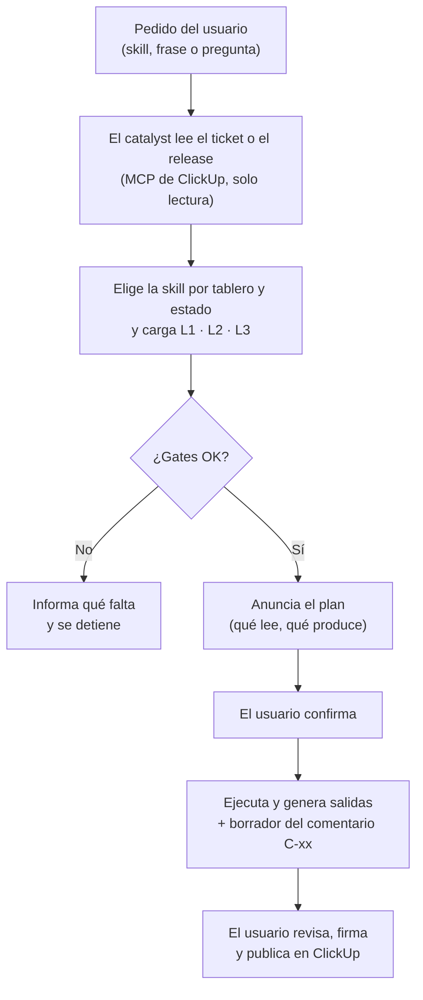
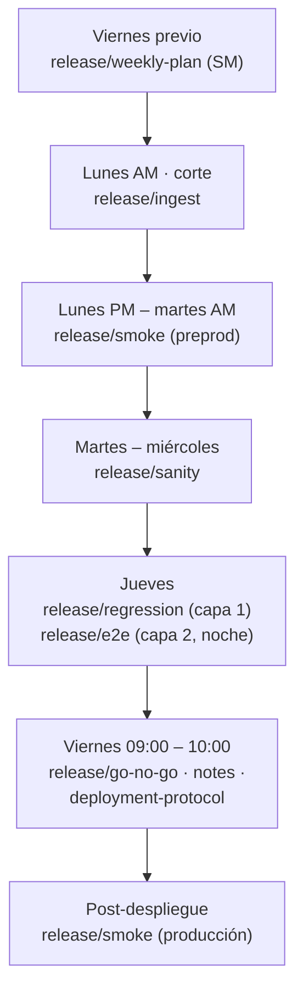

# Guía de Uso del QA Catalyst

**Cómo usar las skills del catalyst en cada estado del SDLC IOND**

Propuesta por: Steve Nina — Scrum Master IOND
Aplica a: IOND · IonMind · StageMind (soporte completo para iond y tickets de Gateway)
Audiencia: QA · Lead QA · Scrum Master — y, como lectores de sus salidas, PO y Lead Dev / RM

---

## 1. Qué es el QA Catalyst

El **QA Catalyst** es el repositorio `ionflow-qa-catalyst`: conocimiento del producto organizado en niveles y un conjunto de **skills** (instrucciones que sigue un agente de IA) para cada estado del SDLC. Acompaña al QA en su rol de **Analista de Calidad y Requerimientos**, al Lead QA en las suites del release y al Scrum Master en el plan semanal, la auditoría del flujo y las métricas.

| El catalyst… | El catalyst **no**… |
|---|---|
| Lee el ticket en ClickUp (tablero, estado, campos, comentarios) en **modo solo lectura** | Crea, mueve ni comenta tickets en ClickUp |
| Prepara artefactos (matrices, reportes, planes) y **borradores** de los comentarios C-xx | Publica comentarios: los publica la persona responsable |
| Sugiere un veredicto con su fundamento | Firma veredictos: firma el QA (C-13/C-14) o el quórum del Go/No-Go (C-29) |
| Lee los repositorios de desarrollo y el de pruebas E2E (bot-test) y genera comandos para ejecutar las suites | Modifica código en los repositorios de desarrollo ni en bot-test |
| Aplica la fuente canónica del SDLC (`knowledge/L1-project/sdlc-consolidation.md`) | Inventa reglas: si algo no está definido, lo pregunta |

---

## 2. Antes de empezar

### 2.1 Requisitos

| Requisito | Para qué | Quién lo configura |
|---|---|---|
| Repositorio `ionflow-qa-catalyst` junto a `gateway-ion`, `flow_binaries`, `webcomponents-flow`, `gateway` y `bot-test` (misma carpeta) | Leer código y pruebas | Cada usuario |
| Claude Code (CLI, escritorio o extensión del IDE) abierto en la carpeta del catalyst | Usar las skills `iond-*` | Cada usuario |
| MCP de ClickUp en **modo lectura** | Leer tickets, comentarios y listas | Cada usuario |
| MCP de Playwright (opcional) | Testing asistido en `mock testing` con el navegador visible | QA |
| Python 3 | Script del E2E maestro y generadores | QA / LQA |
| Archivo `.env` (copia de `.env.sample`) | URL del ambiente asignado y usuarios de prueba | Cada usuario |
| Perfiles `.env.preprod` y `.env.prod-testco` **fuera de los repositorios** | Ejecutar las suites del release en preprod y el smoke en producción con la company de prueba | LQA |

> Nunca se suben al repositorio `.env`, perfiles ni entornos de Postman con valores reales. En los artefactos solo se registra el usuario, nunca la contraseña.

### 2.2 Comprobación rápida

1. Abrir Claude Code en la carpeta del catalyst y escribir `/` : deben aparecer las skills `iond-*`.
2. Pedir `Auditar SDLC`: si el catalyst lista tickets de Discovery e Improvements, el MCP de ClickUp funciona.
3. Ejecutar `python -I scripts/e2e_master.py coverage`: debe regenerar `knowledge/test-suites/coverage.md`.

---

## 3. Cómo se usa una skill

### 3.1 Tres formas de invocarla

| Forma | Ejemplo | Cuándo conviene |
|---|---|---|
| **Skill de Claude Code** | `/iond-requirements` y luego el ID del ticket | Cuando se sabe qué skill se necesita |
| **Frase disparadora** | `Matriz de requerimientos del ticket <id>` | Uso diario; la frase identifica la skill y el ticket |
| **Orquestador** | `/iond-qa` + "¿qué corresponde hacer con el ticket <id>?" | Cuando no se sabe en qué paso está el ticket: el catalyst lee su tablero y estado y propone la skill |

Las frases disparadoras completas están en el `SKILL.md` raíz (sección *Frases disparadoras*) y en la sección 4 de esta guía.

### 3.2 Ciclo de una invocación



- **Announce → Confirm → Act:** el catalyst siempre anuncia la skill, sus prerrequisitos y la salida esperada, y espera una confirmación explícita. El silencio no es aprobación.
- **Tres etapas:** *Planning* (plan), *Execution* (trabajo, interrumpible en cualquier momento) y *Reporting* (salidas en su ruta y borrador del comentario).

### 3.3 Si un gate falla

| Gate que falla | Qué hacer |
|---|---|
| El ticket no tiene la especificación del PO (T-01/T-03) | Pedirla al PO antes de la matriz |
| Falta el VoBo del PO (`po-vobo`, C-06) al llegar a `ready for qa` | No iniciar `mock testing`; escalar según la regla de 24/48 h |
| Falta el handoff del Dev (C-09) o el build en el ambiente de QA | Pedirlo al Dev o al LD/RM |
| Smoke con el core en rojo | No iniciar `sanity` en el área afectada; decidir fix-forward o NO-GO |
| Falta un artefacto previo del release | Ejecutar primero la skill que lo produce (sección 5.3) |

---

## 4. Mapa de skills

| Skill de Claude Code | Archivo(s) en `skills/` | Cuándo | Salida principal | Comentario |
|---|---|---|---|---|
| `iond-qa` | `SKILL.md` (raíz) | Cualquier duda sobre qué hacer | Recomendación de skill | — |
| `iond-prototype-review` | `prototype-review/review.md` | Discovery `prototype review` | `prototype-review-qa.md` | Aporte al C-04 |
| `iond-requirements` | `requirements/matrix.md` · `requirements/mini-matrix.md` | `requirements` (Discovery / Improvements) | `requirements-matrix-v<N>.md` | C-05 (C-07, C-08) |
| `iond-triage` | `improvements-triage/triage.md` | Improvements `backlog` | `triage.md` | C-33 |
| `iond-code-review` | `code-review/review.md` | `code review` / `ready for qa` (opcional) | `code-review-qa.md` | — |
| `iond-mock-testing` | `mock-testing/plan.md` → `execute.md` → `report.md` | `ready for qa` · `mock testing` | `test-matrix.md` + `.csv`, `qa-report.md` | C-13 / C-14 (C-15, C-17, C-20) |
| `iond-bug-report` | `bug-reporter/create.md` | Bug nuevo de cualquier origen | `bug-report.md` (T-02) | — |
| `iond-release` | `release/*.md` (11 skills) | Semana del release | Artefactos en `knowledge/releases/<producto>/<versión>/` | C-23 a C-31 |
| `iond-test-suites` | `test-suites/import-e2e.md` · `smoke-master.md` · `coverage.md` | Mantenimiento de las suites | `e2e-master.csv`, `coverage.md`, `automation-roadmap.md` | — |
| `iond-automation` | `automation/plan.md` → `code.md` → `review.md` | Después de `merged` o por ola de automatización | Plan, paquete para bot-test, revisión 3/3 | — |
| `iond-sdlc-audit` | `sdlc-audit/audit.md` | Diaria y semanal (SM) | `sdlc-audit-<fecha>.md` | — |
| `iond-metrics` | `metrics/weekly.md` | Semanal (SM / LQA) | `metrics-<año>-W<nn>.md` | — |

---

## 5. Recetas por rol

### 5.1 QA — ticket de Discovery

| Estado | Frase disparadora | Qué hace el catalyst | Qué hace QA |
|---|---|---|---|
| Antes de `prototype review` (opcional) | `Riesgos anticipados del ticket <id>` | Riesgos y preguntas tempranas | Las lleva a la Discovery Review |
| `prototype review` | `Prototype review del ticket <id>` | Testabilidad, riesgos, NFR, datos de prueba, preguntas al PO y al Dev/LD, propuesta de UAT | Aporta al acta C-04 |
| `requirements` | `Matriz de requerimientos del ticket <id>` | Matriz vN desde la especificación del PO: REQ críticos, fuera de alcance, REQ-NF, datos de prueba, checklist del Anexo A | Revisa, pega la matriz en la descripción y publica C-05 |
| `requirements` (seguimiento) | `Seguimiento de requirements del ticket <id>` | Respuestas a dudas del Dev (C-07), control del VoBo y escalamiento | Responde en < 2 h; verifica C-06 + `po-vobo` |
| Cambio de alcance | `Cambio de alcance del ticket <id>` | Matriz v+1 y borrador C-08 | Pide el nuevo VoBo |
| `code review` (opcional) | `Code review QA del ticket <id>` | Lee los PR, busca riesgos y agrega casos a la Matriz de Pruebas | Usa los hallazgos en el plan |
| `ready for qa` | `Planificar pruebas del ticket <id>` | Matriz de Pruebas con REQ-ID, no regresión de zonas cercanas, datos y ambiente | Confirma QA Points y el plan |
| `mock testing` | `Ejecutar pruebas del ticket <id>` | Guía la ejecución (manual o con Playwright MCP), registra evidencia y hallazgos | Ejecuta, confirma cada resultado; publica C-17/C-15/C-20 si aplica |
| Cierre de `mock testing` | `Reporte de pruebas del ticket <id>` | `qa-report.md`, veredicto sugerido y borrador C-13 o C-14 | **Firma** y publica; mueve a `uat`, `ready to merge` o `to do` |

### 5.2 QA — ticket de Improvements y bugs

| Situación | Frase disparadora | Resultado |
|---|---|---|
| Ticket nuevo en `backlog` | `Triage del ticket <id>` (o `Preparar triage semanal`) | Clasificación propuesta, severidad, ¿requiere `requirements`? (Q-29) y borrador C-33 para el PO/SM |
| Mejora que pasa por `requirements` | `Mini-matriz del ticket <id>` | Hasta 5 REQ + checklist de no regresión + C-05 |
| `ready for qa` → `mock testing` | Igual que Discovery (sección 5.1) | Sin `uat`: la aprobación lleva a `ready to merge` |
| Bug encontrado en cualquier momento | `Crea un nuevo ticket:` + ruta de navegación y descripción | Borrador T-02 con Project, Iond Subcategory, severidad, `det-*` y relación con el origen; QA lo crea en ClickUp |

### 5.3 QA y LQA — semana del release



| Momento | Frase disparadora | Salida | Comentario |
|---|---|---|---|
| Viernes previo | `Planificar release semanal` | `release-task.md` (T-04), candidatos, riesgo y grupo de rotación | C-23 (borrador para el RM) |
| Lunes, tras el corte | `Preparar datos de release: <producto> vX.Y.Z` | `tickets.md` con el mapa de impacto y los parámetros de las suites | — |
| `smoke` | `Ejecutar smoke: <producto> vX.Y.Z preprod` | `smoke-preprod.md` | C-25 |
| `sanity` | `Ejecutar sanity: <producto> vX.Y.Z` | `sanity-matrix.md` (REQ críticos por ticket e interacciones) | C-26 |
| `regression` — capa 1 | `Ejecutar regresión: <producto> vX.Y.Z` | `regression-matrix.md` + `.csv` y comando de bot-test | C-27 (capa 1) |
| `regression` — capa 2 | `Ejecutar E2E capa 2: <producto> vX.Y.Z` | `e2e-run.md` + `.csv` (automatizado + grupo G1–G4) | C-27 (capa 2) |
| Go/No-Go | `Preparar Go/No-Go: <producto> vX.Y.Z` | `go-no-go.md` con la recomendación del LQA | C-29 |
| Después del GO | `Generar release notes: …` · `Generar protocolo de despliegue: …` | Notas interna y cliente; protocolo | C-30 (RM) |
| Post-despliegue | `Ejecutar smoke: <producto> vX.Y.Z producción` | `smoke-prod.md` con la company de prueba y limpieza | C-31 |
| En cualquier momento | `Generar brief de release: <producto> vX.Y.Z` | `brief.md` para stakeholders | — |

**Selección de la regresión.** La skill arma la selección con el script del E2E maestro; el mismo comando se puede correr a mano:

```bash
python -I scripts/e2e_master.py select --layer 1 \
  --subcategories "Boards,App Connectors" --risk Medio \
  --out knowledge/releases/iond/vX.Y.Z/regression-matrix.csv
python -I scripts/e2e_master.py select --layer 2 --group G2 \
  --exclude knowledge/releases/iond/vX.Y.Z/regression-matrix.csv \
  --out knowledge/releases/iond/vX.Y.Z/e2e-run.csv
```

La salida trae la matriz (con la columna `RESULTADO` para completar) y el comando de bot-test con los IDs de los tests. Para ejecutarlo, se carga antes el perfil del ambiente (sección 7).

### 5.4 Scrum Master

| Necesidad | Frase disparadora | Salida |
|---|---|---|
| Preparar el corte | `Planificar release semanal` | Candidatos (`ready to merge` + versión objetivo + C-13), exclusiones con motivo, borrador T-04 y checklist de acciones del SM y del RM |
| Auditoría diaria (antes de la daily) | `Auditar SDLC` | Desvíos por severidad: VoBo, versión, `blocked`, comentarios faltantes, subtareas que no siguieron al padre |
| Auditoría semanal | `Auditar SDLC semanal` | Lo anterior + tags legacy, campos obligatorios, tareas de Release y WIP |
| Métricas | `Generar métricas semanales` | Reporte por audiencia con M-01 a M-47, metas y tendencias |
| Resumen para stakeholders | `Generar brief de release: <producto> vX.Y.Z` | Una página no técnica |

El catalyst **no** crea la tarea de Release ni mueve tickets: deja la lista de acciones y el SM la ejecuta en ClickUp.

### 5.5 Lead QA — suites y automatización

| Necesidad | Frase disparadora | Salida |
|---|---|---|
| La hoja "Iond Testing Plan" cambió | `Importar E2E maestro` | `e2e-master.csv` con IDs estables, `coverage.md` y el CSV con las columnas ID, TICKET y SPEC para pegar en la hoja |
| Revisar el smoke maestro (retro, incidente, automatización) | `Revisar smoke maestro` | Propuesta de cambios para acordar con el LD/RM |
| Priorizar la automatización | `Analizar cobertura de automatización` | Cobertura, inconsistencias con QA Kanban y hoja de ruta por olas |
| Automatizar un ticket o un módulo | `Planificar automatización: <ticket \| prefijo E2E>` → `Preparar paquete de automatización: …` → `Revisar automatización: …` | Plan, **paquete** para el responsable de bot-test y revisión con 3 corridas verdes |

### 5.6 Después del despliegue

- `Actualizar módulos post-release: <producto> vX.Y.Z`: actualiza el conocimiento L2 de los módulos del release (reglas de negocio, specs de bot-test, filas del E2E maestro, edge cases).
- `Bug Hunt: <módulo>`: sesión de bug bash quincenal (ACT-03); los hallazgos van a `backlog` con `det-exploratorio`.

---

## 6. Dónde quedan las salidas y cómo se publican

| Alcance | Carpeta | Ejemplos |
|---|---|---|
| Ticket | `knowledge/L3-tickets/<id>/` | `ticket-memory.md`, `requirements-matrix-v2.md`, `test-matrix.md`, `qa-report.md`, `comments/C-13-<fecha>.md` |
| Release | `knowledge/releases/<producto>/<versión>/` | `release-task.md`, `tickets.md`, `smoke-preprod.md`, `sanity-matrix.md`, `regression-matrix.csv`, `e2e-run.md`, `go-no-go.md` |
| Suites | `knowledge/test-suites/` | `smoke-master.md`, `e2e-master.csv`, `coverage.md`, `automation-roadmap.md` |
| Gobierno | `knowledge/dashboards/` | `sdlc-audit-<fecha>.md`, `metrics-<año>-W<nn>.md` |

**Publicar un comentario:**

1. Abrir el borrador en `comments/C-xx-<fecha>.md`; el encabezado indica dónde se publica y quién lo publica.
2. Revisarlo y completar lo que falte (votos, firmas, decisiones).
3. Copiarlo en el ticket o en la tarea de Release de ClickUp y aplicar el cambio de estado o los tags que indica.
4. Las plantillas oficiales están en `templates/comments/C-01.md` … `C-33.md`. Las frases fijas de C-13 y C-14 no se modifican: otras skills las leen.

---

## 7. Comandos de referencia

```bash
# E2E maestro (desde la raíz del catalyst)
python -I scripts/e2e_master.py import         # importa la hoja con IDs estables
python -I scripts/e2e_master.py coverage       # regenera coverage.md
python -I scripts/e2e_master.py export-sheet   # columnas ID, TICKET y SPEC para la hoja

# Generadores de la documentación
python -I docs/sdlc-iond/_build/build_templates.py   # comentarios C-01…C-33 desde la fuente canónica
python -I docs/sdlc-iond/_build/build_csvs.py resources
node docs/sdlc-iond/_build/build.mjs                  # PDF de los documentos
```

```bash
# Ejecutar una suite en bot-test (Git Bash, desde ../bot-test/apps/bot-test)
set -a; source ~/.qa-profiles/.env.preprod; set +a
npx playwright test <specs> --config=tests/IONFLOW/playwright.ionflow.config.ts --project=ionflow-chromium -g "<IDs>"
```

En PowerShell, el perfil se carga con el bloque de `knowledge/test-suites/README.md` (sección *Ejecutar en bot-test*).

---

## 8. Buenas prácticas y preguntas frecuentes

**Buenas prácticas**

- Indicar siempre el **ID del ticket** o el **producto y la versión**: el catalyst los usa para leer ClickUp y ubicar las salidas.
- Revisar el plan anunciado antes de confirmar; si el estado del ticket no coincide con lo que se pide, el catalyst lo advierte.
- Mantener `ticket-memory.md` como bitácora: es lo primero que lee la siguiente sesión.
- Publicar los comentarios el mismo día en que se generan los borradores.

**Preguntas frecuentes**

| Pregunta | Respuesta |
|---|---|
| ¿Puedo pedirle al catalyst que mueva el ticket o publique el comentario? | No. El MCP es de solo lectura; el catalyst deja el borrador y la acción a realizar. |
| El ticket está en un estado distinto al que esperaba la skill | El catalyst lo advierte y propone la skill del estado real. |
| La Iond Subcategory del ticket no está en el mapa | El catalyst infiere el módulo por el título, lo marca como *inferido* y pide agregar la subcategoría a `knowledge/test-suites/_config/subcategory-map.csv`. |
| Un test automático falló en la regresión | La skill lo clasifica (falla real, inestable, ambiente, test desactualizado o dato de prueba) antes de reportarlo; solo una falla real es un hallazgo. |
| ¿Puede el catalyst crear o corregir tests en bot-test? | No. Prepara un paquete de automatización para el responsable de bot-test, que lo implementa con la skill de ese repositorio. |
| ¿Qué pasa con IonMind y StageMind? | El flujo, las matrices y el release aplican igual; el smoke maestro ya incluye su health y sus flujos. La base de conocimiento propia de esos productos es trabajo futuro. |

---

## 9. Mantener el catalyst

| Cambio | Cómo se hace |
|---|---|
| Nueva regla o cambio del flujo | Se registra la decisión en el *Registro de Decisiones* (doc 03), se actualiza la fuente canónica (versión nueva) y se regeneran comentarios, CSV y PDF con los comandos de la sección 7 |
| Nueva Iond Subcategory | Agregar una fila en `knowledge/test-suites/_config/subcategory-map.csv` |
| Nueva fila o cambio en la hoja del E2E maestro | `Importar E2E maestro` y pegar las columnas exportadas en la hoja |
| Una suite de bot-test cambia de estado (se integra o se corrige) | Actualizar `knowledge/test-suites/_config/rules.csv` y reimportar el maestro |
| Cambio en el smoke maestro | Acuerdo LQA + LD/RM y registro en el historial de `smoke-master.md` |
| Módulo L2 nuevo o desactualizado | `Actualizar módulos post-release: …` o la plantilla `knowledge/L2-modules/_template.md` |

Las skills y plantillas del proceso anterior están en `docs/history/` como referencia; ninguna skill vigente las usa.
